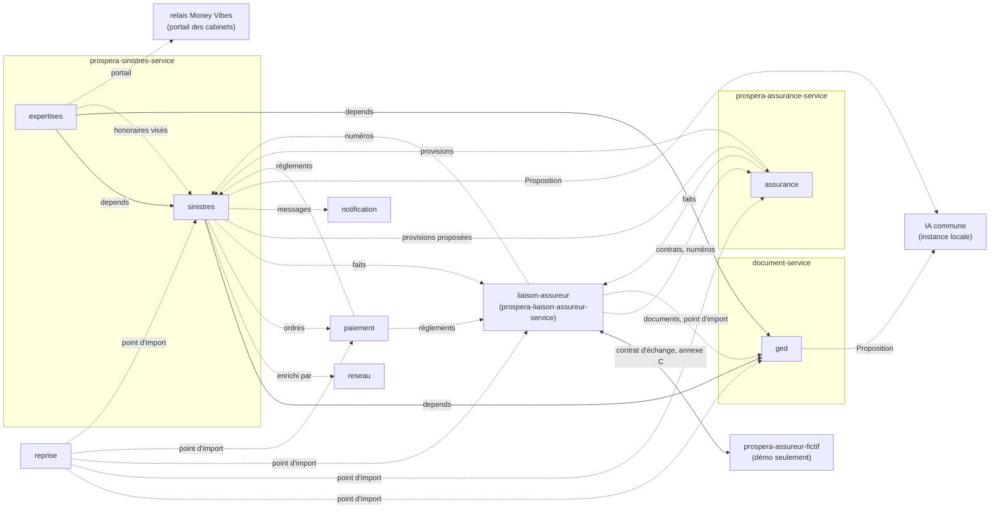
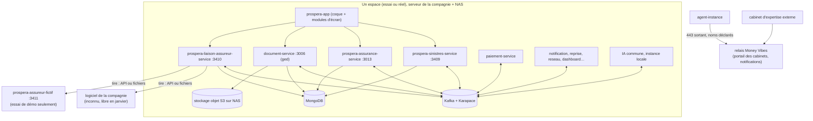

# Architecture Spine — Assurance (chaîne sinistres)

*Amendée le 2026-11-13 par les manifestes de l'assurance : AD-16 (faits `sinistres.sortie.decidee@1` et `sinistres.dossier.rouvert@1`, source de l'envoi C-17 au logiciel de la compagnie ; les honoraires payés se lisent dans `paiement.reglement.changed@1`, nature `HONORAIRES`).*

Rédigée en mode rapide le 2026-11-13 à la demande du PO, après le PRD final. Elle fixe ce que deux unités construites séparément pourraient choisir de façon incompatible. Les raisons sont au `.memlog.md`. `[ADOPTED]` = tranché par le PO ou par la réalité du code ; `[ASSUMPTION]` = proposé ici, à confirmer.

## Design Paradigm

**Un système d'engagement à côté d'un système d'enregistrement.** Le **LC** (logiciel de la compagnie) tient assurés, polices, garanties, primes, intermédiaires, coassureurs et, au départ, le numéro de sinistre officiel : il fait foi pour les contrats. Prospera tient le **dossier sinistre** (déclaration, pièces, instruction, expertise, évaluation, provision, décision, offre, ordre de règlement, recours, archives, journal) et des **projections datées** des contrats. Entre les deux, un seul canal : des faits tirés par Prospera, acquittés, idempotents, portant leur clé d'origine. Rien n'est poussé vers la compagnie ; rien d'un contrat n'est écrit par Prospera.

| Couche | Où | Ce qu'elle tient |
|---|---|---|
| Circuit du dossier | `prospera-sinistres-service` : modules `sinistres` (M05), `expertises` (M29) | dossiers, machine à états, évaluations, décisions, offres, accords, ordres, quittances, recours, missions, rapports, honoraires |
| Contrats lus et provisions | `prospera-assurance-service` : module `assurance` (M30, M31) | projection datée des contrats, mouvements de provision, PSAP brut/cédé/net, traités, coassurance, états et exports |
| Pièces et archives | `document-service` : module `ged` (M07) | pièces et versions, OCR, lots, numéros d'archivage, scellements, cotes, destruction visée |
| Frontière avec le LC | `prospera-liaison-assureur-service` : module `liaison-assureur` (M48 proposé) | journal des échanges, file d'envoi, file des écarts, liste « à saisir », fraîcheur, numéros officiels |
| LC de démonstration | `prospera-assureur-fictif` (application à part) | assurés, polices, sinistres existants, numéros attribués, réglages de panne — en essai seulement |
| Modules partagés | `paiement`, `notification`, `reprise`, `reseau`, `dashboard`, `connecteurs` (hors février) | inchangés, plus les écarts d'assurance du PRD (partie 4) |
| IA | instance locale de l'IA commune | règles v0 puis modèles, servis par `PropositionPort` |
| Portail des cabinets | relais Money Vibes (moteur AD-9) | file et pièces de mission chiffrées ; aucun port entrant chez la compagnie |
| Écrans | `prospera-app/src/modules/<code>/` | aucune donnée ni règle métier (coque AD-11) |

## Inherited Invariants

| Inherited | From parent | Binds here |
| --- | --- | --- |
| AD-2, AD-10, AD-15, AD-16 | spine du moteur | un propriétaire par donnée ; Docker Compose, l'agent seul aux commandes ; une organisation, deux espaces ; sauvegardes orchestrées par l'agent |
| AD-4 | spine du moteur | données vivantes (NAS) et sauvegardes sur **deux supports distincts** ; état de confiance jamais restaurable |
| AD-16 | spine du moteur | copie quotidienne et incrément horaire : **perte maximale 1 h, reprise 4 h** ; Mongo et stockage objet au même instant ; clé de secours remise au client ; `epoque` |
| AD-9 (amendé le 2026-11-13) | spine du moteur | sortie 443 vers les noms déclarés (`destinationsSortantes`) ; le relais sert le portail des cabinets (pièces chiffrées de bout en bout, durée limitée, sans copie, rien de médical sauf nécessité) ; aucun port entrant |
| AD-40 | spine du moteur | supervision par la route `sante` (C13) de chaque service ; un service muet et un consommateur mort sont des alertes vers le ticket de Money Vibes |
| AD-12, AD-17 | spine du moteur | journal de l'agent ; contrats nommés (la piste d'audit métier reste dans chaque module) |
| AD-13, AD-14, AD-39 | spine du moteur | consentements sur l'instance ; l'apprentissage ne reçoit que des données préparées ; la calibration du client est intouchable |
| AD-27 | spine du moteur | `@confluentinc/kafka-javascript`, Karapace, partition par `organisationId`, dédoublonnage par `eventId`, BACKWARD |
| AD-30 | spine du moteur | maintenance, version figée, gel J+30 |
| AD-28 | spine microfinance | tables légales mises à jour par **correctif réglementaire**, même sur une version figée |
| AD-18 | spine microfinance | **chiffrement par champ** : bibliothèque `prospera-plateforme/champs-sensibles`, enveloppe, **index aveugle HMAC** pour l'égalité ; clés hors du compte d'administration |
| AD-3, AD-5, AD-13 | spine de la Reprise | la clé d'origine suit l'objet ; les règles restent chez la cible qui simule ; valeurs de contrôle de la cible |
| AD-4, AD-5, AD-8, AD-13 | spine de Connecteurs | jamais un total ; identité d'un échange ; file d'envoi acquittée ; concordance et file des écarts |
| AD-1, AD-3, AD-4, AD-8, AD-11 | spine de `paiement` | aucune détention de fonds ; ledger en ajout seul ; idempotence arbitrée par la base ; montants en unité mineure ; séparation des pouvoirs au niveau de l'acteur |
| AD-1, AD-2, AD-11 | spine de l'assistant | forme de la Proposition ; décideur typé ; règles en stratégies typées (le contrat est aligné, le service n'est pas repris) |
| `PropositionPort` | spine microfinance (AD-14) | même port, même contrat, instance locale de l'IA commune |
| AD-3, AD-6, AD-11, AD-16 | spine de la coque | module d'écran par dossier ; droits lus, jamais calculés ; aucun métier dans Next |
| Conventions et Stack | spine du moteur | nommage, données, idempotence, erreurs, événements, temps, tests ; Node 24, NestJS 11, Mongoose 8, MongoDB 8.0, BullMQ 6.7 |
| C1 → C13 | contrat de module | manifeste, gate, données possédées, emplacements vides, contrats, paramètres, droits, écran, installer et désinstaller, démarrer seul, IA, migrations, installable sous contrôle |

## Invariants & Rules



Trait plein : dépendance dure (`depends`, l'installation est refusée sans elle). Pointillé : faits ou port (`enrichiPar`, jamais bloquant). Aucune autre flèche n'est permise ; `expertises` n'a aucune flèche vers `paiement`. `ged` seul reste installable (pièces dans « à rattacher ») ; `sinistres` sans `ged` est refusé à l'installation (C4). `reseau`, `assurance` et `liaison-assureur` ne sont pas des dépendances dures de `sinistres` : sans `reseau`, un seul site, portée lue des affectations de `sinistres` ; sans `assurance` ou `liaison-assureur`, le circuit marche, la recevabilité affiche « à relire » (AD-1).

### AD-1 — Le LC fait foi pour les contrats et le numéro ; Prospera ne tient que des projections datées `[ADOPTED]`

- **Binds:** FR-2, FR-3, FR-186, FR-194, FR-198, FR-201, annexe C
- **Prevents:** un contrat modifié par Prospera ; une projection présentée comme vérité ; deux numéros pour un sinistre ; un circuit arrêté parce que le LC est muet ; un paiement sur une police périmée.
- **Rule:**
  - Aucun module de ce périmètre ne crée, ne modifie ni ne supprime un assuré, une police, une garantie, une prime, un intermédiaire ou un coassureur. Ce qui vient du LC est une **projection** : `valeur`, `lueLe` (date de la dernière réponse **valide** du LC, pas de la dernière tentative), `cleOrigineLC` (identifiant stable du LC, jamais remplacé). **`liaison-assureur` est le seul écrivain des projections brutes** (faits `liaison-assureur.*.recu@1`) ; `assurance` en tient la **copie de lecture** par ces faits et la sert aux autres (AD-2). Les autres modules ne lisent jamais la base d'un voisin.
  - Tout affichage d'un contrat porte sa source (« LC » ou « Prospera ») et `lueLe`. **Fraîcheur** : paramètre par objet et par transport (défaut 5 minutes avec une API, 24 heures avec des fichiers, annexe D), **calculée par `liaison-assureur` seul** et publiée (`fraicheur.changed@1`) ; une projection plus vieille que le **double** de sa fraîcheur est « périmée ».
  - **LC indisponible** (aucune lecture valide depuis le double de la fraîcheur) : **continuent** déclarer (référence `DEC-` attribuée sans attendre), joindre des pièces, instruire, évaluer, valider, ordonner ; les envois attendent dans la file, dans l'ordre. **Refusés** : l'ouverture d'un dossier sur une police lue depuis plus de l'âge maximal (sauf décision motivée `GARANTIE_ACQUISE`, `SOUS_RESERVE` ou `REFUS_DE_GARANTIE`) et la **libération d'un ordre** sans revérification de la police sur une projection assez fraîche (garde `POLICE_A_RELIRE`, évaluée par `sinistres`, AD-5). Une projection périmée donne « à relire » à la recevabilité, **jamais** un refus de garantie.
  - `assurance` absent : l'emplacement rend `NON_INSTALLE` ; la décision de garantie est motivée par l'humain.
  - En cas d'écart sur un contrat, le LC gagne ; sur un champ du dossier que Prospera tient, Prospera gagne (AD-13). Un fait reçu du LC qui touche un dossier tenu par Prospera (règlement, annulation, clôture) suspend les ordres du dossier (« litige de source », AD-22).

### AD-2 — Les unités et leurs données : un propriétaire par objet `[ADOPTED]`

- **Binds:** C3, FR-6, annexe A
- **Prevents:** deux modules qui écrivent le même objet ; un module qui lit la base d'un autre ; un règlement tenu à deux endroits ; un fichier tenu par deux modules.
- **Rule:** chaque objet a **un seul écrivain**. Les autres le lisent par ses faits ou par sa route de lecture.

| Module (service) | Seul écrivain de | Lit (par faits ou route) |
|---|---|---|
| `sinistres` (sinistres) | dossiers et leur statut, déclarations et référence `DEC-`, décisions de garantie, évaluations arrêtées et décomptes, délégations et comités, offres, accords, **ordres de règlement** (`ordreId`, décision, bénéficiaire, montant, nature, marque « libéré », suspension), quittances, remises constatées, recours (agrégat séparé), signaux et revues de fraude, échéances légales et internes, accès par dossier aux données de santé, **index de recherche** (AD-24), registre de décisions de l'IA du dossier, piste d'audit du dossier ; une **copie dérivée** du numéro officiel | projections de contrats (`assurance`), pièces (`ged`), missions et rapports (`expertises`), états des règlements (`paiement`), numéros (`liaison-assureur`), portées et affectations (`reseau`), Propositions |
| `expertises` (sinistres) | référentiel des experts et cabinets, missions et leur machine, convocations, **métadonnées** des rapports, compléments, contre-expertises, notes d'honoraires (métadonnées) et visas, journal des accès des cabinets | dossier et volet (`sinistres`), pièces (`ged`), provision (`assurance`) |
| `assurance` (assurance) | **copie de lecture** des contrats (jamais modifiée, AD-1), table type de sinistre → garanties, **mouvements de provision** et état PSAP brut/cédé/net, traités et cessions, clés de coassurance et lignes « à réclamer », états et exports, données de base des états de contrôle | faits de `liaison-assureur`, `sinistres.provision.revisee@1`, règlements et recours |
| `ged` (document-service) | pièces et **leurs fichiers** (rapports d'expertise, notes d'honoraires, pièces de mission, documents du LC compris), versions, texte lu (classé), lots, contrôles, file « à rattacher », numéros d'archivage, bordereaux, scellements, cotes, sorties du papier, reconstitutions, bordereaux de destruction, journal des lectures de pièces | dossiers et statuts (`sinistres`), clés de rattachement (`reprise`) |
| `liaison-assureur` (liaison) | **projections brutes du LC**, journal des échanges, file d'envoi, file des écarts, liste « à saisir », fraîcheur, **numéro officiel et voie** (seul écrivain, seul générateur du préfixe `PRO-`, AD-6), table de correspondance des états du LC, répertoire d'échange (AD-13) | faits à envoyer de `sinistres` et d'`assurance`, règlements de `paiement` |
| `paiement` | **registre des règlements sortants, tous moyens**, règlements historiques repris compris (états, clé d'idempotence `ordreId`, chèques et leurs états, oppositions, rapprochement, contrôles LBC/FT d'exécution, contrôle de doublon) | ordres libérés et suspendus de `sinistres` **seulement** |
| `reprise` | lots, rapports, tables de correspondance, feu vert par module (`sinistres`, `ged`, `assurance`) ; **n'écrit jamais dans un module** | — |
| `notification` | messages, accusés, états de distribution | faits des modules |
| IA commune | Propositions et leur registre technique | demandes des modules |

- La décision humaine sur une Proposition (acceptée, modifiée, rejetée, motif) est écrite par le **module consommateur** ; la Proposition par l'IA commune (AD-10).
- Une quittance est écrite par `sinistres` (états `PRETE`, `EDITEE`, `SIGNEE`, `REMISE`, `ANNULEE`) ; `ENCAISSEE` n'est posée que sur `paiement.reglement.changed@1` `[ASSUMPTION]`.
- Le statut du dossier `ORDRE_EMIS`, `CHEQUE_A_REMETTRE`, `REGLE` est **dérivé** par `sinistres` des faits de `paiement` (AD-4, AD-5) ; il n'est jamais saisi.
- Le **fichier** d'un rapport, d'une note ou d'une pièce de mission est une pièce de `ged` ; `expertises` dépose par la route de `ged` et ne garde que `pieceId` et `versionPiece`.

### AD-3 — Services, module `assurance` existant et découpage `[ASSUMPTION]`

- **Binds:** C1, C2, C4, C9, C10, FR-20, FR-188, FR-234
- **Prevents:** un second module `assurance` en collision de code et de gate avec l'existant ; un module qui ne s'installe plus seul parce qu'il importe un voisin ; la compta CIMA active chez qui la tient ailleurs ; un `sinistres` confondu avec le registre comptable existant ; deux consommateurs sur un même fait.
- **Rule:**
  - Cinq unités : `prospera-sinistres-service` (modules `sinistres`, `expertises`) ; `prospera-assurance-service` (module `assurance`, **existant**) ; `document-service` (module `ged` **ajouté**) ; `prospera-liaison-assureur-service` (module `liaison-assureur`) ; `prospera-assureur-fictif` (application à part).
  - **Le code `assurance` existe déjà** (entitlement `assurance`, gate `ASSURANCE_NOT_ENTITLED`, gardes). **Aucun second module** : les nouvelles fonctions (projection métier des contrats, provisions dossier par dossier, PSAP, cessions, états, exports) **s'ajoutent au module `assurance` existant**. La comptabilité CIMA existante (registre art. 415, provisions techniques, réassurance comptable, état des sinistres) passe derrière l'**interrupteur `compta-cima`**, **éteint** chez cette compagnie. Les nouvelles routes portent le gate existant ; les gardes KYC et référentiel du module comptable sont posés **par route**, jamais globaux pour les nouvelles routes `[ASSUMPTION]`.
  - Chaque service contient un module Nest **par code de module**, sous `src/modules/<code>/`. Un module n'importe **jamais** le code d'un autre module du service (test de lint) ; il passe par ses faits ou sa route de lecture. Collections préfixées `<code>_`, outbox et migrations propres, gate `<CODE>_NOT_ENTITLED`. Un module non activé dort.
  - Le `sinistres` comptable du service existant et le module `sinistres` du circuit sont **deux objets** : seul le second porte le code de module M05.
  - **Bus** : un seul client Kafka par processus. Le client Confluent (moteur AD-27) sert les services neufs ; les services existants (`prospera-assurance-service`, `document-service` : kafkajs vers Confluent, Node vers 24, BullMQ 5 vers 6) migrent par une **tâche d'épic qui précède** la mise en service des nouvelles fonctions. Topics et groupes de consommateurs des nouvelles fonctions sont ceux d'AD-16 ; le code existant ne s'abonne à aucun fait d'AD-16 (test de liste d'abonnements).
  - Une image par service ; `retourArriere` le plus restrictif de ses modules ; migration non `SANS_PERTE` refusée en CI. Un module peut sortir de son service plus tard sans changer de contrat.
  - `document-service` reste un **relying party** (RS256/JWKS) ; `ged` y est seul écrivain de son propre bucket, jamais de `kyc-documents`.

### AD-4 — La machine à états du dossier : un écrivain, 42 transitions en donnée versionnée `[ADOPTED]`

- **Binds:** FR-27, FR-30 → FR-33, FR-134 → FR-139, FR-92, FR-137, FR-138
- **Prevents:** deux chemins qui changent un statut ; un écran qui force ce que le serveur refuse ; un statut de paiement saisi à la main ; un recours qui sort le dossier du circuit ; un statut ajouté par un voisin ; une commande rejouée avec un autre contenu.
- **Rule:**
  - Seul `sinistres` change le statut d'un dossier, par une **commande** `(dossierId, transition, acteur, rôleExercé, motif?, versionLue, cléIdempotence)`. La **table** (onze statuts, quatre sorties, 42 transitions dont 10a et 10b écrites sur deux lignes, conditions nommées et leur texte, codes de refus de FR-136) est **une donnée versionnée** du module ; un statut ou une transition ne change que par un **amendement versionné** (FR-27) avec rejeu de la suite de FR-139 ; un dossier garde la version de **son ouverture**. Une transition absente est refusée (`TRANSITION_INCONNUE`).
  - Le serveur revérifie à chaque commande le droit (rôle exercé nommé dans la demande), les conditions, le motif (10 caractères), la **version du dossier** (`ETAT_PERIME`) et la séparation des tâches (AD-7). Un appel direct reçoit le même refus que l'écran. Les tests de la table sont **générés** du tableau.
  - **Clé d'idempotence** conservée tant que le dossier existe, indexée `(dossierId, cléIdempotence)` ; même clé avec un autre contenu : `CLE_REUTILISEE` ; un rejeu rend la réponse d'origine.
  - Dans la **même transaction** : le dossier change, une ligne s'ajoute à la piste d'audit chaînée (AD-17), les faits (`.changed` et fait spécifique, même `versionDossier`) partent dans l'outbox. Chaque refus écrit aussi une ligne d'audit avec son code.
  - `ORDRE_EMIS`, `CHEQUE_A_REMETTRE` et `REGLE` sont **dérivés** des états des règlements d'indemnité non annulés (table de vérité de FR-92, honoraires exclus) ; la commande de transition n'est acceptée que si l'état des règlements la justifie. Le reste à payer se calcule sur le montant **accepté** et sur les règlements de `paiement`, historiques repris compris.
  - Le **recours** est un agrégat séparé (plusieurs par dossier, sa machine propre, `A_QUALIFIER` à `RECUPERE` ou `ABANDONNE`) : il n'ajoute aucun statut au dossier et ne bloque pas la clôture.
  - Le **point d'import** d'un module est une **commande** de ce module, évaluée par sa machine à états (AD-14). La prise en main d'un dossier repris est une commande de cette machine ; « tenu par Prospera » et « suivi depuis la source » sont des **marques** du dossier, jamais un statut.
  - Un dossier réouvert ne passe pas `CLOS` tant que `ged.dossier.verse@1` du volume courant n'est pas reçu (AD-9).

### AD-5 — Ordres et règlements : `sinistres` ordonne, `paiement` est le seul registre des règlements `[ADOPTED]`

- **Binds:** FR-86, FR-90 → FR-103, FR-220 → FR-225 ; amendement `paiement` du 2026-11-13
- **Prevents:** un règlement payé deux fois ; un ordre exécuté avant la fin du délai de dénonciation ; un règlement relancé alors que l'issue est inconnue ; deux registres de règlements ; un chèque de remplacement sans opposition ; deux chemins vers `paiement`.
- **Rule:**
  - `sinistres` est seul écrivain de l'**ordre** (identité et immuabilité : AD-22 ; bénéficiaire, nature `INDEMNITE | ACOMPTE | PROVISIONNEL | HONORAIRES | COMMERCIAL`, montant, moyen, `libere`). Il n'existe **qu'un chemin** vers `paiement` : un ordre publié par `sinistres`. L'ordre d'indemnité naît **seulement** de l'accord enregistré (transition 14, `ACCORD_ENREGISTRE`). Les honoraires : `expertises` vise la note et publie `expertises.honoraires.vises@1` ; **`sinistres` seul émet l'ordre** `HONORAIRES` (`ordonnePar` = le visa de `RESP`), sans effet sur le statut du dossier ; `expertises` n'envoie rien à `paiement`.
  - **Marque « libéré »** : posée par `sinistres` seul quand toutes les gardes nommées sont vraies : `ACCORD_ENREGISTRE`, `DELAI_DENONCIATION_ECOULE` (corporel VTM : conclusion + 15 jours, calculée, non modifiable), `POLICE_A_RELIRE` absente, `LITIGE_DE_SOURCE` absent, `ORDRE_NON_SUSPENDU`, `SEPARATION_DES_TACHES`. `sinistres.reglement.ordonne@1` porte `libere: false` tant que l'ordre est différé ; `sinistres.reglement.libere@1` le libère. **`paiement` refuse tout ordre non libéré**, ne calcule aucun délai, ne lit aucune police. Une dénonciation (transition 42) publie `sinistres.reglement.annule@1` pour chaque ordre `A_PAYER`.
  - **`paiement` tient tous les règlements sortants, tous moyens** (chèque compris : enregistré, remis, encaissé, en opposition, jamais « exécuté »). États : `A_PAYER`, `EN_COURS`, `INCONNU`, `PARTIEL`, `PAYE`, `ECHEC`, `ANNULE` (posé par `paiement` sur `sinistres.reglement.annule@1`, seulement depuis `A_PAYER`). **Clé d'idempotence = `ordreId`**, gardée à chaque tentative ; le `txId` du fournisseur en est dérivé de façon déterministe et réversible.
  - **`INCONNU`** n'est jamais terminal : ni relance ni annulation avant un **rapprochement** (fait par une personne qui n'a pas lancé le paiement) qui pose `PAYE` ou `ECHEC` ; `ECHEC` ne se relance qu'avec la même clé et après confirmation de `paiement`.
  - **Opposition** : un chèque annulé passe `CHEQUE_EN_OPPOSITION` (référence, date) avant toute nouvelle tentative de chèque (`OPPOSITION_NON_ENREGISTREE`).
  - **Second contrôle** : l'ordre préparé par un `CPT` est validé par un second `CPT` distinct ; au-dessus de `reglement.second_controle_seuil`, par le `DG` aussi. Évalué par `paiement` (acteur) sur les références d'acteur portées par `sinistres` (AD-7) ; `SEPARATION_POUVOIRS_VIOLEE` côté `paiement`, `SEPARATION_DES_TACHES` côté `sinistres` : le front les traite en famille.
  - **Remise au guichet** : `sinistres` évalue les gardes (`IDENTITE_RETIRANT`, `QUITTANCE_SIGNEE`, `SEPARATION_DES_TACHES`, `AUCUN_SIGNAL_BLOQUANT`) et publie `sinistres.remise.constatee@1` ; `paiement` pose `PAYE` ; `sinistres` ne passe `REGLE` que sur `paiement.reglement.changed@1` `[ASSUMPTION]`. Virement et PI-SPI : quittance signée **avant** le paiement ; `REGLE` sur la confirmation de `paiement` seule.
  - **Doublon** : même bénéficiaire et même sinistre (date, police, immatriculation), **jamais le montant**, sur 30 jours. `paiement` en est la **garde** (seul à voir tous les règlements) ; `sinistres` n'avertit qu'avant émission. Espèces : plafond paramétré, cumul glissant 30 jours.
  - Le Mobile Money sortant n'a pas d'adaptateur : canal « bientôt », rien n'est simulé.

### AD-6 — Numéro de sinistre et déclaration : `DEC-` sans trou, une seule voie, un seul numéro `[ADOPTED]`

- **Binds:** FR-36 → FR-39, FR-198, FR-199, C-11, C-13, C-18
- **Prevents:** un sinistre à deux numéros ; deux écrivains du numéro officiel ; une déclaration envoyée deux fois ; une déclaration refusée parce que le LC est coupé ; un trou de séquence non expliqué ; un compteur qui double sous concurrence.
- **Rule:**
  - `sinistres` attribue `DEC-AAAA-NNNNN` (AAAA = année de l'**enregistrement**, date serveur au fuseau de la compagnie ; séquence **par exercice**, croissante, **sans réutilisation**) **à l'enregistrement**, avant toute réponse du LC, même sans liaison. Tout **compteur** (`DEC-`, `QUITT-`, chèque, `ARC-`) est un document `compteurs_<code>` `{cle, exercice, valeur}` incrémenté par `findOneAndUpdate({$inc})` **dans la même transaction** que l'objet numéroté ; une annulation consigne le trou avec son motif dans cette transaction ; le contrôle de séquence ne signale que les trous non consignés. L'accusé part à l'attribution.
  - **`liaison-assureur` est le seul écrivain du numéro officiel** et de la **voie** (`AUTO | SAISIE_MANUELLE | REPRISE`, exclusives) et le **seul générateur** du préfixe `PRO-` (`PRO-SIN-AAAA-NNNN`, compteur propre, `epoque`) quand `attributeur = PROSPERA`. `attributeur = LC | PROSPERA` est un paramètre de `liaison-assureur` ; contrôle d'unicité contre les numéros du LC au basculement, refusé en cas de conflit. Aucun format imposé au numéro du LC. `sinistres` n'en garde qu'une **copie dérivée** de ses faits (`numero-sinistre.attribue@1`), jamais écrite par commande.
  - `DEC-` est la **clé d'idempotence** de C-13. Passer à la liste « à saisir » **annule d'abord** l'envoi en attente ; une déclaration `SAISIE_MANUELLE` n'est jamais renvoyée seule ; le report du numéro clôt la voie.
  - Le numéro officiel se rattache **une fois** : un numéro reçu pour une `DEC-` déjà numérotée est un **écart** (`NUMERO_OFFICIEL_DEJA_ATTRIBUE`) ; un numéro déjà porté par un autre dossier est refusé. Pour un dossier repris, le numéro entre par le **point d'import de `liaison-assureur`** (voie `REPRISE`, sans écart). Le contrôle de doublon (police, date de survenance, immatriculation, victime) cherche dans Prospera **et** dans les sinistres reçus du LC ; il signale, l'agent décide, Prospera ne fusionne jamais seul.
  - Sans `liaison-assureur` installé, `attributeur` est forcé à `PROSPERA` (`LIAISON_REQUISE` sinon). Un dossier sans numéro officiel depuis plus d'1 jour ouvré alerte `RESP` (horloge suspendue pendant une coupure déclarée).

### AD-7 — La séparation des tâches se vérifie sur l'historique des acteurs, à chaque commande `[ADOPTED]`

- **Binds:** FR-7, FR-29, FR-81, FR-93, FR-137
- **Prevents:** une règle posée dans l'écran mais pas au serveur ; un cumul contourné par un second rôle ou une réaffectation ; deux modules qui appliquent la règle différemment.
- **Rule:**
  - Les **16 cumuls interdits** de FR-7 sont **une donnée versionnée de `sinistres`**, un test par ligne. Ils se jugent sur l'**identifiant de la personne** (jamais le rôle), au serveur, dans la commande, à partir de l'historique des actes du dossier : la liste **fermée** de FR-29 (affecter, instruire, évaluer, valider, contrôler, enregistrer l'accord, émettre, remettre, rapprocher). Contrôler la qualité d'une pièce n'est pas un acte de partie. Un gestionnaire réaffecté reste partie.
  - Le cumul anti-fractionnement (SEP-03) se compte sur les montants **acceptés et ordonnés non annulés** plus le montant en cours de validation ; il ne s'applique pas aux mouvements de provision (AD-11).
  - Refus `SEPARATION_DES_TACHES`, tracé, visible de `AUD`. Une suppléance (datée, motivée, nommée) ne dépasse pas la limite du délégant et ne lève jamais un cumul.
  - `sinistres` publie, dans ses faits, la référence d'acteur de chaque acte d'argent (`ordonnePar`, `valideePar`, `accordEnregistrePar`) ; `paiement`, `expertises` et `ged` appliquent les cumuls qui les touchent avec le même code, sans recopier la table.
  - Un motif proposé par l'IA ne vaut jamais par un clic seul ; il est interdit au-dessus du seuil du `RESP` (AD-10).

### AD-8 — Les données de santé : classées, appliquées par le propriétaire, jamais dans un événement `[ADOPTED]`

- **Binds:** FR-9, FR-12, FR-19, FR-196, FR-227, FR-232, FR-253
- **Prevents:** un aperçu de certificat médical montré à l'accueil ; un diagnostic dans un SMS ; une donnée de santé dans un fait du bus, un export, un journal ou un envoi vers le LC ; un écart d'IA construit sur une pièce médicale ; une lecture non tracée.
- **Rule:**
  - La **nature « santé »** est portée par la **pièce** (`ged`) et par les champs médicaux de `sinistres` et `expertises`, tels que listés par le **registre `classification-sante`** (AD-23). Une pièce ou un champ de santé est **chiffré par l'application avant écriture** ; les clés ne sont détenues ni par Money Vibes ni par `ADMIN` seul.
  - L'accès est **par capacité** (`sante:lire`, `sante:existence`), **appliqué par le service propriétaire** de la donnée, à chaque lecture : `MED`, le `GEST` corporel affecté et `RESP` lisent ; `DG` et `DT` par un accès par dossier (AD-26) ; `ACC`, `NUM`, `CPT`, `AUD`, `ADMIN`, `ARCH` ne voient que le type, l'existence et la date (la seule image, pour la lisibilité, à `ARCH`, `MED`, `NUM`, `ACC`). Ni aperçu, ni texte lu, ni extrait d'IA, ni résumé pour eux. Les capacités sont lues dans le jeton, jamais recalculées par l'écran ou le BFF.
  - **Aucun événement du bus, aucun message de `notification`, aucun export, aucun envoi au LC, aucun écart d'IA ne transporte de contenu médical** : identifiants et métadonnées non médicales seulement (`pieceId`, `type: DOCUMENT_MEDICAL`, `existence`). Un message dit « un document médical », jamais sa nature. Test de contrat : AD-23.
  - **Journal des consultations** : chaque lecture d'une donnée de santé écrit une entrée (qui, quand, dossier, pièce, marque santé) dans le journal des accès du service propriétaire (AD-17), lisible par `AUD` seul.
  - Vers l'IA commune : l'instance **locale** peut lire (OCR et classement exécutés sur l'instance) ; **rien ne sort**, même anonymisé, d'une donnée de santé ; aucun écart n'est construit sur une pièce médicale.
  - Le consentement écrit se trace **par dossier** ; son absence ne bloque ni une obligation légale ni un chronomètre.

### AD-9 — Pièces, OCR et archives : `ged` stocke, scelle, numérote, ne détruit rien seul `[ASSUMPTION]`

- **Binds:** FR-21, FR-159 → FR-176, FR-263, FR-250
- **Prevents:** un fichier écrasé ; un scan lu comme « sans texte » ; une pièce archivée sans contrôle humain ; un numéro d'archivage réutilisé ; une destruction automatique ; une image qui sort du site ; un appel propre au produit de stockage dans le code métier ; un fichier déclaré sain faute d'antivirus.
- **Rule:**
  - **Stockage** : `ged` écrit par un **port de stockage objet à l'API S3** `[ADOPTED]` ; données sur le **NAS de la compagnie** ; aucun fichier hors du site. **MinIO** (images actuelles épinglées, comme `document-service`) sert **pendant le développement** `[ADOPTED]` ; il sera remplacé avant la mise en service (Stack, Deferred) sans toucher au code. **Aucun appel propre à MinIO hors de l'adaptateur** (ni API d'administration, ni fonction non S3) ; un **test de contrat S3** tourne en CI et tout adaptateur de remplacement doit le passer. Pièce = fichier **immuable** + enregistrement ; une pièce remplacée est une **nouvelle version** (motif obligatoire), l'ancienne reste lisible ; une pièce citée par une décision ne se supprime pas. Aucun bouton ni route « supprimer » pour aucun rôle.
  - **Empreinte** SHA-256 par version ; deux empreintes égales dans un dossier = doublon signalé. **Scellement** : quand toutes les pièces du bordereau sont numérisées, contrôlées et indexées, `ged` calcule et enregistre l'empreinte de l'ensemble ; toute modification postérieure échoue à la vérification. Le scellement **ne change pas le support de référence** : le papier fait foi tant que le juriste n'a pas validé la valeur probante. Une **réouverture** (`sinistres.dossier.rouvert@1`) ouvre un **volume complémentaire** `ARC-…/C1` rattaché au scellé d'origine, qui reste valide.
  - **OCR réel sur l'instance** : Tesseract 5.x derrière le port `OcrProvider` existant, via `tesseract.js` hors ligne (worker, cœur WASM et données `fra` **locaux, aucun téléchargement à l'exécution**) ; une page dont la couche texte compte **moins de 60 caractères** (paramètre) est **rastérisée** avant l'OCR (Tesseract ne lit pas un PDF) ; le texte lu est stocké **en plus**, jamais à la place de l'image, et est une donnée **classée** de `ged` (chiffré pour une pièce de santé). Statuts `NON_TRAITE | EN_COURS | OK | PARTIEL | ECHEC` ; `PARTIEL` et `ECHEC` vont dans « à refaire ». L'OCR propose, un humain contrôle **avant tout archivage** (invariant DO-1 du service). Les consommateurs de file (Kafka, BullMQ) sont **supervisés** (AD-25) ; un message empoisonné part en file morte.
  - **Fichiers déposés** : type, taille, cohérence extension/contenu, puis `AntivirusPort` (antivirus de la compagnie) avant enregistrement ; outil indisponible = dépôt « à scanner », **jamais** « sain » par défaut ; un fichier détecté est mis en quarantaine, jamais ouvert.
  - **Documents reçus du LC** : `liaison-assureur` les remet au **point d'import de `ged`** (clé d'origine) ; il n'écrit jamais dans le stockage de `ged`.
  - Numéro d'archivage `ARC-AAAA-CCCC-NNNNN` (année de clôture, `CORP | MATL | DIVR | RECS`, séquence par année et volet) : **attribué** par `ged` seul au versement par `ARCH`, jamais calculé, jamais réutilisé (même après destruction ou versement annulé) ; un numéro repris de la source est **gardé tel quel** et les séquences le sautent ; reconstitution suffixée `/R1`, `/R2`. Le fonds ne reçoit que du terminé.
  - **Conservation** : durée effective = la plus longue entre le plancher de 10 ans (art. 404) et celle de la nature ; point de départ = date de clôture. **Destruction** = décision visée (bordereau, double visa `RESP` puis `DG`), tracée, refusée si le dossier est sous contrôle, litige ou sorti ; le numéro et la trace survivent. L'effacement d'une donnée sous conservation est refusé avec un code nommé.
  - Sauvegarde et restauration : AD-25.

### AD-10 — L'IA : `PropositionPort`, décision humaine chez le consommateur, jamais bloquante `[ADOPTED]`

- **Binds:** FR-10, FR-11, FR-12, FR-164, FR-230 → FR-233, C11
- **Prevents:** un module qui code son propre score ; une proposition sans provenance ; une décision prise par l'IA ; un montant corporel proposé ; un circuit arrêté parce que l'IA est coupée ; un motif accepté par un clic ; une variable discriminante dans un score.
- **Rule:**
  - Aucun module de ce périmètre n'appelle un modèle ni ne code de règle de score : il demande une **Proposition** à l'instance locale de l'IA commune par `PropositionPort` (contrat de la microfinance : forme de la Proposition de l'assistant, `origine: REGLE | MODELE`, version, `strategieVersion`, `parametresVersion`, sources). Les règles explicables v0 sont des stratégies typées ; les paramètres (seuils, listes) sont des **entrées de la demande** ; une Proposition dont `parametresVersion` diffère de la demande est refusée par le consommateur. Le mot « IA » ne s'affiche que pour un modèle. Les variables d'un score de fraude sont une **liste fermée** ; genre, nationalité, situation matrimoniale et religion en sont exclus (test).
  - **La proposition est tenue par l'IA commune ; la décision humaine** (`ACCEPTEE | MODIFIEE | REJETEE`, motif, auteur, date) **par le module consommateur**, qui garde l'identifiant de la Proposition. Le niveau « décision » n'existe pas (`EXTRACTION | ANALYSE | RECOMMANDATION`). Le compte de service de l'IA n'a que lecture et écriture de propositions. Un rejet d'une recommandation exige un motif ; un motif proposé par l'IA se relit et se modifie, et est interdit au-dessus du seuil du `RESP`.
  - **Garde « aucun montant corporel »** : la liste blanche par volet (matériel, risques divers) est **une donnée versionnée unique** lue par le port et par le consommateur ; le port **refuse** toute proposition portant un montant, une fourchette, une médiane, un comparable ou un écart en pourcentage sur un dossier de volet `corporel`, et le consommateur refuse la **demande** avec un code nommé ; testé **par écran**. Un changement de volet vers `corporel` rend `PERIMEE` (masquée) toute Proposition chiffrée ; le volet est relu à l'affichage.
  - Chaque proposition est **sourcée jusqu'à la pièce** ; une proposition sans source n'est pas affichée. **Jamais bloquante** : sans IA commune, l'emplacement rend `NON_INSTALLE` et le circuit avance sur la saisie humaine.
  - Données envoyées à l'IA : sans identifiant, nom, téléphone ni donnée de santé ; écarts anonymisés vers l'apprentissage **seulement** si le registre de l'agent couvre la finalité (moteur AD-13) et que la compagnie a consenti ; groupes de moins de 5 retirés. Aucune capacité vocale au premier jour.

### AD-11 — Provisions : `sinistres` propose, `assurance` est seul écrivain des mouvements et du PSAP `[ADOPTED]`

- **Binds:** FR-76, FR-188 → FR-193, FR-103
- **Prevents:** une provision écrasée ; deux écrivains de la provision ; un total d'état différent de la somme des dossiers ; une écriture comptable passée par Prospera ; un recalcul d'un état passé avec les paramètres du jour ; un encaissement compté deux fois.
- **Rule:**
  - `sinistres` **propose** (`sinistres.provision.revisee@1` : dossier, montant, motif de la liste fermée, pièce, auteur). `assurance` **écrit** les **mouvements** (ajout seul : séquence, date de valeur, avant, après, motif, auteur, pièce, `origine` `HUMAIN | REPRISE`) et l'**état PSAP** (brut, cédé, net, par exercice de **survenance**). `assurance` évalue **seul** le seuil glissant : une révision cumulée au-dessus attend `RESP` (`assurance.provision.a-valider@1`) et n'est pas effective avant ; la **révision à zéro de clôture** en est exemptée (validée par la transition de clôture). Un nouveau montant égal à l'ancien ou sans motif est refusé. `sinistres` n'affiche comme provision en vigueur que le dernier `assurance.provision.changed@1` effectif.
  - La provision est **brute** ; poste distinct « risque de pénalité ». Au corporel VTM, un refus ou un classement ne la remet pas à zéro tant que l'obligation d'offre demeure. À la clôture elle revient à zéro (motif « clôture »). Elle n'est confondue avec aucun des cinq montants (évalué, proposé, validé, payé, reste à payer).
  - Cession : traité **en vigueur à la date de survenance** (millésime), jamais celui du règlement ; un dossier sans traité s'affiche « sans traité », jamais cédé à zéro. Coassurance : clé de somme 100 % ; l'apériteur règle, les coassureurs remboursent leur part.
  - Un **encaissement** (recours, remboursement de coassureur ou de réassureur) est un fait de clé `(objetId, rang)` (`sinistres.recours.encaisse@1`, `assurance.coassurance.reglee@1`), rapproché d'un relevé, jamais d'une saisie libre ; l'export ne l'émet qu'une fois par clé.
  - L'état d'une date passée se **reconstruit des mouvements**, sans recalcul ; total = somme des dossiers au franc près. L'IBNR officiel n'est pas calculé.
  - Les **exports** sont produits par `assurance` (provisions, cessions) et `paiement` (règlements) : numérotés, par période, **idempotents par clé d'origine**, débits = crédits ; « proposition de mouvements », **jamais une écriture au grand livre** ; le plan de comptes est celui de la compagnie (table de correspondance paramétrée).

### AD-12 — Paramètres et référentiels datés : jugé à la date de survenance, évaluation figée `[ADOPTED]`

- **Binds:** FR-4, FR-5, FR-14, FR-75, annexe D, D.5
- **Prevents:** un dossier dont les règles changent en cours de route ; une évaluation recalculée quand un barème change ; une compagnie qui modifie un délai légal ; une valeur de l'annexe D écrite en dur ; un même seuil lu deux fois avec deux dates.
- **Rule:**
  - Paramètres et modèles de document : **versions immuables** par organisation (date d'effet, auteur, validateur) ; on publie une nouvelle version, on ne modifie pas. Aucune valeur de l'annexe D n'est dans le code. Chaque paramètre a **un seul module propriétaire** ; les autres le reçoivent **dans le fait** qui le met en jeu (`parametresVersion`, seuil appliqué), jamais en le relisant.
  - **Légal** (délais CIMA, barèmes) : version **en vigueur à la date de survenance**. **Interne** (délais) : version à **l'ouverture**. **Seuils d'argent** (second contrôle, SEP-03, provision glissante, plafond d'espèces) : version en vigueur à **la date de l'acte**. Une transition garde la version de la table (AD-4).
  - Une **évaluation arrêtée fige** la version de paramètres utilisée (`parametresVersion`, `financeVersion`) et n'est **jamais recalculée** ; le montant arrêté est au franc près.
  - Les **tables légales** (délais, barème corporel, référentiel) sont **en lecture seule** pour la compagnie : mises à jour par Money Vibes comme données signées de la ligne de version (moteur AD-7), **double saisie** et relecture du juriste, validateur nommé, journal ; **par correctif réglementaire, même sur une version figée** (microfinance AD-28) ; un plancher légal l'emporte sur toute valeur paramétrée (délai de déclaration : 5 jours ouvrés, 48 h pour le vol). Une table non validée donne `TABLE_NON_VALIDEE` et la saisie manuelle motivée.
  - Les seuils d'alerte calibrés sur l'historique ne valent qu'après validation humaine.

### AD-13 — L'échange avec le LC : un port, deux transports, Prospera tire `[ADOPTED]`

- **Binds:** FR-194 → FR-205, annexe C
- **Prevents:** un échange qui dépend d'un produit de LC ; un port ouvert chez la compagnie ; un envoi perdu ou doublé ; une correction silencieuse ; un total échangé au lieu d'un fait ; un règlement annoncé payé avant de l'être.
- **Rule:**
  - Un seul port `TransportLC` ; deux adaptateurs livrant le **même objet** : **API** interrogée par Prospera, ou **fichiers** Excel/JSON (CSV accepté). Aucun webhook entrant. Les objets sont ceux de l'annexe C (C-1 à C-19), décrits en JSON Schema versionné et épinglé au build ; la version N et N-1 sont acceptées `[ASSUMPTION]`, une autre refuse le lot entier (`VERSION_CONTRAT_INCONNUE`).
  - **Transport par fichiers** : un **répertoire d'échange dédié sur le NAS de la compagnie**, propriété de `liaison-assureur` ; entrée en lecture seule, sortie en écriture seule, nom `<objet>_<lotId>_<version>`, fichier visible après renommage atomique. En essai, le LC fictif dépose et relève dans le répertoire de l'espace d'essai.
  - Chaque message porte : clé d'origine, `versionObjet`, date de valeur, empreinte, `messageId` déterministe. Un lot a un identifiant, un décompte et une empreinte ; un lot déjà intégré n'est pas réintégré ; un lot partiel intègre les lignes valides et refuse les autres avec code et motif. Objets d'argent = **faits datés ajoutés**, jamais des totaux ; une annulation est un fait inverse.
  - Les **envois** passent par la **file d'envoi acquittée**, ordonnée par entité (déclaration, puis évaluation et provision, règlement, recours, clôture) ; états `à envoyer | envoyé | accepté | refusé | jamais confirmé après 24 h`. Même clé et contenu différent : écart, jamais écrasement. Motifs vers le LC = **motifs codés** d'une liste fermée, jamais de texte libre ; **aucune donnée médicale** (AD-8). Un **règlement** n'est envoyé au LC (C-15) que sur `paiement.reglement.changed@1` à `PAYE` ou `PARTIEL` ; `ECHEC` ou `ANNULE` après un envoi produit le fait inverse ; `sinistres.reglement.ordonne@1` ne part que comme « décision d'indemnité ».
  - **Rejeu nocturne idempotent** (avant 6 h, paramètre) : clé d'origine + empreinte de ligne ; une ligne absente de la source est « retirée de la source », jamais supprimée. Il passe par les mêmes règles que l'import (AD-14).
  - **Règle de conflit** : le LC gagne sur les contrats ; Prospera gagne sur le dossier qu'il tient (dès la prise en main, AD-14) ; un champ du dossier changé par le LC après la prise en main va dans la **file des écarts** (deux valeurs, résolution tracée), le dossier passe « litige de source » et les ordres sont suspendus (AD-22) tant que l'écart est ouvert. Le « payé » du LC ne remplace jamais le payé de Prospera ; la nuit n'écrase jamais une provision revue à la main.
  - **Liste « à saisir »** (C-18) produite quand le LC ne sait pas recevoir un flux ; une ligne ne se confirme que par la trace renvoyée ou le marquage nominatif de l'agent.
  - `TransportLC` est la couture où se branchera l'adaptateur nommé de Connecteurs (hors février) ; file d'envoi, file des écarts et fraîcheur restent dans `liaison-assureur`.

### AD-14 — La reprise : un objet par module cible, la clé d'origine suit, les dossiers en cours d'abord `[ADOPTED]`

- **Binds:** FR-214 → FR-219, FR-217 ; amendement Reprise du 2026-11-13
- **Prevents:** un dossier repris qui change de date ; un montant absent remplacé par zéro ; un numéro d'archivage renuméroté ; une reprise qui écrit dans un module ; un dossier tenu des deux côtés ; un rejeu qui écrase une action humaine ; deux tables de correspondance des états.
- **Rule:**
  - `reprise` livre par le **point d'import** de chaque cible (contrat de la spine Reprise, schéma d'objet de la cible) : `police`, `assure` et leurs voisins → `assurance` ; `sinistre` → `sinistres` ; **numéros officiels → `liaison-assureur`** ; `reglement-historique` → **`paiement`** (état `PAYE`, clé d'origine, lecture seule, non rejouable) ; `piece`, `numero-archivage`, `cote` → `ged`. Les **règles métier restent chez la cible**, qui simule. La reprise **n'écrit jamais** dans un module.
  - Un point d'import est une **commande** du module cible, évaluée par sa machine à états (AD-4). **Clé d'origine** conservée sur chaque objet ; dates d'origine reprises ; un montant requis absent n'est jamais zéro : « montant à saisir ». **Une seule table de correspondance des états** (LC vers les onze statuts), tenue par `sinistres`, sert la Reprise et le rejeu de nuit ; une valeur sans équivalent est un écart ; un « ouvert » sans pièces devient `PIECES_ATTENDUES`.
  - **Suivi puis prise en main** : un dossier repris est « suivi depuis la source » tant que personne ne l'a pris ; il devient **tenu par Prospera** à la première action humaine (affectation ou première transition ; une consultation, une note ou un dépôt de pièce ne comptent pas). Tout import ou rejeu sur un dossier tenu crée un **écart** dans la file de `liaison-assureur`, **jamais une écriture**. Une provision reprise (`origine = REPRISE`) n'écrase jamais une provision revue à la main : écart.
  - **Ordre** : polices avant sinistres, sinistres avant pièces ; **dossiers en cours d'abord**, historique ensuite (marqué « historique », non modifiable). Le **numéro d'archivage d'origine est conservé** ; `reprise.cles-rattachement.publiees@1` donne à `ged` police, sinistre, `DEC-`, numéro d'archivage.
  - Le **feu vert** est un état absolu par module cible (`sinistres`, `ged`, `assurance`), rattaché aux lots rejoués dans l'espace réel ; valeurs de contrôle : sinistres ouverts, somme de leurs provisions, polices en vigueur, pièces rattachées. Février : fichiers seulement ; l'adaptateur API du LC suit sa connaissance.

### AD-15 — Le portail des cabinets d'expertise : par le relais, aucun port entrant `[ADOPTED]`

- **Binds:** FR-180, FR-181, FR-239, J-21, J-27 ; moteur AD-9 (amendé le 2026-11-13)
- **Prevents:** un port ouvert chez la compagnie pour un cabinet ; un cabinet qui voit la provision ou un autre dossier ; une pièce de mission lisible du relais ; une pièce médicale envoyée par commodité ; une copie qui survit à la mission ; un acte pris pour le rejeu d'un autre.
- **Rule:**
  - Le portail est **servi par le relais Money Vibes**, jamais par un service de la compagnie. L'instance **pousse** vers le relais (sortie 443 déclarée dans `destinationsSortantes`) la liste des missions du cabinet et les pièces choisies par le gestionnaire pour cette mission, et **tire** les actes du cabinet (acceptation ou refus motivé, accusé de réception des pièces, rapport, note d'honoraires). `expertises` est seul écrivain de la mission ; le relais ne tient qu'une file et des états de session.
  - **Pièces de mission** : chiffrées **de bout en bout** (clé par mission, jamais détenue par le relais), à **durée limitée** (expiration paramétrée, lecture seule après le délai de FR-184), **sans copie gardée** : le relais ne garde que du texte chiffré, purgé après tirage ou expiration. Money Vibes est **sous-traitant** pour ce flux (registre des transferts).
  - **Aucune pièce médicale n'y transite sauf nécessité de la mission** (minimisation) ; quand elle transite, la transmission est journalisée au journal des consultations (AD-8, AD-17).
  - Un compte de cabinet (`EXPE`) est **séparé**, avec second facteur obligatoire, et n'ouvre que le portail : **ses seules missions**, jamais le portefeuille, ni les montants de l'évaluation, ni la provision, ni l'instruction. Le serveur de la compagnie n'est jamais joint par un cabinet.
  - Acquittement **après écriture** des deux côtés ; un acte tiré deux fois est rejoué sans double effet (clé `(missionId, typeActe, rang)` ; un contenu différent sous la même clé : `ACTE_CONFLICTUEL`). Relais injoignable : le circuit continue ; la voie `TRANSMISE` (courriel sécurisé ou papier, saisie pour le cabinet) reste le repli. En essai, le relais n'envoie rien de réel.

### AD-16 — Un seul catalogue de contrats nommés `[ASSUMPTION]`

- **Binds:** C5 de chaque module, annexe A, annexe C
- **Prevents:** un module qui publie `x` pendant que son voisin écoute `y` ; un fait qui transporte du médical ou une donnée personnelle directe ; deux faits pour le même état ; un état ancien qui écrase un état récent ; un joker de consommation.
- **Rule:** le tableau est le catalogue **complet** des faits de ce périmètre ; il **complète et corrige** les C5 de l'annexe A du PRD (correspondance « nom du PRD → nom de la spine » tenue dans `manifestes-a-produire.md`). Graphie `module.objet.evenement@1`, au passé ; `.changed` = **état absolu**, portant `versionEtat` (entier croissant par objet, écrit par son propriétaire) et `emisLe` : le consommateur ignore une version ≤ celle qu'il détient et relit l'état par la route de lecture si la version saute ; un état terminal ne se quitte que par un fait d'annulation ou de réouverture nommé. Le fait spécifique d'un acte est écrit dans la même transaction que le `.changed` avec la même version. Un nom absent ne se publie ni ne se consomme ; aucun joker ; il s'ajoute par une PR qui amende ce tableau. **Aucun fait ne porte de contenu de santé (AD-8, AD-23) ni de donnée personnelle directe** (téléphone, numéro de pièce, date de naissance) : clés, identifiants et empreintes seulement ; le sensible ne voyage que par route de lecture ou enveloppe `champs-sensibles` (AD-24). Schémas dans Karapace, BACKWARD, test de contrat des deux côtés.

| Publieur | Faits publiés |
|---|---|
| `sinistres` | `sinistres.declaration.enregistree@1`, `sinistres.dossier.changed@1`, `sinistres.dossier.ouvert@1`, `sinistres.dossier.attribue@1` (porte la marque tenu par Prospera), `sinistres.garantie.decidee@1`, `sinistres.evaluation.arretee@1`, `sinistres.provision.revisee@1`, `sinistres.decision.validee@1`, `sinistres.offre.envoyee@1`, `sinistres.accord.enregistre@1`, `sinistres.reglement.ordonne@1` (avec `empreinteOrdre`), `sinistres.reglement.libere@1`, `sinistres.reglement.annule@1`, `sinistres.ordre.suspendu@1` (absolu : suspendu oui ou non, motif codé), `sinistres.quittance.changed@1`, `sinistres.remise.constatee@1`, `sinistres.dossier.cloture@1`, `sinistres.dossier.rouvert@1`, `sinistres.sortie.decidee@1`, `sinistres.fraude.signalee@1` (jamais vers l'assuré ni le courtier), `sinistres.recours.changed@1`, `sinistres.recours.encaisse@1`, `sinistres.acces-sante.accorde@1`, `sinistres.acces-sante.retire@1`, `sinistres.echeance.alerte@1`, `sinistres.portee.volet.changed@1`, `sinistres.reclamation.changed@1`, `sinistres.ia.decision.enregistree@1`, `sinistres.sortie.decidee@1` (refus, classement sans suite, litige, fraude confirmée : motif codé, jamais de texte libre), `sinistres.dossier.rouvert@1` (amendement du 2026-11-13, manifestes) |
| `expertises` | `expertises.mission.changed@1`, `expertises.mission.designee@1`, `expertises.mission.refusee@1`, `expertises.rapport.depose@1`, `expertises.complement.demande@1`, `expertises.complement.revenu@1`, `expertises.rapport.retard@1`, `expertises.honoraires.notes@1`, `expertises.honoraires.vises@1`, `expertises.agrement.echu@1`, `expertises.expert.changed@1`, `expertises.charge.changed@1` |
| `assurance` | `assurance.police.changed@1` (avec `lueLe`), `assurance.garantie.changed@1`, `assurance.coassurance.changed@1`, `assurance.coassurance.reglee@1`, `assurance.traite.changed@1`, `assurance.provision.changed@1`, `assurance.provision.a-valider@1`, `assurance.cession.changed@1`, `assurance.etat-provisions.produit@1`, `assurance.etat-crca.produit@1`, `assurance.export-comptable.produit@1`, `assurance.sans-traite.constate@1` |
| `ged` | `ged.piece.recue@1`, `ged.piece.controlee@1`, `ged.piece.versionnee@1`, `ged.piece.rattachee@1`, `ged.piece.a-rattacher@1`, `ged.lot.changed@1`, `ged.dossier.verse@1`, `ged.dossier.scelle@1`, `ged.empreinte.echec@1`, `ged.sortie-archive.changed@1`, `ged.dossier.reconstitue@1`, `ged.destruction.decidee@1`, `ged.stockage.alerte@1` |
| `liaison-assureur` | `liaison-assureur.assure.recu@1`, `.police.recue@1`, `.garantie.recue@1`, `.prime.recue@1`, `.intermediaire.recu@1`, `.coassurance.recue@1`, `.traite.recu@1`, `.produit.recu@1`, `.sinistre-existant.recu@1`, `.document.recu@1` (métadonnées ; le fichier va à `ged`), `.numero-sinistre.attribue@1`, `.envoi.etat@1`, `.ecart.ouvert@1`, `.ecart.resolu@1`, `.fraicheur.changed@1`, `.liste-a-saisir.changed@1`, `.sans-numero.alerte@1` |
| `paiement` (faits ajoutés) | `paiement.reglement.changed@1` (état absolu : `ordreId`, état, moyen, état du chèque, référence ; **remplace** pour les consommateurs `execute`, `echoue`, `inconnu`), `paiement.reglement.rapproche@1`, `paiement.export-comptable.produit@1` |
| `reprise` | `reprise.feu-vert.changed@1`, `reprise.historique.livre@1`, `reprise.cles-rattachement.publiees@1` |
| agent, essai | `essai.horloge.changed@1`, `etat-publie.changed.reel@1` et `.essai@1` |

Consommations (liste fermée) : `sinistres` consomme `ged.piece.recue@1`, `ged.piece.rattachee@1`, `ged.piece.controlee@1`, `ged.dossier.verse@1`, `assurance.police.changed@1`, `assurance.provision.changed@1`, `liaison-assureur.numero-sinistre.attribue@1`, `.envoi.etat@1`, `.ecart.ouvert@1`, `.ecart.resolu@1`, `.fraicheur.changed@1`, `expertises.mission.changed@1`, `expertises.rapport.depose@1`, `expertises.honoraires.vises@1`, `paiement.reglement.changed@1`, `notification.envoi.delivre@1`, `notification.reponse.recue@1`, `reseau.portee.changed@1`, `reseau.affectation.changed@1`, `reprise.feu-vert.changed@1` ; `liaison-assureur` consomme `sinistres.declaration.enregistree@1`, `sinistres.garantie.decidee@1`, `sinistres.evaluation.arretee@1`, `sinistres.provision.revisee@1`, `sinistres.reglement.ordonne@1`, `sinistres.quittance.changed@1`, `sinistres.recours.changed@1`, `sinistres.dossier.cloture@1`, `paiement.reglement.changed@1`, `assurance.provision.changed@1` ; `ged` consomme `sinistres.dossier.changed@1`, `.cloture@1`, `.rouvert@1`, `sinistres.acces-sante.accorde@1`, `.retire@1`, `reprise.cles-rattachement.publiees@1` ; `assurance` consomme `liaison-assureur.assure.recu@1`, `.police.recue@1`, `.garantie.recue@1`, `.prime.recue@1`, `.intermediaire.recu@1`, `.coassurance.recue@1`, `.traite.recu@1`, `.produit.recu@1`, `sinistres.provision.revisee@1`, `sinistres.dossier.cloture@1`, `sinistres.recours.encaisse@1`, `paiement.reglement.changed@1` ; `paiement` consomme `sinistres.reglement.ordonne@1`, `.libere@1`, `.annule@1`, `sinistres.ordre.suspendu@1`, `sinistres.remise.constatee@1` ; `expertises` consomme `sinistres.dossier.changed@1`, `sinistres.acces-sante.accorde@1`, `.retire@1`, `ged.piece.versionnee@1`. Les faits d'analyse de l'IA ne sont pas des faits de module : ce sont des Propositions (AD-10).

### AD-17 — La piste d'audit et le journal des consultations : par module, chaînés, 10 ans `[ADOPTED]`

- **Binds:** FR-13, FR-26, FR-138, FR-12 ; moteur AD-12
- **Prevents:** une trace modifiable ; une décision sans pièces, règle, motif et auteur ; un journal de lectures que `RESP` pourrait lire ; une modification directe en base qui passe inaperçue ; une donnée de santé recopiée dans la trace ; un point de sérialisation unique.
- **Rule:**
  - Chaque module tient une collection **en ajout seul** `<code>_audit` : acteur, **rôle exercé**, objet, état avant et après, motif, version des paramètres, conditions évaluées et leur résultat, empreinte de l'entrée précédente ; horodatage **serveur**, horloge croissante. Aucun écran, API ni administrateur ne modifie ni ne supprime ; la tentative est tracée. Toute décision porte ses **quatre éléments** (pièces, règle, motif, auteur) sinon elle est refusée en nommant l'élément manquant.
  - Pour un champ classé santé (AD-23), la trace ne garde que **l'identifiant et une empreinte**, jamais la valeur ni un motif libre qui la recopie.
  - **Chaîne par dossier** (ou partition fixe) ; la **tête agrégée** de chaque module, avec son `epoque`, est remise à l'agent chaque jour (moteur AD-9, AD-17 de la microfinance) ; une chaîne cassée ou une tête qui recule **dans** une époque est une anomalie `[ASSUMPTION]`.
  - Le **journal des consultations** (lectures de dossiers, de pièces, de données de santé, accès des cabinets) est une collection **distincte** par service, lisible par `AUD` seul ; la piste de changements est lisible par `AUD`, `RESP` et `DG`.
  - Conservation : 10 ans au moins (paramètre, jamais en dessous). Les numéros `DEC-`, chèque et quittance sont sans réutilisation ; les trous d'annulation sont consignés. Le **registre de l'IA** est conservé 10 ans comme le journal.

### AD-18 — Montants, temps et délais `[ADOPTED]`

- **Binds:** FR-14, FR-73, FR-262, FR-260, annexe D
- **Prevents:** un arrondi différent d'un écran à l'autre ; un montant sans devise ; un délai sans départ ni arrêt ; un calcul d'âge sur l'horloge système en essai ; une répartition dont la somme n'est pas le total.
- **Rule:**
  - Tout montant est un couple `(entier, devise)` (FCFA : unité = 1 franc) ; aucun flottant stocké. Le **montant arrêté** par le gestionnaire est **au franc** ; les montants que le système **propose** à un humain (provision d'ouverture, indemnité proposée par un formulaire) sont arrondis au **multiple de 5 000 FCFA** ; un même montant est identique à l'écran, dans l'offre, l'ordre et l'export. Les cinq montants (évalué, proposé, validé, payé, reste à payer) ne se confondent jamais ; un écart entre évalué et décompte exige un motif.
  - Une **répartition** (cession, coassurance, taxes) arrondit chaque part **au franc** et attribue le reste à la ligne de plus grande part (à l'apériteur en coassurance) ; la somme des parts égale le total par construction ; le multiple de 5 000 ne s'applique jamais à une part calculée.
  - Une échéance sans point de départ **et** point d'arrêt n'existe pas ; le point de départ est déclaré à l'annexe D (`ENVOI | REMISE | RECEPTION`), la remise étant `notification.envoi.delivre@1` ou la saisie nominative de l'agent. Deux familles jamais mélangées : **légale** (corporel VTM, référentiel versionné, non modifiable par la compagnie) et **interne** (paramètre). Suspensions et prorogations saisies avec article et motif, déplaçant l'échéance au journal.
  - Les « heures ouvrées » suivent un **calendrier des jours ouvrés paramétré** de la compagnie, lu par un port unique ; tout module lit le temps par un port `Horloge` (fuseau de la compagnie). Dans l'espace d'essai l'horloge est pilotée par l'agent et partagée avec le LC fictif ; aucun calcul d'échéance, d'âge ou de fraîcheur n'y utilise l'horloge système.
  - La pénalité de 5 % par mois s'affiche « estimation, base non validée » tant que le juriste n'a pas tranché la base (`penalite.base`) ; elle n'entre dans aucun état.

### AD-19 — La démonstration : un LC fictif, jamais en production `[ADOPTED]`

- **Binds:** FR-15, FR-16, FR-202 → FR-205, annexe E
- **Prevents:** une démo qui ne prouve pas le contrat ; un LC fictif chez un vrai client ; un ordre réel parti d'une démo ; un jeu de démonstration différent d'une installation à l'autre.
- **Rule:**
  - `prospera-assureur-fictif` est une application à part qui parle l'annexe C par **les deux transports** et rien d'autre : il ne lit ni n'écrit aucune base de Prospera. Il tient assurés, polices, garanties des sept produits, primes (payées et impayées), coassurance, sinistres existants et leurs documents, et attribue des numéros dans un **format propre** (différent de celui de Prospera), sans trou ni doublon, `DEC-` idempotente.
  - Il ne s'installe que dans un **espace d'essai** : l'état voulu signé porte `assureurFictifAutorise` (faux par défaut, sur le modèle de `coeurFictifAutorise`) ; l'agent refuse de le démarrer ailleurs et le bilan d'un espace « réel » échoue s'il est présent ou activable. Ses réglages d'essai (coupure, refus motivé, doublon, écart, retard, mode « ne reçoit pas », changement de police) se pilotent depuis l'espace d'essai seulement.
  - Le jeu (14 gestionnaires, environ 3 500 dossiers sur tous les statuts, quatre scénarios `SIN-2026-9001` à `9004`) est produit par un **générateur à graine fixe**, par le contrat, jamais par écriture directe. Les écrans branchés disent « données fictives » ; tout envoi sortant (messages, ordres) est intercepté et compté (C13) ; rien de l'essai ne passe au réel sauf par la Reprise. La remise à zéro est une opération serveur de `ADMIN`, en essai seulement.

### AD-20 — Après une restauration : numéros qui ne reculent pas, aucune émission avant rapprochement `[ADOPTED]`

- **Binds:** FR-236, FR-176, NFR sauvegarde ; moteur AD-16
- **Prevents:** une `DEC-`, un numéro de chèque, de quittance ou d'archivage réutilisé ; un règlement rejoué après restauration ; un ordre recréé par restauration ; une alerte d'audit permanente après une restauration légitime ; un dossier du LC sans pendant.
- **Rule:** une restauration ouvre une nouvelle `epoque`. Les **compteurs** (`DEC-`, chèques, quittances, `ARC-`) reprennent au **maximum** entre la base restaurée et ce que détiennent le LC, `paiement`, le relais et les objets du stockage (source des `ARC-`). L'instance passe en état « **restauration en cours : aucune émission** » : toute émission de règlement, de chèque et de quittance est refusée, **ordres déjà reçus par `paiement` compris** (`sinistres.ordre.suspendu@1` de portée instance), jusqu'au rapprochement des règlements de la période perdue avec le relevé du fournisseur ; les déclarations ne se refusent pas. Une restauration **ne recrée jamais un ordre** (AD-22). Un `DEC-` connu du LC et inconnu de Prospera devient un dossier « à reconstituer », suivi depuis la source.

### AD-21 — Ce que cette spine change chez ses voisins `[ASSUMPTION]`

- **Binds:** AD-2, AD-5, AD-9 (moteur), AD-16
- **Prevents:** des voisins qui gardent une version contredite.
- **Rule:** à porter dans la série de PR qui suivra :
  - PRD assurance, annexe A.1 : les règlements ne sont pas une donnée de `sinistres` (AD-2) ; noms de faits alignés sur AD-16 ; table de correspondance dans `manifestes-a-produire.md` ; A.1 C1, C4, C10 : `reseau` en enrichissement. PRD A-14 (24 h / 8 h ouvrées) et H-192 alignés sur le moteur AD-16 (1 h / 4 h) (AD-25).
  - Manifestes : service porteur de M05 et M29 = `prospera-sinistres-service`, M30/M31 = `prospera-assurance-service` (module `assurance` existant, interrupteur `compta-cima`), M07 = `document-service`, M48 = `prospera-liaison-assureur-service`.
  - Spine du moteur : `assureurFictifAutorise` dans l'état voulu ; le relais et son portail y sont déjà (AD-9) ; empreintes de tête des pistes d'audit dans `instance.indicateurs` ; **produit de stockage objet : décision de plateforme** (Stack).
  - `paiement` : `paiement.reglement.changed@1` (avec `ordreId`, état `ANNULE`) ; refus d'un ordre non libéré ou suspendu ; point d'import des règlements historiques ; adaptateur Mobile Money sortant à chiffrer.
  - Format des droits d'`auth-service` (amendement C7) pour les codes à tiret `liaison-assureur`, `assureur-fictif`.
  - `document-service` : module `ged`, bucket propre ; migration Node 24, Confluent et BullMQ 6 (AD-3).

### AD-22 — Identité, immuabilité et suspension d'un ordre `[ADOPTED]`

- **Binds:** FR-90 → FR-103, FR-220 → FR-225, FR-236 ; AD-5, AD-20
- **Prevents:** un même paiement dû sous deux clés ; un ordre recréé par une restauration ; un ordre modifié après libération ; un ordre libéré que rien n'arrête ; des règlements d'avant Prospera ignorés.
- **Rule:**
  - **Identité** : `sinistres` attribue à chaque ordre un **`ordreId` stable et immuable**, clé d'idempotence chez `paiement`. Un **chèque de remplacement** est une **nouvelle tentative du même ordre** (même `ordreId`, rang de tentative croissant, accepté seulement si le rang précédent est `CHEQUE_EN_OPPOSITION` ou `ECHEC` confirmé), jamais un nouvel ordre. Une **restauration ne recrée jamais un ordre** : les compteurs reprennent au maximum, aucune émission avant rapprochement (AD-20).
  - **Immuabilité** : un ordre libéré est **immuable** (bénéficiaire, coordonnées, montant, moyen). `reglement.ordonne@1` porte `empreinteOrdre` ; même clé avec une autre empreinte : `ORDRE_MODIFIE_REFUSE`. Tout changement = **annulation** (seulement si `A_PAYER`) puis **nouvel ordre** avec nouvel `ordreId`, soumis au second contrôle.
  - **Suspension** : `sinistres` suspend un ordre libéré (litige, dénonciation, fraude, police devenue invalide, restauration) par `sinistres.ordre.suspendu@1` ; `paiement` **refuse d'exécuter** un ordre suspendu ; un ordre déjà `EN_COURS` va au rapprochement (`INCONNU`), jamais à `PAYE` par défaut.
  - **Validité** : un ordre libéré porte `valideJusqua` (paramètre `reglement.validite_liberation`, défaut 24 h) ; `paiement` n'exécute pas au-delà (retour à la libération) `[ASSUMPTION]`.
  - **Historique repris** : les règlements d'avant Prospera entrent au registre de `paiement` en `PAYE`, avec leur clé d'origine, lecture seule (AD-14) ; sans l'historique complet, le dossier est « reste à payer non fiable » et ne libère aucun ordre `[ASSUMPTION]`.

### AD-23 — Registre `classification-sante` : une seule liste des champs classés `[ADOPTED]`

- **Binds:** FR-9, FR-12, FR-196, FR-227, FR-253 ; AD-8
- **Prevents:** deux modules qui classent différemment un même champ ; un champ de santé qui fuit par la trace, un journal, un rapport ou un export ; un texte lu d'une pièce médicale en clair.
- **Rule:**
  - Un **registre unique, versionné et épinglé au build**, `prospera-plateforme/contrats/assurance/classification-sante.json`, liste, **par module**, les champs et les types de pièces classés « santé » ; un champ de schéma absent du registre refuse le schéma en CI.
  - Un **test de contrat** vérifie qu'**aucun schéma d'événement enregistré (Karapace)** ne porte un champ classé ; il tourne des deux côtés de chaque fait.
  - La piste d'audit ne garde, pour un champ classé, que l'identifiant et une empreinte (AD-17). Les **rapports de reprise, journaux techniques, files mortes et exports masquent** les champs classés (ligne, code d'erreur, jamais la valeur). Le **texte OCR** d'une pièce médicale est une donnée classée de `ged`.

### AD-24 — Recherche, champs sensibles et index aveugle `[ADOPTED]`

- **Binds:** FR-150 → FR-152, FR-250, FR-253
- **Prevents:** une recherche par service qui lit la base d'un voisin ; un téléphone ou une pièce d'identité en clair pour être cherché ; une recherche qui contourne la capacité santé ; deux façons de chiffrer.
- **Rule:**
  - `sinistres` est **propriétaire de l'index de recherche** des dossiers (collection `sinistres_recherche`) : dossiers, déclarations, numéros, immatriculations, noms, téléphones, numéros d'archivage, alimentée par les faits de `ged`, `assurance` et `liaison-assureur` ; ces faits ne portent que des clés (AD-16).
  - **Héritage** du chiffrement par champ de la microfinance (AD-18, `champs-sensibles`) : téléphone et pièce d'identité **chiffrés**, recherchables à l'**égalité** par **index aveugle HMAC** ; nom **normalisé** recherchable ; la tolérance aux fautes ne vaut que sur les champs non chiffrés. La recherche dans le texte OCR est un index de `ged`, filtré par la capacité santé.
  - Objectif : **5 s au 95e centile** sur 50 000 dossiers (FR-150) ; le test de volume en est la recette.

### AD-25 — Exploitation : sauvegardes, supervision, sorties, mises à jour `[ADOPTED]`

- **Binds:** FR-234, FR-236, FR-238, FR-261 ; moteur AD-4, AD-9, AD-10, AD-16, AD-40
- **Prevents:** une sauvegarde sur le support qui porte les données vivantes ; une perte supérieure à celle du moteur ; un service muet pris pour sain ; une sortie non déclarée ; un secret du réel dans l'essai ; une table légale périmée sur une version figée.
- **Rule:**
  - **Sauvegarde** : celle du moteur (AD-16) : **perte maximale 1 h, reprise 4 h** (le PRD A-14 est aligné) ; le stockage objet de `ged` est dans le jeu « même instant » que Mongo ; données vivantes (NAS) et sauvegardes sur **deux supports distincts** (moteur AD-4) ; la clé de chiffrement des pièces s'ajoute à la clé de secours remise au client.
  - **Supervision** : route `sante` (C13) de chaque service (moteur AD-9, AD-40) ; `liaison-assureur` passe `DEGRADE` sur fraîcheur périmée, file d'envoi bloquée plus de 24 h ou écarts ouverts ; les consommateurs de file (Kafka, BullMQ, OCR) sont supervisés ; alerte à `ADMIN` sans donnée métier.
  - **`destinationsSortantes`** déclarées : le relais (portail des cabinets), le tunnel de l'IA commune ; le LC est **local** ; toute autre sortie est refusée. Secrets **séparés** entre essai et réel : l'essai ne reçoit aucun secret ni destination du réel.
  - **Mises à jour** : tables légales par correctif réglementaire, même sur version figée (AD-12) ; version du contrat de l'annexe C : N et N-1 (AD-13).
  - Le dimensionnement de l'OCR est au Deferred.

### AD-26 — Portée et accès par dossier : appliqués par chaque service `[ASSUMPTION]`

- **Binds:** FR-9, FR-20, FR-196 ; AD-8
- **Prevents:** un courtier hors portée qui lit une pièce ou une provision par son identifiant ; un `DG` qui ne peut pas lire la pièce qu'il valide ; une portée calculée par la coque.
- **Rule:**
  - Tout service qui sert une donnée rattachée à un dossier applique la **portée** portée par le jeton (issue de `reseau`, ou des affectations de `sinistres` sans `reseau`) ou la refuse ; un test de contrat par route paramétrée par `dossierId` ou `pieceId` vérifie le refus hors portée.
  - L'**accès par dossier** aux données de santé (`DG`, `DT`) est un objet de `sinistres`, publié par `sinistres.acces-sante.accorde@1` et `.retire@1` (dossier, bénéficiaire, motif, échéance, sans contenu) et gardé en table locale de lecture par `ged`, `expertises` et `assurance` ; durée limitée, retrait à la sortie de l'étape.

### AD-27 — Échéances, pilotage et canaux entrants `[ASSUMPTION]`

- **Binds:** FR-35, FR-140 → FR-149, FR-206 → FR-213
- **Prevents:** un échéancier rejoué en double après restauration ; un tableau de bord qui lit la base d'un module ; une déclaration entrante sans commande.
- **Rule:**
  - L'**échéancier** est un composant de `sinistres` (BullMQ `upsertJobScheduler`), clé `(dossierId, échéance, epoque)` (moteur AD-16) ; relances et dossiers muets en dérivent.
  - `dashboard` lit par **faits d'état absolu** et routes de lecture seulement ; tout indicateur se recalcule des faits.
  - Une déclaration reçue par WhatsApp ou courriel entre par `notification.reponse.recue@1` vers une **commande de brouillon** de déclaration ; la boîte courriel entrante est au Deferred. Appel de `notification` : route synchrone, clé d'idempotence `(dossierId, événement)`, repli « cloche interne » si le service est coupé, texte sans donnée de santé.

## Consistency Conventions

Les conventions de la spine du moteur s'appliquent (nommage, données, idempotence, erreurs, événements, temps, tests). S'y ajoutent :

| Concern | Convention |
| --- | --- |
| Nommage | services `prospera-sinistres-service`, `prospera-liaison-assureur-service` ; application `prospera-assureur-fictif` ; modules Nest `src/modules/<code>/` ; collections `<code>_<objet>` ; groupes de consommateurs préfixés du code du module ; topics d'AD-16 seulement |
| Statuts | en majuscules, sans accent, tels que le PRD les nomme (`EN_VALIDATION`) ; un statut ou un état est une donnée de machine, jamais une chaîne libre ; un état du règlement a **un seul** jeu (`A_PAYER`, `EN_COURS`, `INCONNU`, `PARTIEL`, `PAYE`, `ECHEC`, `ANNULE`) |
| Clés d'origine | Prospera : déclaration `DEC-AAAA-NNNNN`, ordre et règlement `ordreId`, mouvement de provision `(numéro de sinistre ou DEC-, séquence)`, autre objet `<code>:<objet>:<id>` ; LC : telle que le LC la donne, jamais réécrite |
| Projections du LC | `valeur`, `lueLe`, `cleOrigineLC` toujours ensemble ; écrites par `liaison-assureur` seul |
| Erreurs | codes nommés du catalogue FR-136 (stables, sans nom de personne ni de compagnie), plus `NUMERO_OFFICIEL_DEJA_ATTRIBUE`, `VERSION_CONTRAT_INCONNUE`, `LOT_DEJA_INTEGRE`, `LC_INDISPONIBLE`, `ASSUREUR_FICTIF_INTERDIT`, `RESTAURATION_EN_COURS`, `DONNEE_DE_SANTE_REFUSEE`, `ORDRE_MODIFIE_REFUSE`, `CLE_REUTILISEE`, `ACTE_CONFLICTUEL`, `LIAISON_REQUISE` ; un code ne change jamais de sens |
| Paramètres | un document versionné par module (`<code>_parametres`), date d'effet, auteur, validateur ; un propriétaire par paramètre ; lu par version (AD-12) |
| Ports de dev (proposés) | `prospera-sinistres-service` 3409, `prospera-liaison-assureur-service` 3410, `prospera-assureur-fictif` 3411 ; existants : `prospera-assurance-service` 3013, `document-service` 3006 ; pris : 3401 → 3408 ; stockage objet : port S3 standard |
| Tests | chaque module : « transition interdite refusée », « commande rejouée sans effet », « séparation des tâches » (un test par cumul) ; table des 42 transitions et table de vérité de FR-92 **générées** du tableau ; `liaison-assureur` : « lot rejoué », « même `DEC-` deux fois », « LC coupé 3 jours », « aucune donnée médicale dans un envoi » ; `ged` : « scan sans texte lu », « pièce médicale invisible de `ACC` », contrat S3 ; `paiement` : « ordre modifié refusé », « ordre suspendu non exécuté » ; recette : parcours `SIN-2026-9002` rôle après rôle et 104 vérifications de l'annexe E |

## Stack

Héritée de la spine du moteur (Node.js 24.x LTS, NestJS 11.x, Mongoose 8.x, MongoDB 8.0, `@confluentinc/kafka-javascript` 1.11.x, Karapace 6.2.x, BullMQ 6.7.x). NestJS 12 et Mongoose 9 existent : report assumé (Deferred). **Mesuré le 2026-11-13** : `prospera-assurance-service` (NestJS 11, Mongoose 8, **kafkajs 2.2.4**, **`node:20-slim`**, fin de vie, port 3013) et `document-service` (NestJS 11, Mongoose 8, **kafkajs 2.2.4**, **`node:22-slim`**, tesseract.js **5.1.1**, pdfjs-dist **4.10.38**, @napi-rs/canvas, BullMQ **5.81**, client `minio` 8) ne sont pas sur la pile du moteur ; les services neufs naissent sur le client Confluent ; les existants migrent par tâche d'épic (Node 24, Confluent, BullMQ 6, AD-3).

| Name | Version |
| --- | --- |
| Stockage objet, API S3 | **MinIO `[ADOPTED]` pour le développement** (images actuelles épinglées, comme `document-service`). Risque nommé : l'édition communautaire est **archivée depuis le 2026-04-25**, sans image ni correctif. **Remplacement avant la mise en service** = décision de plateforme à porter dans la spine du moteur (AD-10 y met MinIO au socle) ; recommandation SeaweedFS, repli Garage (un seul nœud) ; condition : aucun appel propre à MinIO hors de l'adaptateur, test de contrat S3 que le remplaçant devra passer (AD-9) |
| Client S3 (npm `minio`) | 8.0.7, client S3 générique, conservé derrière le port |
| Redis | version supportée à vérifier ; à défaut Deferred |
| Tesseract (moteur d'OCR, derrière `OcrProvider`) | 5.5.4, dernière stable (dépôt tesseract-ocr, lu le 2026-11-13) |
| tesseract.js (WASM hors ligne) | dernière 7.0.0 ; en place 5.1.1 ; épinglé avec `tesseract.js-core` et les données `fra` locales, aucun téléchargement à l'exécution ; montée à décider à la story de pointe de `ged` après mesure (lot de 50 pages sous 10 min) `[ASSUMPTION]` |
| pdfjs-dist (rastérisation PDF) | dernière 6.5.438 (exige Node 22.13+ ou 24+) ; en place 4.10.38 `[ASSUMPTION]` |
| @napi-rs/canvas | 1.1.1 dernière (en place : ^1.0.7) |
| Antivirus | celui de la compagnie, derrière `AntivirusPort` `[ASSUMPTION]` |
| Rendu PDF des courriers et quittances | bibliothèque épinglée à la story de pointe de `sinistres` `[ASSUMPTION]` |

## Structural Seed



**Déploiement.** Les services tournent dans **chaque espace** de l'instance sur le serveur applicatif de la compagnie et sur la plateforme Money Vibes (démo) ; les fichiers sont sur le NAS ; l'instance locale de l'IA est sur une machine à part, dimensionnée au devis. Le LC fictif ne tourne que dans un espace d'essai de démonstration (AD-19). Démarrage, mises à jour, sauvegardes et supervision sont ceux du moteur (AD-25). Aucun port entrant d'internet ; les guichets joignent le serveur par le réseau de la compagnie ; les cabinets n'atteignent que le relais (AD-15). Volumes de départ à remplacer par les vrais : 5 000 sinistres par an, 50 000 dossiers archivés, 1,5 million de pages, 60 utilisateurs.

```text
prospera-sinistres-service/
  src/modules/sinistres/          # AD-4, AD-5, AD-6, AD-7, AD-22, AD-24
  src/modules/expertises/         # AD-15 (côté instance)
prospera-assurance-service/
  src/modules/assurance/          # AD-1, AD-11 (existant : les nouvelles fonctions s'y ajoutent)
  src/modules/{contrats,sinistres,provisions,provisions-techniques,reassurance,etat-sinistres,referentiel}/  # comptabilité CIMA existante, derrière l'interrupteur compta-cima (éteint)
document-service/
  src/modules/ged/                # AD-9 (nouveau) ; src/ocr/ réutilisé derrière OcrProvider ; adaptateur S3 unique
prospera-liaison-assureur-service/
  src/transport/                  # TransportLC : api/, fichiers/
  src/echanges/                   # journal, file d'envoi, file des écarts, liste « à saisir », fraîcheur
prospera-assureur-fictif/         # AD-19 : contrat de l'annexe C + générateur à graine fixe
prospera-plateforme/
  contrats/assurance/             # schémas JSON de l'annexe C, des faits d'AD-16 et classification-sante.json (AD-23)
  champs-sensibles/               # hérité de la microfinance (AD-24)
prospera-app/src/modules/
  sinistres/  expertises/  ged/  assurance/  liaison-assureur/   # écrans seulement (coque AD-3)
```

## Capability → Architecture Map

| Capability / Area | Lives in | Governed by |
|---|---|---|
| Circuit du dossier (FR-30 → FR-139) | `sinistres` | AD-4, AD-6, AD-7, AD-12, AD-18 |
| Règlements et chèques (FR-90 → FR-103, FR-220 → FR-225) | `sinistres` (ordre), `paiement` (registre) | AD-5, AD-7, AD-22, AD-20 |
| Expertises et portail (FR-177 → FR-185) | `expertises`, relais | AD-15, AD-8 |
| Pièces, OCR, archives (FR-159 → FR-176) | `ged` | AD-9, AD-8, AD-20 |
| Contrats lus, provisions, états (FR-186 → FR-193) | `assurance` | AD-1, AD-11, AD-3 |
| Échange avec le LC (FR-194 → FR-205) | `liaison-assureur`, `prospera-assureur-fictif` | AD-1, AD-6, AD-13, AD-19 |
| Reprise et resynchronisation (FR-214 → FR-219) | `reprise` + points d'import | AD-14, AD-13 |
| IA (FR-10 → FR-12, FR-230 → FR-233) | IA commune, modules consommateurs | AD-10, AD-8 |
| Trace, consultations, conservation (FR-13, FR-174) | tous | AD-17, AD-9 |
| Santé (FR-9, FR-227) | tous | AD-8, AD-23, AD-26 |
| Recherche (FR-150 → FR-152, FR-250, FR-253) | `sinistres`, `ged` | AD-24 |
| Échéances, pilotage, canaux entrants (FR-35, FR-140 → FR-149, FR-206 → FR-213) | `sinistres`, `dashboard`, `notification` | AD-27 |
| Exploitation, supervision (FR-234, FR-236, FR-238, FR-261) | tous, agent | AD-25, AD-20 |
| Règles transverses (FR-1 → FR-29) | tous | AD-1, AD-2, AD-12, AD-17, AD-18 |
| Restauration (FR-236) | tous | AD-20 |

## Deferred

- **Le connecteur nommé du LC réel** : le LC est libre en janvier ; le contrat de l'annexe C suffit au premier jour ; `TransportLC` est la couture (AD-13).
- **Le produit de stockage objet de production** : MinIO `[ADOPTED]` pour le développement ; remplacement avant la mise en service (recommandation SeaweedFS, repli Garage) = décision de plateforme à porter dans la spine du moteur ; le port S3 et son test de contrat le rendent sans effet sur le code (AD-9).
- **Le moteur d'OCR définitif et la montée de tesseract.js, pdfjs-dist dans `document-service`** : Tesseract 5.x derrière `OcrProvider` est retenu ; la version exacte se fixe à la story de pointe de `ged`, après mesure.
- **Le dimensionnement de l'OCR** (plafond de concurrence, volume du NAS par espace) : mesuré sur le volume repris.
- **NestJS 12 et Mongoose 9** : existent ; montée hors périmètre, décision du moteur.
- **Redis** : version supportée à confirmer avant de promettre un plancher.
- **Le service porteur de l'instance locale de l'IA commune** (assistant réutilisé ou instance distincte) et les modèles : `PropositionPort` ne bougera pas.
- **Le chatbot de l'assuré, toute fonction vocale, l'anglais, la signature électronique** : « bientôt », sans date.
- **Le Mobile Money sortant** de `paiement` (T-Money, Flooz) : à chiffrer au plan.
- **Les données du barème corporel** (tables en images) et le référentiel légal à jour : tâche du plan, relecture du juriste ; mode dégradé en saisie manuelle motivée.
- **La base légale des données de santé, la valeur probante de la copie numérisée, le plafond d'espèces, le régime du portail des cabinets** : revue juridique obligatoire avant mise en service (J-01, J-21, J-27…).
- **La boîte courriel entrante de déclaration** (FR-35) : à décider.
- **La haute disponibilité, plusieurs sites, le hors connexion des guichets** : hors premier jour.
- **La sortie d'un module de son service** (`expertises`, `ged`) : quand la charge ou l'équipe le demandera.
- **Le moteur de règles du chèque (gabarits de lettre-chèque, formats de quittance)** : paramètres de la compagnie ; story de pointe.

## Questions ouvertes

- **Q-2** Qui écrit la quittance et le chèque (AD-2 : quittance = `sinistres`, chèque = `paiement`) ; la remise au guichet à deux temps (AD-5) est à confirmer par le PO et Dev A.
- **Q-3** Produit de stockage objet de production : SeaweedFS (recommandé) ou Garage (repli), en remplacement de MinIO avant la mise en service ; décision de plateforme, en attente du PO (Stack, AD-9).
- ~~**Q-4** Le relais Money Vibes : service, propriétaire et date de cadrage du portail ; ouvert aussi côté microfinance.~~ **Tranchée (2026-11-13)** : le relais est `prospera-relais`, décrit par AD-44 de la spine du moteur ; propriétaire Dev A ; à cadrer avant février.
- **Q-6** `paiement.reglement.changed@1` à la place des quatre faits proposés par l'annexe A : accord de Dev A.
- **Q-7** Séquence `DEC-` : par exercice de l'enregistrement, sur toute l'organisation ou par guichet ? Par défaut : organisation (AD-6).
- **Q-8** Corriger l'annexe A.1 du PRD (règlements) : par la série de PR d'AD-21.
