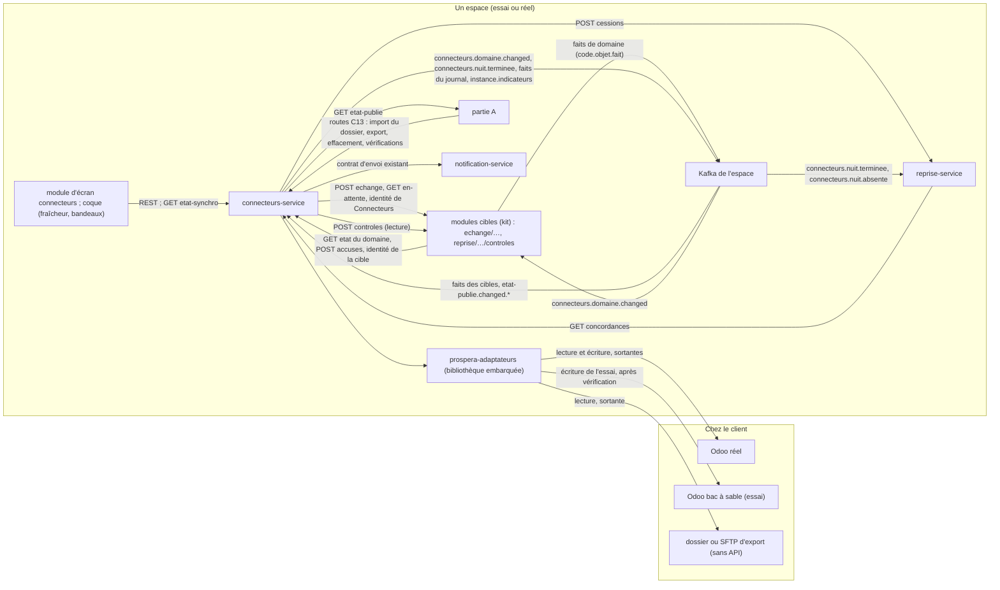
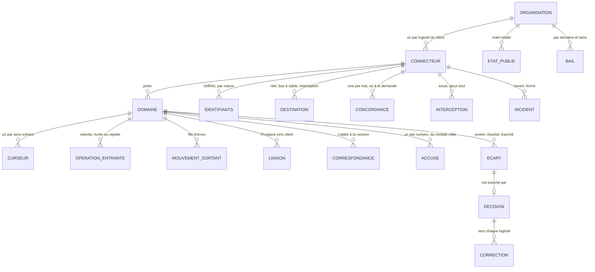
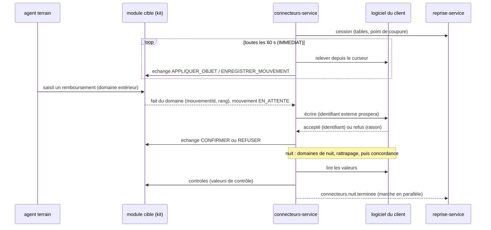
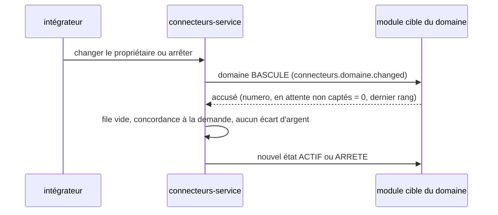

# Architecture Spine — Connecteurs

Connecteurs garde Prospera branché, dans les deux sens et en permanence, sur un logiciel que le client conserve : l'Odoo d'un distributeur, le logiciel de gestion d'une IMF, plus tard celui d'un assureur. Raisons au `.memlog.md` (D-1 → D-48).

**Février.** Aucun des deux clients de février ne garde son logiciel : l'assureur fournit un export Excel, le distributeur quitte Sage (spine de la Reprise, D-B et D-13). Connecteurs sort donc du chemin critique de février (AD-32). La spine fixe tout ce que le premier client qui garde Odoo exigera, et ce que les modules cibles construits d'ici là doivent déjà respecter pour ne pas être repris. La liste des cibles de février n'est pas réduite : jusqu'à une trentaine de modules cibles peuvent recevoir une reprise, et le kit des cibles (AD-12) est ce qui le permet.

`[ADOPTED]` = tranché par le PO (PRD, séance, ou réponse du 2026-11-12 pour le kit des cibles). `[PROPOSÉ]` = recommandation de cette spine, retenue par défaut, contestable dans la PR.

## Design Paradigm

**Un connecteur, des domaines, deux sens, des échanges acquittés.** Le patron est celui du connecteur d'Odoo (OCA `connector` et `queue_job`) : un *backend* par logiciel du client, une *liaison* par enregistrement, un *adaptateur* qui parle au logiciel, un *traducteur* pur, un *importeur* et un *exporteur* qui travaillent par une file de travaux. Microsoft Dual-write et SAP DRF suivent la même coupe (synchronisation initiale, correspondance des clés et des valeurs, file d'erreurs, pause).

| Sens | Étape | Lit | Écrit | Qui |
|---|---|---|---|---|
| Entrant | 1. Relever | le logiciel du client, par l'adaptateur, depuis un curseur | opérations entrantes (brut, identité = clé d'origine), nouveau curseur | `prospera-adaptateurs`, piloté par `connecteurs-service` |
| Entrant | 2. Traduire | opérations entrantes, correspondances | opérations au format du schéma d'objet de la cible | `prospera-adaptateurs` (fonctions pures) |
| Entrant | 3. Livrer | opérations traduites | résultat par opération | point d'échange de la cible (AD-10) |
| Sortant | 1. Capter | faits publiés par les modules cibles | mouvements dans la file d'envoi | `connecteurs-service` |
| Sortant | 2. Traduire | mouvements, correspondances, liaisons | écriture au format du logiciel du client | `prospera-adaptateurs` (fonctions pures) |
| Sortant | 3. Envoyer | écriture traduite | identifiant chez le client ou refus | `prospera-adaptateurs` (écriture), piloté par `connecteurs-service` |
| Sortant | 4. Rendre | réponse du logiciel du client | confirmation ou refus chez la cible | point d'échange de la cible (AD-10) |
| Nuit | Concorder | valeurs du logiciel du client, valeurs de contrôle de la cible | écarts, rapport de concordance | `connecteurs-service` (AD-13) |

Chaque étape est un travail idempotent dont l'acquittement s'écrit dans Mongo avec son résultat ; Redis est perdable. Kafka ne transporte que des faits, jamais une opération à appliquer.

| Couche | Où |
|---|---|
| Adaptateurs (lecture **et écriture**), traduction et comparaison (pures, sans base ni état) | `prospera-adaptateurs` |
| Connecteurs, domaines, curseurs, files, liaisons, écarts, concordance | `connecteurs-service` |
| Schémas d'objets, contrats, seuils de fraîcheur, kit des cibles, bibliothèque de masquage | `prospera-plateforme` |
| Point d'échange, mouvements en attente, valeurs de contrôle | chaque module cible, par le kit (AD-12) |
| Écrans | `prospera-app/src/modules/connecteurs/` ; mentions et bandeaux par la coque ; vue du parc dans la console Money Vibes |

## Inherited Invariants

| Inherited | From parent | Binds here |
| --- | --- | --- |
| AD-P18 | écosystème | le propriétaire d'un domaine a toujours raison **dans la synchronisation automatique** ; un utilisateur ne modifie pas directement une donnée d'un domaine extérieur, il saisit un mouvement en attente de confirmation ; le logiciel du client n'appelle jamais Prospera. Une décision humaine sur un écart d'argent prime (AD-14, AD-31) |
| AD-2, AD-18 | spine du moteur | un propriétaire par donnée ; `connecteurs-service` est un service distinct de `reprise-service` ; `prospera-adaptateurs` commun ; identifiants de connexion propres à chaque service ; aucun webhook entrant |
| AD-6, AD-24 | spine du moteur | la garde lit l'état publié de son espace seul ; aucune transition d'état publié n'est calculée ici ; l'heure de référence vient de la lecture de l'état publié |
| AD-9 | spine du moteur | les compteurs de Connecteurs remontent par la vérification quotidienne ; schéma fermé. Le signal les porte aussi (PRD moteur FR-26, amendé en AD-31) |
| AD-12, AD-17, AD-26, AD-27 | spine du moteur | `instance.journal` écrit par l'agent seul (liste fermée des `type`, amendée ici) ; contrats nommés ; contenu de `prospera-plateforme` ; JSON Schema draft-07 ; `@confluentinc/kafka-javascript`, Karapace, `organisationId`, `eventId` avec `epoque` |
| AD-15, AD-38 | spine du moteur | deux espaces ; trois exceptions de cloisonnement seulement ; identités de service par espace, limitées à l'organisation ; effacement par la route C13 de chaque propriétaire ; bibliothèque de masquage (AD-15 seul la nomme) |
| AD-16, AD-36 | spine du moteur | sauvegarde avec l'espace ; restauration = nouvelle `epoque` ; secrets sous contrôle de l'agent, identifiants des connecteurs dans les secrets de `connecteurs-service` |
| AD-9, AD-20, AD-40 | spine du moteur | supervision des services par la route `sante` (un service muet est un incident de l'instance) ; support à distance ouvert par l'agent ; alertes vers le ticket de Money Vibes |
| FR-34 | PRD moteur | un prérequis en échec : le module concerné rouge, ses dépendants orange, le reste ouvert |
| Conventions et Stack | spine du moteur | nommage, port 3405, montants, JCS et SHA-256, idempotence, temps ; Node 24, NestJS 11, Mongoose 8, MongoDB 8.0 ; BullMQ et Redis relevés en AD-31 |
| AD-2, AD-3, AD-4, AD-13, AD-18, AD-27, AD-32 | spine de la Reprise | schéma d'objet de la cible comme format commun ; clé d'origine et alias rangés par la cible ; point d'import ; valeurs de contrôle de la cible ; interface `Adaptateur` et fonctions pures ; jeton limité à l'organisation (`ORGANISATION_HORS_JETON`) ; formes canoniques (identifiant, nombres, arrondi) |
| AD-6, AD-7, AD-9, AD-11, AD-12, AD-33 | spine de la Reprise | correspondances = valeurs de référence ; part de la Reprise au dossier ; doublons et alias ; comptage d'ouverture ; feu vert par module ; accusé d'effacement |
| AD-20, AD-28 | spine de la Reprise | cession des correspondances et du point de coupure ; un domaine, un écrivain : la Reprise jusqu'à la cession, Connecteurs ensuite |
| AD-5, AD-7, AD-8, AD-14, AD-25 | spine de la coque | « maintenant » = heure de référence plus le temps écoulé ; mentions de fraîcheur et bandeaux rendus par la coque seule, depuis `etat-synchro` ; proxy `/api/<code>/v1/…` ; l'Administration renvoie vers le module d'écran ; protection d'un objet par `<ProtectionObjet>` |
| C2, C3, C4, C5, C6, C7, C8, C9, C10, C11, C12, C13, §4 | contrat de module | garde, neuf états, exceptions nommées ; un agrégat, un service ; module seul ; contrats nommés ; données par client ; droits ; écrans ; désinstaller sans perte ; profil compose ; IA (sans objet ici, AD-27) ; rétrocompatibilité ; installable sous contrôle |

## Invariants & Rules



Une flèche = « peut appeler ou écrire vers ». Aucune flèche ne va du logiciel du client vers Prospera, de Connecteurs vers la base d'une cible, ni d'une cible vers la base de Connecteurs. Dans ce document, `<code>` = code du module cible ; le domaine voyage dans l'enveloppe.

### AD-1 — Un connecteur, des domaines, des échanges acquittés `[PROPOSÉ]`

- **Binds:** FR-1, FR-4, FR-6, NFR-1, NFR-4
- **Prevents:** un échange perdu ou doublé après une coupure ; une logique d'échange recopiée dans chaque module ; un connecteur qui garde un état dans Redis ; deux travailleurs qui écrivent chez le client.
- **Rule:**
  - Un **connecteur** relie une organisation, dans un espace, à **un** logiciel du client (une base Odoo et une société, ou une API d'IMF, ou un export). Il porte des **domaines** (AD-2) ; chaque domaine a un sens (entrant si le logiciel du client en est propriétaire, sortant sinon), une sorte (AD-4) et un niveau de fraîcheur.
  - Chaque étape du tableau du paradigme est un **travail BullMQ** de clef `(connecteurId, domaine, sens, étape, numéro)`. Les rythmes (relevé, pouls, nuit) sont des **job schedulers** de BullMQ 6 (`upsertJobScheduler`, un par bail), jamais l'option `repeat`, supprimée en 6 ; aucun accès direct à `Queue#client`. Son **acquittement** (curseur avancé, opération livrée, mouvement envoyé) s'écrit dans Mongo dans **la même transaction** que son résultat (jeu de réplicas exigé, voir Déploiement) ; Redis se reconstruit depuis Mongo au démarrage. Reprises et plafonds : AD-35.
  - **Bail** par (organisation, connecteur, domaine, sens), durée 2 minutes, renouvelé pendant les appels longs, plus long que le délai d'un appel (30 s). Jeton de *fencing* croissant porté par chaque travail et vérifié par une écriture conditionnelle en Mongo. **Le fencing protège la base de Connecteurs, pas le logiciel du client** : celui-ci est protégé par l'identifiant externe (AD-5, AD-23). Un adaptateur sans dédoublonnage n'a qu'un envoi en vol par domaine ; un envoi sans réponse dans le délai passe `A_VERIFIER` (AD-8).
  - **Un verrou Mongo par objet** ordonne ses opérations (AD-6) ; l'ordre de BullMQ n'est jamais invoqué.
  - Kafka ne transporte que des faits (AD-29) ; aucune opération à appliquer ne voyage par Kafka.

### AD-2 — Les domaines sont déclarés par les modules cibles `[PROPOSÉ]`

- **Binds:** FR-2, FR-5, FR-14, FR-15, FR-16, C1, C4, C6, C11
- **Prevents:** un connecteur qui tient la liste des objets d'un métier ; un domaine synchronisé vers un module absent ; une répartition par défaut écrite en code ; un domaine d'argent jamais comparé.
- **Rule:**
  - Un module cible déclare à son manifeste **`domainesEchange`** (champ nouveau de C1, AD-31) : pour chaque domaine, `code` (`<module>.<domaine>`, ex. `stock.disponible`, `pdv.points-de-vente`), `objets` (schémas d'objets `<code>.<objet>@<majeure>`, spine de la Reprise AD-2), `sorte` (AD-4), `argent` (vrai pour encaissements, remboursements, soldes, prêts, épargne, créances, factures, écritures), `controle` (vrai si la concordance de nuit le compare), `niveauParDefaut`, `cleLibelleAction` (message d'action de la coque) et `publie` (faits qu'il émet pour le sens sortant).
  - **Règles de manifeste**, refusées par le catalogue : `argent: true` exige `controle: true` (sauf sorte `LECTURE`, jamais comparée, AD-13) ; `objets` ⊆ les schémas de `contrats/objets/<code>/`, sans devoir figurer dans `objetsDeReprise` ; un domaine `controle: true` exige les valeurs de contrôle de ses objets, donc la route des contrôles, même sans `objetsDeReprise`. Un domaine d'argent comparé (`controle: true`) dont l'adaptateur n'a pas `lireValeurs` refuse de passer `ACTIF`.
  - Connecteurs ne tient **aucune liste d'objets métier** ; un domaine dont le module n'est pas installé est `NON_INSTALLE`, jamais synchronisé ailleurs (C4).
  - Les **répartitions par défaut** (FR-14 pour le distributeur avec Odoo, FR-15 pour l'IMF) sont des **données** livrées avec `prospera-adaptateurs` (`repartitions/distributeur-odoo.json`, `repartitions/imf.json`), proposées par l'écran et ajustées par l'intégrateur. La table « donnée → niveau » du PRD (FR-5) est la **somme des `niveauParDefaut`** des manifestes cibles et de ces répartitions ; le blocage de crédit de l'IMF est un domaine `LECTURE` de niveau `IMMEDIAT` lu chez le logiciel de l'IMF. Un domaine sans propriétaire refuse le passage en `ACTIF` (`DOMAINE_SANS_PROPRIETAIRE`).
  - **Historique de nuit pour l'IA** (C11) : un domaine `OBJET_DATE` ordinaire, de niveau `NUIT`, déclaré par la cible ; Connecteurs ne porte aucune règle propre et le module n'a pas de champ `ia` (C11 sans objet pour lui).
  - Configuration d'un domaine, par organisation : `proprietaire` (`PROSPERA` | `LOGICIEL_CLIENT`), `niveau` (`IMMEDIAT` | `HEURE` | `NUIT`), `source` (`API` | `EXPORT`, imposée par l'adaptateur), `etat` (AD-34), `pointDeRelais`, curseurs. Ce sont des données par client, jamais du code (C6).

### AD-3 — Un domaine, un propriétaire, un état absolu publié `[ADOPTED]`

- **Binds:** FR-2, FR-3, FR-8, FR-9, NFR-6, UJ-8, AD-P18
- **Prevents:** deux logiciels qui ont raison sur le même domaine ; un module cible qui accepte une écriture directe sur un domaine extérieur ; un changement de propriétaire qui laisse de l'argent en vol ; une cible qui se croit propriétaire sans l'être.
- **Rule:**
  - Le topic **`connecteurs.domaine.changed`** porte l'état absolu d'un domaine : `organisationId`, `espace`, `domaine`, `moduleCible`, `proprietaire`, `etat`, `niveau`, `epoque`, `numero`, `eventId` (qui contient `epoque`). `numero` est un compteur par (organisation, domaine), incrémenté dans la même transaction Mongo que le changement et publié par l'outbox ordonnée (partition `organisationId`) ; le consommateur garde le plus grand (`epoque`, `numero`). Au démarrage après un changement d'époque, Connecteurs republie l'état absolu de chaque domaine (patron du feu vert, spine de la Reprise AD-12).
  - `[PROPOSÉ]` **Propriétaire inconnu : défaut fermé.** Le kit ne suppose jamais « Prospera » quand Connecteurs est installé pour l'organisation. Le propriétaire est Prospera **seulement** si le module `connecteurs` est `NON_INSTALLE` ou `DESINSTALLE` pour l'organisation, lu dans l'état publié que la cible lit déjà. Sinon la cible tient l'état du domaine par `connecteurs.domaine.changed` **et le relit** par `GET /api/v1/domaines/etat/{organisationId}` (identité de service de la cible, limitée à l'organisation) : au démarrage, après tout changement d'époque et devant tout trou de `numero`. Tant que l'état n'est pas connu, toute écriture d'un utilisateur sur ce domaine est refusée `PROPRIETAIRE_INCONNU` (503, réessayable).
  - `[PROPOSÉ]` **Le propriétaire est publié dès l'import du dossier** (domaine `PREPARE`, AD-19), donc avant la mise en service. Une cession ratée (AD-20) ne laisse jamais la cible croire qu'elle est propriétaire : elle retarde seulement le passage `ACTIF` (domaine rouge, alerte).
  - **Changer le propriétaire** et **arrêter la synchro** d'un domaine sont des actes tracés de `connecteurs:configuration:administrer`, qui suivent le protocole d'AD-33. L'arrêt d'un domaine d'argent exige une file des écarts de Connecteurs sans écart ouvert sur ce domaine et une concordance sans écart juste avant (FR-3, QC-8). Le rapport d'écarts de la période de la Reprise et son feu vert sont d'autres objets : Connecteurs ne les lit pas (A-5 du PRD, rejetée). Un domaine arrêté ne revient à `ACTIF` que par une nouvelle configuration tracée.
  - Le logiciel du client « s'arrête » quand tous ses domaines sont arrêtés : le connecteur passe `TERMINE`, ses identifiants sont effacés, ses données restent (C9).
  - Le mode **temporaire** ou **permanent** est un attribut du connecteur, proposé depuis l'offre et confirmé par l'intégrateur ; il ne change aucune règle d'échange, seulement ce que l'écran propose (arrêter les domaines un par un, UJ-8).

### AD-4 — Trois sortes d'échange ; jamais un total `[ADOPTED]`

- **Binds:** FR-4, FR-5, NFR-3
- **Prevents:** deux saisies simultanées qui s'écrasent ; un stock ou un solde recalculé par Prospera à partir de mouvements reçus ; un prix sans date d'effet ; un montant arrondi en silence.
- **Rule:**
  - **`MOUVEMENT`** : un changement unitaire, identifié (AD-5), additif chez le propriétaire (« −12 cartons, commande 4521 », un encaissement, un remboursement). Deux saisies simultanées, une dans chaque logiciel, s'additionnent chez le propriétaire.
  - **`OBJET_DATE`** : un objet et ses attributs (point de vente, produit, prix, facture et son reste dû). Il suit le **dernier effet daté** : une opération dont `dateEffet` est **strictement antérieure** à celle que la cible détient rend `INCHANGE` (`EFFET_ANTERIEUR`). À `dateEffet` **égale** et contenu différent, la dernière lecture s'applique (le propriétaire a raison) et un compteur `EFFET_EGAL` est tenu par domaine. Un prix sans `dateEffet` est refusé à la traduction (`DATE_EFFET_ABSENTE`), jamais complété. Pour un attribut sans date d'effet métier, `dateEffet` est l'instant de modification chez la source (`write_date` d'Odoo, à la seconde).
  - **`LECTURE`** : une valeur **calculée par le propriétaire** (stock disponible, solde d'un prêt, encours, blocage de crédit) que Prospera lit et affiche avec sa date, sans jamais l'écrire, l'additionner, la recalculer ni la comparer (AD-13). Une différence sur une valeur lue est un retard de fraîcheur, réglé par une relecture.
  - **Prospera ne recalcule jamais un solde ou un stock d'un domaine qu'il ne possède pas** : il le lit. Les mouvements entrants d'un domaine extérieur (remboursements reçus de l'IMF) sont des enregistrements d'historique, jamais une base de calcul ; une modification chez le client d'un tel mouvement met à jour le même enregistrement (AD-5). Aucun total ne s'échange. **Seule exception : le mode ombre** (AD-15) : dans l'espace d'**essai** uniquement, pour un domaine marqué `OMBRE` (AD-34), les modules de l'essai recalculent à partir des mouvements relevés pour comparer leurs règles à celles du logiciel du client, qui reste propriétaire ; le kit refuse `OMBRE` dans le réel.
  - **Argent** : un montant qui ne se convertit pas exactement en unités mineures n'est jamais arrondi ; l'opération est rejetée `ARRONDI_REQUIS`, visible (AD-9). Le kit refuse toute opération entrante sur un domaine dont Prospera est propriétaire (`DOMAINE_PROSPERA`).
  - Le disponible lu au moment de valider une commande est la valeur `LECTURE` du domaine, au niveau `IMMEDIAT`, avec sa mention de fraîcheur ; aucune lecture synchrone du logiciel du client ne se trouve sur le chemin d'une saisie (FR-10, Deferred).

### AD-5 — L'identité d'un échange : clé d'origine, identifiant de mouvement, liaisons `[PROPOSÉ]`

- **Binds:** FR-4, FR-6, FR-20, FR-21, NFR-1
- **Prevents:** un objet repris puis reçu une seconde fois ; un mouvement modifié chez le client compté deux fois ; un mouvement renvoyé qui crée un doublon chez le client ; une table d'identifiants tenue en double.
- **Rule:**
  - **Code de source partagé.** `cleOrigine.source` n'est pas `odoo:<connecteurId>`. C'est le code stable du **système d'origine**, déclaré **une fois par organisation** par l'intégrateur (ex. `odoo-principal`), utilisé par le gabarit de la Reprise **et** par le connecteur, porté dans la part de la Reprise au dossier (AD-19) et rendu par la cession. Sans Reprise, l'intégrateur le déclare à la création du connecteur.
  - **Entrant : l'identité d'un mouvement EST sa `cleOrigine`** `{ source, objet, identifiant }` (forme canonique d'AD-32 de la Reprise), où `identifiant` est celui de l'enregistrement ou de la ligne chez le client, jamais une empreinte contenant une date. La cible la range dans son index unique (spine de la Reprise AD-3) : un objet ou un mouvement repris puis relevé n'est jamais créé deux fois (`INCHANGE`). Une modification chez le client d'un mouvement déjà relayé met à jour le même enregistrement (dernier effet daté, AD-4). **Les écarts ne naissent que de la concordance** (AD-13).
  - **Sortant** : un objet ou un mouvement né dans Prospera porte l'identifiant que **la cible** lui a donné (`mouvementId` en ObjectId, ou identifiant de l'objet). Connecteurs tient la **liaison** (identifiant Prospera ↔ identifiant chez le client), seule table d'identifiants qu'il possède, et l'écrit **aussi chez le client** quand l'adaptateur le sait (Odoo : identifiant externe `ir.model.data`, module `prospera`, nom `<objet>_<identifiant>`). L'adaptateur déclare `deduplication: true | false` ; la suite de conformité de l'adaptateur le prouve.
  - **Protocole d'envoi** d'un adaptateur qui dédoublonne : chercher d'abord par identifiant externe, créer seulement s'il est absent ; une violation d'unicité sur l'identifiant externe vaut succès (`DEJA_PRESENT`). Testé avec une coupure après la validation chez le client.
  - Si le client refuse de donner le droit de créer des identifiants externes (AD-23), l'adaptateur range la liaison chez Connecteurs seulement et se déclare `deduplication: false` pour ce connecteur.
  - Une **correspondance** reste une table de valeurs de référence (codes de produit, de zone, d'agence), jamais une clé d'origine (spine de la Reprise AD-6). Une valeur sans correspondance rend un refus de traduction (`CORRESPONDANCE_ABSENTE`), jamais une invention.

### AD-6 — L'ordre : par objet, par rang de la cible, avec dépendances `[PROPOSÉ]`

- **Binds:** NFR-2, FR-6, FR-7
- **Prevents:** un refus qui bloque tout un domaine ; un encaissement envoyé avant la facture qu'il règle ; deux mises à jour d'un même objet appliquées à l'envers ; un ordre qui dépend de l'arrivée.
- **Rule:**
  - Le **`rang`** est attribué par la **cible**, dans la transaction de la saisie : une version monotone par objet, portée par le fait publié. Connecteurs ordonne par (objet, `rang`) avec un **verrou Mongo par objet** (AD-1), jamais par l'ordre de BullMQ ni par l'arrivée.
  - Les **dépendances** se résolvent **tous domaines du connecteur confondus** : un encaissement attend la facture qu'il règle, même si elle est d'un autre domaine (`EN_ATTENTE_DEPENDANCE`). Une attente de plus de 24 h est signalée « dépendance non résolue » : visible, jamais convertie en refus.
  - Un refus ou un rejet bloque **son objet et ce qui en dépend** : pour un mouvement, les mouvements de rang supérieur sur le même objet et ceux qui le référencent. Les autres objets continuent. Ce que le domaine n'a pas appliqué reste visible et la concordance le compte (AD-13).
  - Précise NFR-2 du PRD (« dans l'ordre de leur création ») : l'ordre garanti est celui de chaque objet et de ses dépendances (AD-31). Ancrage : `queue_job` d'Odoo, file d'erreurs de Dual-write.

### AD-7 — Le relevé : un curseur, un rythme par niveau, un chevauchement `[PROPOSÉ]`

- **Binds:** FR-1, FR-5, FR-10, FR-11, SM-3, SM-4
- **Prevents:** un enregistrement modifié dans la même seconde que le curseur ou pendant une longue transaction et jamais relevé ; un domaine calme pris pour un domaine en retard ; une interrogation qui sature le logiciel du client.
- **Rule:**
  - Chaque domaine entrant a un **curseur** fourni par l'adaptateur (Odoo : couple `write_date`, `id`, précision à la seconde). Le relevé relit à partir du curseur **moins le chevauchement déclaré par l'adaptateur** (Odoo : 10 minutes, pour les écritures de la même seconde et les transactions longues) et dédoublonne par clé d'origine. Chaque nuit, un **relevé de rattrapage** relit les dernières 24 heures de chaque domaine entrant. Pages de 200 enregistrements. Le relevé passe `active_test: false` : un archivage (Odoo : `active = False`) est un attribut, pas une disparition.
  - Un domaine **`LECTURE`** se relève par le curseur de l'objet porteur (Odoo : `stock.quant`) plus un **instantané complet chaque nuit** ; l'adaptateur déclare sa méthode par domaine (`decrire()`). La valeur n'est jamais comparée (AD-13).
  - **Concurrence** par organisation : **un canal de lecture et un canal d'écriture**, plafonds de requêtes par minute déclarés par l'adaptateur. Priorités : `IMMEDIAT`, puis envois, puis `HEURE`, puis `NUIT` (AD-35).
  - Rythme, **réglable par données** (valeurs de cette spine) : `IMMEDIAT` toutes les **60 secondes** (QK-19) ; `HEURE` toutes les **10 minutes** ; `NUIT` une passe à partir de **00 h 30**, budget jusqu'à **05 h 30**, échéance **06 h 00**, dans le fuseau de l'organisation et sur l'heure de référence (AD-15). Sans trafic, une vérification d'accès toutes les 5 minutes sert de pouls (AD-17).
  - **`dernierEchangeLe`** d'un domaine entrant = l'instant du dernier relevé **complet** réussi (curseur arrivé en tête), même s'il n'a rien trouvé ; d'un domaine sortant = l'instant du dernier envoi confirmé ou, file vide, de la dernière vérification d'accès réussie. Un domaine calme n'est jamais « en retard ». Le décalage d'horloge du client est mesuré à chaque réponse (en-tête de date) ; il sert à corriger SM-3 (AD-30) et à comparer les `dateEffet` ; une borne, réglable par données, le signale à l'intégrateur.
  - Une **suppression** chez le client n'est jamais propagée : un enregistrement disparu est trouvé par la concordance (AD-13) et devient un écart `OBJET_ABSENT_CHEZ_LE_PROPRIETAIRE`.
  - Une page ou une opération dont la traduction échoue (correspondance absente, schéma non conforme) est **mise de côté** comme rejet, visible, rejouée **par objet et dans l'ordre** après correction de la règle ; le curseur avance. `write_date` n'est pas fiable pour un champ calculé stocké : la suite de conformité le prouve par version, la concordance le rattrape.

### AD-8 — La file d'envoi : rien n'est perdu `[ADOPTED]`

- **Binds:** FR-6, FR-12, FR-19, FR-21, NFR-1, NFR-4
- **Prevents:** un mouvement saisi qui ne part jamais ; un envoi doublé au retour de la connexion ; une file vidée par un redémarrage ; un mouvement en attente oublié chez la cible.
- **Rule:**
  - Un mouvement d'un domaine sortant entre dans la **file d'envoi** (collection Mongo) à la **capture** du fait publié par la cible (AD-11), dédoublonné par `mouvementId`. États : `EN_ATTENTE`, `EN_ATTENTE_DEPENDANCE` (clé avec une dépendance non résolue, AD-6), `ENVOYE`, `CONFIRME`, `REFUSE`, plus `EN_ECHEC_TECHNIQUE` (plafond de reprises atteint : visible, rejouable, jamais un refus), `ABANDONNE` (remplacé, AD-9), `FIGE` (lecture seule, désinstallation, retour arrière), `INTERCEPTE` (essai, AD-18), `A_VERIFIER` (après restauration ou envoi ambigu, AD-25). Chaque transition est horodatée ; l'état d'envoi est une donnée relue par la version précédente (FR-21).
  - L'envoi suit l'ordre d'AD-6 et le protocole d'AD-5 ; un mouvement `ENVOYE` sans réponse est rejoué avec le même identifiant ; il ne devient jamais `CONFIRME` sans une réponse du logiciel du client qui l'accepte.
  - **Mouvements en attente orphelins.** Chaque nuit, Connecteurs lit la liste des mouvements en attente de chaque cible (`GET /api/v1/echange/<code>/{organisationId}/en-attente`, par le kit) et la compare à sa file : un mouvement absent de la file est capté. Un mouvement en attente depuis plus de 24 h est signalé.
  - Le module publie, par domaine, la **longueur de la file** et l'instant du plus ancien mouvement en attente (`etat-synchro`, AD-16), sans jamais rendre de bandeau.

### AD-9 — Refus, rejets et erreurs techniques `[ADOPTED]`

- **Binds:** FR-7, FR-10, NFR-6, SM-2
- **Prevents:** une panne réseau affichée comme un refus ; un refus retenté sans fin ; un refus qu'on ne voit plus ; un compte du client verrouillé par des reprises.
- **Rule:**
  - L'adaptateur classe chaque échec : **erreur technique** (réseau, délai, 5xx, verrou, quota), **refus** du logiciel du client avec sa **raison** lisible (« Odoo refuse la facture 4521 : produit inconnu dans Odoo »), ou **authentification refusée**, classe à part : les travaux du connecteur sont mis en pause après 3 essais (aucun état de plus : le connecteur reste `EN_SERVICE`, la santé passe `DEGRADE`) et une alerte « identifiants » part (pas un incident de panne), jamais de boucle ; la reprise se fait quand l'intégrateur déclare de nouveaux identifiants (AD-22). Une erreur technique est retentée (AD-35) et nourrit la santé (AD-17) ; un refus ne l'est jamais seul.
  - Un **refus** reste visible tant qu'il n'est pas traité. **« Corriger et renvoyer »** (`connecteurs:refus:renvoyer`, dans `<Ecriture>`) suit l'une de deux voies :
    - une **règle** de Connecteurs corrigée (correspondance, liaison) : le **même** mouvement repart avec le même identifiant ;
    - l'**objet source** corrigé dans son module (lien vers l'écran de la cible) : la cible publie un **nouveau** mouvement qui **remplace** le refusé ; le refusé passe `ABANDONNE`, le lien est tracé, le remplaçant garde le `rang` du remplacé (AD-6).
    Connecteurs ne modifie jamais le contenu d'un mouvement d'une cible. `[PROPOSÉ, à confirmer par le PO]` (D-44).
  - Un **rejet** (sens entrant : la cible refuse une opération, `REFERENCE_INCONNUE`, `SCHEMA_NON_CONFORME`…, ou rejet de traduction `ARRONDI_REQUIS`) suit la même règle, du côté de l'intégrateur. Refus et rejets entrent au journal (AD-29).

### AD-10 — Le point d'échange de la cible `[PROPOSÉ]`

- **Binds:** FR-2, FR-4, FR-6, FR-8, FR-19, C2, C3, C5, C13, NFR-1
- **Prevents:** Connecteurs qui écrit dans la base d'une cible ; une seconde forme d'objet à côté du schéma de la reprise ; un mouvement appliqué deux fois ; une correction rejouée après la lecture seule.
- **Rule:**
  - Route de service `POST /api/v1/echange/<code>/{organisationId}/objets/<objet>` (public : `/api/<code>/v1/echange/<code>/{organisationId}/objets/<objet>`, `<code>` = code du module cible), appelée par la seule **identité de service de Connecteurs**, limitée à l'organisation (`ORGANISATION_HORS_JETON`). Enveloppe `echange-enveloppe@1` : `connecteurId`, `domaine`, `schema` (mineure), `operations` (200 au plus, corps ≤ 1 Mio, borne de la Reprise reprise ; au-delà 413 `ECHANGE_TROP_GROS`), chacune avec `operationId`, `operation`, `cleOrigine` ou identifiant Prospera, `rang`, et selon l'opération `dateEffet`, `mouvementId`, `ecartId`, `champs` au **schéma d'objet** de la cible (spine de la Reprise AD-2). Lecture des mouvements en attente : `GET /api/v1/echange/<code>/{organisationId}/en-attente`.
  - Opérations : `APPLIQUER_OBJET` (`OBJET_DATE`, `LECTURE`), `ENREGISTRER_MOUVEMENT` (entrant), `CONFIRMER` et `REFUSER` (réponse du propriétaire à un mouvement en attente, AD-11), `CORRIGER` (décision sur un écart, AD-14).
  - Réponse **par opération** : `APPLIQUE`, `INCHANGE` (`DEJA_APPLIQUE`, `EFFET_ANTERIEUR`), `REJETE` (`REFERENCE_INCONNUE`, `SCHEMA_NON_CONFORME`, `OBJET_HISTORIQUE`, `DOMAINE_PROSPERA`, `CORRECTION_REFUSEE`, `MOUVEMENT_INCONNU`). Le vocabulaire diffère exprès de celui de la Reprise (`CREE`, `MODIFIE`, `REFUSE`) : l'échange met à jour par clé connue et ne crée pas de lot. Idempotente par `operationId` ; un `APPLIQUER_OBJET` sur une clé connue met à jour, jamais ne crée (index de la Reprise, alias compris). Un objet `HISTORIQUE` n'est jamais modifié.
  - La cible juge selon **sa propre règle** ; quand le logiciel du client est propriétaire du domaine, elle **reçoit** : elle ne refuse que ce qu'elle ne peut pas ranger (référence, schéma), jamais une valeur d'argent qu'elle trouverait fausse (un tel désaccord est un écart, AD-13).
  - **Garde par opération** (matrice complète en AD-21) : en `LECTURE_SEULE`, `APPLIQUER_OBJET`, `ENREGISTRER_MOUVEMENT`, `CONFIRMER` et `REFUSER` passent (la vérité du propriétaire et la réponse à un mouvement né avant la lecture seule) ; `CORRIGER` est refusé `ABONNEMENT_EXPIRE`. Un refus de garde n'est jamais un rejet d'opération : l'opération attend chez Connecteurs et le domaine vieillit (AD-16).
  - **Valeurs de contrôle** : Connecteurs lit celles de la Reprise, `POST /api/v1/reprise/<code>/{organisationId}/controles/<objet>` (spine de la Reprise AD-13), route de **lecture** ouverte aux identités de la Reprise **et** de Connecteurs (AD-21, AD-31). Aucune seconde route de contrôle.

### AD-11 — Les mouvements en attente de confirmation chez la cible `[ADOPTED]`

- **Binds:** FR-2, FR-6, FR-15, AD-P18
- **Prevents:** un remboursement saisi sur le terrain qui modifie un solde avant que l'IMF l'accepte ; un écran qui laisse modifier directement une donnée d'un domaine extérieur ; une saisie perdue parce que le connecteur est en panne.
- **Rule:**
  - Quand le propriétaire d'un domaine est `LOGICIEL_CLIENT` (AD-3), la cible transforme toute écriture d'un utilisateur sur ce domaine en **mouvement en attente de confirmation** : elle le range avec l'état `EN_ATTENTE`, ne modifie aucun solde ni aucun attribut, lui attribue son `rang` (AD-6) et publie le fait déclaré au domaine (`<code>.<objet>.<fait>`, charge au schéma d'objet, `mouvementId`, `rang`). Connecteurs le capte (AD-8). Si le propriétaire est inconnu ou le domaine en bascule, la cible refuse la saisie (`PROPRIETAIRE_INCONNU`, `DOMAINE_EN_BASCULE`, AD-3, AD-33).
  - Connecteurs rend la réponse du propriétaire par `CONFIRMER` ou `REFUSER` (AD-10) ; la cible applique alors le mouvement ou le marque refusé. La valeur que l'utilisateur voit reste celle du propriétaire (`LECTURE` ou objet relevé), avec ses mouvements en attente à côté.
  - L'API de la cible rend, par objet, les marqueurs **`autoriteExterieure`** (domaine dont le propriétaire est le logiciel du client) et **`mouvementsEnAttente`** ; l'écran enveloppe l'objet dans `<ProtectionObjet>` de la coque, qui retire les actions de modification directe et affiche « en attente » (amende la coque AD-25, AD-31).
  - Une panne du connecteur n'empêche aucune saisie : le mouvement attend dans la cible puis dans la file (FR-10). Le balayage nocturne d'AD-8 rattrape un fait perdu.
  - **Un seul point d'écriture par domaine** dans le code du module : une fonction de service par domaine déclaré dans `domainesEchange` (AD-12).

### AD-12 — Le kit des cibles `[ADOPTED]`

Décision du PO du 2026-11-12 : le kit est adopté, et il paie son chantier avec la capacité libérée par Connecteurs (D-1).

- **Binds:** C2, C3, C5, C13, FR-2, FR-6, FR-8 ; spine de la Reprise AD-4, AD-13, AD-23
- **Prevents:** trente modules qui codent trente fois la même mécanique d'import, d'échange et de garde ; deux cibles qui interprètent différemment l'enveloppe, l'idempotence ou l'exception d'installation ; une charge de cibles que personne ne porte.
- **Rule:**
  - La mécanique commune aux points d'entrée de la Reprise et de Connecteurs vit dans **une bibliothèque NestJS**, `kit-cible`, publiée par `prospera-plateforme` comme `point-de-decision` (paquet npm privé, version épinglée par service). Comme l'import d'Odoo (`base_import` et `load()` de l'ORM) : le cadre fait la mécanique, le module déclare ses objets.
  - **Le kit porte** : garde d'identité de service et d'organisation (`ORGANISATION_HORS_JETON`) ; exceptions nommées par état (AD-21) ; validation de l'enveloppe et du schéma (Ajv draft-07, schémas épinglés) ; magasin d'idempotence ; index unique de clé d'origine et d'alias ; `SIMULER` par transaction annulée ; comparaison au verdict validé ; refus 413 (`LOT_TROP_GROS` pour un lot de reprise, `ECHANGE_TROP_GROS` pour une enveloppe d'échange) ; route des valeurs de contrôle ; route des mouvements en attente ; read-model de `connecteurs.domaine.changed`, relecture de l'état du domaine et accusés (AD-3, AD-33) ; automate des mouvements en attente (AD-11) ; refus du domaine possédé par Prospera (`DOMAINE_PROSPERA`) ; marqueurs `historique`, `montantASaisir`, `autoriteExterieure`, `mouvementsEnAttente` ; et les **suites de conformité** de la reprise et de l'échange.
  - **Comportements par défaut, comme l'ORM d'Odoo.** Pour un **objet de référence simple** (sans circuit d'états ni règle métier : zone, catégorie, fournisseur, commercial…), le module déclare seulement son **schéma d'objet** et un **raccord** vers sa collection (champs du schéma → champs du document). Le kit fournit alors `appliquer` (création ou mise à jour par clé d'origine), `juger` (conformité au schéma seule) et `valeursDeControle` (relecture des champs déclarés comme valeurs de contrôle). Le module ne surcharge `juger`, `appliquer` ou `valeursDeControle` que pour un **objet à circuit ou à argent** (prêt, police, sinistre, facture, stock). Même principe pour la part échange.
  - **Le point d'import fait partie de la définition de « fini » de chaque module cible** : schémas d'objets au manifeste (`objetsDeReprise`), raccord ou fonctions, suite de conformité de la reprise verte. Ce n'est plus un passage d'une semaine dans les dépôts cibles.
  - **Le chantier transverse se limite au kit lui-même** : un développeur, une semaine, **avant** le point d'import de `pdv` et **avant** la pause du 21/12. La part reprise se construit avec les épics de la Reprise ; la part échange avec les épics de Connecteurs.
  - **Versions du kit.** Semver ; la majeure est alignée sur celle des enveloppes (reprise, échange) ; version épinglée par service ; la suite de conformité du kit prouve la compatibilité ; au plus **deux majeures actives** dans une version de plateforme. **Un propriétaire unique** (celui qui le construit), relu par l'autre développeur. Connecteurs lit la version du kit de la cible dans la route des mouvements en attente et refuse de piloter une cible sous le plancher de la majeure active (`KIT_TROP_ANCIEN`, domaine rouge).
  - Amende la spine de la Reprise AD-4, AD-21 et AD-23 (AD-31).

### AD-13 — La concordance de nuit et la file des écarts `[ADOPTED]`

- **Binds:** FR-8, FR-9, NFR-3, NFR-6, SM-1, SM-4
- **Prevents:** une différence d'argent corrigée en silence ; un écart sans les deux valeurs ; une concordance finie après 6 h ; de faux écarts dus aux mouvements en vol.
- **Rule:**
  - Chaque nuit, après les domaines de nuit (AD-15), Connecteurs compare, pour chaque domaine `controle` **sauf les domaines `LECTURE`** (AD-4), les valeurs du logiciel du client (lues par l'adaptateur) aux **valeurs de contrôle** de la cible (AD-10), objet par objet, par lots de 500 clés, avec la **fonction de comparaison unique** de `prospera-adaptateurs` (spine de la Reprise AD-13), à une `dateDeValeur` fixée par la passe. Quand le logiciel du client sait rendre la valeur à cette date, il la rend ; sinon les clés modifiées depuis `dateDeValeur` (par `write_date`) sont exclues, et une clé en écart est relue avant d'ouvrir l'écart. Le **rapport de concordance** (figé, haché) agrège les totaux (stock par entrepôt, encours par agence) et liste les écarts.
  - **Mouvements en vol.** Une clé qui a un mouvement non confirmé (dans la file de Connecteurs ou en attente chez la cible, ou une dépendance non résolue) est listée **« en vol »** au rapport, jamais en écart. Une décision sur un écart est refusée tant qu'un mouvement est en vol sur sa clé (`MOUVEMENTS_EN_ATTENTE`).
  - **Concordance à la demande** : `POST /api/v1/domaines/{domaine}/concordances`, même fonction, même rapport, bail du domaine, `dateDeValeur` postérieure au dernier envoi ; elle sert à l'arrêt et au changement de propriétaire (AD-33).
  - Un **écart** porte : domaine, `cleOrigine`, champ, valeur Prospera, valeur du logiciel du client, sources, instant, concordance d'origine, `versionEcart`. La clé d'unicité est (domaine, `cleOrigine`, champ) : un même désaccord n'ouvre jamais deux écarts. Types : `VALEUR_DE_CONTROLE_DIFFERENTE` (les deux ont l'objet, les valeurs diffèrent), `OBJET_ABSENT_CHEZ_LE_PROPRIETAIRE` (supprimé chez le propriétaire), `OBJET_ABSENT_DANS_PROSPERA` (jamais relevé). Les écarts ne naissent **que** de la concordance. **Toute discordance entre dans la file** (FR-9) ; aucune n'est corrigée automatiquement, argent ou pas.
  - Un écart est **ouvert** jusqu'à une décision (AD-14) ou jusqu'à ce qu'une concordance suivante trouve les deux valeurs égales : il se ferme alors `RESORBE`, journalisé, sans correction, visible au rapport et compté ; pour un domaine d'argent, il reste visible 30 jours dans la file. `RESORBE` est `[PROPOSÉ, à confirmer par le PO]` (D-18).
  - **Aucun chemin de code ne corrige un montant sans décision** (NFR-3). Les chemins d'écriture d'argent forment une **liste fermée**, un test par chemin : relevé, relais, restauration, cession, `CORRIGER`. Le **test de mutation** retire : la condition d'`ecartId` décidé par un détenteur de `connecteurs:ecart:trancher` (`CORRIGER` sans décision) ; le refus d'une opération entrante sur un domaine possédé par Prospera (`DOMAINE_PROSPERA`) ; le rejet `ARRONDI_REQUIS` (arrondi silencieux). Chacun doit faire échouer un test. Un balayage nocturne vérifie les invariants.
  - **Dimensionnement** : volume cible par organisation = 100 000 objets par domaine contrôlé et 10 000 mouvements par jour ; budget de la nuit 00 h 30 → 05 h 30 ; domaines d'argent d'abord. À 05 h 30, une passe inachevée rend un **rapport partiel** : les domaines non comparés sont `NON_COMPARE`, alerte à Money Vibes, et SM-4 compte un échec. Mesuré à la première story de concordance (AD-35).

### AD-14 — Trancher : la correction suit le chemin normal `[PROPOSÉ]`

- **Binds:** FR-8, UJ-7, NFR-3, NFR-6
- **Prevents:** une décision qui écrit directement dans un logiciel ; une correction envoyée au mauvais côté ; une décision sans trace ; deux décideurs qui tranchent le même écart ; un montant corrigé deux fois.
- **Rule:**
  - La décision (`connecteurs:ecart:trancher`, dans `<Ecriture>`) enregistre l'acteur, l'instant, la **valeur retenue**, le motif et la `versionEcart` vue (contrôle optimiste : une version périmée est refusée). Elle est refusée tant qu'un mouvement est en vol sur la clé (AD-13). Une décision **en bloc par motif** existe pour un écart de masse (une correspondance fausse).
  - Elle crée **une correction vers chaque logiciel dont la valeur diffère de la valeur retenue** : vers le logiciel du client, un mouvement dans la file d'envoi (AD-8), de valeur absolue ; vers la cible, une opération `CORRIGER` (AD-10), que la cible applique ou refuse (`CORRECTION_REFUSEE`, visible). Pour un domaine d'argent, la décision humaine prime sur « le propriétaire a toujours raison » : elle peut corriger le propriétaire lui-même (UJ-7 : la valeur retenue est celle du relevé de l'opérateur) ; jamais un chemin de code. Pour un domaine qui n'est pas d'argent, l'écran propose « **réaligner sur le propriétaire** », une décision comme une autre, tracée.
  - L'écart reste ouvert jusqu'à la confirmation des corrections ; une correction refusée le rouvre avec sa raison.
  - En `LECTURE_SEULE`, les écarts restent consultables, non tranchables (FR-19).
  - Précise FR-8 (« la correction part vers le propriétaire », AD-31).

### AD-15 — La nuit : un ordonnancement, une lecture du logiciel du client `[PROPOSÉ]`

- **Binds:** FR-5, FR-9, FR-13, SM-4 ; PRD Reprise FR-17
- **Prevents:** une IA qui prépare le matin sans les données de la nuit ; deux lectures nocturnes du logiciel du client avec deux jeux d'identifiants ; une comparaison de la Reprise lancée avant que la synchronisation de la nuit soit finie ; une nuit comptée deux fois ou sautée.
- **Rule:**
  - L'heure de la nuit se lit dans le **fuseau de l'organisation**, sur l'**heure de référence** : celle que porte la dernière lecture réussie de l'état publié (moteur AD-24, `heureDeReference`) plus le temps écoulé sur l'horloge système. C'est une source unique ; si l'état publié est illisible, le dernier décalage connu continue de servir. La **date de nuit** est le jour de début de la passe dans le fuseau ; la clef d'idempotence est (`organisationId`, date de nuit). Un changement d'heure ne double ni ne saute une passe (test avec décalage et changement d'heure).
  - Ordre, par organisation : domaines de nuit (à partir de 00 h 30), relevé de rattrapage, concordance, puis le fait **`connecteurs.nuit.terminee`** (`organisationId`, `espace`, date de nuit, domaines arrivés, `complete`, domaines non comparés, `concordanceId`, `epoque`, `eventId`).
  - Les données de nuit absentes à **06 h 00** passent le domaine au rouge, déclenchent l'alerte à l'administrateur (FR-13, AD-17) et le fait **`connecteurs.nuit.absente`**. La Reprise marque alors la nuit « non couverte » dans son rapport de la période.
  - **Marche en parallèle** (PRD Reprise FR-17, PRD moteur UJ-3, PRD Connecteurs UJ-8 et FR-3) : elle **précède la mise en service** et se joue **dans l'espace d'essai**, où elle est une répétition (PRD moteur FR-33). Le connecteur de l'essai relève le **vrai** logiciel du client avec ses identifiants en lecture seule (FR-18) ; rien n'est jamais écrit chez le client (écritures interceptées, AD-18). Chaque nuit de la période, la Reprise de l'essai construit son **rapport d'écarts de la période** à partir du rapport de concordance désigné par `connecteurs.nuit.terminee` (lu par `GET /api/connecteurs/v1/concordances/{id}`, identité de la Reprise), sans relire elle-même le logiciel du client. **La mise en service attend l'écart nul de la période** (dans l'essai) **et**, comme toujours, le feu vert de la Reprise du réel (écart de reprise nul sur le lot frais, spine de la Reprise AD-12) : deux conditions distinctes, le feu vert ne se lit pas dans la file des écarts (A-5 rejetée par le PO). Les règles corrigées pendant la période sont des réglages : elles passent au réel par le dossier d'installation.
  - **Mode ombre** (AD-4, AD-34) : pendant la période, les domaines concernés sont à l'état `OMBRE` dans l'essai ; le logiciel du client reste propriétaire, mais les modules de l'essai **recalculent** à partir des mouvements relevés (par exemple les pénalités de l'IMF) pour comparer leurs règles à celles de l'ancien logiciel. Le kit refuse `OMBRE` dans le réel (`OMBRE_REFUSE_DANS_LE_REEL`). Mécanismes différés (Deferred).
  - **Dans le réel**, la synchro démarre à la mise en service, en relevant depuis le point de coupure (AD-20, A-11 modifiée) ; ensuite l'intégrateur **arrête la synchro** des domaines un par un (FR-3) : un domaine d'argent seulement sans écart ouvert dans la file des écarts du réel (QC-8, AD-3, AD-33). Les deux clients de février n'ont pas de marche en parallèle. Précise PRD Reprise FR-17 (AD-31).

### AD-16 — La fraîcheur : `etat-synchro` et une table de seuils partagée `[ADOPTED]`

- **Binds:** FR-5, FR-11, FR-12, UJ-6 ; coque AD-7
- **Prevents:** deux tables de seuils qui divergent entre la coque et la santé du module ; une mention qui ment parce que deux horloges diffèrent ; un bandeau montré à qui n'a pas le droit.
- **Rule:**
  - `GET /api/connecteurs/v1/etat-synchro` (service : `/api/v1/etat-synchro`), organisation tirée du jeton de l'utilisateur, ouverte dans tous les états où le module est ouvert, en lecture seule comprise. Réponse normalisée **par domaine et par sens** : `domaine`, `sens`, `etat`, `niveau`, `source` (`API` | `EXPORT`), `dernierEchangeLe`, `ageSecondes` (calculé par Connecteurs à la réponse, pour que la coque ne compare pas deux horloges), `nuit` (`attendueAvant`, `arriveeLe`) pour le niveau `NUIT`, `cleLibelleAction`, et `file` (`enAttente`, `plusAncienLe`) **seulement** si l'appelant détient `connecteurs:file:consulter`. Pendant la synchronisation initiale (AD-35), le domaine est hors seuils et porte son avancement.
  - Les seuils orange et rouge par niveau (QK-3 : immédiat 5 et 15 min ; heure 1 h et 3 h ; nuit rouge à 06 h) sont un **contrat**, `prospera-plateforme/contrats/seuils-fraicheur.json` (`seuils-fraicheur@1`), lu par la coque (table générée, copie épinglée) **et** par Connecteurs (santé, alertes). Une seule source. Le contrat porte aussi, par niveau, le champ **`messageDes`** : le message d'action est rendu **dès l'orange** pour `IMMEDIAT` et `HEURE`, dès 06 h pour `NUIT` (FR-11).
  - Avec un **export** du logiciel du client, le niveau `IMMEDIAT` est refusé à la configuration (`NIVEAU_IMPOSSIBLE_SANS_API`) et la mention dit `EXPORT`.
  - Le bandeau de la file d'envoi s'adresse aux détenteurs de `connecteurs:file:consulter` (PRD FR-12, A-7) ; amende la coque AD-7, qui disait « administrateurs » (AD-31).

### AD-17 — La santé et les alertes : Money Vibes d'abord `[ADOPTED]`

- **Binds:** FR-10, FR-13, NFR-5, C13
- **Prevents:** un client qui découvre la panne avant Money Vibes ; une alerte répétée chaque minute ; un contenu métier qui sort d'une instance sur site ; un service muet que personne ne voit.
- **Rule:**
  - **Santé** (`GET /api/v1/instance/connecteurs/{organisationId}/sante`) : `DEGRADE` dès qu'un domaine `ACTIF` est rouge selon `seuils-fraicheur@1`, que le logiciel du client est **injoignable depuis plus de 30 minutes** (aucun appel réussi alors que des appels ont été tentés), ou que Redis est indisponible (`[PROPOSÉ, à confirmer par le PO]`, D-44) ; `OK` sinon. Un prérequis perdu (accès au logiciel) rend le connecteur rouge et ses dépendants orange, sans bloquer le reste (moteur FR-34). La santé ne ferme rien.
  - **Incident** : ouvert à 30 minutes **continues** d'injoignabilité ou de domaine rouge, fermé après 10 minutes sans rouge (pas d'alternance) ; **une alerte à l'ouverture, une à la fermeture** (`[PROPOSÉ, à confirmer par le PO]` pour le message de fermeture, D-44). L'administrateur est prévenu par `notification-service` (WhatsApp ou e-mail, contrat d'envoi existant), et aussi si les données de nuit manquent à 06 h.
  - **Plateforme** : l'alerte de Money Vibes (ticket, moteur AD-40) est émise par la supervision du moteur, qui lit la route `sante` ; l'alerte à l'administrateur part à l'accusé du ticket, ou 15 minutes après l'ouverture, au premier des deux (`[PROPOSÉ]`). **Service muet** : un `connecteurs-service` qui ne répond plus à `sante` est vu par la même supervision et remonte comme incident de l'instance (moteur AD-9, AD-40) ; aucune alerte ne dépend du service lui-même.
  - **Sur site**, l'alerte à l'administrateur reste sur l'instance ; seuls des **compteurs** par domaine (mouvements envoyés et refusés, écarts ouverts, longueur de la file, dernier échange, `niveau`, santé) remontent, par `instance.indicateurs` vers l'agent, puis par la vérification quotidienne et le signal (moteur AD-9, FR-26). Schéma fermé ; un test échoue si un numéro, un montant ou un nom en sort. Le délai de Money Vibes sur site (contrôle quotidien) est une décision du PO (FR-13, QC-11) : aucune règle de la spine ne l'avance.

### AD-18 — L'essai : destinations, bac à sable, identifiants en lecture seule, interception `[ADOPTED]`

- **Binds:** FR-18, C13 point 6, NFR-6 ; PRD moteur FR-9, addendum A-7
- **Prevents:** une écriture de l'essai dans le logiciel réel du client ; des identifiants réputés « lecture seule » qui écrivent ; une donnée personnelle réelle écrite dans un bac à sable ; un bac à sable recréé ou repointé vers le réel.
- **Rule:**
  - Une **destination d'écriture** a une nature : `REEL`, `BAC_A_SABLE`, `INTERCEPTION`. Dans l'espace d'essai, le serveur refuse toute destination `REEL` (`ECRITURE_REELLE_DEPUIS_ESSAI`), quel que soit l'écran.
  - **Cascade** de l'essai : bac à sable vérifié, sinon interception ; le client peut forcer l'interception ; le réel, jamais. Une écriture interceptée est rangée dans le **journal des écritures interceptées** de Connecteurs (collection en ajout seul, consultable par `connecteurs:file:consulter`) et compte au fait du journal (sans contenu).
  - **Bac à sable vérifié** : (a) la référence de la confirmation écrite du client est enregistrée ; (b) l'adaptateur constate une **base distincte** de celle que lit la connexion en lecture du réel (adresse et nom de base différents ; Odoo : et `database.uuid` différent quand il est lisible, ce qu'un compte sans droit système ne permet pas) ; (c) le client confirme que les envois de messages du bac à sable sont coupés. La vérification est tracée (qui, quand, adresse, base) ; tant qu'elle n'a pas réussi, le bac à sable ne reçoit rien. **L'empreinte de la base est revérifiée à chaque ouverture de session de l'adaptateur et avant chaque lot d'écritures** ; si elle change, l'écriture est refusée (`BAC_A_SABLE_NON_VERIFIE`).
  - **Identifiants en lecture seule propres à l'essai** : à leur déclaration, l'adaptateur prouve qu'ils ne peuvent pas écrire, par le **contrôle de droits natif** quand le logiciel en a un. Pour Odoo, il suit le **profil de version** : `check_access_rights` jusqu'à Odoo 17, `has_access` à partir de 18 ; il couvre les modèles des domaines, l'objet de test et `ir.model.data`, en `create`, `write` et `unlink`. Sans contrôle natif, la preuve est une **écriture de test sur l'objet de test déclaré par l'adaptateur**, archivé et supprimable, qui doit être refusée ; sans objet de test déclaré, aucune écriture de test n'est faite et la preuve est marquée « non démontrée » au bilan (confirmation écrite du client). Un droit d'écriture constaté rejette les identifiants (`IDENTIFIANTS_NON_LECTURE_SEULE`). Une écriture de test qui réussit est un incident.
  - **Prospect** (`ESSAI_PROSPECT`) : lecture seule de son logiciel avec ses identifiants dédiés, écritures toujours interceptées, pas de bac à sable sans Money Vibes. Sa lecture est limitée aux domaines configurés dans l'essai ; les champs personnels sont masqués à la lecture par la bibliothèque de masquage ; les données lues vivent le temps de l'essai (effacement, AD-26). La Reprise ne lit jamais le bac à sable : elle lit le réel avec ses propres identifiants (PRD A-10).
  - **Masquage** : une écriture vers un bac à sable passe par la bibliothèque de masquage, **placée dans `prospera-plateforme`** et partagée avec l'agent (moteur AD-15), sauf accord écrit du client, enregistré par sa référence par un détenteur de `connecteurs:configuration:administrer` (tracé).
  - **Aller-retour** (vérification `aller-retour`) : un objet de test déclaré par l'adaptateur (Odoo : un contact archivé « Prospera — vérification », identifiant externe `prospera.verification_<clef>`) est écrit puis relu à l'identique, sous l'identité du moteur, clef d'idempotence de la vérification. Sur un bac à sable, c'est l'« écriture de test acceptée » de C13 point 2. Intercepté dans l'essai : 🟠 « aller-retour non vérifié » ; vérifié dans le réel à la mise en service.

### AD-19 — Ce qui passe de l'essai au réel `[ADOPTED]`

- **Binds:** FR-2, FR-18, NFR-3 ; moteur AD-15
- **Prevents:** un identifiant ou une donnée métier qui franchit le cloisonnement ; un réel configuré autrement que l'essai répété ; une table de correspondance écrite deux fois.
- **Rule:**
  - La **part de Connecteurs au dossier d'installation** : connecteurs (logiciel, version et édition détectées, société, mode), domaines (propriétaire, niveau, source), correspondances (valeurs de référence). Codes et libellés seulement ; à l'export, une valeur hors du domaine de valeurs déclaré est rejetée ; un test cherche une valeur témoin. Le **code du système d'origine** (AD-5) voyage dans la part de la Reprise.
  - **Propriété des tables de correspondance** à l'export : avant la cession, la Reprise ; après, Connecteurs. L'import du réel n'écrase jamais une table cédée.
  - Ne passent **jamais** : identifiants de connexion (le réel reçoit les siens), adresses de bac à sable, curseurs, liaisons, files d'envoi et d'entrée, écarts, rapports de concordance, journal des interceptions.
  - La partie A l'importe par la route C13 `import` de Connecteurs, idempotente par version du dossier. Les domaines y naissent `PREPARE`, **propriétaire publié** (AD-3).

### AD-20 — Le relais de la Reprise `[ADOPTED]`

- **Binds:** FR-20, FR-3 ; PRD Reprise FR-24 ; spine de la Reprise AD-11, AD-20, AD-28
- **Prevents:** un objet chargé par la Reprise puis reçu de nouveau ; deux écrivains d'un même domaine ; un connecteur qui démarre avant que la cible soit en service ; deux logiciels qui écrivent pendant une cession ratée.
- **Rule:**
  - Un domaine passe `ACTIF` quand son **module cible est `EN_SERVICE`** dans le réel (fait `etat-publie.changed.reel`) **et** que la cession a réussi : c'est le **point de relais** (PO, A-11 modifiée). Juste avant, Connecteurs appelle la **cession** de la Reprise pour ce domaine (`POST /api/reprise/v1/correspondances/{organisationId}/cessions`), copie les tables, compare leur hachage et range le **point de coupure** ; ensuite il est seul propriétaire des tables. Le domaine d'une correspondance est celui qui liste l'objet dont elle remplit un champ (précise la spine de la Reprise AD-20, AD-31). Une cession ratée (Reprise injoignable, hachage différent) laisse le domaine `PREPARE`, rouge, avec alerte, et la reprend de façon bornée ; le propriétaire, lui, est déjà publié (AD-3). Journal : `reprise.cession` seul ; Connecteurs n'en émet pas un second.
  - **Deux points, pas un.** Le premier relevé part du **point de coupure** (début de l'extraction du lot du réel, spine de la Reprise AD-20) : un enregistrement antérieur est ignoré, un enregistrement relu en double est reconnu par sa clé d'origine (`INCHANGE`). La **mise en service** reste ce qui rend le domaine `ACTIF` (AD-31).
  - **Domaine `MOUVEMENT`** : il démarre au point de coupure s'il y a eu cession (l'historique repris porte la même clé d'origine, la cible rend `INCHANGE`, AD-5) ; à la mise en service sinon, sans historique.
  - **Sans Reprise** dans l'offre, ou sans lot sur ce domaine : tables vides (dit au bilan), et le premier relevé d'un domaine `OBJET_DATE` ou `LECTURE` part de **zéro** (synchronisation initiale, comme Dual-write, AD-35).
  - **Stock d'ouverture quand Odoo possède le stock.** Le comptage n'est **jamais additionné** chez Odoo. Il part comme **ajustement d'inventaire** : une **quantité comptée** par (entrepôt, article) que l'adaptateur applique comme un inventaire du propriétaire (Odoo : `stock.quant`, `inventory_quantity`, puis application de l'inventaire ; Odoo calcule lui-même la différence), en attente de confirmation (FR-20). Le comptage est livré à `stock` par la Reprise (spine de la Reprise AD-11), qui le garde comme ajustement en attente et publie le fait à la mise en service ; Connecteurs le capte alors (AD-11). Dans Prospera, le stock d'un domaine possédé par Odoo reste une `LECTURE`.
  - La Reprise retire ses identifiants à la réception définitive (spine de la Reprise) ; le connecteur ne les reprend jamais (AD-22).

### AD-21 — Les états publiés : la garde de Connecteurs `[ADOPTED]`

- **Binds:** FR-19, C2, C9, C13 point 4
- **Prevents:** un envoi vers le client pendant une lecture seule ; une garde qui lit l'horloge ; une file perdue à la désinstallation ; une désinstallation qui surprend le client.
- **Rule:**
  - Garde `CONNECTEURS_NOT_ENTITLED` (`ABONNEMENT_EXPIRE` à l'expiration) : lit l'état publié de son espace seul (moteur AD-24) ; au démarrage et après restauration, reste fermée tant que la lecture n'a pas réussi. **Âge de l'état publié** : quand il n'a été confirmé ni par un fait (`etat-publie.changed.*`) ni par une lecture depuis **15 minutes** (valeur de configuration, réglable par données ; `[PROPOSÉ]`), la garde le relit par la route de lecture de l'état publié (identité de service). Si la relecture échoue, elle **garde l'état courant** (comme la partie A garde l'état publié quand l'heure est indisponible, moteur AD-6), passe sa santé à `DEGRADE` (AD-17) et réessaie ; **elle ne ferme rien pour cette seule raison**. Le kit des cibles fait de même pour la route d'échange et la route des contrôles.
  - Matrice de FR-19, par état, avec les deux routes de la cible :

    | État | `connecteurs-service` | Route d'échange de la cible | Route des contrôles (lecture) |
    |---|---|---|---|
    | `NON_INSTALLE` | rien ; export refusé | refusée | refusée |
    | `EN_INSTALLATION` | vérifications seules, à l'identité du moteur ; import du dossier | refusée | Reprise seule (réel) |
    | `EN_SERVICE`, `PREAVIS` | tout ouvert | toutes les opérations | Reprise et Connecteurs |
    | `ESSAI_PROSPECT` | lecture seule du logiciel du client ; écritures interceptées | toutes les opérations (espace d'essai) | Reprise et Connecteurs |
    | `LECTURE_SEULE` | **entrant continu**, sortant **fermé** (nouveaux mouvements refusés `ABONNEMENT_EXPIRE`, file **figée**, reprise au paiement dans l'ordre, sans doublon) ; écarts consultables, non tranchables | `APPLIQUER_OBJET`, `ENREGISTRER_MOUVEMENT`, `CONFIRMER`, `REFUSER` ; `CORRIGER` refusé `ABONNEMENT_EXPIRE` | Reprise et Connecteurs |
    | `SUSPENDU`, `ESSAI_TERMINE` | tout fermé sauf l'export | refusée | refusée |
    | `DESINSTALLE` | échanges coupés, file figée, rien supprimé | refusée | refusée |

  - `GEL` et `VERSION_FIGEE` ne changent rien aux échanges. Un prérequis perdu (accès au logiciel) laisse l'état publié et passe la santé `DEGRADE` (AD-17).
  - **Avertissement avant désinstallation** (C9), donnée du manifeste (`avertissementDesinstallation`) lue par la partie A : « Le logiciel du client cessera de recevoir les mouvements de Prospera ; la file d'envoi sera figée, rien ne sera supprimé. »
  - **Réinstallation** : la file figée est présentée à l'intégrateur, qui la rejoue ou l'écarte, mouvement par mouvement ou en bloc, de façon tracée ; rien ne repart seul (C9, A-14).
  - Test : matrice des neuf états jouée pour chaque sens, pour la garde de Connecteurs et pour les lignes « route d'échange » (par opération) et « route des contrôles ».

### AD-22 — Les identifiants de connexion `[ADOPTED]`

- **Binds:** FR-1, FR-18, NFR-5 ; moteur AD-36
- **Prevents:** un mot de passe ou une clé d'API qui sort de l'instance, d'un journal ou d'un export ; les identifiants d'une organisation lisibles avec ceux d'une autre ; une sauvegarde qui rend le connecteur muet.
- **Rule:**
  - Chiffrés au repos en AES-256-GCM : IV aléatoire de 12 octets par chiffrement, rangé avec l'étiquette ; contexte (`organisationId`, `connecteurId`, nature) authentifié en données associées ; identifiant de version de clé (`kid`) dans chaque enveloppe, rotation documentée. Clé maîtresse dans les secrets de `connecteurs-service` sous contrôle de l'agent, **hors de la sauvegarde des données**, vérifiée au démarrage. Champs **en écriture seule** : aucune route ne les rend.
  - Une alerte « identifiants » part avant l'expiration connue d'une clé d'API (AD-9).
  - Jamais au dossier, à l'export, dans un journal, une alerte ou un fait. Effacés à l'effacement (AD-26) et à l'arrêt du dernier domaine.
  - Jeux distincts : réel en écriture, essai en lecture seule, bac à sable ; ceux de la Reprise sont les siens (FR-1).

### AD-23 — Les adaptateurs d'écriture et Odoo `[ADOPTED]`

- **Binds:** FR-1, FR-14, FR-21, SM-5
- **Prevents:** un connecteur qui casse à la version suivante d'Odoo ; un adaptateur Odoo écrit deux fois ; une API dépréciée gardée par habitude ; un compte d'écriture sans les droits qu'il faut.
- **Rule:**
  - `prospera-adaptateurs` étend l'interface `Adaptateur` de la Reprise (AD-18 de sa spine) par **`AdaptateurEcriture`**. L'extension **garde** `decrire`, `verifierAcces` et `lire(source, gabarit, curseur)`, que la Reprise appelle seule ; elle **ajoute** `detecter(connexion)` (version, édition, société, droits), `verifierLectureSeule(connexion)`, `relever(domaine, curseur)`, `ecrire(mouvement)` (rend identifiant ou refus classé, AD-9) et `lireValeurs(domaine, cles, dateDeValeur)`. `decrire()` porte aussi `deduplication`, plafonds, chevauchement, objet de test, méthode de relevé par domaine. La Reprise et Connecteurs partagent le code de connexion et les profils de version d'Odoo, pas les identifiants. La Reprise n'importe toujours aucune fonction d'écriture (garde de test de sa spine).
  - **Odoo** : détection de la version et de l'édition à la connexion (affichées au bilan) ; API **JSON-2** dès qu'elle existe (Odoo 19 et suivants), derrière l'interrupteur `odoo-json2` ; sinon **JSON-RPC** (`execute_kw`), présent de 8.0 à 19.0 ; XML-RPC seulement pour une version plus ancienne (Deferred). XML-RPC et JSON-RPC sont annoncés en retrait d'Odoo 22 (automne 2028) et d'Odoo Online 21.1 (hiver 2027) : le jalon d'Odoo Online est le premier.
  - Les **générations de modèles** (`account.invoice` jusqu'à 12 ; dès 13, la facture est un `account.move` filtré par `move_type`) et les champs par version sont des **profils de version** en données, pas des branches de code. Le profil porte aussi, par champ d'argent : champ source, devise, nombre de décimales lu de la devise ; un montant qui ne s'y convertit pas exactement est rejeté `ARRONDI_REQUIS` (AD-4).
  - **Une société Odoo par connecteur** : l'adaptateur passe `allowed_company_ids = [société du connecteur]` dans chaque contexte et filtre `company_id` ; la société se détecte à la connexion. Instants Odoo lus en UTC.
  - **Prérequis vérifiés** : joignable (lecture de test en moins de 30 s), version détectée, droits du compte, plan Custom d'Odoo Online (avec l'action à faire si le client n'y est pas), Redis de l'espace. **Le compte d'écriture du réel doit détenir le groupe « Droits d'accès »** (`base.group_erp_manager`) pour créer des identifiants externes (`ir.model.data`) : c'est un prérequis du bilan, contraire au moindre privilège ; si le client le refuse, repli d'AD-5 (liaison chez Connecteurs seulement, `deduplication: false`). Une version jamais testée est signalée au bilan, sans refus (A-9).
  - **Matrice de versions** : la CI de `prospera-adaptateurs` joue la suite de conformité contre l'image officielle d'Odoo (Community) de **chaque version rencontrée** chez un client ; les images 12 et 13 ne sont plus reconstruites. Les éditions Enterprise, Odoo Online et Odoo.sh ne se testent pas en conteneur : le bilan dit « testé » ou « non testé » pour l'édition du client, et le premier contrat d'un client Odoo est conditionné à une recette sur une copie de sa base.

### AD-24 — L'export du logiciel du client, sans API `[PROPOSÉ]`

- **Binds:** FR-1, FR-5, FR-11
- **Prevents:** un fichier que le client pousse vers Prospera (appel entrant) ; une donnée d'export présentée comme immédiate.
- **Rule:** Sans API, l'adaptateur `export` **va chercher** le fichier produit par le logiciel du client, en sortant : dossier partagé du réseau du client (sur site) ou serveur SFTP du client. Il lit avec les lecteurs de l'adaptateur `fichier` de la Reprise et un gabarit ; le curseur est l'empreinte et l'horodatage du dernier fichier traité. Source `EXPORT`, niveaux `HEURE` ou `NUIT` seulement (AD-16). Le protocole se choisit avec le premier client concerné (Deferred).

### AD-25 — Rétrocompatibilité, retour arrière, restauration et interrupteurs `[ADOPTED]`

- **Binds:** FR-21, C12, NFR-3
- **Prevents:** une montée de version qui rend la file illisible ; un retour arrière qui renvoie des mouvements déjà écrits chez le client ; une correction inverse faite toute seule ; une restauration qui renvoie ou perd des mouvements.
- **Rule:**
  - Point d'entrée **`migrer`**, idempotent, appelé par l'agent sous verrou. Pendant 7 jours, migrations **additives** ; les versions N et N-1 relisent connecteurs, domaines, files, liaisons, écarts, rapports et charges BullMQ en vol ; lecteurs d'énumérations tolérants ; topics `@2` si incompatible. `retourArriere: SANS_PERTE` pour les données Prospera du connecteur.
  - **Un retour arrière ne défait rien chez le client** : pendant la fenêtre (`instance.retourArriereEnCours` de l'état publié), la file d'envoi est **suspendue** jusqu'à la confirmation du DSI (`connecteurs:file:reprendre`) ; les corrections sont des **mouvements inverses proposés** à l'intégrateur et à la personne habilitée, jamais créés seuls.
  - **Restauration `AVEC_PERTE`** (nouvelle `epoque`) : **tous** les mouvements non `CONFIRME` passent `A_VERIFIER` ; les curseurs reviennent à l'instant restauré. Pour un adaptateur qui dédoublonne, ils repartent avec leur identifiant externe (AD-5) ; sinon, relecture chez le client quand c'est possible, décision de l'intégrateur sinon. Les mouvements saisis par les utilisateurs après l'instant restauré et perdus sont listés à l'intégrateur ; le relevé du logiciel du client et la concordance retrouvent ceux que Prospera a oubliés. La garde reste fermée jusqu'à la fin de cette reprise. Le fencing protège la base de Connecteurs, le logiciel du client est protégé par l'identifiant externe ; un envoi ambigu (délai sans réponse) chez un adaptateur sans dédoublonnage passe `A_VERIFIER` (AD-1).
  - **Interrupteurs** déclarés au manifeste : `odoo-json2` et chaque changement de comportement d'un adaptateur, lus dans `interrupteurs[]` de l'état publié (addendum A-8 du moteur) ; un interrupteur ne change jamais la forme d'une donnée.

### AD-26 — Effacement, export et import par organisation `[ADOPTED]`

- **Binds:** C13 point 7, FR-18 ; moteur AD-38
- **Prevents:** un identifiant ou une file qui survit à l'effacement d'un prospect ; un accusé invérifiable ; un prospect qui renaît d'une restauration.
- **Rule:**
  - **Effacement** (`POST …/instance/connecteurs/{organisationId}/effacement`) : transition `EFFACEMENT_EN_COURS` qui refuse toute écriture, draine les travaux, coupe les connecteurs, puis supprime identifiants, curseurs, liaisons, correspondances (cédées comprises), files d'envoi et d'entrée, écarts, rapports, journal des interceptions, read-models. La liste vient du schéma : **toute collection qui porte `organisationId`** est balayée, zéro reste vérifié. Redis est purgé par préfixe d'organisation (travaux, verrous, clés). Idempotent ; **accusé** au format de la Reprise (AD-33 de sa spine). Les entrées nominatives d'`instance.journal` sont pseudonymisées par le moteur, jamais supprimées.
  - **Kafka** : les faits de Connecteurs ne portent aucun contenu métier et expirent avec la rétention du topic. **Sauvegardes** : une restauration antérieure à un effacement doit rejouer l'effacement (registre d'effacements tenu par le moteur, AD-16 et AD-38 : précision demandée, AD-31).
  - **Export** CSV et JSON (configuration, domaines, files, refus, écarts, rapports ; jamais les identifiants), ouvert dans tous les états sauf `NON_INSTALLE`, réservé à `instance:donnees:exporter` pour l'utilisateur ; `perimetre=dossier` rend la part au dossier (AD-19).

### AD-27 — Connecteurs, module installable (M43) `[ADOPTED]`

- **Binds:** FR-3, C1, C2, C4, C7, C8, C9, C10, C11, C13
- **Prevents:** un module vendu sans manifeste ; un module commercial qu'on oublie d'ajouter au contrat ; un droit inventé par une story ; un manifeste et une spine qui se contredisent.
- **Rule:**
  - **Manifeste `connecteurs`**, écrit dans `prospera-stories/manifestes/connecteurs.manifest.ts` : `depends: []` ; `enrichiPar` = `reprise` et les modules qui déclarent `domainesEchange`, avec une raison par entrée ou par groupe d'entrées ; `prerequis` (logiciel joignable, version détectée, droits du compte, plan Custom d'Odoo Online, Redis de l'espace), chacun avec l'`action` à faire s'il est en échec ; `verifications` (`acces-logiciel`, `lecture-seule`, `bac-a-sable`, `aller-retour`, `objets-lus`), chacune avec route et critère chiffré ; `retourArriere: SANS_PERTE` ; `interrupteurs: ['odoo-json2']` ; `publie`, `consomme` (AD-29) ; routes C13 ; `avertissementDesinstallation` (AD-21) ; routes autorisées en lecture seule : export, `etat-synchro`, `connecteurs`, `connecteurs/{id}/domaines`, file d'envoi, refus, écarts, interceptions, concordances ; profil compose `connecteurs` ; `objetsDeReprise: []`, `domainesEchange: []` (Connecteurs relie les domaines, il n'en déclare pas). Une même liste de routes en lecture seule ici et au manifeste.
  - **Module commercial** : ligne au catalogue, ajouté d'office dès que le contrat déclare un logiciel du client, inclus dans la plateforme complète (QC-2). M43 couvre **le logiciel du client seulement** ; banques, Mobile Money, OTR et signature sont des intégrations de leurs modules métier (`paiement`, `fiscal`…), hors de ce module (amende M43, AD-31).
  - **Droits** : `connecteurs:configuration:administrer` (plateforme, intégrateur Money Vibes ; une entrée de plus aux quatre copies du catalogue de plateforme) ; de tenant : `connecteurs:file:consulter`, `connecteurs:refus:renvoyer`, `connecteurs:ecart:trancher`, `connecteurs:file:reprendre` (DSI, après un retour arrière). Le rôle du DSI les contient dès l'installation ; la comptable et le chef d'agence reçoivent `ecart:trancher` de l'administrateur du client. Une PR dans `auth-service` porte les droits de tenant et l'identité de service de `connecteurs-service` (AD-31).
  - **C11** : sans objet pour le module (pas de champ `ia`) ; l'historique de nuit pour l'IA est un domaine ordinaire de la cible (AD-2).

### AD-28 — Les écrans `[PROPOSÉ]`

- **Binds:** FR-2, FR-7, FR-8, FR-12, FR-13, C8, UJ-8
- **Prevents:** une configuration impossible sur une instance sur site ; un module qui rend une mention de fraîcheur ou un bandeau.
- **Rule:**
  - **Module d'écran `connecteurs`** (`prospera-app/src/modules/connecteurs/`), sur la plateforme comme sur site : file des écarts (deux valeurs côte à côte, décision), refus (« Corriger et renvoyer »), file d'envoi, interceptions de l'essai, et **configuration** (connecteur, propriétaires, niveaux, correspondances, bac à sable, bascule et arrêt de la synchro, UJ-8) derrière `connecteurs:configuration:administrer`. Sur site, l'intégrateur l'atteint pendant une session de support ouverte par l'agent (moteur AD-20). L'Administration de la coque renvoie vers ce module (coque AD-14).
  - **Console Money Vibes** : vue du parc (dernier échange, file, refus, écarts, santé par client) ; complète sur la plateforme, réduite aux compteurs sur site (AD-17).
  - Mentions de fraîcheur et bandeaux : par la coque seule (coque AD-7) ; actions d'écriture dans `<Ecriture>` ; export dans les actions hors garde. Même API pour les deux publics ; OpenAPI publié par `connecteurs-service`. Tous les écrans par Dev B (règle des épics du moteur).

### AD-29 — Les contrats nommés de Connecteurs

- **Binds:** C5, FR-6, FR-9, FR-11, FR-13, FR-20, NFR-6
- **Prevents:** des noms de topics ou de routes inventés par chaque story ; deux producteurs pour un même fait.
- **Rule:** Ces noms sont les seuls ; chaque contrat a un test joué des deux côtés ; les schémas vivent dans `prospera-plateforme/contrats/` et sont enregistrés à « migrer ». Les chemins `/api/v1/…` sont ceux vus par le service ; devant, `/api/connecteurs/v1/…`.

  | Contrat | Producteur | Consommateurs |
  |---|---|---|
  | `domainesEchange` au manifeste (champ de C1) | module cible | connecteurs-service, partie A (catalogue) |
  | `POST /api/<code>/v1/echange/<code>/{organisationId}/objets/<objet>`, enveloppe `echange-enveloppe@1` (service : `/api/v1/echange/<code>/…`) | module cible (kit) | connecteurs-service |
  | `GET …/echange/<code>/{organisationId}/en-attente` (mouvements en attente, version du kit) | module cible (kit) | connecteurs-service |
  | `POST /api/<code>/v1/reprise/<code>/{organisationId}/controles/<objet>` (existant, ouvert en lecture à Connecteurs) | module cible (kit) | reprise-service, connecteurs-service |
  | faits sortants déclarés par chaque domaine (`<code>.<objet>.<fait>`, charge au schéma d'objet, `mouvementId`, `rang`) | module cible | connecteurs-service |
  | `connecteurs.domaine.changed` (état absolu par domaine, `epoque`, `numero`) | connecteurs-service | modules cibles (kit) |
  | `GET /api/v1/domaines/etat/{organisationId}` (état de chaque domaine, identité de service de la cible) | connecteurs-service | modules cibles (kit) |
  | `POST /api/v1/domaines/{domaine}/accuses/{organisationId}` (accusé de numéro, mouvements non captés, dernier `rang`) | module cible du domaine (kit) | connecteurs-service |
  | `POST /api/v1/domaines/{domaine}/concordances` (concordance à la demande) | connecteurs-service | intégrateur (écran), AD-33 |
  | `connecteurs.nuit.terminee`, `connecteurs.nuit.absente` | connecteurs-service | reprise-service (marche en parallèle) |
  | `GET /api/connecteurs/v1/etat-synchro` | connecteurs-service | coque |
  | `GET /api/connecteurs/v1/concordances/{id}` | connecteurs-service | reprise-service, module d'écran |
  | routes d'écran : `connecteurs`, `connecteurs/{id}/domaines`, `file-envoi`, `refus`, `ecarts`, `ecarts/{id}/decision`, `interceptions`, `concordances` | connecteurs-service | module d'écran |
  | `seuils-fraicheur@1` (`prospera-plateforme/contrats/seuils-fraicheur.json`, avec `messageDes`) | prospera-plateforme | coque, connecteurs-service |
  | `POST /api/reprise/v1/correspondances/{organisationId}/cessions` (existant) | reprise-service | connecteurs-service |
  | `etat-publie.changed.essai`, `etat-publie.changed.reel`, `GET /api/instance/v1/etat-publie/{organisationId}` | partie A de l'espace | connecteurs-service, kit des cibles |
  | routes C13 : `/api/connecteurs/v1/instance/connecteurs/{organisationId}/export`, `/import`, `/effacement`, `/verifications/<code>`, `/sante` ; `migrer` | connecteurs-service | partie A, agent, supervision du moteur, utilisateur (export) |
  | `instance.indicateurs` (compteurs par domaine dont `niveau`, schéma fermé) | connecteurs-service | agent |
  | contrat d'envoi existant de `notification-service` (modèles `connecteurs.panne`, `connecteurs.panne.fin`, `connecteurs.nuit.absente`) | connecteurs-service | notification-service |
  | faits du journal, `type` : `connecteurs.proprietaire`, `connecteurs.bascule`, `connecteurs.domaine.arrete`, `connecteurs.refus`, `connecteurs.refus.renvoye`, `connecteurs.rejet`, `connecteurs.ecart.tranche`, `connecteurs.ecart.resorbe`, `connecteurs.interception`, `connecteurs.bac-a-sable.verifie`, `connecteurs.identifiants.declares`, `connecteurs.file.reprise`, `connecteurs.effacement` ; charge : identifiants, comptes, `acteurRef`, jamais un montant, un nom ni un contenu | connecteurs-service | agent |

### AD-30 — Mesures `[ADOPTED]`

- **Binds:** SM-1, SM-2, SM-3, SM-4, SM-5, contre-indicateurs
- **Prevents:** des indicateurs de succès que personne ne compte.
- **Rule:** Compteurs tenus par Connecteurs, lus par la console et versés aux indicateurs :
  - corrections d'argent sans décision (SM-1, attendu 0, prouvé par le test de mutation d'AD-13) ;
  - mouvements perdus ou doublés (SM-2) : un mouvement est **perdu** s'il est sans état terminal après 24 h ou absent à la concordance ; un **doublon** est compté par le dédoublonnage (identifiant rencontré deux fois) ;
  - part des mouvements `IMMEDIAT` livrés en moins de 5 minutes, mesurée **depuis l'instant de capture ou de relevé chez Connecteurs** (jamais l'horloge du logiciel du client), corrigée du décalage mesuré (SM-3, ≥ 95 %) ;
  - concordances finies avant 06 h (SM-4) ;
  - écarts ouverts depuis plus de 48 h, refus non traités depuis plus de 24 h, incidents dont l'alerte client précède celle de Money Vibes (contre-indicateurs) ;
  - compteurs de suivi : `EFFET_EGAL`, résorptions, clés en vol, mouvements en attente depuis plus de 24 h.

### AD-31 — Ce que cette spine change chez ses voisins

- **Binds:** C1, C2, C5, C7, C13, PRD Connecteurs, PRD Reprise FR-17, PRD moteur, spines de la Reprise, de la coque et du moteur
- **Prevents:** une spine et ses documents amont qui divergent en silence.
- **Rule:** Ces amendements partent dans la même PR que la spine ou la suivent à l'étape des voisins. Chaque contradiction a son D-n au `.memlog.md`.

  | Document | Amendement |
  |---|---|
  | PRD Connecteurs §0, FR-17, SM-5 | Connecteurs n'est plus requis en février (AD-32) ; requis au premier contrat qui déclare un logiciel du client |
  | PRD moteur introduction, §1, UJ-1, UJ-3, QA-3 ; amendement du plan v3 §3 | Connecteurs sort du chemin critique de février : le distributeur avec Odoo vient après, sans dispense du manifeste du 13/11, des contrats ni du kit |
  | `manifestes-a-produire.md`, M43 | périmètre limité au logiciel du client ; « requis en février » retiré (QA-3) |
  | `manifestes-a-produire.md`, paragraphe des 43 manifestes | chaque module cible déclare `domainesEchange` (avec `publie` des faits de domaine, `consomme: connecteurs.domaine.changed@1`) et applique la règle du point d'écriture unique (AD-11) |
  | `manifestes-a-produire.md`, paragraphe qui cite sept modules pour février | devient « chaque module cible de février, jusqu'à une trentaine ; schémas d'objets écrits avec les manifestes du 20/11 » |
  | `manifestes/reprise.manifest.ts` | `consomme` gagne `connecteurs.nuit.terminee@1` et `connecteurs.nuit.absente@1` ; champ `domainesEchange: []` |
  | PRD Connecteurs NFR-2 | ordre par objet, `rang` attribué par la cible, dépendances tous domaines confondus (AD-6) |
  | PRD Connecteurs FR-8 | la correction part vers chaque logiciel dont la valeur diffère, de valeur absolue ; décision refusée tant qu'un mouvement est en vol (AD-14) |
  | PRD Connecteurs FR-2, UJ-8, C8 ; PRD moteur FR-36 | la configuration vit dans le module d'écran `connecteurs`, sur la plateforme comme sur site ; la console garde la vue du parc (D-10) ; un cas de plus pour « chaque épic porte ses écrans » |
  | PRD Connecteurs FR-3, FR-9, UJ-8 ; PRD moteur UJ-3 | précisions : la marche en parallèle précède la mise en service et se joue dans l'espace d'essai (ordre du PO conservé : parallèle, écart nul, mise en service, arrêt de la synchro) ; dans le réel, l'arrêt de la synchro attend la file des écarts de Connecteurs (AD-15, AD-33) ; D-9 révisée (D-48) |
  | PRD Connecteurs FR-5 | le stock disponible se lit sur la valeur relevée à 60 s, pas chez le propriétaire à la validation ; la table donnée → niveau est la somme des `niveauParDefaut` (AD-2, AD-4) |
  | PRD Connecteurs FR-8, FR-9, §3 (vocabulaire « écart ») | un écart se ferme aussi `RESORBE` sans décision (AD-13) ; une discordance sur une valeur `LECTURE` n'est pas un écart |
  | PRD Connecteurs FR-7 | « Corriger et renvoyer » : règle corrigée (même mouvement) ou objet source corrigé (nouveau mouvement qui remplace, AD-9) |
  | PRD Connecteurs FR-18, C13 point 2 ; addendum A-7 du moteur | lecture seule prouvée par le contrôle de droits natif, selon le profil de version ; écriture de test seulement sur un objet de test déclaré (AD-18) |
  | PRD Connecteurs FR-20, A-11, QK-7, QK-14 | le point de relais se scinde en point de coupure (début de l'extraction) et mise en service ; stock d'ouverture = ajustement d'inventaire en quantité comptée (AD-20) |
  | PRD Connecteurs FR-14, QK-1 | XML-RPC différé : JSON-RPC est présent de 8.0 à 19.0 (AD-23) |
  | PRD Connecteurs FR-2, FR-5, FR-9, FR-14, FR-20 | précisions : propriétaire inconnu = refus, jamais Prospera (AD-3) ; concordance objet par objet puis totaux ; premier relevé depuis zéro sans Reprise ; JSON-2 derrière interrupteur |
  | PRD Connecteurs FR-13, QK-20 ; PRD moteur FR-26 ; moteur AD-9 | `niveau` et santé dans les compteurs ; le signal porte aussi les compteurs de Connecteurs (`instance.indicateurs`, schéma fermé) |
  | PRD Connecteurs C5 | `mouvements-echange@1` remplacé par la route d'échange (`echange-enveloppe@1`), les faits déclarés par les domaines et `connecteurs.domaine.changed` ; `fraicheur-domaine@1` par la route `etat-synchro` (coque AD-7) ; `etat-connecteur@1` par la route `sante` et `instance.indicateurs` ; `domainesEchange` est un champ nouveau, pas un renommage ; C3 et C11 : même remplacement |
  | PRD Connecteurs C7 | droit `connecteurs:file:reprendre` ajouté ; rôle du DSI et délégation de `ecart:trancher` (AD-27) |
  | PRD Connecteurs C9 | texte de l'avertissement de désinstallation (AD-21) |
  | PRD Reprise FR-17 | précise : la marche en parallèle se joue dans l'essai avant la mise en service, qui attend l'écart nul de la période en plus du feu vert de la Reprise du réel ; le rapport d'écarts de la période se construit chaque nuit à partir de la concordance du connecteur de l'essai ; mode `OMBRE` (AD-15) ; l'arrêt de la synchro du réel attend la file des écarts de Connecteurs sans écart ouvert sur le domaine d'argent (QC-8, FR-9) ; le contrôle de Connecteurs reste un contrôle de synchronisation, non un rapport de reprise ; la comptabilité d'Odoo vers Prospera attend |
  | contrat de module C1 | champs `domainesEchange` et `avertissementDesinstallation` ; champ facultatif `action` sur chaque `prerequis` (ce que l'intégrateur fait si le prérequis échoue) ; `objets` ⊆ `contrats/objets/<code>/` ; `argent` implique `controle` ; règle du point d'écriture unique par domaine |
  | contrat de module C2, C13 (tableau des chemins, ligne contrôles) ; PRD moteur §3.1 | route d'échange par opération (AD-10, AD-21) ; route des contrôles ouverte en lecture aux identités de la Reprise et de Connecteurs en `EN_SERVICE`, `PREAVIS`, `ESSAI_PROSPECT`, `LECTURE_SEULE`, à la Reprise seule en `EN_INSTALLATION` du réel ; chemins de la route d'échange ; deux lignes de plus à la matrice des neuf états |
  | PRD moteur FR-43 ; `contrat/matrice-etats.json` (partie A, à sa publication) ; EPIC-142 | troisième famille de routes autorisées en lecture seule, « échange entrant » : quatre opérations passent, `CORRIGER` non ; sorte de route « échange » et « contrôles à deux identités » |
  | épics du moteur EPIC-143 | champ `domainesEchange` dans `ModuleVersion` et garde source/copie ; association objet → domaine rendue à la Reprise |
  | contrat de module, règle de construction | dès maintenant, chaque domaine d'un module cible a un seul point d'écriture ; ses faits portent l'identifiant stable de l'objet et un `rang` (AD-11, AD-32) |
  | spine de la Reprise AD-3 | `source` = code du système d'origine, déclaré par l'intégrateur, jamais `odoo:<connecteurId>` (AD-5) |
  | spine de la Reprise AD-7, AD-33 | le code du système d'origine passe au dossier ; propriétaire des tables de correspondance à l'export (AD-19) ; effacement des tables cédées |
  | spine de la Reprise AD-4, AD-13, AD-21 | le point d'import et les contrôles vivent dans le kit ; route des contrôles ouverte en lecture à Connecteurs ; écart nommé `VALEUR_DE_CONTROLE_DIFFERENTE` ; contrats ajoutés |
  | spine de la Reprise AD-11 | le comptage d'ouverture, livré à `stock`, est gardé par `stock` comme ajustement en attente et publié à la mise en service si Odoo possède le stock |
  | spine de la Reprise AD-18 | le paquet d'adaptateurs porte aussi l'écriture (`AdaptateurEcriture`) ; « ne touche le réseau que pour lire » vaut pour l'interface `Adaptateur` ; la Reprise importe `lire`, `decrire`, `verifierAcces` |
  | spine de la Reprise AD-20, AD-28 | domaine d'une correspondance ; la Reprise tient l'association objet → domaine depuis le catalogue ; `DOMAINE_CEDE` se calcule par objet ; point de coupure |
  | spine de la Reprise AD-23 | la liste des objets de février n'est plus présumée à sept modules : chaque manifeste tranche, jusqu'à une trentaine ; le point d'import est dans la définition de « fini » |
  | spine de la Reprise, Deferred | adaptateur `odoo` et ordonnancement de la nuit résolus ici ; adaptateur `api` (IMF) reste différé (QK-18) |
  | PRD Reprise FR-23 (et FR-24 pour le retrait des identifiants), renvoi à A-10 du PRD Connecteurs | la Reprise retire ses identifiants à la réception définitive ; elle ne lit pas le bac à sable (renvois, AD-18, AD-20) |
  | écosystème AD-P18 | « a toujours raison » vaut pour la synchronisation automatique ; pour l'argent, la décision humaine prime et peut corriger le propriétaire (AD-14) ; les mouvements en attente vivent chez la cible, par le kit (AD-11) |
  | spine de la coque AD-7, AD-15 | seuils générés de `seuils-fraicheur@1` (champ `messageDes`) ; `ageSecondes` et échéance de nuit ; bandeau de la file pour `connecteurs:file:consulter` |
  | spine de la coque AD-25 | marqueurs `autoriteExterieure` et `mouvementsEnAttente` dans `<ProtectionObjet>` |
  | spine de la coque AD-8, AD-14 | troisième préfixe de route `echange` ; l'Administration renvoie vers le module d'écran `connecteurs` |
  | spine du moteur AD-12, AD-17 | `type` du journal d'AD-29 (liste fermée, sans `connecteurs.cession` : `reprise.cession` seul) ; contrats de Connecteurs ajoutés à la table ; `connecteurs-service` consomme la route de l'état publié |
  | spine du moteur AD-26, AD-15 | contenu de `prospera-plateforme` : `kit-cible`, `seuils-fraicheur`, contrats d'échange, bibliothèque de masquage ; la bibliothèque de masquage est dans `prospera-plateforme`, AD-15 seul la nomme |
  | spine du moteur AD-24 | précision proposée : relecture de l'état publié par les gardes au-delà de 15 minutes sans confirmation, état courant gardé en cas d'échec (AD-21) |
  | spine du moteur AD-9, AD-40 | les compteurs de Connecteurs dans le signal ; la supervision lit la route `sante` des services ; un service muet et les incidents de connecteur rejoignent la liste des alertes vers le ticket |
  | spine du moteur AD-16, AD-38 | une restauration antérieure à un effacement rejoue l'effacement (registre d'effacements) ; délai d'effacement automatique à la fin de l'essai prospect |
  | spine du moteur, Stack | `bullmq` 6 : job schedulers, `ioredis` en peer ; `@nestjs/bullmq` « 11.0.5 au moins (peer `bullmq` 6) ou 12.x » (la stack du moteur dit 11.x) ; Redis « 7.2 ou plus récent » (elle dit 7) |
  | épics du moteur EPIC-157 | Connecteurs devient producteur des compteurs |
  | `auth-service` ; catalogue de permissions de plateforme | quatre droits de tenant et l'identité de service de `connecteurs-service` ; `connecteurs:configuration:administrer` au catalogue de plateforme (quatre copies) |
  | `notification-service` | trois modèles : `connecteurs.panne`, `connecteurs.panne.fin`, `connecteurs.nuit.absente` |

### AD-32 — La tranche de février et l'ordre de construction `[PROPOSÉ]`

- **Binds:** SM-5, FR-17, FR-14, FR-15, FR-16
- **Prevents:** un connecteur construit pour un client qui n'existe pas encore pendant que la Reprise et les cibles de février manquent de bras ; un premier client Odoo signé sans plan ; des cibles de février à reprendre quand le premier client Odoo arrivera.
- **Rule:**
  - **Pour février** : rien dans `connecteurs-service`. Sont faits avant : ce manifeste (13/11) ; les contrats de cette spine dans `prospera-plateforme` (`domainesEchange`, `echange-enveloppe@1`, `connecteurs.domaine.changed`, `seuils-fraicheur@1`) ; la part reprise du **kit** (AD-12), qui fait tenir jusqu'à une trentaine de cibles recevant une reprise ; et, dans chaque module cible construit d'ici là, l'index de clé d'origine de la Reprise (déjà exigé) **et le point d'écriture unique par domaine** : une fonction de service par domaine déclaré dans `domainesEchange`, dont les faits portent l'identifiant stable de l'objet et un `rang`. Le passage aux mouvements en attente se fera alors en un seul endroit. Les lignes « Connecteurs » du bilan sont « hors offre » (PRD moteur C4).
  - **Le point d'import de chaque cible** (schémas, raccord ou fonctions, conformité verte) est dans sa définition de « fini » (AD-12) ; la liste de février n'est pas bornée par cette spine.
  - **Déclencheur** : le premier contrat signé qui déclare un logiciel du client, **avec un délai de construction chiffré** avant signature. Ordre alors (FR-17) : (1) clients et produits avec les prix, relais de la Reprise ; (2) stock en lecture ; (3) factures et encaissements vers la comptabilité, **avec** la file des écarts et l'écran de santé. Puis le connecteur de l'IMF (QK-18), puis l'assureur après examen de son logiciel (QK-17).
  - Qui construit, quand : épics de Connecteurs (EPIC-161 et suivantes, avec ceux de la Reprise), chiffrés le 04/12.
    **Écrit le 2026-11-12** (`epics-reprise-connecteurs-2026-11-12.md`) : EPIC-161 (kit, part reprise, S4) et EPIC-169 (contrats et point d'écriture unique, S5) avant février ; EPIC-170 → 179 chiffrés, non placés, au déclencheur.

### AD-33 — Bascule de propriétaire et arrêt de la synchro : un protocole `[PROPOSÉ]`

- **Binds:** FR-2, FR-3, FR-8, NFR-3, NFR-6
- **Prevents:** de l'argent en vol pendant un changement de propriétaire ; une saisie appliquée en direct par une cible qui n'a pas encore lu l'état ; un arrêt qui laisse des mouvements en attente que personne ne confirme.
- **Rule:** Le changement de propriétaire et l'arrêt d'un domaine suivent les mêmes cinq étapes (acte tracé de `connecteurs:configuration:administrer`) :
  1. Connecteurs publie le domaine `BASCULE` (AD-3) ; la cible refuse alors toute nouvelle écriture d'utilisateur sur ce domaine (`DOMAINE_EN_BASCULE`, 503, réessayable).
  2. Le module cible du domaine **accuse** : `POST /api/v1/domaines/{domaine}/accuses/{organisationId}` (identité de la cible), avec le `numero` reçu, le nombre de ses mouvements en attente non captés (attendu 0) et le dernier `rang` publié.
  3. Connecteurs attend tous les accusés et une file d'envoi vide (aucun mouvement `EN_ATTENTE`, `EN_ATTENTE_DEPENDANCE`, `ENVOYE`, `A_VERIFIER` ni `EN_ECHEC_TECHNIQUE`), puis lance une **concordance à la demande** du domaine (AD-13).
  4. Pour un domaine d'argent, aucun écart ouvert (`ECART_OUVERT`) ; pour un autre, les écarts sont listés sans bloquer.
  5. Publication du nouvel état : `ACTIF` avec le nouveau propriétaire, ou `ARRETE`.
  - Délai maximal de la bascule : **1 h**, sinon retour à l'état précédent, journalisé (`connecteurs.bascule`). Les cinq étapes sont journalisées. Une étape qui manque (accusé, file non vide) refuse avec `MOUVEMENTS_EN_ATTENTE` et rend l'état précédent.
  - Test : une saisie concurrente pendant la bascule n'est jamais appliquée en direct.

### AD-34 — Les états d'un domaine et d'un connecteur `[PROPOSÉ]`

- **Binds:** FR-2, FR-3, FR-18, FR-19, C13
- **Prevents:** un domaine d'essai sans règle pour devenir actif ; des transitions décidées par chaque story.
- **Rule:** Domaine (par espace) :

  | De → vers | Déclencheur | Droit ou acteur | Refus |
  |---|---|---|---|
  | `NON_INSTALLE` → `PREPARE` | import du dossier (réel) ou configuration (essai) ; propriétaire publié | partie A, route C13 `import` ; `configuration:administrer` | `DOMAINE_SANS_PROPRIETAIRE` |
  | `PREPARE` → `ACTIF` | module cible `EN_SERVICE` dans le réel (`EN_SERVICE` ou `ESSAI_PROSPECT` dans l'essai) et cession réussie s'il y a une Reprise ; `lireValeurs` présent si argent comparé (`controle: true`) | automatique | domaine rouge, alerte (AD-20) |
  | `ACTIF` → `BASCULE` → `ACTIF` ou `ARRETE` | protocole d'AD-33 | `configuration:administrer` | `MOUVEMENTS_EN_ATTENTE`, `ECART_OUVERT` |
  | `PREPARE` → `OMBRE` → `PREPARE` ou `ACTIF` | **essai seulement** : début et fin de la période de marche en parallèle (AD-15) ; le logiciel du client reste propriétaire, les modules de l'essai recalculent pour comparer | `configuration:administrer` | `OMBRE_REFUSE_DANS_LE_REEL` |
  | `ARRETE` → `ACTIF` | nouvelle configuration tracée | `configuration:administrer` | |
  | tout état → `NON_INSTALLE` | module cible désinstallé (C4) | automatique | |

  Connecteur : `CREE` (identifiants déclarés) → `VERIFIE` (prérequis et vérifications vertes) → `EN_SERVICE` (au moins un domaine `ACTIF`) → `TERMINE` (tous les domaines `ARRETE` ; identifiants effacés, AD-3) ; `EFFACEMENT_EN_COURS` → effacé (AD-26). La santé et les états publiés (AD-21) ne changent pas ces états.

### AD-35 — Exploitation : volumes, reprises, priorités, rétention `[PROPOSÉ]`

- **Binds:** NFR-1, NFR-4, SM-3, SM-4 ; C12
- **Prevents:** un connecteur qui ne tient pas sa nuit ; une synchronisation initiale qui fait vieillir tout le reste ; des données personnelles gardées sans fin ; un travail bloqué que personne ne voit.
- **Rule:**
  - **Reprises** : 8 reprises, attente de 1 s à 15 min ; au plafond, `EN_ECHEC_TECHNIQUE` (AD-8). Un travail empoisonné est mis de côté, visible.
  - **Ordonnanceur à priorités** par organisation, deux canaux (lecture, écriture) : `IMMEDIAT`, puis envois, puis `HEURE`, puis `NUIT` (la concordance cède au relevé immédiat). **Synchronisation initiale** : régime à part, hors des seuils de fraîcheur, avancement visible (AD-16) ; plafond de file et débit de reprise après une longue panne du logiciel du client.
  - **Dimensionnement** par organisation : 100 000 objets par domaine contrôlé, 10 000 mouvements par jour ; nuit de 00 h 30 à 05 h 30, domaines d'argent d'abord ; à 05 h 30, rapport partiel (AD-13). Plafond de requêtes par minute par défaut chez l'adaptateur.
  - **Observabilité** minimale lisible par l'agent : profondeur de file par étape, âge du plus ancien travail, durée par étape ; alerte « travail bloqué depuis N » vers l'incident (AD-17).
  - **Rétention** : opérations entrantes brutes (peuvent porter des données personnelles) purgées 30 jours après leur livraison réussie, l'identité seule restant ; mouvements `CONFIRME` : 90 jours, puis compteurs seuls ; refus et écarts : jusqu'au traitement, puis 13 mois ; rapports de concordance : 13 mois ; interceptions de l'essai : avec l'essai (effacement) ; journal : règles du moteur.

## Consistency Conventions

| Concern | Convention |
| --- | --- |
| Nommage | service et dépôt `connecteurs-service`, module `connecteurs` ; domaines `<module>.<domaine>` en kebab-case ; topics `connecteurs.<objet>.<fait>` au passé, `.changed` toléré pour un état absolu ; opérations, états et sortes en majuscules ; `<code>` dans une route = code du module cible |
| Données | `organisationId` seul ; `connecteurId` et identifiants Prospera en ObjectId hexadécimal ; `cleOrigine` `{ source, objet, identifiant }`, `source` = code du système d'origine déclaré (ex. `odoo-principal`) ; `mouvementId` ObjectId (sortant), la clé d'origine (entrant) ; montants en couple (entier d'unité mineure, devise ISO 4217) ; dates métier `AAAA-MM-JJ` ; instants ISO 8601 UTC |
| Idempotence | travaux `(connecteurId, domaine, sens, étape, numéro)` ; opérations d'échange `operationId` ; mouvements `mouvementId` ou clé d'origine ; vérifications : clef de C13 ; cession `(organisationId, domaine)` ; nuit `(organisationId, date de nuit)` ; `eventId` de tout fait contient `epoque` |
| Erreurs | codes HTTP nommés ; propres : `CONNECTEURS_NOT_ENTITLED`, `ABONNEMENT_EXPIRE`, `DOMAINE_SANS_PROPRIETAIRE`, `PROPRIETAIRE_INCONNU`, `DOMAINE_EN_BASCULE`, `DOMAINE_PROSPERA`, `MOUVEMENTS_EN_ATTENTE`, `ECART_OUVERT`, `NIVEAU_IMPOSSIBLE_SANS_API`, `IDENTIFIANTS_NON_LECTURE_SEULE`, `BAC_A_SABLE_NON_VERIFIE`, `ECHANGE_TROP_GROS`, `OMBRE_REFUSE_DANS_LE_REEL`, `KIT_TROP_ANCIEN` (cible sous le plancher du kit, domaine rouge) ; repris : `ECRITURE_REELLE_DEPUIS_ESSAI`, `ORGANISATION_HORS_JETON`, `SCHEMA_NON_CONFORME`, `LOT_TROP_GROS` ; résultats d'opération : `APPLIQUE`, `INCHANGE` (`DEJA_APPLIQUE`, `EFFET_ANTERIEUR`), `REJETE` (`REFERENCE_INCONNUE`, `SCHEMA_NON_CONFORME`, `OBJET_HISTORIQUE`, `DOMAINE_PROSPERA`, `CORRECTION_REFUSEE`, `MOUVEMENT_INCONNU`) ; envoi : `DEJA_PRESENT` (succès) ; refus de traduction : `CORRESPONDANCE_ABSENTE`, `DATE_EFFET_ABSENTE`, `ARRONDI_REQUIS` ; écarts : `VALEUR_DE_CONTROLE_DIFFERENTE`, `OBJET_ABSENT_CHEZ_LE_PROPRIETAIRE`, `OBJET_ABSENT_DANS_PROSPERA` ; rapport : `NON_COMPARE`, « en vol » |
| États | mouvement : `EN_ATTENTE`, `EN_ATTENTE_DEPENDANCE`, `ENVOYE`, `CONFIRME`, `REFUSE`, `EN_ECHEC_TECHNIQUE`, `ABANDONNE`, `FIGE`, `INTERCEPTE`, `A_VERIFIER` ; domaine : `NON_INSTALLE`, `PREPARE`, `ACTIF`, `BASCULE`, `ARRETE`, `OMBRE` (essai seulement) ; écart : `OUVERT`, `RESORBE`, `TRANCHE` ; connecteur : `CREE`, `VERIFIE`, `EN_SERVICE`, `TERMINE`, `EFFACEMENT_EN_COURS` ; propriétaire : `PROSPERA`, `LOGICIEL_CLIENT` ; destination : `REEL`, `BAC_A_SABLE`, `INTERCEPTION` ; santé : `OK`, `DEGRADE` ; sortes : `MOUVEMENT`, `OBJET_DATE`, `LECTURE` ; niveaux : `IMMEDIAT`, `HEURE`, `NUIT` ; source : `API`, `EXPORT` |
| Droits | `connecteurs:configuration:administrer` (plateforme) ; `connecteurs:file:consulter`, `connecteurs:refus:renvoyer`, `connecteurs:ecart:trancher`, `connecteurs:file:reprendre` (tenant) ; `instance:donnees:exporter` (export) |
| Faits et contrats | `connecteurs.domaine.changed`, `connecteurs.nuit.terminee`, `connecteurs.nuit.absente`, `instance.indicateurs`, faits du journal (AD-29), `etat-synchro`, `seuils-fraicheur@1`, `echange-enveloppe@1` ; opérations d'échange : `APPLIQUER_OBJET`, `ENREGISTRER_MOUVEMENT`, `CONFIRMER`, `REFUSER`, `CORRIGER` |
| Journaux techniques | aucune valeur d'un enregistrement du client dans un journal technique ; un extrait cité dans une erreur est tronqué (`extraitBorne`) ; identifiants de connexion jamais |
| Écrans et API | ressources listées en AD-29 ; pagination par curseur ; chaque action liée à son droit |
| Temps | la garde lit l'état publié ; la nuit et ses échéances se lisent sur l'heure de référence (dernière lecture de l'état publié plus temps écoulé) et le fuseau de l'organisation ; les minuteurs techniques (relevé, attente) lisent l'horloge système |
| Ports de dev | `connecteurs-service` 3405 (réservé par la spine du moteur) |
| Tests | matrice des neuf états (garde de Connecteurs, route d'échange par opération, route des contrôles, deux sens) ; suite de conformité de l'échange jouée par chaque cible ; suite de conformité de l'adaptateur contre Odoo officiel en conteneur, par version rencontrée ; coupure à un travail tiré au hasard ; relever deux fois ne crée rien ; relever, modifier le montant, relever : un seul enregistrement, dernière valeur ; deux saisies simultanées dans les deux logiciels s'additionnent ; panne simulée puis commande, encaissement, visite sans erreur bloquante ; saisie concurrente pendant la bascule ; deux travailleurs simulés ; coupure après validation chez le client ; renvoi après restauration ; test de mutation de NFR-3 (trois chemins) ; aucun montant ni nom dans les indicateurs ; essai : écriture réelle refusée côté serveur, identifiants en écriture rejetés ; seuils lus du contrat des deux côtés ; nuit avec changement d'heure |

## Stack

| Name | Version |
| --- | --- |
| Node.js | 24.x LTS (héritée ; en maintenance depuis le 20/10/2026, la montée vers 26 se décide avec le moteur) |
| NestJS | 11.x (héritée ; la 12 existe, alignement avec le parc) |
| Mongoose | 8.x (héritée) |
| MongoDB | 8.0 (héritée), en jeu de réplicas (transactions) |
| @confluentinc/kafka-javascript | 1.11.x (héritée) |
| @confluentinc/schemaregistry | 1.11.x (héritée) |
| Karapace | 6.2.x (héritée ; épingler 6.2.4 au compose) |
| BullMQ | 6.7.x (héritée du moteur) ; job schedulers (`upsertJobScheduler`), pas d'option `repeat` ; les trois services existants sont en 5.x : première majeure 6 ici |
| ioredis | peer optionnel de BullMQ 6, à installer |
| @nestjs/bullmq | 11.0.5 au moins (peer `bullmq` 6) ou 12.x ; story de pointe : démarrer un `BullModule` avec bullmq 6.7 et rejouer un scheduler ; si elle échoue, rester sur bullmq 5.x comme `document-service` |
| Redis | 7.2 ou plus récent (la 7.0 est hors support) ; minimum de BullMQ 6 contrôlé à la story de pointe |
| ajv | 8.20.x (draft-07, comme la Reprise) |
| ajv-formats | 3.0.x (comme la Reprise) |
| Client HTTP vers Odoo (JSON-RPC, JSON-2) | `fetch` natif de Node 24 ; aucune bibliothèque tierce |
| Chiffrement des identifiants | `node:crypto` (AES-256-GCM, IV de 12 octets) |
| Odoo de la matrice de tests | images officielles `odoo:<version>` (Docker Hub, Community), une par version rencontrée ; 20.0 existe, à ajouter dès qu'un client l'exige |

## Structural Seed

```text
MoneyVibes_Apps/
  connecteurs-service/              # nouveau dépôt
    src/
      module.manifest.ts            # M43
      garde/                        # CONNECTEURS_NOT_ENTITLED, état publié, heure de référence
      connecteurs/                  # connecteurs, détection, identifiants chiffrés, bac à sable
      domaines/                     # propriétaires, niveaux, états, bascule, accusés, connecteurs.domaine.changed
      releve/                       # curseurs, rythmes, traduction, livraison aux cibles
      envoi/                        # capture des faits, file d'envoi, liaisons, refus, balayage des en-attente
      concordance/                  # nuit, à la demande, rapports, écarts, décisions
      fraicheur/                    # etat-synchro, santé, incidents, alertes
      relais/                       # cession de la Reprise, point de relais
      essai/                        # destinations, interceptions
      instance/                     # C13 : /api/v1/instance/connecteurs/{organisationId}/…
      kafka/outbox/
  prospera-adaptateurs/
    src/adaptateurs/odoo/           # détection, JSON-RPC, JSON-2, profils de version
    src/adaptateurs/export/         # fichier tiré (dossier partagé, SFTP), après février
    src/adaptateurs/api/            # logiciel d'IMF : différé (QK-18), interface AdaptateurEcriture seule
    repartitions/                   # distributeur-odoo.json, imf.json
  prospera-plateforme/
    bibliotheques/kit-cible/        # part reprise (Reprise) et part échange (Connecteurs)
    bibliotheques/masquage/         # partagée avec l'agent
    contrats/seuils-fraicheur.json
    contrats/echange/               # enveloppe d'échange, suite de conformité de l'échange
  prospera-app/src/modules/connecteurs/
```







**Déploiement et environnements.** `connecteurs-service` tourne dans **chaque espace** (essai et réel) de chaque instance, plateforme Money Vibes comme serveur sur site, dans le profil compose `connecteurs`, avec sa base, sa file BullMQ et ses secrets ; livré et retiré avec la version de plateforme. Sortant seulement : vers le logiciel du client (Odoo, API, dossier ou SFTP d'export), jamais entrant. **MongoDB en jeu de réplicas** (à un nœud suffit, patron `rs0`) dans le compose de développement et dans le gabarit d'instance, faute de quoi les transactions d'acquittement ne tournent pas. En développement : port 3405, Redis 7.2+ et Mongo du compose de développement, Odoo officiel en conteneur pour les tests de l'adaptateur. Un `connecteurs-service` muet est vu par la supervision du moteur (AD-17).

## Capability → Architecture Map

| Capability / Area | Lives in | Governed by |
| --- | --- | --- |
| Adaptateurs, Odoo, export (FR-1, FR-14) | `prospera-adaptateurs` | AD-23, AD-24 |
| Propriétaires, domaines, modes (FR-2, FR-3) | `connecteurs-service`, manifestes des cibles | AD-2, AD-3, AD-33, AD-34 |
| Mouvements, effet daté, lecture (FR-4) | échange, cibles | AD-4, AD-5, AD-10 |
| Fraîcheur (FR-5, FR-11), bandeau (FR-12) | `etat-synchro`, coque | AD-7, AD-16 |
| File d'envoi, refus (FR-6, FR-7) | `connecteurs-service` | AD-6, AD-8, AD-9 |
| Écarts, concordance (FR-8, FR-9) | `connecteurs-service`, contrôles des cibles | AD-13, AD-14, AD-15 |
| Panne, santé, alertes (FR-10, FR-13) | `connecteurs-service`, notification, supervision du moteur | AD-17, AD-35 |
| Mouvements en attente chez la cible (FR-2, FR-15, AD-P18) | modules cibles, kit, coque | AD-11, AD-12 |
| Essai, bac à sable, prospect (FR-18) | `connecteurs-service`, adaptateurs | AD-18, AD-19 |
| États publiés (FR-19) | garde de Connecteurs, garde des cibles | AD-10, AD-21 |
| Relais de la Reprise (FR-20) | cession, point de relais | AD-20 |
| Mise à jour, retour arrière, restauration (FR-21) | `connecteurs-service`, adaptateurs | AD-25 |
| Module installable, effacement (C1 → C13) | manifeste M43, routes C13 | AD-26, AD-27 |
| Idempotence, ordre, résistance (NFR-1, NFR-2, NFR-4) | travaux, files | AD-1, AD-5, AD-6, AD-8, AD-35 |
| Argent (NFR-3), confidentialité (NFR-5), traçabilité (NFR-6) | écarts, indicateurs, journal | AD-13, AD-17, AD-29 |
| Mesures (SM-1 → SM-5) | compteurs, console | AD-30 |
| Février (SM-5), kit des cibles | `prospera-plateforme`, cibles | AD-12, AD-32 |
| Amendements des voisins | documents amont | AD-31 |

## Deferred

| Point | Pourquoi il peut attendre | Revoir quand |
| --- | --- | --- |
| Construction de `connecteurs-service` et de l'adaptateur Odoo | aucun client de février ne garde son logiciel (D-B, D-13 de la Reprise) | premier contrat signé qui déclare un logiciel du client |
| Connecteur de l'IMF (API) | pas de date (QK-18) | premier client IMF |
| Répartition des propriétaires chez l'assureur ; export de l'assureur unique ou répété | logiciel non examiné (QK-17) ; un export répété relèverait de l'adaptateur `export` ou d'un lot courant de la Reprise | examen du logiciel de l'assureur |
| XML-RPC pour les versions d'Odoo sans JSON-RPC | JSON-RPC est présent de 8.0 à 19.0 ; aucune version de ce genre rencontrée | première version rencontrée sans `/jsonrpc` |
| Protocole de l'export tiré (dossier partagé ou SFTP) | aucun client sans API | premier client sans API |
| Lecture synchrone du disponible à la validation d'une commande | le niveau immédiat (60 s) et la mention suffisent (AD-4) | premier client qui exige moins d'une minute |
| Mécanismes du mode ombre (opérations recalculées, valeurs comparées, fin de période) | la règle de principe est écrite (AD-4, AD-15, AD-34) ; aucun client de février n'a de marche en parallèle | premier client qui exige une marche en parallèle (l'IMF, QK-18) |
| Webhook entrant | refusé en v1 (QK-19, AD-P18) | un logiciel qui ne sait que pousser |
| Écritures comptables d'Odoo vers Prospera | Odoo en est propriétaire ; rien à recevoir avant un besoin (FR-17) | premier besoin de la comptabilité d'Odoo dans Prospera |
| Rattacher à la main un objet Prospera à un enregistrement existant chez le client | la liaison se crée à l'envoi ; un doublon devient un écart | premier doublon réel |
| Plusieurs sociétés Odoo pour une organisation | une société par connecteur | premier client multi-sociétés |
| Banques, Mobile Money, OTR, signature | intégrations des modules métier, hors M43 | PRD de chacun |
| ~~Qui construit, quand~~ | **Écrit le 2026-11-12** : EPIC-169 → 179 (`epics-reprise-connecteurs-2026-11-12.md`) ; 170 → 179 non placés | chiffrage du 04/12 ; premier contrat qui déclare un logiciel du client |
