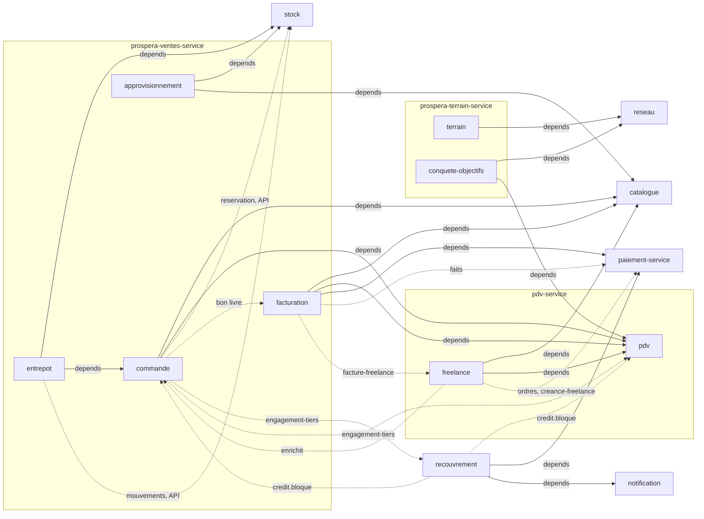
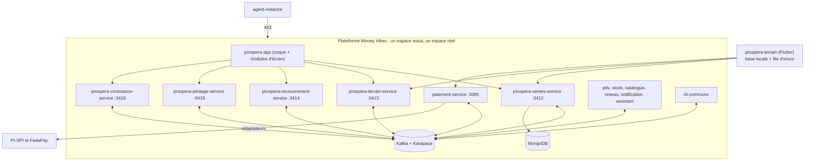

# Architecture Spine — Distributeur

Rédigée en mode rapide le 2026-11-13 à la demande du PO, après le PRD final, comme les spines de la microfinance et de l'assurance, puis corrigée après trois relectures (arbitrages : `arbitrages-relectures-spine.md`). Elle fixe ce que deux unités construites séparément pourraient choisir de façon incompatible. Les raisons sont au `.memlog.md`. `[ADOPTED]` = tranché par le PO, un manifeste ou le code ; `[ASSUMPTION]` = proposé ici, à confirmer. Le client de février est nommé « le distributeur ».

## Design Paradigm

**Un système d'enregistrement modulaire, piloté par des faits.** Ici Prospera tient seul les ventes, le stock, la facture et la Créance du distributeur : aucun logiciel tiers ne fait foi (il quitte Sage ; l'export vers Sage vient après). Chaque objet a **un seul écrivain** ; les autres le lisent par les faits d'état qu'il publie. Les modules sont regroupés **par domaine** dans quelques services, sans import croisé. La Créance est tenue par `paiement` seul. Les modules partagés de la partie 3 sont un **noyau neutre de vertical** : le vocabulaire est une donnée, pas une branche de code.

| Couche | Où | Ce qu'elle tient |
|---|---|---|
| Ventes | `prospera-ventes-service` : modules `commande`, `facturation`, `approvisionnement`, `entrepot` | commandes, bons, factures et séries, achats, préparation et réception |
| Argent | `paiement-service` (existant) | Créances, crédit du tiers, encaissements, ordres, adaptateurs PI-SPI et FedaPay |
| Stock et référentiels | `stock-service`, `catalogue-produits-service`, `pdv-service` (hôte de `freelance`), `reseau-service`, `notification-service` | mouvements et réservations, articles et grilles, points de vente et plafonds, zones et portées, envois |
| Terrain | `prospera-terrain-service` : `terrain`, `conquete-objectifs` | tournées, visites, remises d'espèces, positions, carnet de prospects, objectifs |
| Recouvrement | `prospera-recouvrement-service` : `recouvrement` | dossiers, escalade, promesses, décision de blocage du crédit |
| Pilotage | `prospera-pilotage-service` : `dashboard`, `equipe`, `controle-gestion`, `finance-transactions` | cartes et alertes, indicateurs de poste, budgets, rapprochements |
| Croissance | `prospera-croissance-service` : `marketing`, `studio-social`, `support-client` ; `automatisations` dans `assistant-service` | campagnes, publications, dossiers de support, règles |
| Application mobile | `prospera-terrain` (Flutter) | base locale, file d'envoi, aucune règle métier |
| Écrans | `prospera-app/src/modules/<code>/` | aucune donnée ni règle métier (coque AD-11) |
| IA | IA commune (hébergée par Money Vibes pour le distributeur), `PropositionPort` | règles v0 puis modèles |

## Inherited Invariants

| Inherited | From parent | Binds here |
| --- | --- | --- |
| AD-2, AD-10, AD-15, AD-16 | spine du moteur | un propriétaire par donnée ; Docker Compose, l'agent seul aux commandes ; une organisation, deux espaces (essai, réel) ; sauvegardes orchestrées par l'agent |
| AD-19, AD-38 | spine du moteur | la plateforme Money Vibes est une instance comme les autres sauf sept points (le distributeur y est hébergé) ; effacement du prospect et de l'acheteur hébergé par les routes C13 |
| AD-12, AD-17 | spine du moteur | journal de l'agent ; contrats nommés (la piste d'audit métier reste dans chaque module) |
| AD-24, AD-27 | spine du moteur | la garde lit l'état publié de son espace ; `@confluentinc/kafka-javascript`, Karapace, partition par `organisationId`, dédoublonnage par `eventId`, BACKWARD |
| AD-14, AD-39 | spine du moteur | l'apprentissage ne reçoit que des données préparées ; la calibration du client est intouchable |
| AD-30, AD-40 | spine du moteur | maintenance et version ; supervision par la route `sante` (C13) |
| AD-3, AD-5, AD-13 | spine de la Reprise | la clé d'origine suit l'objet ; les règles restent chez la cible qui simule ; valeurs de contrôle de la cible |
| AD-2, AD-4, AD-5, AD-8 | spine de Connecteurs | un domaine d'échange a un propriétaire ; jamais un total ; file d'envoi acquittée ; en février `domainesEchange: []` |
| AD-1, AD-2, AD-3, AD-4, AD-8, AD-11, AD-17 | spine de `paiement` | aucune détention de fonds ; Créance par upsert idempotent ; ledger en ajout seul ; idempotence arbitrée par la base ; montants en unité mineure ; séparation des pouvoirs au niveau de l'acteur ; `paiement` publie, ne décide pas |
| AD-3, AD-4, AD-6, AD-14 | spine de `stock` | idempotence exigée sur toute écriture de mouvement ; toute quantité `{valeur, unite}` en unité de base ; `dossierId` première classe ; le stock ne réserve jamais de lui-même |
| AD-5, AD-9, AD-10 | spine de `catalogue` / `pdv` / `reseau` | prix freelance dans l'espace de son propriétaire ; révélation au départ ; portée fail-closed |
| AD-3, AD-6, AD-11, AD-16 | spine de la coque | module d'écran par dossier ; droits lus, jamais calculés ; aucun métier dans Next ; contrat d'un emplacement |
| AD-14, AD-17, AD-18, AD-19 | spine de la microfinance | `PropositionPort` ; piste d'audit par module chaînée, 10 ans ; chiffrement par champ et index aveugle (`champs-sensibles`) ; terrain hors ligne : l'appareil propose, le serveur juge |
| Conventions et Stack | spine du moteur | nommage, données, idempotence, erreurs, événements, temps, tests ; Node 24, NestJS 11, Mongoose 8, MongoDB 8.0 |
| C1 → C13 | contrat de module | manifeste, gate, données possédées, emplacements vides, contrats, paramètres, droits, écran, installer et désinstaller, démarrer seul, IA, migrations, installable sous contrôle |

## Invariants & Rules



Trait plein : dépendance dure (`depends`, l'installation est refusée sans elle ; ce sont celles des manifestes, validées par le PO le 2026-11-12). Pointillé : enrichissement par des faits ou par une API nommée (`enrichiPar`, jamais bloquant, emplacement `NON_INSTALLE` si absent). Les modules `equipe`, `finance-transactions`, `marketing`, `controle-gestion`, `dashboard`, `support-client`, `studio-social` et `automatisations` ne sont la dépendance dure de personne ; leurs propres `depends` sont ceux de l'annexe A (`equipe` → `reseau`, `finance-transactions` → `paiement`, `marketing` → `pdv` et `notification`). `dashboard` et `automatisations` lisent des faits sans dépendre de personne. Aucune autre flèche n'est permise.

### AD-1 — Un propriétaire par objet : le tableau des écrivains `[ADOPTED]`

- **Binds:** C3, FR-1, FR-14, FR-19, annexe A
- **Prevents:** deux modules qui écrivent le même objet ; un solde, un stock ou un numéro recopié dans un second module ; un module qui lit la base d'un autre.
- **Rule:** chaque objet a **un seul écrivain**. Les autres le lisent par ses faits d'état (`<module>.<objet>.changed@1`) ou par sa route de lecture, jamais par sa base ; une copie locale est un cache dérivé de ses faits. Une décision (dérogation, blocage, validation) est un objet de son décideur.

| Module (service) | Seul écrivain de | Lit (faits ou route) |
|---|---|---|
| `commande` (ventes) | commandes et lignes (prix société figé), états, demandes de remise et décision, bons de livraison (numéro `BL-`, lignes, état `EN_ATTENTE_RESERVATION`, `EMIS`, `EXPEDIE`, `AVEC_ECART`, `LIVRE`, `ANNULE`), reliquats, dérogations de plafond, engagement non facturé par `(tiers, perimetre)` | articles et grilles, plafond et conditions, disponible, faits d'`entrepot`, Créances et crédit du tiers, blocage |
| `facturation` (ventes) | factures, lignes, **quantité facturée par ligne de bon**, avoirs, proformas, **toutes les séries et leurs compteurs**, relevés de vente pour le compte (`RVC-`), factures et avoirs des freelances (collection séparée, AD-31), PDF figés et leur empreinte, mentions, statuts d'e-facture, liens publics (AD-33), objets de reprise `facture-ouverte` et `suite-numerotation` | bons livrés, Créances (reste dû, balances, vues sans solde propre), grilles, plafonds |
| `approvisionnement` (ventes) | fournisseurs et leur note, règles de réapprovisionnement, commandes fournisseur (cycle `SUGGEREE` à `RECUE`), plafonds de validation, retours fournisseur, dette fournisseurs (dérivée) | alertes et disponible de `stock`, réceptions d'`entrepot`, articles |
| `entrepot` (ventes) | carnet de préparation, vagues, camions et chargement, départs, **confirmation de livraison, une par `livraisonId`** (quantités livrées et refusées), réceptions et litiges, comptages d'inventaire, demandes d'entrée pour retour | commandes validées, points de stock, transferts lancés |
| `stock` (stock-service) | **seul écrivain des mouvements**, réservations, disponible, ajustements validés, transferts exécutés, valorisation, alertes | articles, points de vente, portées |
| `paiement` (paiement-service) | **Créances** (sources `FACTURE`, `RELEVE_VENTE_COMPTE`, `ECHEANCE_DE_PRET`, `PRIME`, clé `(source, sourceId)`, échéance portée), crédit du tiers et imputations (figées), encaissements (dont espèces avec remise de caisse quand `collecte` est absent), liens de paiement, ordres (fournisseurs, versement de commission, remboursement), constat de tenue d'une promesse, compteur d'abonnement | faits de `facturation`, de `freelance`, des verticales |
| `pdv` (pdv-service) | points de vente, affectations et portefeuilles, plafond et sa suspension, conditions de règlement, client comptoir, score de santé déposé | blocage (`recouvrement`), scores (`dashboard`), départ (`reseau`) |
| `freelance` (pdv-service) | statut du freelance, taux et plafond, commissions (`ACQUISE`, `VALIDEE`, `VERSEE`), reversements (suivi du dû), classement séparé | relevés et factures du freelance (`facturation`), Créances du freelance (`paiement`), ordres de versement, commande |
| `catalogue` (catalogue-produits-service) | articles, grilles société, grille « ce client », **prix des freelances** (espace privé), avertissement de marge du freelance, promotions, profils, révélation | départ d'un commercial |
| `reseau` (reseau-service) | nœuds, zones, commerciaux (dont `FREELANCE`), portée | points de vente |
| `terrain` (terrain) | tournées, missions, visites et clôture, positions, remises d'espèces et écarts de caisse, appareils, agenda, relevé de stock en visite | plan lu des modules d'amont, encaissements validés, portée |
| `conquete-objectifs` (terrain) | carnet de prospects, zones blanches, entonnoir, ouvertures, décision de passation, objectifs et quotas | commandes validées, factures émises, points de vente |
| `recouvrement` (recouvrement) | dossiers (un par tiers, par prêt chez l'IMF), escalade, actions, **promesses**, **décision de blocage et de déblocage du crédit**, table unique des seuils de retard et des tranches | Créances, crédit du tiers, engagement (`commande`), dérogations, plafond, réponses de `notification` |
| `equipe` (pilotage) | indicateurs de poste, classements, coaching, matrice des postes, commission des salariés (sur l'encaissé) | faits de `commande`, `facturation`, `terrain`, `reseau` |
| `finance-transactions` (pilotage) | rapprochements, suspens, trésorerie à 7 jours, BFR, état du run de paiement (jamais l'ordre) | encaissements, Créances, commandes fournisseur |
| `controle-gestion` (pilotage) | budgets par axe et versions, atterrissage, prévision, rapports | factures émises, valorisation, zones |
| `dashboard` (pilotage) | définitions de cartes et de KPI, alertes du jour, rapports de direction, règle du score de santé et scores calculés, diagnostics d'article | tous les faits des modules sources (aucune copie des données) |
| `marketing` (croissance) | campagnes, segments (critères, jamais des personnes), combos, résultats et ROI, scoring de leads | points de vente, alertes de stock, blocage, Créances, retours de `notification` |
| `studio-social` (croissance) | publications, messages reçus, boîte unique, propositions d'accroche | alertes de stock, campagnes, dossiers de recouvrement |
| `support-client` (croissance) | dossiers de support, échanges, statuts | points de vente, commandes, factures |
| `automatisations` (assistant-service) | règles (grammaire fermée), niveaux, file d'arbitrage, journal de la nuit | faits des modules sources ; **exécute par les commandes des propriétaires** |
| `notification` (notification-service) | envois, canaux, consentements, modèles, journal d'envoi | demandes des modules |

- Chaque module qui a des **décisions à trancher** (FR-14) en possède les siennes sur le schéma commun (objet, rôle, gravité, échéance, statut, choix) et publie `<module>.decision.changed@1` ; `dashboard` les liste sans les posséder.
- Une règle d'automatisation ne modifie jamais un objet : elle appelle la **commande publique** de son propriétaire, avec ses droits d'auteur de la règle et une clé d'idempotence ; le blocage automatique du crédit est une règle propre de `recouvrement` (AD-9), pas de `automatisations`.

### AD-2 — Cinq services neufs, des hôtes ratifiés, aucun import croisé `[ADOPTED]`

- **Binds:** C1, C2, C3, C10, FR-19
- **Prevents:** quinze services pour deux développeurs ; un module qui ne s'installe plus seul parce qu'il importe le code d'un voisin ; une collection écrite par deux modules ; deux versions d'une même fonction partagée en production.
- **Rule:**
  - Services neufs, un par domaine (ports de dev proposés) : `prospera-ventes-service` 3412 (`commande`, `facturation`, `approvisionnement`, `entrepot`) ; `prospera-terrain-service` 3413 (`terrain`, `conquete-objectifs`) ; `prospera-recouvrement-service` 3414 (`recouvrement` seul : partagé avec la microfinance, qui n'installe pas les autres modules du distributeur) ; `prospera-pilotage-service` 3415 (`dashboard`, `equipe`, `controle-gestion`, `finance-transactions`) ; `prospera-croissance-service` 3416 (`marketing`, `studio-social`, `support-client`). `automatisations` reste porté par `assistant-service` (:3011, manifeste M26).
  - **Ratifié** : `freelance` est hébergé par `pdv-service`, derrière sa gate `FREELANCE_NOT_ENTITLED` et avec ses collections (`freelance_*`) : exception écrite au critère « un agrégat distinct, un service distinct » du contrat (D-24). La Créance est tenue par `paiement-service` ; `facturation` est dans `prospera-ventes-service` et **n'écrit jamais** dans une collection de `paiement`.
  - **Ratifié** : `entrepot` reste dans `prospera-ventes-service`, jamais dans `stock-service` : le stock est le seul écrivain de ses mouvements, un module hôte partage la gate, pas les collections ; l'entrepôt les demande par l'API (AD-8).
  - Dans un service, un module Nest par code, sous `src/modules/<code>/`, **sans import** d'un autre module du service (un test de lint échoue sur tout import croisé) ; collections préfixées par le code (`commande_commandes`, `facturation_factures`), garde `<CODE>_NOT_ENTITLED`, outbox et migrations propres ; un module non activé dort ; `profiles: ["<code>"]` au compose ; une image par service, son `retourArriere` est le plus restrictif de ses modules.
  - Un module peut sortir de son service sans changer de contrat.
  - **Bibliothèques partagées** (`series`, `encours`, `champs-sensibles`) : paquets privés versionnés de `prospera-plateforme`, comme `prospera-adaptateurs` (moteur AD-26) ; chaque manifeste qui en embarque une déclare son **numéro de contrat majeur** ; l'installation est refusée si deux modules d'une organisation déclarent des majeurs différents ; une suite de vecteurs d'or (mêmes entrées, mêmes sorties) est un test de chaque consommateur.
  - **Propriétaire de dépôt** : Dev A et Dev B ne sont jamais dans le même dépôt la même semaine (moteur) ; la table service, propriétaire, semaine de naissance est dans les épics.

### AD-3 — La chaîne de vente : qui écrit quoi, dans quel état `[ADOPTED]`

- **Binds:** FR-30 → FR-41, FR-42, FR-220, D-2, D-10
- **Prevents:** deux écrivains d'un même statut ; une facture avant la livraison ; une sortie de stock sans bon ; une commande validée sans réservation ; un fait de commande qui expose un prix ou l'identité d'un freelance à l'entrepôt.
- **Rule:**
  - États de la commande, écrits par `commande` seul : `BROUILLON`, `TRANSMISE`, `VALIDEE`, `PREPARATION`, `EXPEDIEE`, `LIVREE`, `ANNULEE`. Les transitions sont **une donnée versionnée** ; une transition absente est refusée (`TRANSITION_INTERDITE`). Un commercial transmet, il ne valide pas.
  - **Validation** (commande) : contrôles dans l'ordre crédit bloqué, stock, plafond (AD-9), puis **saga de réservation** (AD-34) ; il n'y a **aucune transaction entre `commande` et `stock`**. Le bon naît `EN_ATTENTE_RESERVATION` ; la commande est `VALIDEE` quand tous ses bons sont `EMIS` (numéro `BL-` attribué à l'émission, un bon par point de stock source).
  - Deux faits distincts : `commande.commande.validee@1` (**sans prix, sans identité de freelance** : lignes et quantités seules ; `entrepot`, `terrain`, `conquete-objectifs`) et `commande.commande.chiffree@1` (montants ; `facturation`, `equipe`, `dashboard`).
  - `entrepot` prépare et expédie : `entrepot.preparation.commencee@1`, `.terminee@1` (quantités servies), `entrepot.expedition.partie@1` (départ du camion : identifiants des bons et des sorties ; `EXPEDIEE` se déduit de lui ; sortie de stock, AD-8), `entrepot.expedition.livree@1` (une **livraison** : AD-29). `entrepot` n'écrit **jamais** un état de commande ni de bon : `commande` les déduit de ces faits et publie `commande.bon-livraison.livre@1`.
  - Un servi inférieur au commandé met le bon `AVEC_ECART` et ouvre un reliquat décidé par un rôle de bureau (`LIVRER_PLUS_TARD` : nouvelle livraison, AD-29 ; ou `ANNULER_LE_RELIQUAT`). L'allocation du matin (06:00, paramètre) ne porte que sur les lignes en attente de stock ; elle ne dé-réserve jamais une ligne réservée.
  - Une commande facturée ne s'annule pas : un avoir (AD-6).
  - Le bon ne porte ni prix, ni marge, ni plafond ; celui d'une vente de freelance est celui de la société (AD-10).

### AD-4 — Rejeu sans effet : une clé par geste, arbitrée par la base `[ADOPTED]`

- **Binds:** NFR-1, NFR-6, FR-1, FR-42, FR-104, FR-109
- **Prevents:** une facture en double sur un deuxième clic ; un encaissement ou une commande compté deux fois après une coupure ; une réservation posée deux fois ; une clé réutilisée qui rend « le premier résultat » pour une autre charge.
- **Rule:**
  - Toute commande d'écriture porte une **clé d'idempotence** (`Idempotency-Key`, `eventId` sur le bus) arbitrée par un **index unique**, jamais par un « lire puis écrire » ; le rejeu rend le premier résultat. Tout consommateur de fait déduplique sur `eventId`.
  - La clé est unique **par organisation et par route**, conservée au moins **90 jours** (ou la vie de l'objet) ; la même clé avec une **empreinte de charge différente** est refusée (409 `CLE_REUTILISEE_AVEC_AUTRE_CHARGE`), jamais « premier résultat ».
  - Clés d'origine par geste : confirmation de livraison = `livraisonId` ; facture d'une livraison = `<livraisonId>:facture` ; facture du freelance = `<livraisonId>:facture-freelance` ; relevé = `<livraisonId>:rvc` ; avoir = `<factureId>:avoir:<demandeId>` ; retour en stock = `<avoirId>:retour` ; réservation = `<bonId>:<ligne>` (modification : `<commandeId>:<version>:<ligne>`) ; sortie de stock = `<bonId>:sortie` ; entrée de réception = `<commandeFournisseurId>:<ligne>:<n° de réception>` ; ordre de versement de commission = `<commissionId>:versement` ; encaissement saisi sur le terrain = clé générée sur l'appareil ; autre objet = `<code>:<objet>:<id>`.
  - Un identifiant d'objet saisi hors ligne est créé **sur l'appareil** (UUID) et reste l'identifiant du serveur.

### AD-5 — Les séries de numérotation : un générateur, une série continue qui reprend Sage `[ADOPTED]`

- **Binds:** FR-43, FR-48, FR-217, FR-224, NFR-1, NFR-3, D-3
- **Prevents:** deux séries pour une même pièce ; un trou ou un doublon sous des saisies simultanées ; un numéro réémis après une restauration ; une série de freelance mêlée à celle de la société ; une série qui ne démarre jamais.
- **Rule:**
  - **Une seule implémentation** de compteur, `prospera-plateforme/series` (bibliothèque, AD-2) : l'incrément (`findOneAndUpdate` avec `$inc`) et l'écriture du document se font **dans la même transaction**. **Le compteur vit dans la base du module propriétaire** (`commande_series`, `facturation_series`), jamais dans une collection partagée. Le numéro est attribué **à l'émission**, jamais au brouillon ; un brouillon abandonné ne crée aucun trou ; un document annulé garde son numéro (une annulation de facture émet un avoir).
  - Chaque série a **un seul module propriétaire**. `facturation` possède toutes les séries de documents fiscaux et commerciaux : facture (une série par organisation, continue d'une année à l'autre, qui **reprend le dernier numéro de Sage**), avoir, proforma, `RVC-AAAA-NNNNNN` (relevé de vente pour le compte), et **une série par freelance émetteur**, dont le préfixe contient l'identifiant du freelance (`F<code>-`), jamais mêlée à celle de la société. `commande` possède la suite des bons `BL-AAAA-NNNNNN`. Aucun autre module ne tire un numéro d'une de ces séries.
  - Format = **paramètre de série** (préfixe, année optionnelle, largeur) saisi à la bascule d'après le dernier numéro Sage ; **le compteur est continu, l'année n'est qu'un préfixe** : il ne repart jamais à 1. Avoir, proforma, `RVC-` et `BL-` suivent la même règle.
  - **Initialisation** : seules les séries qui reprennent Sage exigent `facturation.suite-numerotation@1` (objet de Reprise, valeur de départ posée une fois ; tant qu'elle ne l'est pas, l'émission est refusée `NUMEROTATION_NON_INITIALISEE`). Les séries sans correspondance Sage (`RVC-`, `BL-`, séries de freelance) **démarrent à 0 à leur création** ; la série d'un freelance est créée par `facturation` sur `freelance.freelance.active@1`. Une facture reprise garde son numéro d'origine et n'avance jamais une suite. L'initialisation se fait au **gel de Sage** ; un numéro Sage postérieur au gel bloque le feu vert de `facturation`.
  - Un compteur **ne recule jamais** : `facturation` et `commande` publient la tête de chacune de leurs séries (`facturation.serie.changed@1`, `commande.serie.changed@1`), topic conservé sans expiration ; les numéros de bon figurent dans `commande.bon-livraison.emis@1`. Restauration et perte de numéro : AD-30.

### AD-6 — La facture naît de la livraison, sur les quantités servies `[ADOPTED]`

- **Binds:** FR-36, FR-41, FR-42, FR-46, FR-47, FR-48, FR-58, D-2
- **Prevents:** une facture sur des quantités commandées ; un prix retapé ; une facture modifiée après émission ; un reste dû stocké dans la facture ; une consommation de `livre@1` qui boucle sur une mention manquante.
- **Rule:**
  - `facturation` consomme `commande.bon-livraison.livre@1` et facture **par livraison** (AD-29) : quantités servies de cette livraison, prix figés de la commande, taux de TVA de chaque article ; une quantité refusée à la porte n'est pas facturée. Option d'organisation « facturer dès la validation » : AD-29.
  - La facture est émise (numéro, AD-5) dans la même action que sa création si les mentions légales sont complètes. Sinon (`MENTION_OBLIGATOIRE_MANQUANTE`) : un **brouillon lié à la livraison** (clé tenue), une alerte à un rôle de bureau, l'émission reprend sur correction, **sans numéro consommé** ; le consommateur ne boucle pas.
  - Une facture émise est **figée** : jamais supprimée ni modifiée. Le numéro est attribué dans la transaction ; le PDF est rendu **de façon asynchrone** (état `PDF_EN_ATTENTE`), déterministe, stocké avec son empreinte SHA-256 portée par la facture, conservé 10 ans (paramètre ; liste de travail jusqu'à l'expert-comptable du client) ; l'écran rend la facture en moins d'une seconde (NFR-7) sans attendre le PDF. Une erreur se corrige par un avoir (total ou partiel, numéro propre, au plus le reste à créditer, au-delà de 500 000 XOF validation du DAF).
  - `facturation` ne contient **aucun** champ de reste dû, de montant encaissé ni de statut payé (test de schéma) : `PARTIELLE` et `PAYEE` se déduisent de la Créance lue chez `paiement`. La balance clients et la balance âgée sont des vues qui lisent `paiement.creance.changed@1`, avec les tranches de `recouvrement` (AD-16).
  - Un avoir pour retour de marchandise : AD-29 (l'entrée de stock est demandée par `entrepot`, jamais par `facturation`).
  - Sans `commande`, la facture se saisit à lignes libres (reprise et cas dégradé) ; sans `paiement`, `facturation` ne s'installe pas. L'envoi au client par lien : AD-33.

### AD-7 — La Créance : un registre, tenu par paiement, ouvert par des faits `[ADOPTED]`

- **Binds:** FR-49, FR-111, FR-172, FR-247, FR-248, D-1 ; spine de `paiement` AD-2, AD-3
- **Prevents:** deux restes dus qui se contredisent ; un paiement déjà reçu refusé ; une créance ouverte deux fois ; deux séries qui portent le même numéro et une Créance jamais ouverte ; un solde recopié dans `facturation` ou `recouvrement` ; une échéance recalculée.
- **Rule:**
  - `paiement` est **le seul propriétaire** de la Créance et du crédit du tiers. Une Créance est identifiée par **`(source, sourceId)`** (porté en `referenceExterne = <source>:<sourceId>` par l'upsert idempotent existant sur `(organisationId, moduleAppelant, referenceExterne)`), où `sourceId` est l'**identifiant interne** du document, **jamais son numéro d'affichage**. Ouverture à partir de `facturation.facture.emise@1` (source `FACTURE`, tiers = le point de vente), `facturation.avoir.emis@1` (réduit, ou crée un crédit du tiers au-delà du reste dû), `facturation.facture.reprise@1` (reste dû repris, `origine = REPRISE`), `facturation.releve-vente.emis@1` (source `RELEVE_VENTE_COMPTE`, tiers = le freelance) et, pour le périmètre du freelance, `facturation.facture-freelance.emise@1` (AD-31). Le montant d'origine est figé ; une divergence est une anomalie tracée, jamais un écrasement.
  - `reste_du = montant_origine − avoirs − encaissements imputés`, calculé par `paiement` seul et lu partout (`paiement.creance.changed@1`, état absolu : `montantExigible` **déclaré exclu**, `montantDeclare` à part, **`echeanceLe`**, `perimetre`, `livraisonId`, `lueLe`). Un encaissement **déclaré** (espèces, virement) réduit le reste dû à l'affichage, marqué « déclaré », jusqu'à sa confirmation ; celui qui déclare ne confirme pas ; une relance ne s'arrête que sur un encaissement confirmé.
  - **Un paiement déjà reçu n'est jamais refusé** : l'excédent devient un crédit du tiers (avance, acompte, trop-perçu, avoir sur facture payée), imputé sur la Créance désignée puis sur la plus ancienne échue ; seul un encaissement déclaré au-dessus du reste dû peut être refusé (`PAIEMENT_SUPERIEUR_AU_RESTE_DU`). Rembourser un crédit du tiers est un ordre à deux personnes. **L'imputation est calculée une fois**, rangée avec l'encaissement (`imputations`) ; le rejeu rend le même résultat ; une réimputation est une opération distincte, tracée ; **une imputation ne franchit jamais un périmètre** (AD-31).
  - **Condition de règlement** (comptant, 30, 45, 60 jours) : `pdv` est seul propriétaire de la condition courante ; `facturation` **fige l'échéance dans la facture** à l'émission et la porte dans `facture.emise@1` ; `paiement` la tient sans la recalculer ; un changement de condition ne touche jamais une facture émise. Le mode d'encaissement est de `paiement`, qui ne contient aucun champ de condition de crédit. Une facture sans condition de règlement est refusée (`CONDITIONS_REGLEMENT_MANQUANTES`).
  - La Créance reflète la facture en moins de 5 s ; aucun test ne suppose deux services « au même instant » (AD-9 : la fenêtre se compte deux fois, jamais zéro).
  - Composantes (principal, intérêt, pénalité, frais) : le distributeur n'en utilise qu'une (principal) ; les autres sont prévues pour les verticales (spine de la microfinance AD-6).

### AD-8 — Le stock : réserver par ligne de bon, sortir au départ du camion, le stock seul écrit `[ADOPTED]`

- **Binds:** FR-32, FR-34, FR-36, FR-70, FR-71, FR-74, FR-203, D-10 ; spine de `stock` AD-3, AD-14
- **Prevents:** une survente sur le dernier article ; une sortie écrite par l'entrepôt ; une réservation qui reste après une annulation ou un servi partiel ; un inventaire qui écrase des sorties ; un stock « réservé = 0 » pris pour « rien n'est réservé » ; un retour compté deux fois.
- **Rule:**
  - **Réservation par ligne de bon** (`<bonId>:<ligne>`) : `commande` appelle l'API de réservation de `stock` (synchrone, idempotente, AD-4) sur le point de stock source ; le stock l'accepte ou la refuse (`STOCK_INSUFFISANT`) de façon **atomique** : deux validations sur le dernier stock, une réussit. Le disponible = physique − réservé. Modifier une commande validée = émettre un **delta** (clés `<commandeId>:<version>:<ligne>`) ou un seul appel `stock.reserver(replace)`, jamais annuler puis recréer en deux temps. `stock` publie `stock.disponible.changed@1` et `stock.reservation.changed@1`. Sans `stock`, la validation est refusée (`STOCK_NON_INSTALLE`) : la commande reste `BROUILLON` ou `TRANSMISE`, l'installation de `commande` seule le signale ; un commercial ne voit jamais la quantité, seulement `DISPONIBLE`, `LIMITE` ou `RUPTURE`.
  - **Pas de transaction entre services** : l'enchaînement est la saga d'AD-34.
  - **Sortie** : au départ validé du camion, `entrepot` demande à `stock` un mouvement de sortie (`<bonId>:sortie`) qui **référence les réservations qu'il consomme** ; `stock` tient l'égalité réservé consommé = sorti. Le **non servi est libéré par `stock`** à la confirmation de la livraison (AD-29) ; l'annulation d'une commande ou d'un reliquat libère par la même API ; une réservation n'expire pas seule tant que son bon est vivant (alerte au bout de N jours, paramètre). Test : 100 réservés, 70 sortis, 30 annulés = réservé 0, physique −70.
  - **Entrée** : réception d'`entrepot` (`entrepot.reception.enregistree@1`, **seul** fait de réception, D-22), clé `<commandeFournisseurId>:<ligne>:<n° de réception>` avec ou sans `entrepot` (qui reprend le numéro suivant à son arrivée) ; **retour** : une entrée qui référence la facture ou l'avoir (AD-29).
  - **Inventaire** : `entrepot` publie le comptage et l'écart (`entrepot.inventaire.compte@1`, avec l'heure serveur de gel du point de stock, qui fait foi) ; l'**ajustement est écrit par `stock`** comme un **delta daté** (écart au moment du comptage), les mouvements postérieurs restent ; validation à échelle de droits. **Transfert** : `stock` lance (`stock.transfert.lance@1`), `entrepot` exécute physiquement, `stock` écrit les mouvements.
  - Toute quantité est `{valeur, unite}` en unité de base ; le magasinier ne voit jamais un prix ni une marge.

### AD-9 — L'encours, le plafond, le blocage du crédit : qui calcule, qui bloque `[ADOPTED]`

- **Binds:** FR-13, FR-33, FR-52, FR-119, FR-187, FR-189, D-5, D-21
- **Prevents:** deux formules d'encours ; une facture comptée zéro fois pendant la fenêtre entre commande et Créance ; deux commandes simultanées qui passent toutes deux sous le plafond ; un blocage levé seul ; un seuil de retard dispersé ; un crédit bloqué contourné par une dérogation, ou bloqué par elle ; un tiers confondu avec son freelance.
- **Rule:**
  - `encours = créances ouvertes + commandes validées non facturées − crédit du tiers`. **Une seule fonction pure**, `prospera-plateforme/encours` (bibliothèque épinglée, majeur déclaré, AD-2), **la même partout** : `commande` (qui **juge**), `pdv` (qui **affiche** `plafond − encours = disponible à crédit`) et `recouvrement` (qui **évalue le blocage**). Entrées identiques : `paiement.creance.changed@1`, `paiement.credit-tiers.changed@1`, `commande.engagement-tiers.changed@1` (TTC restant à facturer par `(tiers, perimetre)`, publié par `commande`, porte la version de la fonction). Une entrée d'un module non installé (l'IMF n'a pas `commande`) est déclarée `ABSENTE` : comptée zéro **et dite** dans la provenance, jamais un zéro muet. Test : même entrée, même encours dans les trois modules.
  - **L'engagement d'une commande ne baisse qu'à la réception du fait de Créance de la facture correspondante** (jamais avant) ; pendant la fenêtre on compte **deux fois** (plus prudent), jamais zéro fois. Un avoir ou l'annulation d'un reliquat le baisse aussi, sur son fait. Test : plafond 1 000 000, deux commandes de 600 000 avec une facture émise entre elles : même résultat quel que soit l'ordre d'arrivée des faits.
  - **Jugement** : `commande` valide sous un **verrou par tiers** (le jugement et l'incrément de l'engagement sont atomiques) ; plafond 1 000 000, deux validations de 600 000 simultanées : une réussit, l'autre reçoit `PLAFOND_CREDIT_DEPASSE`. Le plafond lu est celui de `pdv` (`pdv.plafond.changed@1`) ; sans plafond propre, `max(400 000, 0,6 × CA mensuel)` (paramètre) ; le client comptoir est au comptant. La commande d'un freelance engage **le freelance** (périmètre société, son dû, AD-10) et ne compte jamais sur le détaillant.
  - **Blocage** : `recouvrement` seul le pose et le lève, **automatiquement** (créance échue au-delà du seuil de la table de `recouvrement`, ou encours au-dessus du plafond par la fonction ci-dessus) ou à la main avec motif ; le déblocage n'est **jamais automatique** et relève du droit `recouvrement:credit:debloquer` (DAF par défaut, réglable par verticale). Fait `recouvrement.credit.bloque@1` / `.debloque@1`, **porte `{tiersId, portee, engagementId}`** (`portee` = `TIERS` ou `ENGAGEMENT`, un consommateur n'agit que sur la portée qui le concerne), code de refus neutre `CREDIT_BLOQUE`. `pdv` écrit la suspension du plafond sur ce fait et l'affiche ; `commande` refuse en premier.
  - **Dérogation** : droit propre `commande:plafond:deroger` (DG et DAF par défaut), pour **une** commande, avec motif, tracée (qui, quand, montant) ; celui qui valide n'est pas celui qui déroge ; elle ne lève jamais un crédit bloqué et ne change pas le plafond du client. `commande.derogation.accordee@1` est lu par `recouvrement`, qui **exclut le montant dérogé** de son évaluation tant que la commande n'est pas facturée.
  - Une commande déjà validée n'est pas annulée par un blocage ; sa réservation reste ; une alerte part au-delà de N jours (paramètre) ; la préparation est suspendue.
  - Les seuils de retard (rappel J+1, alerte direction J+30, blocage) forment **une table de `recouvrement`** (AD-12) ; aucun autre module n'a de seuil de retard propre.

### AD-10 — Le freelance : vente pour le compte, deux prix, étanchéité par construction `[ADOPTED]`

- **Binds:** FR-8, FR-93 → FR-99, FR-224, NFR-4, D-4, D-24
- **Prevents:** un prix ou une marge de freelance lisible par la société ; une facture de freelance dans une balance de la société ; un freelance qui « achète » du stock ; une fuite par un export, un indicateur ou un fait du bus.
- **Rule:**
  - La vente d'un freelance est une **commande de la société** (champ `freelance`, lignes au prix société), servie par le stock de la société ; le stock reste à la société jusqu'à la livraison au détaillant. Il n'existe aucune commande du freelance à la société.
  - **Deux prix, deux propriétaires** : le prix société est de `catalogue` (grille intouchable, `GRILLE_SOCIETE_NON_MODIFIABLE`) et figure sur la commande, le `RVC-` (le bon n'a pas de prix) ; le **prix freelance** est de `catalogue` (espace privé, visible du freelance seul) et ne figure que sur **sa facture**, dans `facturation`, espace du freelance ; le lien ligne à ligne vit dans cet espace. `freelance` ne porte aucun champ de prix ou de marge. L'**avertissement de marge minimale** est calculé par `catalogue` (seul à voir les deux prix) et rendu au freelance seul ; `commande.commande.validee@1` n'en porte rien.
  - **Étanchéité** : tout montant au prix freelance ne circule que sur les topics et dans l'espace définis par AD-31 ; `facturation.facture.emise@1`, `.avoir.emis@1`, `.serie.changed@1` et `paiement.creance.changed@1` ne portent **jamais** une pièce au prix freelance.
  - Le crédit du freelance (plafond propre, dû échu au-delà du seuil de `recouvrement`) est jugé comme celui de tout client (AD-9). Le freelance **doit le prix société même si son détaillant ne paie pas** ; un détaillant impayé ne réduit ni son dû ni sa commission. Un avoir de la société sur le relevé (retour confirmé au stock) réduit le dû et la commission ; un avoir du freelance à son détaillant ne change ni l'un ni l'autre.
  - Un freelance n'existe que si `freelance` est installé ; sans lui, le type `FREELANCE` n'est pas proposé et les données affichent « non installé ».

### AD-11 — Relevé de vente pour le compte, commission, compensation `[ADOPTED]`

- **Binds:** FR-96, FR-98, FR-99, D-4, D-15, D-24 ; amendement `paiement` du 2026-11-13 §4
- **Prevents:** un dû ouvert sans pièce ; une commission calculée sur le prix du freelance ou sur le TTC ; deux bases pour une même vente ; deux modules qui versent la commission ; une compensation silencieuse.
- **Rule:**
  - À la livraison confirmée (AD-29), `facturation` émet **deux pièces** des mêmes quantités livrées : la facture du freelance (AD-10, AD-31) et le **relevé `RVC-`** de la société (prix société, HT, TVA, TTC). Fait `facturation.releve-vente.emis@1` ; `paiement` ouvre la Créance (source `RELEVE_VENTE_COMPTE`, tiers = le freelance, périmètre société).
  - **Base de toute commission = HT au prix société de la ligne livrée** : `freelance` acquiert `taux × HT` sur `releve-vente.emis@1` ; pour un salarié (`equipe`), proportionnelle à l'encaissé : `HT de la facture × part encaissée`, jamais le TTC. Un avoir de la société sur un `RVC-` porte le HT crédité par ligne et n'est émis qu'à la confirmation du retour au stock ; la commission baisse de `taux × HT crédité`, un seul arrondi par avoir (AD-22) ; `freelance` ne lit **jamais** l'avoir du freelance (famille d'AD-31).
  - Cycle : `ACQUISE` → `VALIDEE` (DAF, dans `freelance`) → `VERSEE` par un **ordre de versement** de `paiement` (préparé par un acteur, validé par un autre) ; `freelance` passe `VERSEE` sur `paiement.ordre-versement.changed@1` (`EXECUTE`).
  - Le versement de la commission et le règlement du dû sont deux mouvements ; une **compensation** est une décision du DAF (objet de `freelance`, tracée), qui produit un encaissement imputé sur le dû et un ordre de versement de même montant, par les commandes de `paiement`, jamais une écriture directe.

### AD-12 — Les garde-fous : des paramètres par organisation, figés à l'acte `[ADOPTED]`

- **Binds:** FR-13, FR-14, FR-63, FR-64, FR-79, C6
- **Prevents:** un seuil codé en dur ; un garde-fou affiché sans bloquer ; une règle appliquée à une commande avec un seuil qui a changé depuis ; deux écrans qui lisent deux valeurs.
- **Rule:**
  - Chaque garde-fou est un **paramètre versionné** du module qui l'applique (`<code>_parametres`, date d'effet, auteur) avec la valeur de la démo par défaut ; un **seul propriétaire** par paramètre : plafond et plafond de première commande (`pdv` ; le seuil de 1,5 M : `conquete-objectifs`), seuil de remise (`commande`), plafonds de validation d'achat et plancher de trésorerie (`approvisionnement`, saisi en février), seuils de retard et tranches (`recouvrement`), géofencing et distances (`terrain`, `conquete-objectifs`). Changer un seuil est réservé à `DIST_ADMIN` et au DG, tracé.
  - Un garde-fou **bloque** par un refus nommé qui porte le seuil et le moyen de le lever ; l'exception unique est la marge minimale du freelance, qui avertit. Une commande, une commande fournisseur ou un dossier enregistre la `parametresVersion` qu'il a utilisée ; une règle appliquée plus tard lit **cette** version.
  - Chaque dérogation est un objet du module qui la décide (qui, quand, combien, pourquoi). Un acteur ne cumule pas préparation et validation d'un même ordre (séparation au niveau de la personne, vérifiée par le serveur dans la commande ; refus `SEPARATION_DES_TACHES`, `SEPARATION_POUVOIRS_VIOLEE` côté `paiement`, traités comme une famille par le front).

### AD-13 — Le terrain hors ligne : l'appareil propose, le serveur juge `[ADOPTED]`

- **Binds:** FR-20, FR-100 → FR-110, FR-173, FR-174, NFR-6, NFR-7 ; décision D4 (Flutter)
- **Prevents:** un doublon à la synchronisation ; un encaissement perdu avec un téléphone ; une décision prise hors ligne ; une commande validée sur un stock devenu nul ; deux files d'envoi qui ne s'ordonnent pas ; un prix vu différent du prix facturé sans que personne ne le sache ; une file bloquée à l'infini.
- **Rule:**
  - **Une seule application** `prospera-terrain` (même binaire) pour toutes les verticales : la table des routes de synchronisation, l'ordre d'envoi, la politique d'appareil perdu et les objets optionnels sont **une donnée de la verticale**, chargée à l'ouverture de session. Elle tient une **base locale** (consultation du plan, des tiers, du catalogue et des états de disponibilité) et une **file d'envoi** persistante : visites clôturées, commandes, encaissements, confirmations de livraison, remises, relevés de stock. Chaque élément porte un identifiant créé sur l'appareil, une clé d'idempotence (AD-4), son parent éventuel et son état local (`A_ENVOYER`, `ENVOYE`, `CONFIRME`, `REFUSE` avec le motif du serveur).
  - **Aucune décision** hors ligne : la commande prise en visite est `TRANSMISE`, jugée à sa validation (AD-9, AD-34) ; le serveur valide ou refuse chaque élément et **horodate à la réception** ; l'heure de l'appareil est une trace (« heure déclarée »), jamais un contrôle d'ordre ou de délai.
  - **Prix** : le prix d'une ligne est **celui du serveur à la validation** ; l'appareil envoie la `grilleVersion` affichée ; périmée, la commande reste `TRANSMISE` avec l'écart `PRIX_CHANGE` et la validation demande la confirmation du prix, jamais un refus silencieux. Un brouillon porte `(visiteId, pdvId, rangDuBrouillon)` ; deux commandes `TRANSMISE` identiques (même visite, même point de vente, mêmes lignes) dans une fenêtre paramétrée sont refusées `COMMANDE_PROBABLEMENT_DOUBLE` (passage par un rôle).
  - **Chaque service reçoit ses éléments par sa propre route** : commandes → `commande`, confirmations de livraison → `entrepot` (clé `livraisonId`, AD-29), encaissements d'espèces → **`collecte` si le module est installé (IMF), sinon `paiement`** (encaissement d'espèces avec remise de caisse, distributeur), visites, remises, positions et relevés → `terrain`. **Un seul ordre d'envoi** : une file par objet, dans l'ordre de création ; un élément dont le parent est inconnu rend `PARENT_INCONNU` (réessayable) et passe `REFUSE` après N jours (paramètre) ; un échec n'invalide que son élément ; la file reprend après coupure sans perte ni doublon.
  - **Conflits** : le serveur est seul juge ; une visite clôturée deux fois, une seule retenue ; un encaissement dont la clé existe renvoie l'existant ; une commande sur stock nul est refusée ou validée en partie à la validation.
  - Les encaissements en espèces ou virement saisis sont « déclarés » : le déclarant ne confirme pas ; la remise d'espèces (`terrain.remise.*`, qui n'existe que si `paiement` est la voie d'encaissement des espèces) est un objet de `terrain`, son rapprochement valide les encaissements chez `paiement` ; l'écart se calcule **toujours sur les encaissements déclarés** de la tournée (le rapprochement ne change que leur statut) ; jamais estimé (« remise non saisie » plutôt que 0).
  - **Appareil perdu** : jeton révoqué, application verrouillée ; politique de la file = réglage de verticale `politiqueAppareilPerdu` : `TRANSMETTRE_PUIS_EFFACER` pour le distributeur (au contact suivant l'application transmet d'abord sa file, puis efface sa base ; sans contact, export par le superviseur avec confirmation) ; `QUARANTAINE` (`A_ARBITRER`) pour l'IMF (spine de la microfinance AD-19). Dans les deux cas rien n'est perdu ni accepté en silence, et les encaissements non transmis sont signalés au superviseur.
  - Base locale chiffrée au repos (Stack), jeton dans le stockage sécurisé de l'appareil ; nouvelle authentification après 14 jours sans contact (paramètre) ; un appareil par compte. Les positions de l'agent se conservent 90 jours glissants puis sont purgées ; une visite faite en mode démonstration est marquée et ne se mélange pas aux positions réelles.

### AD-14 — Le client d'API généré, la version d'API, la distribution `[ASSUMPTION]`

- **Binds:** FR-20, FR-109, NFR-7 ; spine de la coque AD-15
- **Prevents:** un client Dart écrit à la main qui diverge du serveur ; un serveur mis à jour qui casse une file d'envoi pleine ; une application qui ne se met pas à jour ; une file perdue pendant un blocage de version.
- **Rule:**
  - Le client d'API de `prospera-terrain` est **généré depuis l'OpenAPI publié** de chaque service (`prospera-plateforme/contrats/openapi/`), jamais écrit à la main, par le générateur de la Stack ; la version du contrat est épinglée au build, la génération s'exécute dans le build et un test compare la sortie au contrat.
  - Les routes de synchronisation sont sous `/api/v1/` et **additives** : un champ ajouté est optionnel, un champ retiré passe par `/api/v2/` servi **en même temps** pendant la fenêtre de retour arrière (7 jours, C12). L'application envoie sa version (`X-Client-Version`) ; un client plus ancien que le minimum du serveur reçoit `CLIENT_TROP_ANCIEN` et **conserve sa file intacte**, qui part à la mise à jour ; le serveur n'efface jamais un élément qu'il ne comprend pas, il le refuse avec son motif.
  - **Distribution** : en février, Android seul (iOS au Deferred) ; l'application se distribue par un **lien d'installation** sans boutique d'entreprise et **se met à jour par le même lien** sans boutique ; elle démarre en moins de 5 s sur un Android à 2 Go, en 3G coupée.

### AD-15 — Un noyau neutre de vertical : le vocabulaire est une donnée `[ADOPTED]`

- **Binds:** FR-100 → FR-179, §6 du PRD (règle de la partie, §6.0)
- **Prevents:** un test « si distributeur » dans un module partagé ; un second module de recouvrement ou de terrain pour une autre verticale ; un mot de vertical codé dans un refus ; un noyau qui oblige l'IMF et l'assurance à le rouvrir ; un fait du noyau que l'une des verticales ne sait pas lire.
- **Rule:**
  - Les modules `terrain`, `recouvrement`, `equipe`, `finance-transactions`, `marketing`, `controle-gestion`, `automatisations`, `dashboard`, `support-client` sont **un code, un service, un contrat** pour toutes les verticales. Les objets sont neutres : **tiers** (point de vente, membre, assuré), **agent de terrain**, **source de créance**, **engagement**. Les faits du noyau sont **l'union** de ce que chaque verticale y publie ; un schéma, un seul Karapace de plateforme (BACKWARD).
  - Le **vocabulaire** par verticale (libellés d'écran, de PDF et de message) est une donnée de l'organisation, livrée en fichiers `prospera-plateforme/vocabulaires/<verticale>.json` (distributeur, IMF, assurance) et lue par chaque module ; un test change le tableau d'une organisation et vérifie que **seuls les libellés** changent. Les **codes de refus** du noyau sont neutres (`CREDIT_BLOQUE`, `DISPONIBILITE_INCONNUE`) ; le libellé affiché vient du vocabulaire.
  - Les **écarts de verticale** sont des réglages de l'organisation (`<code>_parametres`) : statuts du dossier de recouvrement, dossier par tiers ou par prêt, `sourceDuRetard` (`CREANCE` ou `RISQUE_PAR`), `politiqueAppareilPerdu`, table des routes et ordre d'envoi du terrain, tranches de la balance âgée. Une verticale installe un module du noyau et le règle ; elle ne le copie pas. Test : l'IMF et le distributeur sur le même binaire du terrain.
  - Les cinq capacités du noyau (Créance à composantes, PAR sur l'encours entier, épargne et dépôts, tiers collectif, blocage porté par le noyau) sont des **contrats réservés, non implémentés ici** ; propriétaire : la spine de la microfinance. Le distributeur n'utilise que la composante principal et le blocage ; ce que la microfinance et l'assurance ont déjà fixé s'y applique sans les contredire (spines IMF AD-19, AD-20 ; assurance).

### AD-16 — Le recouvrement partagé : un service, la Créance lue, les décisions publiées `[ADOPTED]`

- **Binds:** FR-111 → FR-121, FR-211, A.9 ; spine de la microfinance AD-20
- **Prevents:** un second module de recouvrement ; un dossier qui recalcule un reste dû ; un blocage qui dépend de `pdv` ; une promesse écrite par deux modules ; deux calculs de jours de retard.
- **Rule:**
  - `recouvrement` vit seul dans `prospera-recouvrement-service`, installé par le distributeur et par l'IMF ; il **lit** `paiement.creance.changed@1`, `paiement.credit-tiers.changed@1` et, pour l'encours, `commande.engagement-tiers.changed@1` (AD-9) ; il ne stocke aucun solde. La table des seuils et des **tranches** de la balance âgée (cinq, paramétrables) est de `recouvrement` seul ; `facturation` et `dashboard` l'appliquent par sa route de lecture.
  - **Jours de retard** : réglage de verticale `sourceDuRetard` ; pour le distributeur, `recouvrement` les calcule depuis `echeanceLe` du fait de Créance (AD-7) ; pour l'IMF il les lit de `risque-par` (spine IMF AD-6, inchangé).
  - Un dossier s'ouvre seul quand une Créance passe le premier palier de l'échelle ; un tiers a au plus un dossier ouvert (un par prêt chez l'IMF, réglage de verticale) ; son journal est en ajout seul, une annulation est un événement. Seul le DAF abandonne une créance. L'abandon, le blocage et le déblocage sont des **décisions** publiées (AD-9).
  - **Promesses** : `recouvrement` écrit la promesse (comme dans la spine microfinance) ; la tenue est **constatée** par `paiement` (`paiement.promesse.constatee`) ; le module `promesses` déjà codé dans `paiement` est **migré** vers `recouvrement` (tâche d'épic, sans perte), pas ratifié.
  - Une relance part par `notification` (WhatsApp, repli SMS), s'arrête à l'encaissement confirmé ; un client en défaut ou au crédit bloqué est exclu des campagnes par `marketing`, qui lit le blocage.
  - La verticale alimente les sources par `enrichiPar` (`facturation` pour `FACTURE`, `credit` pour `ECHEANCE_DE_PRET`, `commande` pour l'engagement) : un module source absent ouvre aucune Créance « fantôme ».

### AD-17 — Les paiements : PI-SPI ET FedaPay, deux adaptateurs derrière un port `[ADOPTED]`

- **Binds:** FR-24, FR-104, FR-205 → FR-210 ; décision du PO du 2026-11-12 ; spine de `paiement` AD-5, AD-6
- **Prevents:** un encaissement réduit à PI-SPI ; un module du distributeur qui appelle un fournisseur ; un libellé « Mobile Money » ou « module PI-SPI » à l'écran ; un paiement réel dans l'essai ; un doublon fournisseur pris pour un second paiement.
- **Rule:**
  - Les moyens sont **PI-SPI** (adaptateur `API_BUSINESS`) **et FedaPay** (adaptateur `fedapay`), plus espèces et virement déclarés, tous derrière le port `PaymentProvider` de `paiement-service` ; le routage par pays, devise et méthode est de `paiement` ; désactiver l'un laisse l'autre actif, sans déploiement. Aucun module du distributeur n'appelle un fournisseur : il demande un lien ou un ordre à `paiement`. Aucune idempotence fournisseur n'est supposée : la déduplication est faite par `paiement` ; le webhook FedaPay est vérifié par sa signature, secret par mode.
  - Écran : le libellé est « Encaissements » et « Paiement mobile » ; un lien de paiement (30 jours par défaut, 90 au plus) est émis depuis une facture ou un dossier, partagé par `notification`, ses frais sont une politique du créancier figée à l'émission ; le montant imputé est le montant dû, jamais le total frais compris.
  - Les ordres sortants (fournisseurs, versement de commission, remboursement d'un crédit du tiers) : préparés et validés par deux droits et deux personnes ; un ordre sans raccordement reste « en attente de raccordement » ; sa clé d'idempotence est celle de l'ordre ; un ordre rejeté est terminal.
  - **Essai** : la sortie réelle est **interceptée d'abord** (AD-25, C13) ; tout paiement d'essai porte la mention « test » (écran, PDF) ; le mode de test d'un fournisseur n'est utilisé que s'il est vérifié ; un essai n'encaisse jamais un paiement réel, une production jamais un paiement de test.

### AD-18 — Les boutons « bientôt » : un état de la coque, pas un comportement du module `[ADOPTED]`

- **Binds:** FR-2, FR-19 ; spine de la coque AD-7, AD-16
- **Prevents:** un bouton qui simule un effet ; une date promise ; un module qui oublie d'étiqueter un bouton inactif ; un emplacement vide pris pour un zéro.
- **Rule:**
  - Un module d'écran déclare chaque action dans son `ecran.ts` avec un état **`BRANCHE` ou `BIENTOT`** et l'exigence qui la branche ; un bouton `BIENTOT` rend « bientôt », **sans date**, ne fait rien d'autre qu'expliquer ce qu'il fera, et ne déclenche **aucun appel serveur**. Un test parcourt chaque écran et échoue si un bouton n'est ni branché ni `BIENTOT` ; l'inventaire des boutons (écran, libellé, état) est généré des descripteurs.
  - Ne sont jamais `BIENTOT` : l'envoi de la facture par WhatsApp et l'application terrain hors ligne (parcours n° 1).
  - Un emplacement dont le module contributeur n'est pas installé rend `<EmplacementVide raison>` (« non installé »), jamais 0 ; une donnée absente s'affiche « non disponible ».

### AD-19 — L'IA commune : `PropositionPort`, règle avant modèle, provenance toujours `[ADOPTED]`

- **Binds:** FR-16, FR-184, C11 ; spine de la microfinance AD-14, AD-25
- **Prevents:** un module qui code son score ; une prédiction sans provenance ; une règle déterministe appelée « IA » ; une décision prise par l'IA ; une donnée nominative sortie ; des variables libres dans une demande.
- **Rule:**
  - Les modules du distributeur (recommandation de panier, détection d'erreur de commande, probabilité d'acceptation d'une proforma, probabilité de recouvrement, quantité de réapprovisionnement, score de santé d'un point de vente, prévision, accroches) demandent une **Proposition** par le port `PropositionPort` de la microfinance (même contrat, même instance de l'IA commune) ; le service porteur reste à cadrer (Deferred). Les règles de la microfinance s'appliquent : paramètres du score portés par la demande, **liste fermée de variables autorisées**, consentement avant tout export d'écarts, amendements de la spine de l'assistant (IMF AD-25) si elle porte l'instance.
  - Toute prédiction affichée porte sa **provenance** : `origine` (`REGLE` ou `MODELE`), version, date, facteurs ; une règle déterministe s'appelle « règle ». Une prédiction sans provenance ne s'affiche pas. Le score de santé est une règle de `dashboard`, déposée dans `pdv` avec sa provenance.
  - Le décideur est un humain ; le scoring de crédit est une aide qui n'accorde ni ne refuse seul (le plafond de crédit n'est pas négociable par l'IA). Un chiffre financier affiché ne vient jamais d'un modèle. Le prix et la marge d'un freelance ne sont jamais une entrée d'une Proposition de la société.
  - Sans IA commune, l'emplacement rend `NON_INSTALLE` et le processus continue (relances par règle de base, Copilot « bientôt »). Les écarts prédiction / réalité n'en sortent que préparés sur l'instance (moteur AD-14).

### AD-20 — Un seul catalogue de contrats nommés `[ASSUMPTION]`

- **Binds:** C5 de chaque module, annexe A
- **Prevents:** un module qui publie `x` pendant que son voisin écoute `y` ; un fait de décision lu à la place d'un fait d'état ; une charge de fait qui porte ce qu'elle ne doit pas.
- **Rule:** le tableau ci-dessous **complète et corrige** les C5 des manifestes ; les faits marqués « nouveau » sont à ajouter aux manifestes par la série de PR d'AD-27. Graphie `domaine.objet.fait@version`, au passé ; `.changed` pour un état absolu ; les faits déjà codés de `paiement` gardent leur graphie sans `@1`. Chaque fait porte `organisationId`, un identifiant stable d'objet et un `rang`. Un nom absent du tableau ne se publie ni ne se consomme, **sauf** les faits que les spines du moteur, de la microfinance et de l'assurance fixent pour leurs modules (par exemple `recouvrement.plan-etalement.decide@1`, `.contentieux.transfere@1`, `.perte.decidee@1`, `paiement.abonnement.impayee`, `.regularise`, `reprise.feu-vert.changed`), qui font foi.

| Publieur | Faits publiés (consommateurs principaux) |
|---|---|
| `commande` | `commande.commande.validee@1` (nouvelle charge : sans prix ni identité de freelance ; `entrepot`, `terrain`, `equipe`, `conquete-objectifs`), `commande.commande.chiffree@1` (nouveau : montants ; `facturation` en option, `equipe`, `dashboard`), `.annulee@1`, `.changed@1`, `commande.remise.decidee@1`, `commande.bon-livraison.emis@1` (numéros de bon), `commande.bon-livraison.livre@1` (`livraisonId` et quantités de cette livraison ; `facturation`), `commande.engagement-tiers.changed@1` (nouveau : `(tiers, perimetre)`, version de `encours` ; `pdv`, `recouvrement`), `commande.derogation.accordee@1` (nouveau : `recouvrement`), `commande.serie.changed@1` (nouveau : tête de la suite des bons), `commande.decision.changed@1` |
| `facturation` | `facturation.facture.emise@1` (`paiement` ; `conquete-objectifs`, `equipe`, `controle-gestion`, `dashboard` ; porte `echeanceLe`, `commandeId`, `livraisonId` ; **jamais une facture de freelance**), `facturation.facture-freelance.emise@1` (nouveau : famille freelance, AD-31 : `paiement`, `freelance`), `facturation.avoir-freelance.emis@1` et `facturation.serie-freelance.changed@1` (nouveaux : famille freelance), `facturation.releve-vente.emis@1` (nouveau : `paiement`, `freelance`), `facturation.avoir.emis@1` (société et `RVC-`, HT crédité par ligne), `facturation.facture.reprise@1`, `facturation.facture.changed@1`, `facturation.proforma.changed@1`, `facturation.serie.changed@1` (nouveau : tête de série, AD-5) |
| `approvisionnement` | `approvisionnement.commande-fournisseur.changed@1`, `approvisionnement.fournisseur.changed@1`, `approvisionnement.escalade.demandee@1`, `approvisionnement.retour.changed@1` |
| `entrepot` | `entrepot.preparation.commencee@1`, `.terminee@1`, `entrepot.expedition.partie@1` (nouveau : bons et sorties), `entrepot.expedition.livree@1` (`livraisonId`), `entrepot.reception.enregistree@1` (seul fait de réception), `entrepot.litige.ouvert@1`, `entrepot.inventaire.compte@1` |
| `stock` | `stock.disponible.changed@1`, `stock.mouvement.enregistre@1`, `stock.alerte.changed@1`, `stock.point-de-stock.changed@1`, `stock.transfert.lance@1`, `stock.liquidation.lancee@1`, `stock.valorisation.publiee@1`, `stock.reservation.changed@1` (nouveau) |
| `paiement` | faits déjà codés (`paiement.creance.materialisee`, `.soldee`, `.cloturee`, `paiement.encaissement.valide`, `.declare`, `.constate`, `.annule`, `paiement.promesse.constatee`) ; `paiement.creance.changed@1` (porte `echeanceLe`, `montantExigible`, `montantDeclare`, `perimetre`, `livraisonId`), `paiement.credit-tiers.changed@1`, `paiement.encaissement.changed@1`, `paiement.ordre-versement.changed@1` ; famille freelance (nouveaux, AD-31) : `paiement.creance-freelance.changed@1`, `paiement.encaissement-freelance.changed@1` |
| `pdv` | `pdv.point-de-vente.changed@1`, `pdv.affectation.changed@1`, `pdv.plafond.changed@1`, `pdv.commercial.parti@1` |
| `freelance` | `freelance.freelance.active@1` (compteur d'abonnement ; `facturation` crée la série), `freelance.commission.acquise@1` (base : HT au prix société, jamais le prix freelance) |
| `catalogue`, `reseau`, `notification` | faits de leurs manifestes (`catalogue.grille.publiee@1`, `reseau.portee.changed@1`, `reseau.commercial.changed@1`, `notification.reponse.recue`, `notification.envoi.delivre`) |
| `terrain` | `terrain.visite.changed@1` (porte `visitePar`), `terrain.visite.cloturee@1`, `terrain.remise.declaree@1`, `terrain.position.changed@1`, `terrain.releve-stock.saisi@1` |
| `conquete-objectifs` | `conquete-objectifs.prospect.changed@1`, `.passation.effectuee@1`, `.objectif.changed@1` |
| `recouvrement` | `recouvrement.dossier.changed@1`, `recouvrement.credit.bloque@1`, `.debloque@1` (portent `portee`, AD-9), `recouvrement.promesse.changed@1`, `recouvrement.alerte-direction.emise@1` |
| `pilotage`, `croissance` | `dashboard.rapport.genere@1`, `dashboard.score-pdv.calcule@1`, `dashboard.article.diagnostic@1`, `equipe.coaching.changed@1`, `controle-gestion.rapport.envoye@1`, `.budget.fige@1`, `finance-transactions.tresorerie.changed@1`, `.rapprochement.effectue@1`, `marketing.campagne.changed@1`, `.combo.valide@1`, `studio-social.publication.changed@1`, `.message.recu@1`, `support-client.dossier.changed@1`, `automatisations.regle.changed@1`, `.cible.decidee@1` |

Tous les modules publient aussi `instance.journal@1` (actes de configuration, export, effacement ; **aucun prix freelance**) et consomment `etat-publie.changed.essai@1` / `.reel@1` de leur espace. Les faits de décision (`<module>.decision.changed@1`) sont lus par `dashboard` seul. Les faits des analyses d'IA ne sont pas des faits de module : ce sont des Propositions (AD-19). Les trois grammaires déclaratives (KPI de `dashboard`, segments de `marketing`, règles d'`automatisations`) ont chacune leur propriétaire et leur grammaire fermée ; aucune n'est partagée.

### AD-21 — La piste d'audit : par module, en ajout seul, chaînée `[ADOPTED]`

- **Binds:** FR-3, FR-14, NFR-1, NFR-5, NFR-10 ; spine de la microfinance AD-17
- **Prevents:** une trace modifiable ; un journal qui oublie l'argent, le stock ou un garde-fou ; deux formats de trace ; un prix de freelance lisible dans l'audit de la société.
- **Rule:** chaque module tient `<code>_audit` en **ajout seul** : acteur, rôle, objet, état avant, état après, motif, date, empreinte de l'entrée précédente. Toute action sur l'argent, le stock, un garde-fou, une décision, une dérogation, un blocage, un numéro est tracée. La piste d'une pièce de freelance vit dans **la piste du freelance** (AD-31), visible des seuls rôles qui y ont droit. L'empreinte de tête de chaque piste, et la tête de chaque série (AD-5), avec leur `epoque`, sont remises chaque jour à l'agent, qui les joint à sa vérification quotidienne ; elles ne portent ni identité ni contenu. Conservation : 10 ans pour les factures, avoirs et leur trace ; positions GPS 90 jours.

### AD-22 — Montants, quantités, TVA, temps `[ADOPTED]`

- **Binds:** NFR-2, NFR-8, FR-11, FR-45
- **Prevents:** un arrondi différent d'un module à l'autre ; un taux de TVA codé en dur ; une quantité sans unité ; une date sans fuseau.
- **Rule:**
  - Tout montant est un entier d'unité mineure avec sa devise (XOF : 1 FCFA, sans décimale) ; aucun flottant n'est stocké. La TVA se calcule **par taux sur le total HT** de la pièce, un seul arrondi par taux, à l'unité ; la même règle sert la facture, l'avoir, la proforma et le `RVC-` ; le taux vient du référentiel fiscal du pays (18 % au Togo), jamais du code.
  - Toute quantité est `{valeur, unite}` et persistée en unité de base ; l'affichage convertit.
  - Les dates sont stockées en UTC et rendues au fuseau `Africa/Lome` (jj/mm/aaaa, « 35 000 F ») ; tout module lit le temps par le port `Horloge`, piloté dans l'espace d'essai ; l'ordre et les délais d'un élément du terrain se jugent sur l'heure du serveur (AD-13).

### AD-23 — Portée, droits et données privées : appliqués par le serveur, partout `[ADOPTED]`

- **Binds:** FR-4 → FR-8, annexe B, NFR-4 ; spine de `reseau` AD-6, de la coque AD-6
- **Prevents:** un filtre vide qui retombe sur « toute l'organisation » ; une adresse saisie à la main qui rend un écran ; une rémunération lisible par un superviseur ; un magasinier qui voit un prix.
- **Rule:**
  - La portée (région, zone, portefeuille, entrepôt) se lit dans `reseau.portee.changed@1` (**fail-closed** : sans portée, rien) ; chaque module filtre **au serveur** chaque lecture par l'organisation et la portée. Un objet hors portée rend « introuvable » (comme un objet inexistant), jamais 403 révélateur. Chaque droit est du format `^[a-z-]+:[a-z-]+:[a-z]+$` (forme élargie, livrée dans `auth-service` avant la semaine 5) ; la table d'accès est **unique** (annexe B) : le menu en est une projection, le serveur l'applique sur chaque route.
  - Données privées : la marge et les prix d'un freelance (AD-10) ; les rémunérations et commissions individuelles, visibles de l'agent et des rôles à droit explicite (DG, DC, DAF) ; la marge par facture est cachée du contrôle de gestion et du superviseur ; `DIST_ADMIN` ne reçoit aucun droit qui lit une donnée métier ; MARKETING et RECOUVREMENT ne lisent pas le CA détaillé hors besoin.
  - Les données personnelles sensibles (pièces, téléphones, positions) sont **chiffrées par champ** avec `prospera-plateforme/champs-sensibles` (enveloppe, index aveugle pour l'égalité) ; les messages WhatsApp suivent la conservation et le consentement de `notification` (§9.2). Le chiffrement par champ interdit les requêtes de distance en base : la position est **déchiffrée dans le service** et la distance (géofencing) se calcule en mémoire ; une seule décision pour les trois verticales.

### AD-24 — La reprise depuis Sage : par fichiers, un objet par propriétaire, le contrôle chez la cible `[ADOPTED]`

- **Binds:** FR-58, FR-215 → FR-219, D-8 ; spine de la Reprise AD-3, AD-5, AD-13
- **Prevents:** une reprise qui avance une suite de numérotation ; une facture ouverte qui ne tombe pas juste ; un client créé en silence ; des commandes anciennes reprises sans que personne ne l'ait demandé.
- **Rule:**
  - En février, la reprise de Sage est **par fichiers** (Connecteurs est hors février). Objets repris et leur cible : clients, plafonds et conditions (`pdv`), articles et tarifs par client (`catalogue`), factures impayées (`facturation.facture-ouverte@1`), suite de numérotation (`facturation.suite-numerotation@1`), fournisseurs (`approvisionnement.fournisseur@1`), stock d'ouverture (`stock`), zones et commerciaux (`reseau`). `commande`, `terrain`, `recouvrement` et tous les modules de la partie 3 ont `objetsDeReprise: []` (ni commandes en cours ni historique). Aucun crédit du tiers n'est repris : les avoirs et acomptes non imputés de Sage sont listés au rapport de contrôle et validés par le DAF.
  - Le contrôle est chez la cible : `Σ reste dû chargé = total de la balance Sage fourni`, par client et en total, à la date de coupure ; un écart refuse la validation (`ECART_DE_CONTROLE`) ; un client absent de `pdv` rejette sa ligne (`CLIENT_INCONNU`) ; un numéro repris deux fois est refusé (`NUMERO_DEJA_REPRIS`). Une facture reprise ouvre sa Créance au reste dû repris (`origine = REPRISE`) par `facturation.facture.reprise@1`, sans lignes, sans PDF.
  - La marche en parallèle ne dépasse pas le **gel de Sage** (AD-5).

### AD-25 — La démonstration et l'essai : un grossiste fictif, un jeu à graine fixe, aucune sortie réelle `[ADOPTED]`

- **Binds:** FR-9 → FR-12, FR-20 → FR-24, UJ-1, UJ-2 ; spine du moteur AD-15
- **Prevents:** un jeu qui diffère d'une installation à l'autre ; une donnée de démonstration dans l'espace réel ; un message ou un paiement réel parti d'un essai ; un chiffre de démo incohérent.
- **Rule:**
  - Le jeu est **« Grossiste du Golfe »** (jus et boissons, Lomé Port et dépôt Kara, trois zones, douze commerciaux dont trois freelances, environ 600 points de vente, XOF, TVA 18 %), en trois tailles, produit par un **générateur à graine fixe** (`prospera-plateforme/jeu-grossiste`) qui passe par les **commandes publiques** de chaque module, jamais par une écriture directe en base ; cohérent au centime (chaque total se retrouve dans la pièce qui le porte).
  - Dans l'essai, toute sortie réelle (message, lien, ordre) est interceptée et comptée (C13) ; un journal d'envoi est visible du prospect ; les messages ne partent que vers un numéro déclaré ; la connexion « en tant que » un compte du jeu n'existe que dans l'essai ; la position simulée est marquée.
  - Rien de l'essai ne passe au réel sauf par la Reprise ou le dossier d'installation (moteur AD-15).

### AD-26 — Exploitation : hébergé chez Money Vibes, ce qui diffère de l'IMF et de l'assurance `[ADOPTED]`

- **Binds:** NFR-1, NFR-9, FR-17, FR-32 ; spine du moteur AD-19, AD-38, AD-16
- **Prevents:** un module qui suppose un serveur chez le client ; un tunnel ou un relais déclaré pour rien ; une licence qui coupe un hébergé ; une montée de version sans retour arrière.
- **Rule:**
  - Le distributeur est **hébergé chez Money Vibes** : la plateforme de Money Vibes est son instance (moteur AD-19), deux espaces (essai, réel). Ce que cela change par rapport à l'IMF et à l'assurance (sur les serveurs du client) : **pas de licence ni de gel J+30** (l'impayé suit le contrat de `paiement`, jamais `SUSPENDU`) ; **une version de plateforme unique**, fenêtre fixée par Money Vibes avec annonce 7 jours avant, retour arrière global décidé par Money Vibes, `AVEC_PERTE` interdite ; **pas de tunnel sortant déclaré** vers l'IA commune ni de relais pour les liens de paiement (le service de paiement est celui de la plateforme) ; Money Vibes est exploitant et sous-traitant des données du distributeur ; aucune cohabitation d'organisations dans une base partagée sans `organisationId` imposé par le jeton (`ORGANISATION_HORS_JETON`).
  - **Aucun module** ne branche sur « hébergé » ou « sur site » : la différence est dans le port d'heure, la source de droits et la configuration (moteur AD-19) ; un distributeur qui passerait sur site reçoit les mêmes modules.
  - Aucune perte de numéro ni d'argent : AD-30. Enveloppe de service, clés, support : AD-32.
  - Chaque module suit le contrat : désinstaller ne supprime rien ; l'effacement par organisation (C13) est tracé, avec certificat, et n'efface jamais une pièce que la loi oblige à conserver.

### AD-27 — Ce que cette spine change chez ses voisins `[ASSUMPTION]`

- **Binds:** AD-2, AD-5, AD-7, AD-8, AD-9, AD-10, AD-11, AD-13, AD-16, AD-20, AD-29, AD-30, AD-31, AD-33
- **Prevents:** des voisins qui gardent une version contredite.
- **Rule:** à porter dans la même série de PR que les épics.
  - Manifestes : `commande` (consomme `stock.reservation.changed@1`, publie `commande.engagement-tiers.changed@1`, `.commande.chiffree@1`, `.derogation.accordee@1`, `.serie.changed@1`, service porteur `prospera-ventes-service` ; la validation sans `stock` est refusée) ; `facturation` (publie `facture-freelance.emise@1`, `avoir-freelance.emis@1`, `serie-freelance.changed@1`, `releve-vente.emis@1`, `serie.changed@1` ; facture par livraison, quantité facturée par ligne de bon, lien public) ; **`recouvrement` (`enrichiPar` + `commande` pour `engagement-tiers.changed@1` et `derogation.accordee@1`, promesses, service porteur fixé)** ; **`freelance` (consomme `facturation.releve-vente.emis@1` et `facture-freelance.emise@1` à la place de `facture.emise@1`, `paiement.creance-freelance.changed@1`)** ; **`pdv` (fait de facture freelance distinct, aucun abonnement à la famille freelance ; consomme `commande.engagement-tiers.changed@1`, `paiement.creance.changed@1`, `paiement.credit-tiers.changed@1`, `recouvrement.credit.bloque@1`, `conquete-objectifs.passation.effectuee@1` ; hôte de `freelance`)** ; `terrain` (service porteur fixé ; route d'encaissement `collecte` ou `paiement`) ; `entrepot` (service porteur `prospera-ventes-service`, « peut s'adosser à stock-service » retiré) ; `manifestes-a-produire.md` (M03, M08 à M13, M19, M21 à M26, M28, M42).
  - **PRD et manifeste de `paiement`** : source `RELEVE_VENTE_COMPTE` ; clé de Créance `(source, sourceId)` ; topics freelance distincts (`paiement.creance-freelance.changed@1`, `paiement.encaissement-freelance.changed@1`) et ACL ; **échéance (`echeanceLe`, `montantExigible`, `montantDeclare`, `perimetre`, `livraisonId`) dans `paiement.creance.changed@1`** ; imputation rangée avec l'encaissement ; encaissement d'espèces avec remise de caisse ; **migration du module `promesses` codé vers `recouvrement`**, `paiement` ne gardant que le constat ; module `points-de-vente` de `paiement` documenté « affiche de paiement », jamais le `pdv` ; consommateurs qui lisent les deux graphies d'organisation du code ; Dockerfile `node:20-slim` vers Node 24 ; **Dev A écrit l'amendement**.
  - Spine de `stock` : API de réservation par ligne de bon, libération du non servi, libération des réservations sans bon vivant (AD-34), fait `stock.reservation.changed@1` (le « réservé = 0 » du v1 prend fin à l'arrivée de `commande`, AD-14 du stock).
  - `prospera-plateforme` : bibliothèques `series` (AD-5), `encours` (AD-9), `champs-sensibles`, `vocabulaires/`, `jeu-grossiste/`, contrats OpenAPI du terrain (AD-14), publiées en paquets privés (AD-2).
  - Spine de la microfinance AD-19 : `politiqueAppareilPerdu` devient un réglage de verticale (AD-13). Spine du moteur : topologie du jeu de répliques et du coffre de clés pour AD-30 et AD-32 ; successeur de Redis (Stack).

### AD-28 — La tranche de février et l'ordre de construction `[ASSUMPTION]`

- **Binds:** ★ du PRD, R-1, FR-20 → FR-24, D-6, D-7
- **Prevents:** un module ★ qui attend un voisin non planifié ; une construction « tout, sans ordre ».
- **Rule:** les modules ★ sont `commande`, `facturation`, `paiement`, `recouvrement`, `pdv`, `catalogue`, `stock` et `terrain`. Ordre de dépendance (sans date, D-7) : `reseau`, `catalogue`, `pdv`, `stock` ; amendements de `paiement` (Créance, crédit du tiers, source `RELEVE_VENTE_COMPTE`, topics freelance, échéance, promesses) ; `prospera-plateforme/series` et `encours` ; `commande` puis `entrepot` (préparation, départ, livraison) ; `facturation` (numérotation et reprise de la suite) ; `terrain` avec l'application hors ligne ; `recouvrement` ; ensuite `freelance`, `approvisionnement`, `conquete-objectifs` et le reste de la partie 3. Ce qui n'est pas prêt s'affiche « bientôt » (AD-18) sans casser les deux parcours n° 1 (la facture juste, la tournée finie). La comptabilité (`finance-transactions`), l'e-facture OTR, l'export vers Sage et Connecteurs sont hors février.

### AD-29 — Livraison et facturation par livraison `[ADOPTED]`

- **Binds:** FR-36, FR-41, FR-42, FR-47, FR-48, FR-58, FR-74, D-2
- **Prevents:** une facture sur des quantités cumulées ; un reliquat livré jamais facturé ; deux confirmations d'une même livraison, l'une par l'appareil, l'autre par le bureau ; un retour qui rentre deux fois en stock ; une facture libre qui touche le stock.
- **Rule:**
  - Chaque livraison d'un bon a un **`livraisonId`** (`<bonId>:<n°>`, calculé de la même façon par l'appareil et par le bureau). Un reliquat livré plus tard est une **nouvelle livraison** du même bon.
  - **Une seule confirmation par livraison**, écrite par `entrepot` ; sa clé est le `livraisonId`, **jamais la clé de l'appareil**. Une seconde confirmation (appareil puis bureau) aux mêmes quantités est un no-op idempotent qui rend l'existante ; à des quantités différentes, c'est un écart `A_ARBITRER` (et `commande` ne publie pas `livre@1`) ; une correction est un objet tracé d'un rôle explicite, qui fait naître un avoir ou une facture complémentaire, jamais une réécriture.
  - `commande.bon-livraison.livre@1` porte le `livraisonId` et les quantités **de cette livraison**, jamais cumulées.
  - `facturation` facture **par livraison**, sur les quantités servies de cette livraison ; **chaque ligne de bon tient sa quantité facturée** (collection de `facturation`) ; clé d'idempotence de la facture = `livraisonId` (AD-4) ; facturer au-delà du servi est refusé (`QUANTITE_DEJA_FACTUREE`).
  - Option « facturer dès la validation » : figée **par commande à sa validation**, jamais en cours de vie ; la facture porte `commandeId` et marque ses lignes ; la livraison ne produit alors aucune facture, un écart se règle par un avoir.
  - Une facture à lignes libres est marquée `SANS_BON` : aucun effet sur `stock`, hors de la règle de quantité facturée, jamais rapprochée d'une commande.
  - **Retour** : toute entrée de stock pour retour est demandée par `entrepot` seul (clé `<avoirId>:retour`) et référence la facture ou l'avoir ; l'avoir porte le `livraisonId` de la ligne ; s'il se rapporte à une quantité refusée à la porte, il ne propose aucune entrée.

### AD-30 — Aucune perte de numéro ni d'argent `[ADOPTED]`

- **Binds:** NFR-1, NFR-9, FR-43, FR-48, FR-49
- **Prevents:** un numéro remis au client puis réémis après une restauration ; un encaissement confirmé perdu ; une facture, un avoir ou un bon qui disparaît dans la fenêtre de perte de 1 h ; un trou de numérotation caché.
- **Rule:**
  - Hébergé chez Money Vibes, les séries, factures, avoirs, bons, encaissements et compteurs s'écrivent en **écriture majoritaire synchrone** (jeu de répliques MongoDB, `w: majority`, `j: true`) ; **RPO 0** pour ces données, 1 h pour le reste. Un numéro ou un PDF n'est remis qu'après l'acquittement de l'écriture.
  - Après une restauration, un compteur reprend au **maximum connu** : réplique, tête de série ancrée par l'agent (AD-21), topic `serie.changed@1` conservé sans expiration, numéros portés par les Créances ; un numéro n'est **jamais réémis** ; un trou éventuel est **déclaré et documenté**, jamais comblé.
  - Aucun encaissement confirmé par PI-SPI ou FedaPay n'est perdu : rapprochement avec le relevé du fournisseur après toute restauration.

### AD-31 — Étanchéité du prix freelance : périmètre, topics distincts, ACL `[ADOPTED]`

- **Binds:** FR-8, FR-93 → FR-99, NFR-4, D-4, D-24
- **Prevents:** un prix freelance déduit d'une Créance, d'un avoir, d'une tête de série ou d'un audit lu par la société ; une marge calculée par soustraction ; un consommateur de la société abonné par erreur ; une imputation qui traverse deux périmètres.
- **Rule:**
  - Un champ **`perimetre`** (`SOCIETE` ou `FREELANCE:<id>`) est obligatoire sur la Créance, le crédit du tiers, l'encaissement et tout fait qui les relaie.
  - Tout montant au prix freelance ne circule que sur des **topics de périmètre freelance distincts** : `facturation.facture-freelance.emise@1`, `facturation.avoir-freelance.emis@1`, `facturation.serie-freelance.changed@1`, `paiement.creance-freelance.changed@1`, `paiement.encaissement-freelance.changed@1`. Les noms sans suffixe (`facture.emise`, `avoir.emis`, `serie.changed`, `creance.changed`, `encaissement.changed`) ne portent **jamais** une pièce au prix freelance ; les consommateurs de la société (`recouvrement`, `pdv`, `dashboard`, `equipe`, `controle-gestion`, `finance-transactions`, `marketing`, exports, rapports, analyses) ne reçoivent que des faits au prix société.
  - **ACL Kafka par service**, déclarées dans les manifestes (C5) et vérifiées par un test de câblage : seuls `paiement`, `facturation` et le service du freelance lisent la famille freelance.
  - Les factures et avoirs du freelance vivent dans une **collection séparée** (`facturation_factures_freelance`), jamais une colonne filtrée de celle de la société ; leur audit vit dans la piste du freelance (AD-21), le prix n'y est visible que des rôles qui y ont droit. La série d'un freelance est créée par `facturation` (AD-5).
  - La Créance d'un détaillant envers son freelance est dans le périmètre du freelance et n'entre dans aucune balance de la société ; l'imputation d'un encaissement ou d'un crédit du tiers **ne franchit jamais un périmètre**.
  - **Test de fuite** : il parcourt **tous** les topics d'AD-20 et toutes les réponses de lecture (dont `paiement`, `recouvrement`, `dashboard`), pas seulement ceux de `facturation` : zéro occurrence du prix freelance.

### AD-32 — Enveloppe d'exploitation hébergée `[ADOPTED]`

- **Binds:** NFR-1, NFR-9, FR-17, FR-32 ; spine du moteur AD-19, AD-20, AD-40
- **Prevents:** un support Money Vibes qui lit une pièce, un téléphone ou une position sans trace ; une clé de chiffrement dans l'image d'un service ; une panne sans alerte propre aux services du distributeur ; un hôte dimensionné sans mesure.
- **Rule:**
  - Disponibilité cible **99,5 %** sur les heures ouvrées du client ; **RTO 4 h** ; RPO d'AD-30.
  - Les clés des champs sensibles (`champs-sensibles`) sont dans un **coffre de Money Vibes, par organisation** ; l'accès du support aux données d'un client se fait par **bris de glace**, tracé et **visible du client** (moteur AD-20).
  - Supervision par le moteur (AD-40) : la route `sante` de chaque service, plus des alertes propres : consommateur bloqué, retard de l'outbox, dérive d'une série ; essai et réel isolent bases, topics et Karapace par espace (moteur AD-15).
  - La **capacité est dimensionnée par client** ; les métriques qui la fondent sont au Deferred.

### AD-33 — Lien public d'envoi de la facture `[ADOPTED]`

- **Binds:** FR-46, FR-249, NFR-7
- **Prevents:** une route publique qui sert plusieurs documents ou qui s'énumère ; un lien qui ne s'éteint pas ; une ouverture sans trace ; le prix d'un freelance dans un lien de la société.
- **Rule:**
  - Le lien est **signé** (jeton opaque de 128 bits, stocké haché), donne **un seul document**, **expire à 7 jours** (paramètre), est **révocable**, ne demande **aucun compte**.
  - Il est servi par **`facturation` seul**, derrière la passerelle publique, avec limitation de débit ; chaque ouverture est journalisée dans la piste d'audit (AD-21). Un lien de facture de freelance suit AD-31. L'envoi part par `notification` (WhatsApp, repli SMS). Test d'énumération.

### AD-34 — Saga de réservation : pas de transaction entre services `[ADOPTED]`

- **Binds:** FR-32, FR-34, FR-36, D-10 ; AD-3, AD-8
- **Prevents:** une « transaction » entre `commande` et `stock` qui n'existe pas ; une réservation orpheline après un échec ; une commande perdue quand `stock` répond non.
- **Rule:**
  - `commande` écrit, en **une transaction locale**, la commande, ses bons `EN_ATTENTE_RESERVATION` et l'engagement (AD-9), puis appelle `stock` pour chaque ligne de bon (AD-8) ; sur réponse, elle bascule le bon `EMIS` (numéro `BL-`, AD-5) et, quand tous ses bons sont `EMIS`, la commande `VALIDEE`.
  - Un échec (`STOCK_INSUFFISANT`, indisponibilité) laisse le bon **en attente avec son motif** : rien n'est perdu, le bureau rejoue ou annule ; **aucune compensation à écrire côté `commande`**.
  - **`stock` libère** toute réservation qui n'a pas de bon vivant après un **délai** (paramètre de `stock`). Test : crash après la réservation, avant la bascule.

## Consistency Conventions

Les conventions de la spine du moteur s'appliquent (nommage, données, idempotence, erreurs, événements, temps, tests). S'y ajoutent :

| Concern | Convention |
|---|---|
| Nommage | services `prospera-<domaine>-service` ; application `prospera-terrain` ; modules Nest `src/modules/<code>/` ; collections `<code>_<objet>` ; groupes de consommateurs préfixés du code ; topics d'AD-20 seulement |
| Statuts | en majuscules, sans accent, tels que le PRD les nomme (`PLAFOND_CREDIT_DEPASSE`, `AVEC_ECART`) ; un état est une donnée de machine, jamais une chaîne libre ; documents numérotés `FAC-`, `AV-`, `PRO-`, `BL-`, `RVC-` (préfixe et largeur : paramètres de série) |
| Clés d'origine | geste : AD-4 ; serveur : identifiant du module propriétaire ; Sage : numéro d'origine tel que repris, jamais réécrit |
| Erreurs | codes nommés, stables, sans nom de personne : `TRANSITION_INTERDITE`, `STOCK_INSUFFISANT`, `STOCK_NON_INSTALLE`, `CREDIT_BLOQUE`, `PLAFOND_CREDIT_DEPASSE`, `NUMEROTATION_NON_INITIALISEE`, `MENTION_OBLIGATOIRE_MANQUANTE`, `AVOIR_SUPERIEUR_A_LA_FACTURE`, `CONDITIONS_REGLEMENT_MANQUANTES`, `PAIEMENT_SUPERIEUR_AU_RESTE_DU`, `GRILLE_SOCIETE_NON_MODIFIABLE`, `PDV_HORS_PERIMETRE`, `PDV_DEJA_AFFECTE`, `PARENT_INCONNU`, `CLIENT_TROP_ANCIEN`, `QUANTITE_DEJA_FACTUREE`, `CLE_REUTILISEE_AVEC_AUTRE_CHARGE`, `PRIX_CHANGE`, `COMMANDE_PROBABLEMENT_DOUBLE`, `ECART_DE_CONTROLE`, `SEPARATION_DES_TACHES`, `ROLE_NON_AUTORISE` ; un code ne change jamais de sens |
| Paramètres | un document versionné par module (`<code>_parametres`), date d'effet, auteur ; un propriétaire par paramètre ; lu par version (AD-12) |
| Ports de dev (proposés) | `prospera-ventes-service` 3412, `prospera-terrain-service` 3413, `prospera-recouvrement-service` 3414, `prospera-pilotage-service` 3415, `prospera-croissance-service` 3416 ; existants : paiement 3005, notification 3008, assistant 3011 (réservé) ; pris : 3000 → 3013, 3401 → 3411 ; ports de `pdv`, `stock`, `catalogue-produits`, `reseau` : à fixer par leurs spines (non codés) |
| Tests | chaque module : « transition interdite refusée », « commande rejouée sans effet », « séparation des tâches » ; 50 émissions simultanées = 50 numéros consécutifs ; deux validations sur le dernier stock et sous le plafond ; facture 507 400 payée en 200 000 puis 307 400 ; trop-perçu = crédit du tiers ; freelance : test de fuite d'AD-31 ; même entrée, même encours dans `commande`, `pdv` et `recouvrement` ; plafond 1 000 000 avec 600 000 + 600 000 et une facture entre les deux ; livraison partielle puis reliquat = deux factures sans excès ; une confirmation d'appareil puis une de bureau = une livraison ; 100 réservés, 70 sortis, 30 annulés ; crash entre la réservation et la bascule du bon ; rejeu d'un encaissement = même imputation ; zéro occurrence du prix freelance sur **tous** les topics d'AD-20 ; terrain : journée en 3G coupée, 5 visites, 2 commandes, 3 encaissements, tout arrive une fois, dans l'ordre ; appareil perdu avec 3 encaissements ; changer le vocabulaire ne change que les libellés ; parcours UJ-1, UJ-2 et UJ-9 sur le jeu « Grossiste du Golfe » |

## Stack

Héritée de la spine du moteur (Node.js 24.x LTS, MongoDB 8.0 en jeu de réplicas pour les transactions d'AD-5 et l'écriture majoritaire d'AD-30, `@confluentinc/kafka-javascript` 1.11.x, Karapace 6.2.x, BullMQ 6.7.x pour les services neufs) ; **NestJS 11.x et Mongoose 8.x sont des lignes de maintenance choisies** (alignées sur le code ; courantes : NestJS 12.5, Mongoose 9.12), migration vers 12 et 9 hors février, au Deferred ; **Redis 7.2.x épinglé** (licence BSD), le successeur (8.x sous AGPL ou Valkey) se décide dans la spine du moteur. Mesuré le 2026-11-13 : `paiement-service` et `notification-service` sont en NestJS 11, Mongoose 8 et **`kafkajs` 2.2.4** ; les cinq services neufs suivent la spine du moteur (client Confluent) ; les existants migrent par tâche d'épic (client Kafka, et le Dockerfile de `paiement` de `node:20-slim` vers Node 24). `pdv`, `stock`, `catalogue-produits` et `reseau` ne sont pas codés (spines et manifestes seulement).

| Name | Version |
| --- | --- |
| Flutter (application `prospera-terrain`) | **3.50** (Dart 3.14), stable depuis le 2026-11-11 ; épinglée à la première story terrain |
| drift (base locale SQLite de l'application) | **2.35.4** ; `drift_flutter` **0.3.1** ; Dart >= 3.10 ; pas de `sqlite3_flutter_libs` (obsolète) |
| Chiffrement de la base locale | **SQLite3MultipleCiphers** via `sqlite3` 3.x (hooks), clé dans le stockage sécurisé ; pas de `sqlcipher_flutter_libs` (obsolète) ; démarrage sous 5 s à vérifier sur un Android à 2 Go |
| Générateur de client OpenAPI pour Dart | **OpenAPI Generator CLI officiel 7.27.x**, générateur `dart-dio` + `built_value`, épinglé dans le build (Java 11+) ; essai d'une demi-journée sur un point de synchronisation à formes multiples (`oneOf`) avant la première story ; plan B `swagger_parser` 2.1.x ; ni `json_serializable` ni `freezed` avec `dart-dio` ; le paquet `openapi_generator` n'est pas retenu |
| NestJS, Mongoose | **11.x, 8.x** (maintenance) ; migration vers 12 et 9 : Deferred |
| Redis | **7.2.x** (BSD) |
| FedaPay | API par `fetch` natif (code de `paiement`) ; le SDK Node n'est pas introduit |
| Rendu PDF des factures et bons | rendu serveur Node déterministe (même PDF pour une même facture), polices embarquées, empreinte conservée ; bibliothèque épinglée à la story de pointe de `facturation`, sans navigateur sans tête avant mesure de mémoire `[ASSUMPTION]` |

## Structural Seed



**Déploiement et environnements.** Les cinq services neufs tournent dans chaque espace de la plateforme Money Vibes (essai et réel) ; le distributeur n'a aucun serveur chez lui. Démarrage, mises à jour, sauvegardes et supervision sont ceux du moteur (AD-10, AD-16, AD-19 de sa spine).

```text
prospera-ventes-service/
  src/modules/commande/            # AD-3, AD-9, AD-34
  src/modules/facturation/         # AD-5, AD-6, AD-11, AD-29, AD-33
  src/modules/approvisionnement/
  src/modules/entrepot/            # AD-8
prospera-terrain-service/
  src/modules/terrain/             # AD-13
  src/modules/conquete-objectifs/
prospera-recouvrement-service/
  src/modules/recouvrement/        # AD-16
prospera-pilotage-service/
  src/modules/{dashboard,equipe,controle-gestion,finance-transactions}/
prospera-croissance-service/
  src/modules/{marketing,studio-social,support-client}/
pdv-service/src/modules/freelance/ # AD-2, AD-10, AD-31
prospera-terrain/                  # Flutter : lib/data (client généré), lib/local (drift), lib/file-envoi
prospera-app/src/modules/<code>/   # un dossier par module d'écran (16 modules du PRD)
prospera-plateforme/
  series/  encours/  champs-sensibles/  vocabulaires/  jeu-grossiste/  contrats/openapi/
```

## Capability → Architecture Map

| Capability / Area | Lives in | Governed by |
|---|---|---|
| Règles transverses (FR-1 → FR-25) | tous | AD-1, AD-12, AD-18, AD-21, AD-23, AD-25 |
| Commande (FR-30 → FR-41, FR-220, FR-221) | `commande` | AD-3, AD-8, AD-9, AD-12, AD-29, AD-34 |
| Facturation (FR-42 → FR-58, FR-222 → FR-224) | `facturation`, `paiement` | AD-5, AD-6, AD-7, AD-24, AD-29, AD-30, AD-33 |
| Approvisionnement (FR-59 → FR-67) | `approvisionnement` | AD-4, AD-8, AD-12, AD-20 |
| Entrepôt (FR-68 → FR-75, FR-225, FR-226) | `entrepot`, `stock` | AD-3, AD-8, AD-29 |
| Conquête et objectifs (FR-76 → FR-86) | `conquete-objectifs` | AD-1, AD-12, AD-15, AD-20 |
| Studio réseaux sociaux (FR-87 → FR-92) | `studio-social` | AD-1, AD-15, AD-18, AD-19 |
| Freelance (FR-93 → FR-99) | `freelance` (dans `pdv-service`), `catalogue`, `facturation` | AD-2, AD-10, AD-11, AD-31 |
| Terrain et application mobile (FR-100 → FR-110, FR-173, FR-174) | `terrain`, `prospera-terrain` | AD-13, AD-14, AD-15 |
| Recouvrement (FR-111 → FR-121, FR-172) | `recouvrement`, `paiement` | AD-7, AD-9, AD-16 |
| Équipes, finance, marketing, contrôle de gestion, automatisations, dashboard, support (FR-122 → FR-171, FR-175 → FR-177) | services `pilotage`, `croissance`, `assistant-service` | AD-1, AD-15, AD-19, AD-20 |
| Modules de la partie 4 (FR-180 → FR-219, FR-240 → FR-249) | `reseau`, `pdv`, `catalogue`, `stock`, `paiement`, `notification`, reprise, connecteurs | AD-7, AD-8, AD-17, AD-24, AD-27 |
| PI-SPI et FedaPay (FR-205 → FR-210) | `paiement` | AD-17 |
| IA et provenance (FR-16, FR-184) | IA commune | AD-19 |
| Reprise depuis Sage (FR-58, FR-215 → FR-219) | modules cibles, `reprise` | AD-5, AD-24 |
| Démonstration et essai (FR-9 → FR-12, FR-20 → FR-24) | `prospera-plateforme/jeu-grossiste`, essai | AD-25 |
| Exploitation hébergée (NFR-1, NFR-9) | plateforme Money Vibes | AD-26, AD-30, AD-32 |
| Ordre de construction, février | tous | AD-28 |

## Deferred

- **Le service porteur de l'instance de l'IA commune** (assistant réutilisé ou instance distincte) et les modèles : à cadrer ; `PropositionPort` ne bougera pas (AD-19).
- **Le format exact des numéros de Sage** : connu à la réception des exports Sage (action A-4) ; AD-5 tient seulement qu'il est un paramètre de série.
- **L'export vers Sage, la facture normalisée OTR, Connecteurs** : après février ; `domainesEchange: []` (AD-24).
- **La comptabilité de référence** (écritures de grand livre, lettrage 411) : hors février ; `finance-transactions` garde ses objets sans écrire de grand livre.
- **Les ports de `pdv-service`, `stock-service`, `catalogue-produits-service`, `reseau-service`** et leur code : à leurs spines et épics.
- **La carte (Google Maps)** et **l'application sur iOS** : à leurs stories (AD-14).
- **La migration vers NestJS 12 et Mongoose 9**, tâche unique pour tous les services : hors février.
- **Les métriques de capacité** par client (AD-32) : à mesurer sur le premier client hébergé.
- **La sortie d'un module de son service** : quand la charge ou l'équipe le demandera (AD-2).
- **Les consignes de bouteilles et de casiers** : hors v1 (D-12).
- **Plusieurs serveurs et la haute disponibilité** : spine du moteur, travaux différés.

## Questions ouvertes

Fermées par arbitrage : Q-1 (AD-2), Q-3 (AD-9, AD-16), Q-4 (AD-13), Q-5 (AD-5), Q-6 (AD-16, AD-27), Q-8 (Stack).

- **Q-2** Dev A écrit l'amendement de `paiement` (source `RELEVE_VENTE_COMPTE`, topics freelance, échéance, promesses, AD-27) : accord sur son contenu.
- **Q-7** Port 3011 : réservé à `assistant-service` et déjà indiqué par `prospera-microfinance-service` ; à départager par la spine du moteur.
- ~~**Q-9**~~ **Tranchée (2026-11-13)** : pour un client hébergé chez Money Vibes, MongoDB tourne en **jeu de répliques à 3 membres porteurs de données**, sur au moins **2 machines ou supports distincts** (pas d'arbitre) ; `w: majority` d'AD-30 s'y applique. À porter dans la spine du moteur par un amendement « profil d'instance hébergée » (Dev A, avant l'épic de `facturation`).
