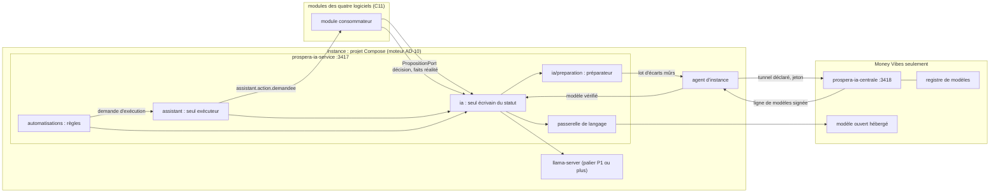
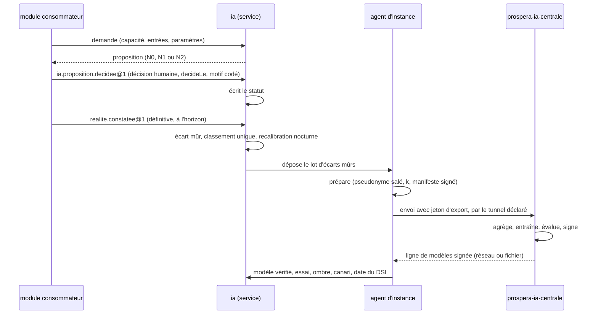

# Architecture Spine — IA commune de Prospera

Rédigée en mode rapide le 2026-11-13, après le PRD final, puis **corrigée après deux relectures** (`arbitrages-relectures-spine.md` fait foi ; constats dans `reviews/`). Elle fixe ce que deux unités construites séparément pourraient choisir de façon incompatible. Les raisons sont au `.memlog.md`. `[ADOPTED]` = tranché par le PRD, le PO ou une spine héritée ; `[ASSUMPTION]` = proposé ici, à confirmer.

## Design Paradigm

**L'IA propose, l'humain décide : un noyau qui ne détient aucune donnée métier, derrière un seul port.** Tout ce que l'IA présente à un utilisateur est une **proposition** immuable d'un contrat unique ; la décision appartient au module consommateur. Le noyau est le même code en ligne (plusieurs organisations dans un service) et en local (une organisation, sous l'agent) ; il apprend par **deux boucles qui ne se mélangent pas** : une boucle locale (écarts de l'organisation, calibration) et une boucle commune (écarts mûrs agrégés, modèles signés d'une ligne distincte).

| Couche | Où | Ce qu'elle tient |
| --- | --- | --- |
| Noyau et port | `prospera-ia-service`, module `ia` : `src/domaine/`, `src/ports/` | proposition, capacité, niveau servi, écart, désaccord, calibration, stratégies typées, ports `PropositionPort`, `LlmProvider`, `ModeleRuntime`, `EnvoiAgent` |
| Application | `prospera-ia-service`, `src/application/` | sélection du niveau, recalibration nocturne, mûrissement des écarts, préparation des lots, promotion locale |
| Adaptateurs | `prospera-ia-service`, `src/adapters/` | Mongo, BullMQ, Kafka (outbox), passerelle de langage, serveur de modèle local, ONNX, dépôt du lot à l'agent |
| Copilot et agents | module `assistant` du même service | sessions, catalogue des types d'action, mandats, exécutions, arbitrage |
| Règles d'automatisation | module `automatisations` du même service | règles à grammaire fermée, modes, exécutions, arbitrage |
| Centrale de l'IA | `prospera-ia-centrale`, Money Vibes seulement | agrégats d'écarts, entraînement, évaluation, registre de modèles, signature, plan de promotion |
| Écrans | `prospera-app/src/modules/ia/`, `assistant/`, `automatisations/` | composant commun d'affichage d'une proposition ; aucune règle métier (coque AD-11) |

## Inherited Invariants

| Inherited | From parent | Binds here |
| --- | --- | --- |
| AD-7, AD-28 (amendés) | spine du moteur | chaîne de clés ; la famille `ci` gagne un usage `modele` et une classe d'effet signée ; vérification hors ligne, à l'installation |
| AD-9 (amendé) | spine du moteur | un seul protocole sortant ; le tunnel de l'IA commune est une `destinationsSortante` déclarée ; l'IA dépose, l'agent envoie ; signal fermé : écarts nommés et `ia.indicateurs` |
| AD-12, AD-37 (amendés) | spine du moteur | types du journal propres à l'IA ; commande `modele.revenir` |
| AD-13 (amendé) | spine du moteur | registre des consentements sur l'instance ; finalités « apprentissage commun » et « agrégats de mesure » ; garde `CONSENTEMENT_ABSENT` en ligne |
| AD-14 | spine du moteur | export préparé sur l'instance, pseudonyme salé par envoi, table qui ne sort jamais, jeton d'export ; amendé : le niveau « apprentissage », à part des niveaux 0 à 3, va à `prospera-ia-centrale` avec un manifeste type approuvé une fois |
| AD-10, AD-43, AD-44 | spine du moteur | Compose, l'agent seul aux commandes ; profil hébergé ; relais |
| AD-16 | spine du moteur | calibration, écarts, registre et modèles sauvegardés et restaurés avec les données ; perte maximale 1 h, reprise 4 h |
| AD-17, AD-22, AD-24 | spine du moteur | catalogue des contrats nommés (amendé : faits « prédiction » et « réalité ») ; état voulu signé (amendé : `cibleModeles`, `fenetreDSI`) ; état publié |
| AD-27 | spine du moteur | un client Kafka, Karapace, partition par `organisationId`, `eventId`, BACKWARD |
| AD-30, AD-32 | spine du moteur | gel à 30 jours, version figée ; vagues et incidents (amendé : incident de modèle) |
| AD-39, AD-40 | spine du moteur | calibration intouchable par une promotion ; supervision par `sante`, service muet |
| AD-1, AD-2, AD-3 | spine de l'assistant | forme de la proposition ; décideur typé ; ré-proposer chaîne, ne réécrit pas |
| AD-4 → AD-6, AD-10 | spine de l'assistant | catalogue des types d'action, défaut le plus strict ; contrôle de mode figé ; mandat à plafond cumulé réservé ; l'assistant décide, n'exécute pas (outbox) |
| AD-14 → AD-23 | spine de l'assistant | corpus versionné et citation ; audit à deux horloges ; quota fail-closed ; deux files à tourniquet ; gate et cloisonnement ; démarrage dégradé ; fournisseur de modèle = port ; surface = gabarit ; arbitrage borné |
| AD-14, AD-18 | spine microfinance | `PropositionPort` (contrat unifié ici) ; chiffrement par champ, `prospera-plateforme/champs-sensibles` |
| AD-8, AD-10, AD-23 | spine assurance | santé classée, appliquée par le propriétaire, jamais dans un événement ; registre `classification-sante` |
| AD-19 | spine distributeur | règle avant modèle, provenance toujours, sans IA l'emplacement rend `NON_INSTALLE` |
| AD-3, AD-11, AD-16 | spine de la coque | un module d'écran par dossier ; aucun métier dans Next ; contrat d'un emplacement |
| Conventions et Stack | spine du moteur | nommage, données, idempotence, erreurs, événements, temps ; Node 24, NestJS 11, Mongoose 8, MongoDB 8.0, BullMQ 6.7 |
| C1 → C13 | contrat de module | manifeste, gate, données, emplacements vides, contrats, paramètres, droits, écran, installer, démarrer seul, IA, migrations, installable sous contrôle |

## Invariants & Rules



Sens des dépendances : un module consommateur dépend du port, jamais d'un modèle ni d'une règle de score ; `assistant` et `automatisations` dépendent de `ia` par son contrat public, jamais l'un de l'autre (`automatisations` demande, `assistant` exécute) ; la centrale ne se connecte à aucun service du poste central ni à aucune instance ; rien ne descend vers une instance sans passer par l'agent.

### AD-1 — Une proposition, jamais une décision : le noyau ne détient aucune donnée métier `[ADOPTED]`

- **Binds:** FR-12, FR-13, FR-25, FR-38, FR-39, C2, C3
- **Prevents:** deux IA aux deux contrats ; une IA qui écrit dans un module ; une copie périmée d'une donnée métier ; un super-droit de l'IA.
- **Rule:**
  - L'IA est **un seul produit** : les quatre logiciels et les verticales à venir la consomment ; aucun ne fabrique la sienne.
  - Le noyau ne connaît que : propositions, capacités, écarts, calibrations, modèles, mandats, exécutions. Toute donnée métier **arrive avec la demande** (« données utilisées », minimisées à la surface) ou par un fait publié ; **elle n'est pas conservée au-delà du registre** (AD-10). L'IA n'a **aucune chaîne de connexion** à la base d'un module.
  - **Seule exception : la donnée dérivée d'apprentissage**, c'est-à-dire l'écart (AD-13) : minimal, pseudonymisé, en valeurs codées, **sans texte libre** ; c'est un amendement de l'assistant AD-7 (AD-39).
  - Le compte de service de l'IA n'a que **lecture** de ce que l'organisation lui ouvre et **écriture de propositions** ; il n'écrit rien dans un module.
  - La décision humaine et son motif sont **pris et gardés par le module consommateur**, qui les remet à `ia` (AD-41) ; `ia` est seul à écrire le statut. Aucun décideur `SYSTEME`, aucun niveau `DECISION`.

### AD-2 — Les unités et leurs données : un propriétaire par objet, sans import croisé `[ADOPTED]`

- **Binds:** FR-1, FR-2, FR-30, FR-43, C1, C3, annexe A
- **Prevents:** un module de l'IA qui lit la base d'un autre ; la centrale installée chez un client ; un second propriétaire du registre, des paramètres ou des exécutions.
- **Rule:** deux unités de déploiement. **`prospera-ia-service`** (dépôt `prospera-ia-service`, port de dev `:3417`, ex-`assistant-service`, jamais codé) porte trois modules installables séparément ; `assistant` et `automatisations` dépendent de `ia` (`MODULE_DEPENDANCE_MANQUANTE` sinon) et **ne s'importent jamais entre eux** (règle d'import vérifiée par la CI, une règle par module). **`prospera-ia-centrale`** (port de dev `:3418` `[ADOPTED]`) tourne **chez Money Vibes seulement**, sur son infrastructure (AD-49) : elle n'a pas de manifeste d'instance et n'est dans l'état voulu d'aucune instance. Elle est un **service séparé** de `apprentissage-service` ; le seul lien est le jeton d'export (AD-20).

  | Objet | Propriétaire | Autres |
  | --- | --- | --- |
  | proposition, **statut**, événements de statut | `ia` (seul écrivain, AD-41) | lus par AUD, RM ; jamais écrits ailleurs |
  | registre de l'IA (catégories `INVOCATION`, `EXECUTION`, `DECLENCHEMENT`, `PASSERELLE`) | `ia` | les trois modules y écrivent par le contrat public d'`ia` (AD-10) |
  | décision humaine, motif codé, commentaire libre | module consommateur | remis à `ia` par commande ; l'IA ne lit que le motif codé |
  | catalogue des capacités de l'instance, fiche de capacité | `ia` (depuis les manifestes C11 et les packs) | lu par DSI, DG |
  | paramètres d'une capacité (barème, seuils, listes) | module consommateur | portés par chaque demande, jamais stockés par l'IA |
  | écarts, paires prédiction/réalité, désaccords, écarts d'ombre | `ia` (une instance, une organisation) | hors migration |
  | préparation du lot d'écarts (en ligne) | `ia`, module `ia/preparation` (AD-19) | seul lecteur transversal des organisations consentantes, une par appel |
  | calibrations, niveau servi (`selection`) | `ia` | sauvegardées avec les données |
  | modèles installés (courant, précédent) | `ia` | livrés par la ligne de modèles |
  | modèles publiés, composition, jeux d'évaluation, plan de promotion | `prospera-ia-centrale` | jamais sur une instance |
  | packs de secteur et jeux de référence | Money Vibes (signés) ; installés par `ia` | un pack ne se modifie pas sur l'instance |
  | catalogue des types d'action, mandats, **exécutions, compteur de mandat, file d'arbitrage, outbox sortante**, sessions | `assistant` (**seul**, AD-45) | types publiés par les modules exécutants |
  | règles d'automatisation, déclencheurs, journal des déclenchements | `automatisations` | demande une exécution à `assistant`, n'en possède aucune |
  | registre des consentements | agent d'instance (moteur AD-13) | l'IA le lit par la garde |
  | corpus légal, jeux de référence datés | `platform-catalog-service` (`ReferentielVersion`) | chargés par `ia` |

### AD-3 — Un seul code, deux profils, une liste fermée de différences `[ADOPTED]`

- **Binds:** FR-30, FR-31, FR-32, FR-42, FR-85, C10, C13
- **Prevents:** une branche « en local » dans le code ; une variante d'IA par client ; deux comportements de contrat selon l'endroit.
- **Rule:** la même image démarre dans les deux profils ; la différence est la **configuration signée de l'état voulu**. Les écarts de comportement sont **la liste fermée suivante**, chacun étant un adaptateur sélectionné par le **nom de profil lu une fois au démarrage** : (1) isolation (une organisation par jeton en ligne, une seule en local) ; (2) source du modèle de langage (AD-24 en ligne, AD-25 en local) ; (3) source des droits et de l'échéance (moteur AD-19) ; (4) absence de gel en ligne ; (5) transport des modèles (AD-21) ; (6) garde du registre des consentements (compte de service en ligne, agent en local) ; (7) copie hors machine de la calibration ; (8) **préparation du lot** (préparateur en ligne, agent en local, **une seule bibliothèque**, AD-19) ; (9) **décision de promotion** (fenêtre Money Vibes en ligne, date du DSI en local, AD-22) ; (10) **calcul du N2** (par l'instance en local, par le service en ligne, AD-9). Ajouter un point demande un amendement de cette AD. Le balayage de la CI trouve toute branche hors de cette liste. Une suite de contrat identique (demande, réponse, refus nommés) est jouée contre les deux profils. Une différence entre deux clients passe par les **paramètres** et la **calibration**, jamais par du code.

### AD-4 — Le port de consommation : une demande, une proposition, jamais bloquante `[ADOPTED]`

- **Binds:** FR-12, FR-15, FR-37, FR-40, FR-53, FR-90, FR-186, C4, C11
- **Prevents:** un module qui appelle un modèle ou code un barème ; un parcours qui attend l'IA ; deux ports aux contrats voisins ; une capacité qui change de sens sous un consommateur.
- **Rule:**
  - **`PropositionPort`** est le **seul** moyen d'obtenir une proposition. Deux formes, même contrat de sortie : **synchrone** (`POST /api/v1/ia/{organisationId}/propositions` : réponse avec la proposition, ou un état) et **asynchrone** (`202` avec `propositionId`, résultat lu par `GET` et annoncé par `ia.proposition.rendue@1`). **La fiche déclare laquelle** par version majeure (AD-42) : le consommateur ne choisit pas. Le client est **généré** de l'OpenAPI du service (coque AD-15), jamais recopié.
  - La demande porte : capacité **`{secteur, code, majeure}`** (AD-47), vocabulaire, `objetRef`, **données utilisées** (champs déclarés par la capacité, sinon `ENTREE_NON_DECLAREE`), **paramètres versionnés** (`versionParametres`), droit de l'appelant, `cleIdempotence`. Le module doit avoir **déclaré la capacité à son manifeste (C11)** (`CAPACITE_NON_DECLAREE`).
  - **Jamais bloquante** : délai maximal `ia.reponse.delai_max_s` ; au-delà, ou service coupé, ou quota épuisé, la réponse est un **état** (`INDISPONIBLE`, `NON_INSTALLE`, `DEGRADE`, `CAPACITE_BIENTOT`), jamais une exception ; la capacité retombe sur la **règle N0** quand elle existe (AD-8), en **proposition distincte** d'origine `REGLE` (AD-42). Le client généré a un délai d'expiration et un état local ; l'écran ne dépend pas de la réponse pour continuer.
  - **Versionnement des capacités** : une version majeure change le contrat d'entrée, de sortie **ou la forme d'appel** et **coexiste** avec la précédente pendant `ia.catalogue.versions_maintenues` versions ; le consommateur demande une **version minimale** ; une version inconnue est refusée, jamais devinée (C12).
  - Une proposition dont `versionParametres` diffère de la demande est **refusée par le consommateur**, qui garde sa règle de base.

### AD-5 — Le contrat de proposition (annexe B) : immuable, chaîné, un événement par transition `[ADOPTED]`

- **Binds:** FR-12, FR-16, FR-49, FR-54, FR-186, annexe B
- **Prevents:** une proposition réécrite pour y mettre une décision ; un champ qui trahit une décision de l'IA ; une confiance qui ouvre une autonomie ; une réponse HTTP qui varie d'un service à l'autre.
- **Rule:**
  - Les champs, énumérations et transitions sont **ceux de l'annexe B** du PRD, sans les redéfinir ici ; la copie normative est un **schéma JSON (JSON Schema draft-07, comme la Reprise)** dans `prospera-plateforme/contrats/ia/` (coque AD-15), testé des deux côtés. `origine` ∈ {`REGLE`, `MODELE`, `LANGAGE`} ; `niveau` ∈ {`EXTRACTION`, `ANALYSE`, `RECOMMANDATION`} ; `maturite` ∈ {`N0`, `N1`, `N2`} (deux notions distinctes) ; `statut` ∈ {`PROPOSEE`, `ACCEPTEE`, `MODIFIEE`, `REJETEE`, `EXPIREE`}. **Hors annexe B** (amendement du PRD à porter, AD-39) : l'indicateur de réponse `masquee` (AD-16), l'état `NON_SOURCEE` et l'état `BLOQUEE` de l'assistant `[ASSUMPTION]` : ces deux derniers sont **visibles au registre et au rôle habilité, jamais rendus à l'utilisateur comme une proposition acceptable**.
  - La proposition est **immuable**. Chaque transition de statut est un **événement de statut** en ajout seul, **écrit par `ia` seul** (AD-41) ; ré-proposer crée une proposition qui porte `remplace`. Toute autre transition est refusée.
  - La décision d'un module est acceptée **si et seulement si** : la proposition existe pour cette organisation, elle est `PROPOSEE`, `decideLe` ≤ `expireLe` (AD-41), le `decideur` est cohérent avec l'effet (`REGLE` et `MANDAT` refusés si la catégorie d'effet est `JURIDIQUE_OU_FINANCIER` ; une catégorie non déclarée vaut `JURIDIQUE_OU_FINANCIER`).
  - La `confiance` est exposée ; elle **n'ouvre aucune autonomie, ne route aucune validation, n'ouvre aucun mode**. Son **seul usage décidé** est le repli d'affichage : sous `ia.proposition.confiance_min`, « je ne sais pas » et règle N0 étiquetée.
  - `expireLe` est exécuté par un **travail idempotent**, pas à la lecture (AD-41 pour la course avec une décision).
  - **Codes HTTP** : une seule table, AD-51. Un code qui trahirait l'existence d'un objet (`ORGANISATION_HORS_JETON`, `ROLE_NON_AUTORISE`) est **interne** (journal) et la réponse publique est `404`.

### AD-6 — L'autonomie interdite est une garde du port et une garde du consommateur `[ADOPTED]`

- **Binds:** FR-13, FR-14, FR-20, FR-28, FR-95, FR-110, FR-127, FR-134, FR-137
- **Prevents:** un mandat ou une règle qui décide un crédit, une garantie, un sinistre, un paiement, un refus ou un blocage ; un montant sur un objet interdit ; une revue juridique qui active une autonomie.
- **Rule:**
  - L'autonomie de l'IA est **interdite sans exception** sur crédit, garantie, sinistre, paiement, refus, blocage, résiliation : aucun mandat, aucun réglage, aucune revue ne l'active ; la faire évoluer demande une décision du PO et un amendement de cette spine. Un type d'action n'est autonomisable que s'il est déclaré **non engageant et réversible** (AD-29) **et** que ses effets ne rencontrent pas la liste des objets interdits (AD-46).
  - **Double garde** : le port refuse (`TYPE_NON_AUTONOMISABLE`, refus de décideur) ; le module consommateur refuse **aussi** (il n'applique pas une proposition `REGLE` ou `MANDAT` d'effet juridique ou financier). Aucune règle d'un module ne change un état (suspension, blocage, refus) à partir d'une proposition de l'IA **ni d'une étiquette `ia:*`** (AD-46) : balayage de la CI.
  - **Interdiction de sortie** : la capacité porte `interdictions[]` ; le port **refuse la sortie** qui contient un montant, une fourchette, une médiane ou un écart en pourcentage sur un objet interdit (`MONTANT_INTERDIT` ; `MONTANT_CORPOREL_INTERDIT` en alias de l'assurance) ; la liste des objets et effets interdits est **une donnée versionnée unique**, lue par le port, le chargeur du catalogue des types d'action et le consommateur (assurance AD-10).
  - Les capacités qui touchent une personne (score de crédit, de sinistre, tarif) sont **sous revue juridique** avant mise en service (FR-28) : un interrupteur éteint par défaut, allumé par une décision tracée.
  - **Règle avant « IA »** : l'écran n'emploie le mot « IA » que pour `MODELE` et `LANGAGE` ; `REGLE` s'appelle « règle ».

### AD-7 — Le catalogue des capacités : une fiche déclarative, sans fiche pas de capacité `[ADOPTED]`

- **Binds:** FR-37, FR-68, FR-74, FR-90, FR-91, FR-92, FR-128, FR-129, FR-130, FR-169, C11 ; les fiches couvrent aussi FR-22, FR-98, FR-101, FR-103 → FR-109, FR-111, FR-115 → FR-124, FR-126, FR-146 → FR-159
- **Prevents:** une capacité sans objectif mesurable ; une capacité sans horizon de vérité ; deux vocabulaires pour une même famille ; une capacité « bientôt » appelée pour de vrai.
- **Rule:**
  - Une **capacité** est identifiée par **`secteur/code@majeure`** (AD-47) et déclarée par une **fiche** versionnée, livrée dans un pack (AD-28) ou dans le catalogue du socle. Sans fiche complète, elle n'entre pas au catalogue. La fiche porte au minimum : `code`, `famille`, `version`, **`appel`** (`SYNC | ASYNC`, AD-42), schéma d'**entrée** (champs autorisés, liste fermée de variables pour un score sur une personne), schéma de **sortie** (`contenu` typé), **vocabulaire par logiciel**, **droit requis**, **règle N0** (AD-8), **catégorie d'effet**, **interdictions**, **mode permis** (le plus strict par défaut), **objectifs mesurés** (qualité, usage, effet métier, équité), **faits de réalité**, **renvoi à l'horizon et à la règle « qui avait raison » du pack** (AD-43, jamais redéclarés), **`comparaison`** (`N0_PERMANENT_OMBRE | AUCUNE`), **seuil de matérialité**, **liste fermée des motifs** d'écart, **champs d'écart exportables** (**typés fermés** : `enum`, entier d'unité mineure, `booleen`, `tranche` ; jamais `string` libre, AD-13), **seuil N2**, **portes de promotion** (AD-22), **famille transverse ou par secteur** (AD-47), **statut de catalogue** (en service, `BIENTOT`, `PLUS_TARD`, `EXCLU`). Une CI refuse une fiche qui redéclare l'horizon ou expose un champ exportable libre.
  - Une capacité `BIENTOT`, `PLUS_TARD` ou `EXCLU` rend l'état `CAPACITE_BIENTOT` : jamais un appel réel, distinct de `NON_INSTALLE`.
  - Le catalogue d'une instance est **dérivé** : capacités déclarées par les modules installés (C11) ∩ packs installés ; retirer un module retire ses capacités ; les propositions rendues restent lisibles au registre. Il est lisible par le DSI et le DG.
  - Une **famille nouvelle** est une **extension versionnée** du catalogue (contrat d'entrée et de sortie, N0 par défaut, objectifs types, garde-fous, niveau de risque), relue par le juriste si elle touche une personne ; elle ne modifie le contrat d'aucune famille existante.

### AD-8 — Trois niveaux, N0 en données versionnées dans les packs, le plus bas toujours disponible `[ADOPTED]`

- **Binds:** FR-45, FR-46, FR-47, FR-48, FR-49, FR-51, FR-53, FR-54, FR-55, FR-91
- **Prevents:** une règle N0 codée en dur ; une valeur réglementaire dans un modèle ; un niveau qui s'affiche pour un autre ; une capacité sans repli.
- **Rule:**
  - **N0** = règles explicables, **données** versionnées dans le pack de secteur (barèmes par défaut, poids, seuils, tables, gabarits, par pays), interprétées par des **stratégies typées** du socle (score à facteurs, seuils, tendance glissante, gabarit, classement par valeur espérée). Un pack **ne contient pas de code exécutable** et son schéma est fermé (AD-28) ; une règle n'est jamais une expression évaluée (assistant AD-11). Les **valeurs modifiables** (barème, seuils, listes) sont des **paramètres du module consommateur**, portés par la demande (AD-4) ; le pack ne livre que le **jeu de départ** et la forme. **Aucune valeur réglementaire** (plafond d'usure, seuil CIMA, ratio légal) dans une règle ou un modèle de l'IA : elle vient du référentiel du module.
  - **N1** = modèle commun, jamais servi avant son évaluation (AD-18) et jamais entraîné sur les données d'un client sans sa finalité. **N2** = **calibration de l'organisation** en v1 (un modèle d'organisation est un horizon, Deferred : aucun Python sur l'instance, AD-17), née quand trois conditions tiennent **par capacité** : volume d'écarts, durée, et victoire sur le niveau en place sur un jeu tiré des écarts de l'organisation.
  - **Un seul niveau servi par demande** (le plus élevé que la fiche autorise et que l'évaluation justifie) ; l'**autre niveau** défini par la fiche (`comparaison`, AD-43) peut tourner **en ombre**, enregistré, jamais affiché. N0 est **exécutable à tout moment, sans réseau et sans modèle** ; le repli (modèle absent, calibration invalide, quota épuisé, empreinte discordante, dérive grave, N2 qui perd son évaluation) est **automatique et dit à l'écran**.
  - Les décisions de N0 servent d'étiquette initiale (écarts) et ne sont pas remplacées par le modèle qu'elles ont amorcé.

### AD-9 — La version servie : une sélection par capacité et par organisation, jamais par calendrier `[ASSUMPTION]`

- **Binds:** FR-45, FR-52, FR-53, FR-64, FR-66, FR-67, FR-90, FR-166
- **Prevents:** un niveau qui change pour toute l'instance d'un seul coup ; une promotion qui efface la possibilité de revenir ; un niveau décidé par la date ; deux majeures qui se partagent un niveau.
- **Rule:**
  - L'état de service d'une organisation est une collection **`selection`** : une ligne par **`(organisationId, secteur, code, majeure)`** (AD-47) qui porte `niveauServi`, `refModele` (modèle commun courant), `refCalibration` (calibration active), `refPrecedents` (la **paire** modèle et calibration précédents, conservée pour le retour arrière, AD-22), `interrupteur`, `etat` (`OK`, `DEGRADE`), et un **numéro qui ne fait que croître, par ligne**. **Un seul service applicatif** (`src/application/selection`) l'écrit, par **compare-and-set sur le numéro** : calibration, plan de promotion, retour arrière et coupe y passent tous. La promotion d'une majeure ne touche jamais l'autre. Elle est **lue à l'exécution**, jamais mise en cache sans révision (assistant AD-20), et chaque changement est une ligne du registre (capacité, niveau avant et après, raison, résultat de l'évaluation).
  - Le **passage d'un niveau** se décide **par capacité**, par évaluation : N2 par l'instance (ou le service en ligne) ; N1 par le plan de promotion (AD-22). Tout changement qui **change une proposition visible** est une classe d'effet `VISIBLE` (AD-44) : **interrupteur de changement** déclaré au manifeste (C12), éteint à la livraison, allumé par l'administrateur, avec une **date limite** `ia.promotion.interrupteur_limite_jours` (30) après laquelle la bascule se fait.
  - L'état absolu d'une capacité est publié sur `ia.capacite.changed@1` (état, niveau, version), pour les consommateurs et les écrans ; un consommateur ne déduit jamais le niveau d'une proposition précédente.
  - **Signal de l'agent** (amendement du moteur AD-9, AD-39) : les écarts nommés `CALIBRATION_DISCORDANTE`, `MODELE_REFUSE_SIGNATURE` et `PALIER_INSUFFISANT` et l'objet `ia.indicateurs` entrent au schéma fermé du signal, sans champ libre.

### AD-10 — Le registre de l'IA : unique, append-only, chaîné, deux horloges, base séparée `[ADOPTED]`

- **Binds:** FR-17, FR-23, FR-89, FR-180, FR-181, C3, C9
- **Prevents:** une trace opposable modifiable ; un contexte brut conservé dix ans ; une invocation anonyme ; une désinstallation qui efface la preuve ; trois journaux aux rétentions différentes.
- **Rule:**
  - Le registre est **unique** : `ia`, `assistant` et `automatisations` y écrivent par le **contrat public d'`ia`**, par catégories `INVOCATION`, `EXECUTION`, `DECLENCHEMENT` et `PASSERELLE` (AD-24). Il est **en ajout seul**, dans une **base séparée** (`ia_service_audit`) dont la protection vient du **rôle serveur**, **chaîné** (`condensat`, `condensatPrecedent`) ; aucun rôle ne modifie ni ne supprime une entrée. Aucune invocation sans organisation, capacité et auteur (utilisateur ou règle). Rétention, effacement et clé sont **ceux de l'ensemble**.
  - **Deux horloges** : la **trace opposable** (identifiants, versions, décision, empreinte de la calibration, version du modèle de langage, sources) est gardée `ia.registre.retention_annees` (10 ans) ; le **contexte brut** et le **rendu figé** sont purgés à `ia.registre.contexte_brut_jours` et `ia.registre.rendu_fige_jours`. La purge est un travail idempotent.
  - Le registre ne contient **ni donnée de santé ni texte libre** : références et valeurs codées. Il est chiffré **par champ** pour ce qui est personnel (`champs-sensibles`) avec **une clé par organisation** : l'**effacement est une destruction de clé**, sous réserve de l'obligation de conservation du métier concerné, dite dans la réponse.
  - **Désinstaller ne supprime rien** : registre, écarts, calibrations, modèles et rapports restent, masqués, avec leur durée ; aucun bouton « supprimer ». La route d'effacement C13 est celle de l'organisation entière (AD-36).

### AD-11 — Isolation, droits de l'utilisateur, tourniquet et quota fail-closed `[ADOPTED]`

- **Binds:** FR-8, FR-25, FR-31, FR-39, FR-139, FR-178, FR-183, C2, C7
- **Prevents:** l'IA d'une organisation visible d'une autre ; un super-droit de l'IA ; une organisation qui sature l'inférence des autres ; une dégradation silencieuse au dépassement de quota.
- **Rule:**
  - En ligne, la route porte l'`organisationId` du jeton ; une route d'une autre organisation rend `404` (code interne `ORGANISATION_HORS_JETON`). **Aucun chemin de lecture ne regroupe deux organisations** dans le service ; aucune route n'a d'`organisationId` facultatif ; la vue de la plateforme lit des **compteurs pré-agrégés** par route dédiée (assistant AD-17). Un dossier hors de la portée de l'utilisateur rend `404`, jamais `403`. Seule exception de lecture : le **préparateur en ligne** (AD-19) lit **une organisation par appel**, jamais de jointure.
  - Une capacité tourne **avec les droits de celui qui la demande**, à l'entrée et à la sortie ; une exécution non interactive tourne avec les droits **du responsable de la règle** et le dit à la provenance ; elle s'arrête et notifie si le responsable perd son droit. Le droit requis est déclaré avec la capacité et vérifié par le serveur.
  - Gate local : licence du module (`IA_NOT_ENTITLED`, `ASSISTANT_NOT_ENTITLED`, `AUTOMATISATIONS_NOT_ENTITLED`), lue de l'état publié (moteur AD-24), jamais d'un appel réseau sur le chemin chaud.
  - Les files d'inférence de langage répartissent le temps **à tour de rôle entre organisations** (assistant AD-18) ; deux files, **interactive** et **de fond**. Le quota d'inférence est **par organisation et fermé** : `QUOTA_INFERENCE_DEPASSE` (`429`) et la capacité retombe sur la règle ; jamais d'attente sans fin.
  - Le **test de fuite par le modèle** (phrase marqueur d'une organisation absente de toute proposition d'une autre) est rejoué à chaque livraison de modèle (FR-189).

### AD-12 — Les entrées sont préparées par le module, déclarées, minimisées `[ADOPTED]`

- **Binds:** FR-37, FR-38, FR-88, FR-94, FR-143, C2
- **Prevents:** une lecture directe d'une base ; un champ non déclaré qui passe ; une lecture sans consentement ; un contexte entier par confort.
- **Rule:**
  - L'IA reçoit les **faits préparés** que le consommateur a choisis et apprend de **faits publiés** (AD-14). Pour l'entraînement local, le Copilot et l'analyse sectorielle, qui lisent plus large, la lecture passe par les **interfaces publiées** des modules (C13 export, faits du bus), avec le **compte de service dédié** ; **en ligne**, chaque lecture passe par la **garde du registre des consentements** (bibliothèque de plateforme, moteur AD-13) : `CONSENTEMENT_ABSENT` si la finalité n'est pas couverte. Les lectures d'exploitation sont journalisées à part, jamais pour l'apprentissage.
  - Un champ absent de la fiche est refusé (`ENTREE_NON_DECLAREE`). Pour un score sur une personne, les entrées sont une **liste fermée de variables autorisées** ; une variable interdite ou hors liste est refusée à l'**entraînement et à l'inférence** (`VARIABLE_NON_AUTORISEE`). Il n'existe **qu'une liste de variables interdites**, versionnée, source unique ; les substituts (nom, prénom, quartier) sont **audités** à chaque version.
  - Le contexte est **minimisé à la surface** : seul ce que la surface affiche ou utilise est transmis ; la minimisation est une propriété du gabarit.

### AD-13 — Le journal des écarts : une paire prédiction/réalité sous une clé pseudonyme stable sur l'instance `[ADOPTED]`

- **Binds:** FR-56, FR-57, FR-58, FR-59, FR-77, FR-87, C3, C12
- **Prevents:** un écart sans réalité envoyé ; un texte libre dans un écart ; une clé qui lie deux instances ou deux envois ; un journal d'écarts écrasé par une promotion ; une valeur lue d'une pièce qui sort.
- **Rule:**
  - Pour chaque proposition **remise** (AD-42), `ia` enregistre **un écart, une seule fois** : référence de la proposition (identifiant, capacité `secteur/code@majeure`, niveau, version, empreinte de calibration), décision (`ACCEPTEE`, `MODIFIEE`, `REJETEE`, `EXPIREE`), **motif codé** (liste fermée de la capacité), valeur retenue, puis **réalité** quand elle arrive. Il ne contient jamais la proposition en clair ni de texte libre ; le **commentaire libre** reste dans le module. C'est la **donnée dérivée d'apprentissage** d'AD-1.
  - **Champs exportables typés fermés** à la fiche : `enum`, entier d'unité mineure, `booleen`, `tranche` ; **aucun `string` libre** ; le schéma d'un lot est `additionalProperties: false` (AD-19). Pour une capacité d'**extraction**, l'écart exporte `corrige: bool` et le **motif codé**, **jamais la valeur lue ni retenue**.
  - La **paire** (prédiction, réalité) est rangée sous une **clé pseudonyme stable sur l'instance** (HMAC par organisation de l'identifiant de l'objet de la capacité) : elle rattache les écarts d'un même objet **à l'intérieur** de l'instance et ne **sort jamais** ; le pseudonyme d'export est différent à chaque envoi (AD-19).
  - **Ombre** : la prédiction d'une proposition servie **en ombre** porte `ombre: true` et `niveauAffiche` ; elle est rangée dans une collection séparée **`ecarts_ombre`**, **sans décision ni désaccord**, qui ne sert qu'à la porte « qualité ≥ champion » ; elle n'est **jamais exportée**.
  - Le journal est **hors de la migration de promotion**, lisible par la version précédente (N et N-1), sauvegardé et restauré avec les données ; un champ ajouté est lu comme inconnu et refusé plutôt que deviné.
  - Un écart **mûrit** selon AD-43 ; un travail idempotent le marque mûr une seule fois. Une capacité sans fait de réalité reste N0 ou N1 et la fiche le dit ; **aucune réalité n'est une saisie**.

### AD-14 — Les faits « prédiction » et « réalité » sont des contrats nommés, versionnés, testés des deux côtés `[ADOPTED]`

- **Binds:** FR-38, FR-57, FR-74, FR-186, C5, annexe A (A-4, trou T-12)
- **Prevents:** une réalité déduite d'une lecture de base ; deux noms pour le même fait ; une photo prise pour un événement ; un impayé qui disparaît par un rééchelonnement ; une valeur de score lisible par tout abonné du bus.
- **Rule:**
  - **Prédiction** : `ia.prediction.enregistree@1`, produit par `ia` **pour une proposition remise seulement** (AD-42) d'une capacité qui déclare un fait de réalité ; charge : `propositionId`, `capacite` (`secteur/code@majeure`), `maturite`, `objetRef` (**pseudonyme d'instance**, jamais un identifiant de personne), `valeurPredite`, `horizons[]`, `organisationId`, `eventId`. Il est **consommé par `ia` seul** (ACL de topic) ; pour une capacité touchant la santé, **aucune valeur sur le bus** (AD-27). **Réalité** : `<module>.realite.constatee@1`, produit par le **module qui sait ce qui s'est passé** ; charge : `capacite`, `objetRef`, `issue` (valeur d'une liste fermée de la fiche), `definitive: bool`, `echeance`, `montant` optionnel en entier d'unité mineure et devise, `constateLe`, `evenementSource`, `eventId`. Chaque module déclare à son manifeste (C5) les faits de réalité qu'il publie ; ces noms sont **retenus** et portés aux manifestes des quatre logiciels (action listée, AD-39) et au catalogue des contrats du moteur (AD-17, amendement).
  - Chaque capacité déclare ses faits de réalité, leur **délai**, la **règle de rattachement** à la proposition et la **définition d'événement** : la réalité d'un impayé est un **événement, pas une photo** (jamais « en retard » levé par un rééchelonnement, une restructuration, une passation en perte ou un solde par un autre prêt).
  - Le schéma est versionné et **testé des deux côtés** (producteur et consommateur) ; rejouer un fait de réalité ne double pas l'écart (clé `eventId`).

### AD-15 — Le désaccord : gardé, tranché à l'horizon, calculé sur l'instance `[ADOPTED]`

- **Binds:** FR-74, FR-75, FR-68, FR-189, C3, C5
- **Prevents:** un taux calculé avant l'horizon ; deux sens de désaccord additionnés ; N0 compté comme « IA » ; un chiffre d'agent présenté comme un reproche ; un taux global sans effectif ; un Copilot qui dénonce un agent.
- **Rule:**
  - Un **désaccord** est une proposition `MODIFIEE` ou `REJETEE` au-delà du **seuil de matérialité** de la capacité, ou `ACCEPTEE` alors que l'**autre niveau déclaré** (`comparaison`, AD-43) disait autre chose ; les capacités génératives en sont exclues. Il est enregistré avec agent, agence ou équipe, organisation, capacité, niveau et version servis, décision et motif codé ; `ia.desaccord.tranche@1` annonce l'issue.
  - L'**horizon**, la **règle « qui avait raison »** et le calcul de maturité sont ceux d'**AD-43** ; **aucun calcul avant l'horizon** ; seuls les cas mûrs comptent, **une seule fois**.
  - Les **deux sens** (« l'IA dit non, l'humain dit oui » ; « l'IA dit oui, l'humain dit non ») ont chacun leur effectif ; un cas non observable est `INDECIDABLE` et son nombre est affiché à côté de chaque taux. Une capacité sans horizon ou sans règle n'enregistre pas de désaccord confrontable.
  - Le taux est **calculé sur l'instance**, sur période glissante, avec effectif, intervalle d'incertitude et **taux de base** ; coupes par capacité, agence et organisation ; **N0 est « règle », jamais « IA »**. Visibilité : le responsable et l'agent pour ses propres désaccords ; un agent ne voit pas un autre agent. **La coupe par agent est hors des outils du Copilot** : l'outil de lecture ne sait que des agrégats par capacité et par équipe de taille ≥ `ia.desaccord.min_cas` ; la lecture par agent est un drapeau `ia.desaccord.vue_agent`, **éteint** jusqu'à la décision tracée du juriste (J-IA-03).
  - **Export de la preuve** : un document signé **par l'instance** (clé de l'instance, mTLS d'AD-29 du moteur), agrégé, sans nom, avec population, part d'indécidables, taux de base, période, horizon atteint, effectif (au moins `ia.desaccord.min_cas`), nombre d'organisations, capacité, niveau et note de méthode. Le chiffre **global** est produit par la centrale (AD-20) à partir des seuls agrégats exportés, avec au moins `ia.export.k_organisations_min` organisations consentantes ; avant, aucun chiffre global.

### AD-16 — L'échantillon aveugle, et aucune promotion sur les seuls prêts accordés `[ADOPTED]`

- **Binds:** FR-47, FR-48, FR-74, FR-94, FR-28
- **Prevents:** un biais de sélection qui fait croire que l'IA est meilleure ; une proposition cachée qui devient une décision ; un score promu sur les seuls dossiers acceptés ; une proposition masquée lue avant la décision.
- **Rule:**
  - Pour toute capacité qui **note une personne**, un échantillon (`ia.desaccord.echantillon_aveugle_pct`, **5 %** retenu) est tiré **par le service**, de façon **reproductible** (graine par organisation et capacité, journalisée), **à la demande acceptée, avant le choix du niveau**, et porte sur **le niveau servi** (le repli N0 sur délai y compris). La proposition est **calculée et enregistrée avant** la décision, **cachée** à l'humain jusqu'à sa décision (le port rend `masquee: true`) ; l'humain décide **seul** ; la proposition cachée **n'a aucun effet**. Sur la forme asynchrone, **la lecture d'une proposition masquée rend `404` tant qu'elle est `PROPOSEE` et non décidée**.
  - Un score de crédit **n'est promu en N1 ou N2** que si l'évaluation s'appuie sur l'échantillon aveugle **ou** sur une **méthode d'inférence des refus** déclarée à la fiche et validée par l'équipe IA et le responsable du risque ; sinon `PROMOTION_REFUSEE` avec la porte. **Toute activation de calibration d'une capacité qui note une personne est une promotion au sens de cette AD** (AD-17) : son jeu d'évaluation vient de l'échantillon aveugle ou de la méthode d'inférence des refus, et la recalibration n'utilise **que** les écarts à réalité observable pour tous ; aucun entraînement sur la seule population décidée.
  - La **méthode** et le pourcentage sont validés par le juriste et le responsable du risque **avant tout score de crédit en service** (FR-28).

### AD-17 — La boucle locale : une calibration sœur chaque nuit, bornée, jamais en place `[ADOPTED]`

- **Binds:** FR-59, FR-60, FR-67, FR-87, FR-181, AD-39 du moteur, C12
- **Prevents:** une calibration validée écrasée ; un apprentissage qui épuise le serveur ; une activation hors bornes sur une personne ; une calibration d'un modèle appliquée à un autre ; un score qui change la nuit sans date.
- **Rule:**
  - Chaque nuit (`ia.calibration.heure`), un travail BullMQ à clé idempotente **recalibre** chaque capacité qui a des écarts échus : poids, seuils et probabilités **à l'intérieur de bornes** de la fiche (variation maximale par nuit, plage, liste de variables inchangée), **incrémental**, repris après une coupure, plafonné à `ia.calibration.cpu_max_pct` et **cédant la place** à l'exploitation. Le calcul est **du code TypeScript du service**, **sans Python** sur l'instance ; il n'utilise que les écarts de l'organisation, **là où ils vivent**.
  - La calibration **en service** est un volume **versionné, hors de la migration** (moteur AD-39) ; la recalibration produit une **calibration sœur**, évaluée contre l'active sur le jeu de validation de l'organisation (tiré **dans le temps**, les plus récents) ; elle n'est activée que si elle gagne, par une ligne du registre ; les `ia.calibration.conservees` précédentes sont gardées au moins `ia.promotion.retour_conservation_jours` (30) jours.
  - **Lien au modèle** : une calibration porte `modeleBase` (empreinte) ; elle n'est **activable** que si `modeleBase` = `refModele` de la `selection`. À la promotion d'un modèle, la calibration active est **mise en réserve**, une sœur est **recalculée sur le nouveau modèle** (écarts échus) et évaluée avant activation ; en attendant, le niveau servi est celui du modèle **sans calibration d'organisation**, dit à l'écran. Le retour arrière repointe **la paire**.
  - **Quand elle s'active** : une calibration dont le niveau servi est **visible à l'écran** est de classe `VISIBLE` (AD-44) ; `ia.calibration.activation` vaut `FENETRE` par défaut (l'activation attend la **fenêtre autorisée par le DSI**, une par semaine au plus) ou `AUTO` sous interrupteur ; **toujours dans les bornes** de la fiche.
  - **Capacité qui note une personne** : l'activation est une **promotion** (AD-16) : bornes **cumulées** (`ia.calibration.borne_cumulee_pct`), **porte d'équité** (AD-18, AD-48), journal ; hors bornes, elle **attend la validation** du responsable du risque ou du DSI.
  - Une calibration activée est **conservée et rejouable** `ia.registre.retention_annees` ; son **empreinte** (SHA-256 du JSON canonique JCS) est déterministe, lisible par la version précédente du code, et figure dans la provenance de chaque proposition.
  - Un retrait du consentement n'arrête **pas** cette boucle : la calibration est la donnée de l'organisation.

### AD-18 — Champion et challenger, jeu d'évaluation figé, équité qui bloque `[ADOPTED]`

- **Binds:** FR-18, FR-47, FR-48, FR-69, FR-70, FR-73, FR-167
- **Prevents:** un candidat promu sur son jeu d'entraînement ; une équité mesurée différemment à la centrale et sur l'instance ; un alias déplacé sans preuve ; un modèle qui dégrade un sous-groupe.
- **Rule:**
  - Une version n'est promue que si elle **bat le champion** de **la même capacité (`secteur/code@majeure`)** sur les objectifs de qualité et d'équité, sans régression des autres, sur le **jeu d'évaluation** **séparé** de l'entraînement et **figé par version de capacité**. Les alias `champion` et `challenger` sont des **pointeurs** du registre de modèles (centrale, **un par secteur**, AD-47) ou de `selection` (instance, AD-9) : promouvoir ou revenir déplace un alias.
  - **Une seule définition des métriques** : qualité (précision, rappel, calibration) et **équité** (taux d'acceptation, de refus et écart de score par groupe d'équité, écart de sous-groupes, impact disparate) sont définies par **un document versionné** de `prospera-plateforme/contrats/ia/metriques/`, implémenté **deux fois** (Fairlearn à la centrale, TypeScript dans le service) et **testé sur un jeu commun** à la tolérance `ia.equite.tolerance_parite` (paramètre chiffré, **la centrale fait foi** en cas d'écart) ; l'**opset ONNX est épinglé** et un **test de parité d'inférence Python/Node** sur vecteurs signés est rejoué à chaque version d'`onnxruntime`.
  - **Équité** : les groupes, leur conservation et leur export sont ceux d'**AD-48**. Une dégradation au-delà de `ia.equite.degradation_max_pts` **bloque la promotion** ; sur un modèle en service, elle lève l'alerte, la revue humaine et compte comme **incident de modèle** (AD-22, moteur AD-32). Un test d'impact disparate précède toute mise en service d'une capacité de score.
  - Le jeu de validation d'un N2 est tiré **dans le temps** ; un N1 est évalué à la centrale, puis en ombre.

### AD-19 — Le niveau d'export « apprentissage » : préparé sur l'instance, agrégé, schéma fermé `[ADOPTED]`

- **Binds:** FR-61, FR-76, FR-77, FR-78, FR-79, FR-82, FR-88, annexe C
- **Prevents:** un lot qui dépasse son manifeste ; un export sans consentement ou après un retrait ; un texte libre ou une donnée de santé exportés ; deux envois qui se joignent ; un entraîneur qui voit le brut ; deux préparateurs qui filtrent différemment.
- **Rule:**
  - Chaque jour, `ia` **dépose à l'agent** (`EnvoiAgent`, jamais un accès direct au canal) les écarts **mûrs et définitifs** (AD-43), un seul envoi par écart, avec prédiction, décision, réalité et **classement** ensemble. L'agent prépare le lot (moteur AD-14) au **niveau « apprentissage »**, qui est **à part des niveaux 0 à 3** du moteur et un **champ du registre de l'agent**, jamais un paramètre de module : écarts sans identité, effectif minimal `k` par groupe (`ia.export.k_min`, 5) et `ia.export.k_personnes_min`, **sans texte libre, sans donnée de santé, sans pièce**, sans variable interdite, sans position précise, date de naissance ramenée à l'année, montants arrondis par tranches, **prix et marges d'un freelance exclus**, **pseudonyme salé propre à chaque envoi**, table de correspondance qui ne quitte pas l'instance. Le lot est **typé fermé** : `additionalProperties: false`, aucun `string` libre exportable, validé par l'agent **et** par la centrale à la réception (`LOT_HORS_MANIFESTE`).
  - **Deux classes d'export** : les **écarts mûrs** et les **agrégats de mesure** (AD-48), chacune avec sa finalité (« apprentissage commun », « agrégats de mesure ») au registre des consentements.
  - **Une bibliothèque unique** `prospera-plateforme/preparation-lot` (même version épinglée dans l'agent et dans le préparateur en ligne) porte filtre, `k`, arrondis, salage ; le lot embarque `versionBibliotheque`, `versionRegistreSante`, `versionVariablesInterdites` ; la centrale **refuse** un lot dont ces versions ne sont pas les courantes (`LOT_VERSION_PERIMEE`) ; un test de contrat joue le **même jeu** contre les deux préparateurs.
  - **Manifeste type** par capacité (champs et agrégats autorisés), **approuvé une fois** au contrat par le DG et par le responsable des données de Money Vibes : approbation portée par `approbationsExport` de l'état voulu, **liée au condensat du manifeste type**, **caduque à tout changement de manifeste**, révocable par nouvel état voulu (amendement explicite du moteur AD-14, AD-39) ; un lot **conforme** part sans nouvelle approbation, un lot qui s'en écarte est refusé. Le lot est décrit par un **manifeste signé**.
  - Conditions **toutes vraies à l'instant de la préparation** : finalité couverte par le registre de l'agent ; consentement distinct du client final pour une institution financière ; copie signée du registre de moins de 14 jours ; **jeton d'export** du jour valide (moteur AD-14) ; aucune finalité retirée. Un retrait **vide d'abord** la file de la finalité, avant d'écrire le retrait au registre.
  - **En ligne**, le **préparateur** est le module **`ia/preparation`** (propriétaire `ia`) ; il lit **par organisation**, par la route de lecture d'`ia` pour cette organisation seule (une par appel, jamais de jointure, AD-11), avec le jeton de la finalité, et dépose le préparé à la centrale ; il est **séparé techniquement de l'entraîneur**, qui ne voit que le préparé. Une règle de résidence « reste dans le pays » (pack de pays, AD-28) suspend **tout** envoi, agrégats compris.
  - Un lot est une donnée **pseudonymisée, pas anonyme** : le régime des données personnelles s'applique ; l'analyse de ré-identification est un livrable de la revue juridique (FR-28).

### AD-20 — La centrale de l'IA : agréger, entraîner, évaluer, signer, rien d'autre `[ADOPTED]`

- **Binds:** FR-62, FR-69, FR-72, FR-81, A.4, C2, C3
- **Prevents:** une centrale qui lit une donnée de client ; un entraînement qui rétient le brut ; un contributeur qui domine ; un modèle sans composition tracée ; deux implémentations de la vérification des clés.
- **Rule:**
  - `prospera-ia-centrale` (`:3418`) n'a **aucune connexion** à un autre service du poste central que la voie du **jeton d'export** (vérifié hors ligne par la chaîne de clés) ; une base propre ; compte de service propre. Son **API de réception est en NestJS** (réutilise la bibliothèque de vérification et les vecteurs signés de `prospera-plateforme` : **une seule implémentation** de la vérification des clés) ; **Python 3.14 est limité à l'entraînement et à l'évaluation**, qui lisent le préparé déposé en base ou en stockage objet. La réception se fait **par morceaux repris**, clé d'idempotence, sur la même identité mTLS que le contact, et **refuse sans jeton valide**. `ia.contribution.recue@1` est le **nom du contrat de charge** du `POST` de réception, **pas un topic** (jamais créé : liste CI des topics).
  - Entraînement **capacité par capacité** et **par ligne** (AD-23, AD-47) ; tant que `ia.export.k_organisations_min` organisations ne contribuent pas, **sources publiques, synthétiques et de démonstration** seulement, et l'écran dit « modèle commun en préparation ». **Plafond de contribution** par organisation (`ia.contribution.plafond_org_pct`), **agrégation robuste** (écrêtage, médiane), contributeur aberrant signalé. Une tournée par ligne au plus toutes les `ia.entrainement.cadence_jours_min` jours ; la **rétention du brut est courte** (supprimé après le tour).
  - Registre de modèles **MLflow** (versions, alias `champion` et `challenger` **par secteur**, signatures, ligne), évaluation (AD-18) et **fiche de composition signée** de chaque modèle publié (jeux publics et synthétiques, organisations ayant contribué par pseudonyme interne, finalités et rang de registre, plage de dates, empreinte du jeu, code d'entraînement, semence) : « quel modèle a vu les données de cette organisation ? » a une réponse. **Un modèle publié n'est pas désentraîné** ; un retrait exclut l'organisation du **tour suivant** et des exports commerciaux futurs, et met en quarantaine ou supprime ce qui est reçu pour la finalité retirée.
  - Droits : rôle `IA-MV` seulement (`ia-centrale:modele:entrainer`, `signer`, `publier`, `rapport:lire`) ; **double signature** pour une capacité qui touche une personne ; aucun droit sur une donnée de client. L'arrêt de la centrale **n'arrête aucune instance**. Son exploitation est celle d'**AD-49**.

### AD-21 — Une ligne de modèles distincte, signée, même contenu par le réseau et par le fichier `[ADOPTED]`

- **Binds:** FR-63, FR-83, FR-84, FR-85, FR-55, FR-173, AD-7 du moteur
- **Prevents:** un modèle poussé par le canal de la plateforme ; un modèle signé par une clé qui ne le couvre pas ; deux contenus selon le transport ; une branche de modèle par client ; un modèle qui s'éteint avec une clé.
- **Rule:**
  - La **ligne de modèles** est **distincte** de la ligne de version de la plateforme : ses propres numéros, son **manifeste de modèles** signé (empreintes, capacités servies, **classe d'effet** de chaque artefact, compatibilité avec la version du service, **fenêtre d'installation**, `retourArriere`), son rythme (au plus une publication par `ia.promotion.cadence_publication_jours_min` jours et par instance). Elle suit la **fenêtre N/N-1** du moteur. **Une seule ligne**, jamais de branche par client.
  - L'**artefact** est un **paquet versionné** : poids **ONNX** (N1), **GGUF** (langage local, plusieurs Go : téléchargement **repris sur morceaux**, clé USB, **budget de disque** N et N-1 dit au devis) ou règles et gabarits, fiche de capacité, fiche de composition, manifeste d'empreintes ; signé par la famille **`ci`**, sous l'`usage` **`modele`** ; **un artefact par secteur** (AD-47). L'instance vérifie **hors ligne**, **une seule fois, à l'installation**, la chaîne, l'`usage` et la période de validité lue sur l'**horloge scellée** (le paquet ne s'installe que dans sa fenêtre), et refuse un artefact invalide **entier**, sans dire à l'extérieur laquelle a échoué (détail au journal). **Un modèle installé sert indéfiniment** (licence à vie, gel, AD-33) : il ne tombe en **N0** avec un bandeau que par **révocation** de sa clé ou par le **fichier d'urgence** (AD-34), jamais par l'écoulement du temps.
  - **Même contenu** par le réseau (l'agent tire par le tunnel déclaré) et par fichier signé (clé USB, lien), mêmes vérification et promotion ; un fichier déjà vu n'est pas un contact. **Tout artefact qui peut changer une proposition suit le plan d'AD-44.** En gel, seul passe un artefact de classe `COUPE_OU_RETOUR`, par fichier. Une `versionCible` antérieure à l'installée est une **proposition** de retour arrière, jamais appliquée seule.
  - Les **gabarits de langage**, les **jeux de référence datés** (indices, calendriers, corpus légal) et les **packs** voyagent sur la même ligne ; chaque jeu porte sa date ; une source de plus de `ia.referentiel.age_max_source_jours` est dite « ancienne ».
  - Runtime : le service charge les artefacts ONNX **en processus** (`onnxruntime-node`), cache clé par `(secteur, code, majeure, empreinte)` ; aucune instance n'exécute de Python ni ne reçoit de code d'entraînement.

### AD-22 — Le plan de promotion : essai, ombre, canari, général ; correctif de modèle = couper ou revenir `[ADOPTED]`

- **Binds:** FR-64, FR-65, FR-66, FR-67, FR-73, FR-85, AD-30, AD-31, AD-32 du moteur
- **Prevents:** un modèle qui saute l'ombre ; une porte changée par le plan lui-même ; un correctif qui pousse un nouveau modèle ; un retour arrière sans perte de calibration dite ; deux promotions la même semaine ; une date du DSI rangée à trois endroits.
- **Rule:**
  - **Étapes, sans en sauter** : (1) évaluation hors ligne contre le champion ; (2) **essai** dans l'espace d'essai ; (3) **ombre** (`ia.promotion.duree_ombre_jours`), réponses comparées, enregistrées (AD-13), jamais affichées ni suivies d'effet ; (4) **canari** (`ia.promotion.part_canari_pct`) par organisation, avec les portes ; (5) **général**. `PROMOTION_ETAPE_MANQUANTE` (`409`) sinon. En local, 2 à 5 se jouent **dans l'instance**, à la **date du DSI** ; une promotion candidate issue d'un **essai à données masquées** n'est jamais promue dans le réel. Le plan s'applique à **tout artefact de classe `VISIBLE`** (AD-44), pas seulement à un modèle.
  - **La date du DSI est un champ de l'état voulu** (`fenetreDSI`, configuration signée, amendement du moteur AD-22, AD-39) lu par l'agent ; `ia` ne joue une étape que sur un **ordre de l'agent portant la fenêtre** ; une fenêtre manquée est **reportée, jamais rattrapée**. L'état voulu porte aussi la **cible de la ligne de modèles** (`cibleModeles`).
  - **Portes écrites avant l'essai**, par capacité : qualité ≥ champion moins une tolérance écrite, latence, dérive, équité, sous-groupes, coût. Sans toutes, la promotion s'arrête et est **inscrite comme refusée** avec la porte. Les portes ne se changent que par une **décision tracée** d'une personne de l'équipe IA, jamais par le plan.
  - **Date et interrupteur** : en local, **rien ne change sans l'accord du DSI** (hors correctif de modèle), informé en langage simple ; en ligne, fenêtre fixée par Money Vibes avec annonce 7 jours avant. Un artefact `VISIBLE` est un **interrupteur de changement** (AD-9).
  - **Vagues** : celles du moteur (AD-32) : une organisation pilote d'abord (la plateforme compte), 7 jours sans incident, plafond d'attente de 14 jours. Un modèle suit la même vague que la version qui le porte, mais **ses incidents sont les siens** : une **régression de qualité ou d'équité**, un retour arrière demandé, ou une dérive grave comptent comme **incident de modèle** et **suspendent la vague suivante** de cette ligne.
  - **Retour arrière en une action** (commande `modele.revenir` de l'agent en local, action de Money Vibes en ligne, amendement du moteur AD-37), par organisation **et** par capacité, sans redéploiement ni perte, **en moins de `ia.promotion.retour_max_min` (15) minutes** (sous la coupure du moteur AD-11) : il repointe sur la **paire** modèle précédent et calibration précédente, conservés jusqu'à la fin du canari plus `ia.promotion.retour_conservation_jours` (30) ; il ne retire **jamais** un correctif de sécurité.
  - **Correctif de modèle** : sert **seulement à couper une capacité ou à revenir à une version antérieure** (classe `COUPE_OU_RETOUR`, AD-44), jamais à pousser un nouveau modèle hors des portes ; délai `ia.promotion.correctif_delai_h`, reportable une fois de `ia.promotion.correctif_report_jours` ; il passe par le chemin rapide du moteur (AD-31) et, en gel, par fichier.

### AD-23 — Les secteurs ne se mélangent pas : une clé de secteur, des alias séparés, des familles transverses déclarées `[ADOPTED]`

- **Binds:** FR-82, FR-160, FR-166, FR-167, FR-168, FR-170
- **Prevents:** un alias partagé entre deux secteurs ; une promotion qui change le comportement d'un secteur qu'elle ne devait pas toucher ; un apprentissage entre institutions concurrentes sans finalité ; un secteur neuf qui hérite d'un modèle sans mesure.
- **Rule:**
  - Tout modèle, calibration et jeu de règles est rangé sous **`secteur/code@majeure`** (AD-47). Le registre de modèles ne fait **jamais** d'alias partagé entre deux secteurs ; un secteur promeut, retient ou retire **en une action** sa propre version. Une organisation qui porte deux secteurs a **deux calibrations séparées** (une ligne `selection` par secteur, AD-9).
  - Par défaut, **l'apprentissage ne franchit pas la frontière d'un secteur**. Une famille n'est **transverse** que si le catalogue la déclare telle (lecture de pièces, contrôle de cohérence, rédaction, résumé sourcé) ; les familles qui évaluent un **risque sur une personne** (score d'un tiers, fraude sur une personne, probabilité de paiement, tarification) restent **par secteur** jusqu'à décision écrite du PO. Un apprentissage transverse exige : famille déclarée transverse, **finalité propre consentie** par chaque organisation, export au niveau « apprentissage ». Aucun pseudonyme ne se joint d'un export à l'autre ; le **croisement d'une même PME entre verticales** est un horizon. Une famille transverse est **publiée en artefacts distincts par secteur consommateur** (AD-47).
  - **Non-régression obligatoire** avant toute promotion (modèle, règle, pack, extension de catalogue) : un **jeu de dossiers figés par secteur** (`ia.secteur.dossiers_figes_min`) est rejoué ; tout secteur que le candidat **ne devait pas** toucher donne les **mêmes propositions** (`ia.secteur.ecart_promotion_pct`) ; puis champion/challenger **du même secteur**. Un secteur sans jeu figé ne peut ni être promu ni être ajouté `ACTIF`.
  - **Démarrage à froid** : N0 au jour 1 ; N1 **hérité** d'une famille transverse **déclarée dans le pack**, réversible, avec la **mesure de sa pertinence** sur la vérité terrain du secteur ; la pertinence n'étant pas mesurable au jour 1, **le défaut est N0** tant qu'elle ne l'est pas (`ia.secteur.pertinence_heritee_min`) ; N2 s'ouvre au seuil de données **dans ce secteur**.
  - Sont **exclus de tout apprentissage**, quelle que soit la finalité : données de santé, prix et marges d'un freelance, chiffres réglementaires comme sortie d'un modèle, variables interdites, lectures d'exploitation.

### AD-24 — La passerelle de langage : un seul chemin en ligne, masqué, journalisé avant chaque envoi, fail-closed `[ADOPTED]`

- **Binds:** FR-33, FR-34, FR-80, FR-112, FR-133, FR-176, FR-179, FR-183, C4, annexe C
- **Prevents:** une capacité qui parle à un fournisseur en direct ; un envoi sans ligne de journal ; un nom, un téléphone ou une pièce d'identité chez le fournisseur ; un fournisseur qui conserve ou s'entraîne ; un transfert hors du pays non déclaré ; un pays ou un contenu de santé sans issue en ligne.
- **Rule:**
  - La passerelle est un **module du service** (`ia/passerelle`), dernier maillon avant le modèle ; **elle seule** détient les secrets des fournisseurs et **le nom d'un fournisseur n'est joignable que depuis elle** (règle réseau du profil en ligne, vérifiée par une inspection du trafic). Le port **`LlmProvider`** est une **API compatible OpenAI** (assistant AD-21) ; l'adaptateur du client est le paquet `openai`, qui parle aussi au serveur local (AD-25) ; **changer de modèle est une configuration** (`ia.passerelle.modele.<capacite>`), zéro ligne de code, sans modifier les anciennes propositions. Aucun service tiers de passerelle n'est mis sur le chemin du masquage.
  - **En ligne, le modèle de langage par défaut est un modèle ouvert hébergé chez Money Vibes** (souveraineté, assistant AD-21), derrière la même passerelle, même port, mêmes garde-fous ; un **fournisseur externe** n'est utilisé qu'avec **l'accord du client** et par la passerelle. Un pays dont la règle de résidence interdit la sortie, et un contenu classé santé (AD-27), n'utilisent que le modèle ouvert hébergé si le pack du pays l'admet, sinon refus rendu.
  - **Avant chaque envoi** : (1) **masquage** par la bibliothèque de plateforme (identifiants, noms, téléphones, pièces d'identité, adresses, positions précises, photos ; montants et dates utiles gardés) ; ce qui est masqué est **rendu à la réponse, sur le service**, jamais chez le modèle ; **la table de correspondance n'est jamais persistée** (mémoire du job ; une reprise ré-exécute le masquage) ; (2) **une ligne de journal par tentative d'envoi**, acquittée en **`w: majority, j: true` avant l'appel**, dans la catégorie `PASSERELLE` du **registre unique** (AD-10) : organisation, capacité, auteur ou règle, modèle, version, **taille, empreinte du contenu masqué**, types de champs masqués, décision ; l'envoi porte l'identifiant de la ligne, **une réponse sans ligne correspondante est jetée**, le **résultat** (statut, durée, jetons) est une ligne **suivante** liée ; **la passerelle refuse d'envoyer si l'écriture échoue** ; (3) contrôle **santé** (AD-27), **activation de l'organisation**, **transfert déclaré** pour le pays du fournisseur (`TRANSFERT_NON_DECLARE`), **quota** (`QUOTA_INFERENCE_DEPASSE`). Un refus est une ligne du journal avec son motif.
  - **Aucune rétention utile** : fournisseurs externes admis seulement s'ils sont liés par un accord **interdisant l'entraînement** et **bornant la rétention** (`ia.passerelle.retention_fournisseur_jours_max`, preuve datée, tableau des fournisseurs admis avec sa date de vérification) ; le contenu masqué est gardé au plus `ia.passerelle.retention_contenu_jours` ; **pays ou région d'hébergement** dans la configuration de chaque modèle et dans le journal.
  - **En profil local**, l'adaptateur `LlmProvider` n'accepte qu'une **adresse interne** (liste blanche du réseau Compose) : toute autre cible est refusée au démarrage (`FOURNISSEUR_HORS_PROFIL`). Une organisation sans activation obtient le **repli** et la mention « Rédigé sans modèle de langage ».
  - Chaque proposition de langage **fige** modèle et **version de gabarit** ; les gabarits sont versionnés et possédés par le service (assistant AD-21).

### AD-25 — Le modèle local : `llama-server` sous l'agent, paliers mesurés, repli dit à l'écran `[ADOPTED]`

- **Binds:** FR-32, FR-35, FR-41, FR-85, FR-182, FR-190, C10
- **Prevents:** un service qui ne démarre pas faute de processeur graphique ; une instance qui envoie une demande de langage à un fournisseur ; un modèle sans licence vérifiée ; un palier annoncé que le serveur ne tient pas ; un projet Compose que le moteur ne connaît pas.
- **Rule:**
  - En local, les capacités de langage utilisent un **modèle ouvert exécuté sur le serveur de l'instance**, par **`llama-server`** (llama.cpp), qui est **un service du projet Compose de l'instance** (moteur AD-10), **pas un projet à part** : démarré et surveillé **par l'agent**, derrière le même port `LlmProvider` ; **aucun port entrant**, écoute interne seulement. Il n'est **activé qu'au palier P1 ou plus, mesuré** ; **P0 (sans modèle local) est le défaut** d'un serveur sans processeur graphique. `[ASSUMPTION]` : **un seul serveur par instance**, sans état (aucun cache d'invite conservé), partagé par l'essai et le réel, chaque requête portant son organisation et son espace.
  - Le modèle est un **artefact signé de la ligne de modèles** (AD-21, GGUF), **licence vérifiée modèle par modèle** à l'entrée du catalogue (`ia.modele.licence_verifiee`) ; un modèle sans licence vérifiée n'entre pas.
  - **Profil matériel** : trois paliers publiés et datés (`ia.materiel.palier`) : **P0** sans modèle de langage (règles, modèles classiques, gabarits), **P1** petit modèle, **P2** classe intermédiaire. Au démarrage, l'instance **mesure** la machine, dit quel palier elle tient et **désactive en le disant** ce qu'elle ne peut pas servir ; un écart entre le palier du contrat et le palier mesuré est un **écart nommé** du signal (`PALIER_INSUFFISANT`, AD-9). Le **modèle de langage est optionnel** ; les valeurs d'empreinte sont des paramètres à mesurer avant le premier devis.
  - Sous le palier, ou modèle arrêté : `sante` rend `DEGRADE` pour le langage, la capacité rend un **gabarit** avec « Rédigé sans modèle de langage : version simplifiée », le service reste vivant et **le surplus attend ou se replie**. Le modèle local et la passerelle partagent les mêmes **garde-fous de sortie** (AD-26).
  - Une **machine d'IA à part** gérée par l'agent est un dernier recours (Deferred) et **n'est livrée qu'avec** sauvegarde, supervision, horloge scellée et chaîne de clés.
  - La **reconnaissance vocale** n'est servie que si le pack l'active (AD-31) ; son empreinte s'ajoute au palier de ce pack.

### AD-26 — La sortie de langage est sourcée, ses chiffres viennent des entrées, le contenu récupéré est une donnée `[ADOPTED]`

- **Binds:** FR-16, FR-26, FR-102, FR-112, FR-113, FR-114, FR-125, FR-131, FR-132, FR-179
- **Prevents:** un chiffre inventé ; une phrase sans source ; une instruction cachée dans une pièce ou un message qui pilote l'IA ; un Copilot qui écrit.
- **Rule:**
  - **Contrôle déterministe** de toute sortie de langage avant affichage : chaque phrase d'une analyse porte un renvoi à une source de la demande (`PHRASE_SANS_SOURCE`) ; **tout nombre du texte se retrouve dans les entrées** (`CHIFFRE_NON_SOURCE`) ; une affirmation à portée légale exige une **citation vérifiable d'un texte du corpus versionné figé** (assistant AD-15), sinon « non sourcé ». **L'IA n'invente aucun chiffre officiel** : un chiffre réglementaire ou comptable vient du calcul déterministe du module (`CHIFFRE_NON_SOURCE` sinon).
  - **Anti-injection** : tout contenu **récupéré ou fourni** (pièce lue, message entrant, texte libre, page du corpus, sortie d'un outil) est **une donnée**, délimitée et jamais concaténée à la consigne ; aucun contenu récupéré n'élargit les outils, les droits, le périmètre ou la destination d'une sortie ; les **outils du Copilot sont en lecture seule** et leurs sorties repassent par le contrôle de citation ; une sortie de langage ne déclenche aucune écriture ni envoi (sa seule issue est une proposition). Un jeu d'attaques d'injection **daté** est rejoué à chaque livraison de gabarit ou de modèle.
  - Un brouillon **n'est jamais envoyé seul** ; une réponse automatique à un client dont une créance est échue est refusée (`REPONSE_AUTO_INTERDITE`) ; une relance **hors calendrier** est refusée (`HORS_CALENDRIER`).
  - Le **RAG** : corpus `ReferentielVersion` (assistant AD-14), index **dérivé et reconstructible**, jamais source.

### AD-27 — La santé : une classification unique, appliquée par l'IA à chaque sortie `[ADOPTED]`

- **Binds:** FR-19, FR-36, FR-143, C13, annexe C
- **Prevents:** une donnée de santé chez un fournisseur, dans un écart, un événement, un journal ou un export ; un champ nouveau non classé ; un texte libre médical implicite qui fuit.
- **Rule:**
  - L'IA charge le **registre `classification-sante`** (une seule liste des champs classés, versionnée, épinglée au build, assurance AD-23) et le **refuse** dans tout flux sortant : passerelle, centrale, lot, écart, indicateur, événement du bus, journal, message. Un champ absent du registre : **schéma refusé en CI**. Le texte lu par OCR d'une pièce médicale est lui-même classé.
  - Une demande dont un champ est classé santé vers un modèle hébergé rend **`SANTE_HORS_INSTANCE`** (`422`, refus rendu), journalisée, **aucun octet** ne part (`DONNEE_SANTE_HORS_INSTANCE` est un alias à retirer). Une capacité de langage qui doit traiter du contenu classé n'a que deux issues : un **modèle ouvert** (hébergé par Money Vibes en ligne, local sur site, AD-24) ou un **refus rendu** (AD-51), jamais un `5xx`. Le **texte libre est sensible par défaut** (masqué avant la passerelle, jamais exporté) sauf déclaration contraire du pack ; un **détecteur de santé implicite** passe sur les textes libres avant la passerelle ; son taux de fuite sur le corpus d'essai est **0**.
  - Aucun écart ne se construit sur une pièce médicale. Le rôle d'accueil voit « pièce médicale reçue », jamais son contenu.

### AD-28 — Un pack de secteur est déclaratif, fermé, signé, versionné ; il n'ajoute que des garde-fous `[ADOPTED]`

- **Binds:** FR-160 → FR-174, FR-138, FR-171, FR-172, C6, C11
- **Prevents:** du code de secteur dans le socle ; un pack qui retire un garde-fou ; un pays qui demande une version du code ; un partenaire qui obtient les poids d'un modèle ; un langage caché dans un gabarit.
- **Rule:**
  - Le **socle est fermé à la modification, ouvert à l'ajout** : un secteur ou un pays s'ajoute par un **pack** et, au plus, une extension de catalogue ; retirer un secteur = désinstaller son pack. Les quatre logiciels sont les **quatre premiers packs** (cabinet, distributeur, microfinance, assurance).
  - **Format** : fichiers **déclaratifs** (JSON, schéma versionné **fermé**, `additionalProperties: false`, aucun `string` interprété, `prospera-plateforme/contrats/ia/pack/`), **signés** par la famille `ci` (usage `modele`), livrés par la ligne de modèles ; contenu minimal : vocabulaire rattaché à un **noyau neutre** (tiers, créance, engagement, objet, zone, événement, pièce) et mots affichés par langue ; capacités consommées avec version minimale et **règles N0** ; réglage de la **voix** (`ACTIVEE`, `BIENTOT`, `SANS_VOIX`) ; **objectifs, horizon, échéances et règle « qui avait raison »** (**source unique**, AD-43) ; **`modesMax`** par type d'action (AD-46) ; paramètres **par pays** ; **garde-fous propres** ; exigences de **résidence** ; héritage transverse déclaré ; **classe d'effet** (AD-44). États : `BROUILLON`, `ESSAI`, `ACTIF`, `RETIRE`.
  - **Aucun code** : les **gabarits** ne connaissent que la **substitution de variables nommées** et la **pluralisation** (aucune condition, boucle, appel ni expression) ; les **formules** et tables de passage sont dans une **liste finie d'opérations d'un langage déclaratif fermé**, vérifié à l'installation ; toute logique est dans une **stratégie typée du socle** ; un pack qui exige une stratégie absente demande **une version du socle**. La CI rejoue un **linter de pack** (interdit : `eval`, `{{#`, `=>`, opérateurs dans les chaînes, code encodé) ; un pack de partenaire est signé **par Money Vibes seulement après passage du linter et revue**.
  - **Un pack ne peut qu'ajouter** : variables interdites, objets sans montant, classes de données sensibles, capacités sous revue, actions jamais autonomes ; il ne retire aucun garde-fou du socle. Il porte **sa part** des règles N0 : **source unique** du barème par défaut ; **aucun paramètre partagé** entre deux secteurs sauf héritage déclaré. Un secteur sans vérité terrain déclarée reste à N0.
  - **Pays** : un référentiel (comptable, fiscal, réglementaire, devise et décimales, calendriers et fuseaux, corpus légal, gabarits par langue, **règle de résidence**, rail de paiement) ; l'IA **ne suppose jamais une devise** (toute somme porte la sienne) ; le rail de paiement est une **interface unique**.
  - **Public** : le format du pack, le contrat de capacité et le contrat de proposition sont **publiés** avec un jeu de tests de conformité ; **l'IA reste à Money Vibes** : un partenaire déclare un pack et consomme des capacités ; il ne reçoit ni code, ni poids, ni données d'entraînement, ni accès à la centrale ; un pack de partenaire n'apporte au plus que ses règles N0 et sa calibration locale. Une **checklist d'ajout** testable (fournir, vérifié, qui valide) est rejouée par la CI.

### AD-29 — Le Copilot est en lecture seule ; les agents n'agissent que sous catalogue, mandat et événement `[ADOPTED]`

- **Binds:** FR-14, FR-131 → FR-139, FR-150, FR-137, C11
- **Prevents:** un Copilot qui écrit ; un type d'action autonome sans déclaration ; un mandat qui s'attribue lui-même plus que son délivreur ; une exécution rejouée deux fois ; une action qu'on ne peut pas défaire.
- **Rule:**
  - **Copilot** (module `assistant`) : texte, **lecture seule** au premier jour, **les droits de l'utilisateur** à l'entrée et à la sortie, sources citées jusqu'à la pièce, **périmètre de chaque chiffre** dit ; vocabulaire et rôles **par logiciel** ; **marche sans modèle de langage** (recherche par règles et gabarits, dit à l'écran) ; aucune saisie vocale au premier jour.
  - **Catalogue des types d'action** : référentiel versionné `types-action@AAAA.N` du catalogue plateforme (assistant AD-4), **publié par les modules exécutants**, chargé au démarrage et sur `referentiel.changed` ; chaque type déclare `code`, `reversible`, `engageant`, `moyenAnnulation`, `serviceExecutant`, `autonomisable` et **`effets[]`** (obligatoire) ; le chargeur **force `autonomisable: false`** si les effets rencontrent la liste d'AD-6 (AD-46) ; **un type non déclaré est engageant et irréversible** ; un catalogue absent ou périmé dégrade vers le plus strict. Une divergence entre la version du catalogue figée par la règle et celle de l'exécution **suspend** l'exécution (ni exécutée, ni rétrogradée en silence).
  - **Mandat** (assistant AD-6) : délivreur habilité, périmètre, **plafond cumulé sur la période** et plafond unitaire optionnel en `(entier d'unité mineure, devise)` (un mandat sans devise est refusé), échéance (`ia.mandat.duree_max_jours`, 90), révocation immédiate ; le délivreur **détient** l'autorité (`AUTORITE_INSUFFISANTE`) ; **un seul compteur par mandat**, quel que soit l'émetteur (Copilot ou règle) : **réservé avant**, **confirmé au succès**, **libéré à l'échec** ; mandat expiré ou révoqué : retombée en `VALIDATION`, notifiée.
  - **Exécution** (assistant AD-10, **propriétaire unique, AD-45**) : un **événement** `assistant.action.demandee`, publié par **outbox transactionnelle**, partition `organisationId`, **dans la transaction** qui écrit l'`Execution`, **idempotent par `executionId`** ; le module exécutant écrit et répond par `<module>.action.executee@1` ou `<module>.action.annulee@1` (portant `executionId` et `origine`) ; l'**annulation est une compensation demandée au même module** ; toute exécution autonome est **journalisée** (registre unique, AD-10), **notifiée au responsable, annulable**, et soumise au quota de sollicitation si elle contacte une personne. L'`Execution` est un **agrégat distinct, en ajout seul** ; une proposition ne devient jamais « exécutée ».
  - **Maxima par logiciel** : **donnée du pack** (`modesMax`, AD-46) avec plancher du socle ; un client peut toujours choisir plus strict. Valeurs de départ des quatre packs : assurance **sans `AUTO`** (`MODE_NON_PERMIS_ASSURANCE`) ; microfinance sans blocage en `AUTO`, aucun décaissement ni provision ; distributeur : `AUTO` seulement pour un type interne, réversible et non engageant, jamais un contact avec une personne ; cabinet : le dépôt et la validation de liasse ne se délèguent pas.
  - La **décision groupée** de la file d'arbitrage est **bornée** (`ia.arbitrage.plafond_lot`, 25 par défaut, 100 au plus) ; le taux d'actions autonomes annulées ou contestées est mesuré (`ia.agent.annulees_pct_max`) et alerte le responsable.

### AD-30 — Les automatisations : une grammaire fermée, un seul moteur de règles, le mode le plus strict par défaut `[ADOPTED]`

- **Binds:** FR-127, FR-97, FR-137, A.3, C11, C13
- **Prevents:** une règle qui évalue une expression ; une règle neuve en `AUTO` ; une règle qui envoie un message sans validation ; deux moteurs d'automatisation ; une règle qui bloque par une étiquette ; une règle sans propriétaire d'exécution.
- **Rule:**
  - Un **seul moteur de règles** pour les quatre logiciels (module `automatisations`, code `M26` à confirmer) : déclencheur (fait publié ou travail planifié à **clé idempotente**), conditions en **grammaire fermée** (`GRAMMAIRE_FERMEE` à l'enregistrement si elle contient une expression hors grammaire ; aucun modèle de langage n'évalue une condition), action = **type du catalogue** (AD-29), mode. Il **ne possède que ses règles et ses déclencheurs** : toute exécution est **demandée à `assistant`** (AD-45).
  - Modes `SUGGESTION`, `VALIDATION`, `AUTO`, `AUTO_SOUS_MANDAT` ; **le plus strict est le défaut** ; **`modesMax` du pack** borne le mode (AD-46) ; une règle `AUTO` qui enverrait un message à une personne est refusée. Une règle qui pose une **étiquette** ou crée une **tâche interne** est acceptée, dans l'**espace réservé `ia:*`** que **aucune règle changeant un état ne peut référencer** (AD-46). Un **interrupteur général** est un état **lu à l'exécution**, fail-closed, avant toute exécution autonome ; le lever et le baisser sont journalisés (assistant AD-20).
  - Une règle tourne avec le droit **du responsable** ; l'**arbitrage groupé** et le plafond sont ceux d'AD-29. **Sans `assistant`, les règles sont `SUGGESTION` seulement, y compris pour les types non engageants** : aucun `AUTO` sans propriétaire d'exécution. Désinstaller le module **suspend** toutes les règles et ne supprime rien.

### AD-31 — La lecture de pièces : l'OCR reste dans `document-service`, la lecture et le classement dans l'IA `[ADOPTED]`

- **Binds:** FR-99, FR-100, FR-140, FR-141, FR-142, FR-143, FR-144, FR-145, FR-138, FR-190
- **Prevents:** un second OCR dans l'IA ; une lecture qui valide ou rejette seule ; une pièce médicale hors instance ; un son conservé.
- **Rule:**
  - L'OCR (Tesseract) reste dans `document-service` ; l'IA reçoit le **texte et la structure** et rend une proposition `EXTRACTION` (champs, **confiance par champ**, classement) que l'humain confirme ; elle ne valide ni ne rejette. `document-service` absent : `NON_INSTALLE`. Une pièce illisible est mise de côté, le lot continue (`PIECE_ILLISIBLE`, `200` avec motif) ; un format non lu (audio au premier jour) : `FORMAT_NON_SUPPORTE` (`415`). La lecture d'une pièce **médicale** tourne **sur l'instance** (AD-27).
  - **Voix** : un **réglage du pack** (`ACTIVEE`, `BIENTOT`, `SANS_VOIX`) ; la dictée de terrain de la microfinance est traitée **sur l'instance**, le **son est supprimé après confirmation** et n'entre jamais dans un écart, un lot ni un journal ; un consentement propre est exigé. Un modèle de vision viendra plus tard **sous le même contrat** (nouvelle capacité ou nouvelle version).

### AD-32 — Les contrats nommés de l'IA : un catalogue, un producteur par fait `[ASSUMPTION]`

- **Binds:** FR-12, FR-57, FR-61, FR-63, FR-186, C5, annexe A
- **Prevents:** deux producteurs pour un même fait ; des noms de topics inventés par chaque story ; un fait qui change de charge sans version.
- **Rule:** ces noms sont les seuls ; tout nouveau contrat s'ajoute **ici** et au catalogue du moteur (AD-17), avec son schéma dans `prospera-plateforme/contrats/ia/`, un **test de contrat joué des deux côtés**, `eventId` avec `epoque`, partition `organisationId`, outbox, compatibilité BACKWARD (moteur AD-27). **Un fait d'exécution a un seul jeu** : l'**ordre** est `assistant.action.demandee` (produit par `assistant` seul) ; la **demande** d'une règle est `ia.execution.demandee@1` ; les **traces** sont `assistant.execution.demandee@1`, `assistant.execution.annulee@1` et `ia.execution.terminee@1`.

  | Contrat | Producteur | Consommateurs |
  | --- | --- | --- |
  | `PropositionPort` (`POST/GET /api/v1/ia/{organisationId}/propositions`, OpenAPI du service) | `ia` | modules consommateurs |
  | `ia.proposition.rendue@1` (identifiant, capacité, version, maturité, origine, niveau, statut ; **pour les deux formes d'appel**) | `ia` | consommateurs, écrans |
  | `ia.proposition.decidee@1` (**fait d'intention** : `propositionId`, `cleIdempotence`, `decideLe`, décideur, motif codé, valeur retenue) | module consommateur | `ia` seul (AD-41) |
  | `ia.proposition.statut.change@1` (statut écrit par `ia`, correction d'expiration comprise) | `ia` | consommateurs, écrans |
  | `ia.prediction.enregistree@1` (ACL : `ia` seul ; `objetRef` pseudonyme) | `ia` | `ia` (journal des écarts) |
  | `<module>.realite.constatee@1` (`definitive`, `echeance`) | module qui sait | `ia` |
  | `ia.ecart.enregistre@1`, `ia.desaccord.tranche@1` | `ia` | `ia`, rapports |
  | `ia.capacite.changed@1` (état absolu : coupée, dégradée, en service, niveau, version) | `ia` | consommateurs, écrans |
  | `ia.modele.promu@1`, `ia.modele.retire@1`, `ia.derive.alertee@1` | `ia` | agent (journal), supervision |
  | `ia.contribution.recue@1` (**contrat de charge** du `POST` de réception par morceaux, **pas un topic**) | agent | `prospera-ia-centrale` |
  | `ia.modele.signe@1`, `ia.modele.publie@1`, `ia.jeton.export@1` | `prospera-ia-centrale` (jeton : `centrale-service` du moteur, AD-14) | agent, `ia` |
  | `assistant.mandat.delivre@1`, `assistant.mandat.revoque@1`, `assistant.execution.demandee@1`, `assistant.execution.annulee@1`, `assistant.arbitrage.decide@1`, `ia.execution.terminee@1` | `assistant` | consommateurs, agent (journal), `automatisations` |
  | `assistant.action.demandee` (ordre ; topic unique sortant, assistant AD-10) | `assistant` **seul** | module exécutant |
  | `ia.execution.demandee@1` (demande d'une règle, par le contrat public d'`ia`) | `automatisations` | `assistant` |
  | `<module>.action.executee@1`, `<module>.action.annulee@1` (`executionId`, `origine` `COPILOT` ou `REGLE:<id>`) | module exécutant | `assistant` seul |
  | `automatisations.regle.changed@1` | `automatisations` | consommateurs |
  | `types-action@AAAA.N`, `classification-sante`, corpus légal (`ReferentielVersion`), liste des objets et effets interdits | `platform-catalog-service` | `assistant`, `ia` |
  | `instance.indicateurs` (indicateurs de niveau 0 de l'IA, schéma fermé) | `ia` | agent |
  | routes C13 : export, import, effacement, vérification, `sante` | `ia`, `assistant`, `automatisations` | partie A, agent |

  **Codes** : une **seule table** (AD-51), celle de l'annexe B étendue.

### AD-33 — Sans contact, l'IA sert indéfiniment ; seul ce qui vient de Money Vibes s'arrête `[ADOPTED]`

- **Binds:** FR-83, FR-85, FR-86, FR-87, FR-88, FR-177, FR-188, AD-30 et AD-35 du moteur
- **Prevents:** une IA qui s'éteint au gel ; une restauration qui ramène un consentement retiré ou une calibration d'une donnée effacée ; un service muet pris pour un service sain ; un palier mal annoncé.
- **Rule:**
  - Après **30 jours sans contact** (gel), après la **fin de maintenance** (version figée) ou **sans licence perpétuelle active**, l'IA **continue de servir avec son dernier modèle valide et sa dernière calibration, sans limite de durée** : rien en lecture seule, rien de suspendu. **Ce qui cesse** est ce qui vient de Money Vibes : nouveaux modèles et jeux de référence, **remontée** des écarts ; **la recalibration locale continue**. Revenir à la maintenance se paie, avec rattrapage des modèles manquants, promus **un par un** selon le plan (AD-22). Une **mise à jour de valeur réglementaire** passe comme les tables légales (microfinance AD-28), même sur version figée, en classe `VISIBLE` avec sa date d'effet légale (AD-44). **Test** : horloge avancée de 10 ans, instance gelée, **un modèle N1 installé est toujours servi** (AD-21).
  - **Sauvegardes** : calibration, journal des écarts, registre, fiches de capacité, **manifeste, empreinte et calibration** des modèles en service et précédent sont sauvegardés **avec les données** (moteur AD-16) et restaurés avec elles ; **les paquets signés N et N-1** (poids, GGUF) vivent dans un **cache local hors sauvegarde de données** ; une restauration **rejoue les effacements** avant de rouvrir les gardes ; **le registre des consentements n'est jamais restauré** ; un modèle absent est réinstallé du paquet signé, **N0 en attendant** ; le test de restauration mensuel vérifie l'**empreinte de la calibration** et qu'une proposition de référence se rend **à l'identique**.
  - **Supervision** : route `sante` par capacité et par moteur (règles, modèles, langage, recalibration, tunnel) : `OK` ou `DEGRADE` ; **un service muet** part vers le ticket de Money Vibes sans dépendre du service ; le signal hebdomadaire porte santé, joignabilité du tunnel (`OK`, `INJOIGNABLE`), **écarts nommés par codes** et indicateurs de niveau 0 en **schéma fermé** sans champ libre. Le **tunnel de l'IA commune** figure dans `destinationsSortantes` (nom, finalité, module) remise au DSI.
  - **Rien ne remonte** d'une instance coupée et **rien ne descend** ; un fichier déjà vu n'est pas un contact. La **panne de la centrale** n'a aucun effet sur le service rendu.

### AD-34 — Sécurité et clés : un usage « modèle », une signature par lot, des secrets à un seul endroit `[ADOPTED]`

- **Binds:** FR-83, FR-179, FR-65, FR-34, AD-7, AD-28 et AD-29 du moteur
- **Prevents:** un modèle signé par la clé qui signe les licences ; un secret de fournisseur dans un module ; une clé d'instance qui sert à autre chose ; une signature unique sur une capacité qui touche une personne.
- **Rule:**
  - **Usage `modele`** (amendement du moteur, AD-7) : la famille `ci` signe les images, le manifeste de version, la ligne de version de l'agent **et** les artefacts de la ligne de modèles, sous un `usage` **distinct** du certificat ; l'agent et le service **refusent** un artefact de modèle signé par une clé dont l'`usage` ne couvre pas `modele`, et refusent une licence signée par une clé de CI (inchangé). La **clé de la centrale** (`centrale`) **ne signe jamais** un artefact de modèle ; ses signatures restent celles du moteur AD-28. La centrale de l'IA signe **par la CI de publication** (clé scellée, jamais sur un poste) ; une capacité qui touche une personne exige une **double signature** (équipe IA et responsable des données), vérifiée avant la publication.
  - **Compromission** d'une clé de modèle : fichier d'urgence du moteur (AD-7) ; les modèles signés par elle retombent en N0 avec bandeau.
  - **Secrets** des fournisseurs de langage : **détenus par la passerelle seule**, hors du compte d'administration (microfinance AD-18) ; aucun secret dans un module, un pack, un état voulu ou un journal. Identité de l'IA locale : celle de l'instance (mTLS, moteur AD-29) ; l'IA n'a pas d'identité propre sortante.
  - Le **journal des accès** (qui a consulté quelle proposition ou quel registre) est tenu et chaîné ; `ia:registre:lire` et `ia:journal:lire` sont séparés. Toute **route** de l'IA est derrière le gate du module ; aucun droit n'ouvre une donnée métier.
  - **Droits propres** au module, au format courant de la plateforme (élargi par le moteur, EPIC-142 : `ia-centrale:modele:entrainer` est valide) : `ia:registre:lire`, `ia:journal:lire`, `ia:capacite:consulter`, `ia:capacite:couper`, `ia:rapport:lire`, `ia:desaccord:lire`, `ia:observation:enregistrer`, `ia:version:promouvoir`, `ia:version:retirer`, `ia:parametre:regler`, `ia:consentement:modifier` (DG) ; `assistant:*` et `automatisations:*` d'AD-29 et AD-30 ; `ia-centrale:*` pour le rôle `IA-MV` ; **cinq droits d'assistant séparés** (créer une règle, changer son mode, arbitrer, accepter, administrer les modèles) ; changer un mode est plus restreint qu'arbitrer.

### AD-35 — Observabilité, rapports mensuels, dérive : mesurer sans rien exporter de personnel `[ADOPTED]`

- **Binds:** FR-68, FR-71, FR-72, FR-73, FR-92, FR-175, FR-184, FR-189, AD-32 et AD-40 du moteur
- **Prevents:** une dérive jamais lue ; un rapport qui envoie une donnée ; une régression de qualité qui n'est pas un incident ; un coût d'inférence ignoré.
- **Rule:**
  - Par organisation, capacité et version : propositions et statuts, latences, **taux de repli sur la règle**, refus nommés, acceptation, modification, rejet, âge du modèle et de la calibration, dérive, coût d'inférence ; métriques **agrégées, sans contenu ni identifiant de personne**, conservées `ia.obs.retention_jours` ; journaux JSON avec `organisationId`, `correlationId`.
  - **Latences** (`n0_p95_ms`, FR-175) mesurées par capacité ; **dérive** (entrées, sorties, qualité sur les écarts échus, équité) calculée **localement**, **par segment**, seuils `ia.derive.seuils` ; seules des statistiques remontent (indicateur de niveau 0). Un seuil franchi : alerte au responsable et à l'équipe IA ; **suspend la vague suivante** si le modèle en cause est le nouveau ; **grave**, la capacité **retombe au niveau inférieur** (AD-8) et propose le retour arrière (AD-22). Une **régression de qualité ou d'équité** d'un modèle est un **incident de modèle** (amendement du moteur, AD-32), au même titre qu'un retour arrière demandé. La dérive **pendant un canari** est comptée avec la part du canari.
  - **Rapport mensuel local** par capacité (niveau servi et changements, objectifs contre le réalisé dans les quatre familles, dérive, sous-groupes, replis, coût, propositions corrigées par motif codé, envois de la passerelle) : lisible par DG, DSI et responsable, **sans rien envoyer** à Money Vibes, exportable. **Rapport global** de la centrale : construit **des seuls indicateurs de niveau 0 et agrégats « apprentissage »**, n'identifie aucune organisation sous `k` ni personne. Un indicateur d'**effet métier** ne s'écrit qu'avec sa méthode causale, sinon il est « suivi ».
  - **Conformité rejouée** à chaque livraison : suite de contrat identique en ligne et en local, fuite par le modèle, injection, santé sortante, variable interdite, `jamais-bloquante`, `port-unique`, `aucun-port-entrant`, `registre-complet` (C13).

### AD-36 — Essai et réel : une calibration par espace, jamais copiée à la signature `[ADOPTED]`

- **Binds:** FR-42, FR-89, FR-181, AD-15 et AD-38 du moteur
- **Prevents:** une calibration d'essai qui entre dans le réel ; un octet d'essai qui part vers la centrale ; une trace d'essai qui reste après l'abandon.
- **Rule:** l'IA existe dans les **deux espaces** avec **une calibration par espace**. L'essai est cloisonné : **rien** ne part vers la centrale sans consentement ; à la **signature**, l'espace réel démarre en N0 ou N1 et recalibre sur **ses** écarts ; à l'**abandon**, la route d'effacement C13 supprime calibration, journal et propositions de l'essai ; une calibration faite sur des **données masquées** n'est jamais promue dans le réel. Le **même code** répond dans les deux espaces (le serveur de langage local, s'il existe, est partagé et sans état, AD-25) ; seuls les secrets d'écriture du réel manquent à l'essai. L'effacement d'une organisation hébergée détruit la **clé** du registre (AD-10) et suit le registre d'effacements (moteur AD-38) à la restauration.

### AD-37 — Montants, temps, identifiants et travaux planifiés `[ADOPTED]`

- **Binds:** FR-14, FR-59, FR-74, FR-135, FR-171, C6
- **Prevents:** un décimal sur un franc CFA ; une échéance qui dépend du fuseau du serveur ; un `setInterval` ; deux exécutions du même fait.
- **Rule:** tout montant est un couple **(entier d'unité mineure, devise)**, la devise toujours portée, les décimales lues du référentiel de pays (XOF : aucune) ; une somme sans devise est refusée. Dates ISO 8601 UTC ; une transition de l'état d'une capacité, une échéance de mandat, un horizon et une expiration se lisent par **`HorlogeDeReference`** (moteur AD-6) ; seuls les minuteurs techniques lisent l'horloge système ; le fuseau d'un calendrier de relance est celui du pack de pays. **Tout fait temporel** (expiration d'une proposition, mûrissement d'un écart, recalibration, purge, déclencheur d'automatisation) est un **job BullMQ à clé idempotente** (job schedulers) ; aucun `setInterval`. Identifiants `organisationId`, `propositionId`, `executionId` ; empreintes SHA-256 hexadécimales ; JSON canonique JCS pour tout ce qui est haché ou signé. Une proposition ne contient jamais de nombre qui ne se retrouve dans ses entrées (AD-26).

### AD-38 — L'écran : des emplacements, un composant commun, aucune règle `[ADOPTED]`

- **Binds:** FR-4, FR-21, FR-44, C8, spine de la coque AD-3, AD-11, AD-16
- **Prevents:** un barème dans un écran ; une erreur d'IA qui casse l'écran hôte ; un « 0 » qui cache une IA absente ; trois affichages d'une proposition.
- **Rule:** l'IA est servie par l'interface du service ; ses contributions d'écran sont des **emplacements** (coque AD-16) qui ne reçoivent que des **identifiants** et chargent par le service, avec **frontière d'erreur** ; `NON_INSTALLE`, `INDISPONIBLE`, `DEGRADE` et `CAPACITE_BIENTOT` sont des **états visibles, distincts d'un résultat vide**. Un **composant commun** (`src/modules/ia/`) affiche toute proposition : provenance (niveau, version, date, données utilisées), explication, confiance, sources, gestes accepter, modifier, rejeter, voir pourquoi ; le motif d'un rejet ou d'une modification est une **liste fermée** ; le droit d'opposition de la personne concernée (`ia:observation:enregistrer`) y est offert. Le composant respecte le gabarit d'accessibilité de la coque (FR-187). Une sortie hors contrat est refusée à l'affichage. Le balayage de la CI ne trouve aucun barème ni seuil de score dans un front.

### AD-39 — Ce que cette spine change chez ses voisins `[ASSUMPTION]`

- **Binds:** FR-2, FR-129, FR-186, A.4
- **Prevents:** deux contrats de proposition qui se contredisent ; un service qui porte l'ancien nom ; une centrale d'IA introuvable dans le catalogue des contrats ; un amendement oublié.
- **Rule:**
  - **Moteur** (amendé à la fin de ce chantier, sans renumérotation) : **AD-3** (la ligne de modèles est une ligne distincte) ; **AD-7** et **AD-28** (usage `modele` de la famille `ci`, classe d'effet signée au manifeste de modèles, fichier d'urgence de modèle de classe `COUPE_OU_RETOUR`) ; **AD-9** (le signal fermé porte `CALIBRATION_DISCORDANTE`, `MODELE_REFUSE_SIGNATURE`, `PALIER_INSUFFISANT` et `ia.indicateurs`) ; **AD-12** (types du journal : modèle installé, refusé, promu, retour arrière, calibration activée, lot d'apprentissage envoyé) ; **AD-13** (finalités « apprentissage commun » et « agrégats de mesure » au vocabulaire fermé) ; **AD-14** (le niveau « apprentissage » est **à part des niveaux 0 à 3**, qui restent ceux d'`apprentissage-service` ; il va à `prospera-ia-centrale` ; **manifeste type approuvé une fois au contrat**, via `approbationsExport`, lié au condensat, caduque au changement, révocable) ; **AD-17** (faits « prédiction » et « réalité », contrats de l'IA) ; **AD-22** (l'état voulu porte `cibleModeles` et `fenetreDSI`) ; **AD-32** (incident de modèle) ; **AD-37** (commande `modele.revenir`, retour arrière d'un modèle par organisation et capacité).
  - **Spine de l'assistant** : le service est renommé `prospera-ia-service` ; ses AD-1 à AD-23 sont **ratifiées et étendues** ; la Proposition de l'assistant et `PropositionPort` de la microfinance sont **remplacés par le contrat unique** (AD-5) ; `origine` reçoit `MODELE` ; **AD-7 est amendé en toutes lettres** : l'assistant ne possède plus « rien d'autre » que ses objets, il garde en plus la **donnée dérivée d'apprentissage** (AD-1) et l'agrégat d'exécution est le seul propriétaire d'exécution (AD-45) ; **AD-3** : `NON_SOURCEE` et `BLOQUEE` visibles au registre et au rôle habilité, jamais rendus comme proposition acceptable (AD-5) ; `:3417` confirmé.
  - **Microfinance AD-14, assurance AD-10, distributeur AD-19** : le « service porteur à cadrer » est `prospera-ia-service` ; le contrat est celui d'AD-5 ; l'origine `MODELE` existe ; leurs règles d'écarts et de consentement sont reprises sans changement de sens. **Table de correspondance des champs** : `versionParametres` (IA) = `parametresVersion` (spines sœurs, à renommer chez elles) ; `strategieVersion` (sœurs) est **retiré** : la stratégie est dans la provenance de la proposition.
  - **Actions à porter** (une PR chacune) : les faits `ia.prediction.enregistree@1` et `<module>.realite.constatee@1` aux **manifestes des quatre logiciels** (C5) ; les trois spines sœurs ci-dessus ; l'annexe B du PRD (`masquee`, `NON_SOURCEE`, `BLOQUEE`).
  - **Manifestes (C11)** : chaque module déclare `ia: { capacites, finalites }` ; les noms de capacités et de finalités sont ceux du catalogue (AD-7).

### AD-40 — La tranche de départ et l'ordre de construction `[ASSUMPTION]`

- **Binds:** FR-50, FR-91, FR-130, §17.4, C10
- **Prevents:** un N1 promis qu'aucun écart n'a nourri ; un modèle de langage exigé pour livrer ; une capacité mise en service avant son pack ; la centrale construite avant d'avoir un client consentant.
- **Rule:** ordre : (1) socle `ia` : contrat, port, registre, catalogue, N0 en stratégies typées, isolation, quota ; (2) packs des quatre logiciels, Copilot lecture seule sans modèle de langage (gabarits), lecture de pièces N0 ; (3) journal des écarts, faits « prédiction » et « réalité », désaccords, rapports locaux ; (4) recalibration nocturne N2 et porte d'équité ; (5) passerelle et modèle local, paliers ; (6) agents sous mandat, automatisations ; (7) `prospera-ia-centrale` (réception NestJS d'abord, AD-20), ligne de modèles, plan de promotion, **un premier N1 au plus tôt au second semestre 2027** ; la centrale peut être un squelette (registre vide, publication désactivée, C10) tant qu'aucune organisation ne consent. Les capacités à effet sur une personne attendent la revue juridique (AD-6).

### AD-41 — Un seul écrivain du statut d'une proposition : la décision porte son heure `[ADOPTED]`

- **Binds:** FR-12, FR-16, FR-49, annexe B
- **Prevents:** deux écrivains de statut ; une décision humaine perdue par une course avec l'expiration ; deux horloges qui jugent différemment ; une route d'écriture de statut.
- **Rule:**
  - **`ia` est le seul écrivain** de la collection des statuts. Le module consommateur ne publie qu'un **fait d'intention** `ia.proposition.decidee@1` (`propositionId`, `cleIdempotence`, `decideLe`) ; `ia` en dérive la ligne de statut et publie `ia.proposition.statut.change@1`. **Aucune route REST d'écriture de statut n'existe.**
  - `decideLe` est lu à la `HorlogeDeReference` **du consommateur**. `ia` accepte la décision si `decideLe` ≤ `expireLe`, **même si le travail d'expiration est déjà passé** : l'expiration est alors **corrigée par un événement de correction** (jamais une réécriture) ; sinon `DECISION_TARDIVE` (écart `EXPIREE`, motif codé, journalisée).
  - Le travail d'expiration ne passe une proposition à `EXPIREE` qu'après un **délai de grâce** `ia.proposition.grace_decision_s`. Un test de contrat rejoue la course (décision, expiration, décision tardive, rejeu).

### AD-42 — Une capacité, une forme d'appel ; une demande, une proposition `[ADOPTED]`

- **Binds:** FR-12, FR-15, FR-57, FR-186
- **Prevents:** deux propositions jumelles pour un même objet ; deux paires prédiction/réalité ; un rejeu qui rend autre chose ; un consommateur qui choisit la forme.
- **Rule:**
  - La fiche déclare **une seule forme d'appel par version majeure** (`appel: SYNC | ASYNC`) ; changer de forme = **version majeure** (coexistence AD-4) ; le port refuse l'autre forme (`FORME_APPEL_INTERDITE`).
  - **Une clé d'idempotence (`cleIdempotence`, capacité, objet) = une proposition** : le rejeu, synchrone ou asynchrone, rend **la même** proposition ou son état terminal, jamais une nouvelle. `ia.proposition.rendue@1` est publié pour **les deux formes**.
  - La **prédiction et l'écart ne naissent que d'une proposition remise** (statut `PROPOSEE` lue ou renvoyée) ; une proposition jetée, expirée avant lecture ou rendue après le délai n'émet **aucun** fait. Le **repli N0 sur délai** est **une proposition distincte, d'origine `REGLE`**, avec sa propre clé. L'écart est enregistré **une fois par proposition**.

### AD-43 — « Qui avait raison » : une règle, un horizon, un calcul, une version `[ADOPTED]`

- **Binds:** FR-74, FR-75, FR-57, FR-189, C3, C5
- **Prevents:** deux horizons pour une capacité ; un écart exporté puis contredit ; un classement recalculé à la centrale avec une autre règle ; un désaccord « autre niveau » sans niveau.
- **Rule:**
  - **Source unique de l'horizon, des échéances et de la règle : le pack de secteur** (AD-28) ; la fiche (AD-7) y renvoie et ne les redéclare pas ; un doublon fiche/pack échoue en CI. **La plus longue échéance fait foi** ; les courtes sont provisoires.
  - `<module>.realite.constatee@1` porte `definitive: bool` et `echeance`. Un écart **ne mûrit** que sur une réalité `definitive` à l'échéance la plus longue ; les réalités provisoires sont gardées et **jamais exportées** ; **seules les réalités définitives sont exportées**. Une réalité définitive **postérieure** à un classement ouvre une **correction versionnée** (jamais une réécriture) et, si l'écart est déjà parti, un **lot de rectification** par la même voie.
  - Le **classement** (`IA_AVAIT_RAISON`, `HUMAIN_AVAIT_RAISON`, `INDECIDABLE`) est **calculé une seule fois, sur l'instance, par `ia`**, et **voyage dans le lot** avec `versionRegle` ; **la centrale ne reclasse jamais**, elle agrège. Un changement de règle ne reclasse pas l'existant. Un test rejoue la règle des deux côtés et exige la même sortie.
  - L'**« autre niveau »** d'un désaccord est celui que la fiche déclare (`comparaison: N0_PERMANENT_OMBRE | AUCUNE`) ; sans lui, pas de désaccord de ce type. La proposition de l'autre niveau est **servie en ombre : enregistrée (`ecarts_ombre`, AD-13), jamais montrée**.

### AD-44 — Tout ce qui change une proposition visible passe par le même plan, sous une classe d'effet signée `[ADOPTED]`

- **Binds:** FR-64, FR-65, FR-66, FR-67, FR-85, AD-30, AD-31 du moteur
- **Prevents:** un pack, un gabarit ou une calibration qui change les scores sans date ; un correctif « critique » auto-déclaré ; une valeur réglementaire sans date d'effet ; un artefact visible sans interrupteur.
- **Rule:**
  - Tout artefact de la ligne (modèle, pack, gabarit, jeu de référence, calibration d'origine centrale) porte au **manifeste signé** une **classe d'effet** : `INVISIBLE` (aucune proposition ne change, vérifié par le jeu de dossiers figés, écart = 0, AD-23), `VISIBLE` (interrupteur de changement, **date du DSI** et non-régression : plan d'AD-22) ou `COUPE_OU_RETOUR` (seule admise en gel). Un artefact `VISIBLE` sans interrupteur est refusé (`INTERRUPTEUR_MANQUANT`).
  - **L'agent vérifie lui-même** la classe `COUPE_OU_RETOUR` : l'artefact ne doit que désactiver une capacité ou rendre une version déjà installée ; sinon refus, quel que soit le drapeau du manifeste. Un **correctif d'urgence ne peut que couper ou revenir** ; il est **signé par Money Vibes** (usage `modele`) et **jamais auto-déclaré**.
  - La **calibration nocturne** d'un niveau visible ne s'active que dans la **fenêtre autorisée par le DSI** et dans ses bornes (AD-17). Une **valeur réglementaire** livrée par le chemin légal est `VISIBLE` avec sa **date d'effet légale**, même sur version figée (AD-33).

### AD-45 — Une exécution, un propriétaire, un compteur : `assistant` `[ADOPTED]`

- **Binds:** FR-127, FR-131 → FR-139, A.3, C11
- **Prevents:** deux plafonds sur un seul mandat ; une règle dont l'ordre n'est jamais confirmé ni compensé ; deux producteurs de l'ordre d'exécution ; un compteur local à `automatisations`.
- **Rule:**
  - **Un seul agrégat `Execution`**, un espace `executionId`, **un compteur de mandat**, une outbox sortante, une file d'arbitrage : tous à **`assistant`**. `automatisations` **ne publie jamais** `assistant.action.demandee` ; il dépose, par le **contrat public d'`ia`**, une **demande** `ia.execution.demandee@1` que le propriétaire consomme.
  - Les réponses `<module>.action.executee/annulee@1` portent `executionId` et `origine` (`COPILOT` ou `REGLE:<id>`) et sont consommées par **`assistant` seul**, qui republie `ia.execution.terminee@1` pour la règle (liste exacte des faits : AD-32).
  - Le **compteur est unique par mandat**, quel que soit l'émetteur ; une CI vérifie qu'`automatisations` n'écrit aucun compteur. Sans `assistant`, aucune règle n'est `AUTO` (AD-30).

### AD-46 — Les objets interdits sont reliés aux types d'action ; les étiquettes ne bloquent jamais `[ADOPTED]`

- **Binds:** FR-13, FR-14, FR-95, FR-127, FR-137
- **Prevents:** un type d'action `autonomisable` dont l'effet réel est un blocage ; un blocage déclenché par une étiquette posée par l'IA ; un maximum par logiciel codé par branche.
- **Rule:**
  - La **liste des objets et effets interdits** (AD-6, donnée versionnée unique : crédit, garantie, sinistre, paiement, refus, blocage) est **rapprochée de chaque type d'action** par le champ obligatoire `effets[]` ; un type dont les effets rencontrent la liste est **`autonomisable: false` forcé par le chargeur du catalogue**, le drapeau du module étant ignoré (`TYPE_NON_AUTONOMISABLE`).
  - Les **étiquettes et tâches** posées par une règle sont d'un **espace réservé `ia:*`** ; **aucune règle d'un module qui change un état** (suspension, blocage, refus, décaissement, résiliation, paiement) ne peut référencer une étiquette `ia:*` (balayage de la CI). **Un blocage vient d'un humain ou d'une règle métier déclarée par le client**, jamais d'une étiquette.
  - Les **maxima par logiciel** sont la donnée **`modesMax`** du pack (AD-28), avec **plancher dans le socle** ; le code lit la donnée, **jamais le nom du logiciel** (balayage CI).

### AD-47 — L'identité d'une capacité est `secteur/code@majeure` partout `[ADOPTED]`

- **Binds:** FR-82, FR-90, FR-160, FR-166, FR-167
- **Prevents:** un modèle d'un secteur qui sert un autre ; un cache ONNX clé par `code` seul ; deux majeures qui partagent un niveau ; un alias transverse partagé ; une non-régression qui ne sait pas quoi tester.
- **Rule:**
  - La clé **`secteur/code@majeure`** est celle de la demande, de la proposition, de la prédiction, de l'écart, de la calibration, de la `selection`, du cache d'exécution, de la route et de l'événement. Une clé sans secteur est refusée (`SECTEUR_MANQUANT`) ; le secteur est déduit **du module qui demande** (C11), jamais de l'organisation seule.
  - **Un artefact par secteur** : un modèle d'une famille transverse est **publié en autant d'artefacts que de secteurs consommateurs** (même poids, N clés, N empreintes), chacun signé et promu **par l'alias de son secteur** ; la centrale entraîne une fois mais promotion, retour arrière et non-régression sont **par secteur**. Le cache de modèle est clé par `(secteur, code, majeure, empreinte)`.
  - La non-régression d'un candidat transverse **rejoue tous les secteurs qui l'héritent** et bloque sur le **pire** secteur.

### AD-48 — L'équité : des groupes consentis, mesurés sur l'instance, exportés en agrégats `[ADOPTED]`

- **Binds:** FR-47, FR-73, FR-78, FR-167, annexe C
- **Prevents:** une porte d'équité sans groupe ; un genre ou un âge dans un modèle ou dans un écart exporté ; une ligne par personne qui sort ; une valeur lue qui sort.
- **Rule:**
  - Les attributs de mesure sont des **groupes grossiers à liste fermée** (`ia.equite.groupes` : tranche d'âge large, genre, zone régionale), **consentis** (finalité « agrégats de mesure »), fournis **au moment de la mesure** par une interface publiée du module, **stockés à part, jamais au journal des écarts, jamais une entrée de modèle** ; ils ne servent qu'à la mesure.
  - La mesure s'exécute **sur l'instance, dans la même passe** que l'écart mûr et ne conserve que des **comptages par sous-groupe × décision × issue**, effectif minimal `ia.export.k_min`.
  - **Classe d'export « agrégats de mesure »** : calculée sur l'instance, listée au manifeste type, finalité consentie, **jamais au niveau de l'écart** ; elle alimente la **porte d'équité** de la centrale (AD-18). Sans agrégat, la centrale **ne promeut pas** un N1 de score (`PROMOTION_REFUSEE`, porte équité).
  - Pour une capacité d'extraction, **seul sort l'indicateur** `corrige` (juste, faux, corrigé) et le motif codé, **jamais la valeur retenue** (AD-13).

### AD-49 — L'exploitation de la centrale de l'IA : sauvegardée, supervisée, sur l'infrastructure de Money Vibes `[ASSUMPTION]`

- **Binds:** FR-62, FR-72, FR-81, FR-177, FR-188, AD-35 et AD-40 du moteur
- **Prevents:** un registre de modèles perdu (donc plus de réponse à « quel modèle a vu cette organisation ? ») ; une centrale muette qu'on croit saine ; une clé de signature sur un poste.
- **Rule:**
  - La centrale est **exploitée par Money Vibes sur son infrastructure**. **Sauvegarde 3-2-1** du registre de modèles et des fiches de composition, rétention égale à `ia.registre.retention_annees`, **test de restauration mensuel**.
  - **Supervision par le moteur** (moteur AD-40) : une alerte « centrale IA muette », « entraînement bloqué » ou « publication en échec » part au ticket de Money Vibes ; la centrale n'a **aucun effet sur le service rendu** (AD-33).
  - La clé de signature de la CI de publication est **scellée** (AD-34). L'API de réception est en NestJS, l'entraînement en Python, à part (AD-20). RPO/RTO et dimensionnement de calcul d'entraînement : Deferred.

### AD-50 — La charge en ligne : une image, deux rôles, calcul hors boucle d'événements `[ASSUMPTION]`

- **Binds:** FR-175, FR-177, FR-185, AD-3
- **Prevents:** une recalibration de nuit qui affame la boucle d'événements ; une organisation qui casse la latence des autres ; un 99,5 % sans disposition qui le tienne.
- **Rule:** la même image démarre en deux rôles, **API** et **travailleur** ; l'inférence ONNX et la recalibration tournent **hors de la boucle d'événements** (`worker_threads` ou rôle `worker`) ; le travail de nuit est **réparti par `organisationId`** entre répliques sans état ; la disponibilité de 99,5 %, le RTO et le RPO de 60 minutes se tiennent par un **jeu de répliques** (moteur AD-43). Dimensionnement de recette : **50 organisations**, `n0_p95_ms` mesuré pendant la nuit de recalibration.

### AD-51 — Une table de codes, trois catégories : état, refus, erreur `[ADOPTED]`

- **Binds:** FR-12, FR-186, annexe B
- **Prevents:** un même code classé en exception par un client et en valeur par un autre ; un refus de politique pris pour une panne ; une santé rendue en `5xx`.
- **Rule:** une **table unique** `(code, HTTP, catégorie)` dans le schéma de contrat, catégorie `ETAT` (rendu en `200`), `REFUS` ou `ERREUR`. Le client généré mappe `ETAT` en **valeur** et `REFUS` en **résultat typé**, **jamais en exception**. `SANTE_HORS_INSTANCE` est un **refus rendu** (`422`), pas un `5xx` ; `PROMOTION_REFUSEE` est `409` avec la porte ; `MODULE_DEPENDANCE_MANQUANTE` est `422` (moteur AD-23) ; `FORMAT_NON_SUPPORTE` est `415`. Les valeurs HTTP sont **fermées avant la première story du port**.

## Consistency Conventions

| Concern | Convention |
| --- | --- |
| Nommage | dépôt et service `prospera-ia-service` (modules `ia`, `assistant`, `automatisations`), `prospera-ia-centrale` ; codes de capacité en kebab-case français (`score-tiers`, `probabilite-paiement`) ; paramètres `ia.<domaine>.<nom>` (annexe D) ; topics `domaine.objet.fait` au passé ; `.changed` pour un état absolu ; faits de réalité `<module>.realite.constatee@1` ; droits au format courant du moteur (élargi, EPIC-142) ; capacité `secteur/code@majeure` ; gates `IA_NOT_ENTITLED` |
| Données | `organisationId` partout, jamais facultatif sur une collection opérationnelle ; une collection par objet d'AD-2 ; montants en couple (entier, devise) ; dates ISO 8601 UTC ; JCS pour tout ce qui est haché ou signé ; **le contrat de proposition est un schéma JSON versionné** dans `prospera-plateforme/contrats/ia/`, source du client généré |
| État et transversal | une proposition n'est jamais réécrite ; une modification d'état est un événement de statut ; un état d'indisponibilité est un `200` avec état, jamais une exception ; erreurs par codes nommés (annexe B + AD-32) ; journal d'accès et registre en ajout seul ; configuration signée de l'état voulu, lue au démarrage ; aucun `setInterval` |
| Paramètres de seuil | `ia.export.k_min` = effectif minimal **par groupe** ; `ia.export.k_personnes_min` = personnes par groupe ; `ia.export.k_organisations_min` = nombre d'**organisations** contributrices ; chaque emploi dit lequel |
| Idempotence | toute demande d'IA porte `cleIdempotence` ; toute exécution `executionId` ; tout lot `cle d'envoi` ; tout travail BullMQ une clé de planification ; rejouer ne crée rien |
| Évolution | N et N-1 ; un champ, code ou statut ajouté est lu comme inconnu et refusé ; promouvoir, saisir, revenir ; `ia.catalogue.versions_maintenues` versions de capacité en parallèle |
| Tests | suite de contrat identique en ligne et en local ; empreinte de calibration avant et après une mise à jour ; fuite par le modèle ; extraction de séquences rares ; santé sortante à zéro ; injection ; mutation qui retire une classification ou un champ ; coupure de l'IA en cours de parcours pour **chaque** logiciel ; équité sur jeu commun ; temps figé avant l'horizon ; balayage de la CI (appel direct à un fournisseur, barème dans un module ou un front, branche de profil hors de la liste d'AD-3, étiquette `ia:*` dans une règle qui change un état, compteur de mandat hors `assistant`, import croisé de modules) |
| Ports de dev | `prospera-ia-service` 3417 (confirmé), `prospera-ia-centrale` 3418 (retenu), `llama-server` service du projet Compose de l'instance sur le réseau interne, jamais publié |

## Stack

| Name | Version |
| --- | --- |
| Node.js | 24.x LTS (héritée du moteur) |
| NestJS | 11.x (héritée) |
| Mongoose / MongoDB | 8.x / 8.0 (hérités) |
| BullMQ, `@nestjs/bullmq`, Redis | 6.7.x, 11.0.5 ou plus, 7.2 ou plus (hérités) |
| `@confluentinc/kafka-javascript`, Karapace | 1.11.x, 6.2.x (hérités) |
| jose (JWS Ed25519), cosign | 6.2.x, 3.1.x (hérités) |
| `onnxruntime-node` (service : exécution des modèles N1 ; opset ONNX épinglé, parité d'inférence testée, AD-18) | 1.31.1 |
| `openai` (npm, client de l'API compatible OpenAI pour la passerelle et le serveur local) | 7.57.0 |
| llama.cpp (`llama-server`, modèle local, GGUF ; tag et empreinte d'image à épingler à la story de pointe) | v1.0.0 (publiée le 2026-11-13) |
| Python (centrale : entraînement et évaluation) | 3.14.x |
| MLflow (registre de modèles de la centrale) | 3.18.0 |
| LightGBM | 4.7.0 |
| scikit-learn | 1.9.1 |
| Fairlearn (mesure d'équité, centrale) | 0.15.0 |
| onnxmltools, skl2onnx (conversion vers ONNX, centrale ; compatibilité avec scikit-learn 1.9.1 et LightGBM à vérifier, sinon épingler une scikit-learn antérieure côté centrale) | 1.16.0, 1.20.0 |
| Modèle de langage ouvert (local et hébergé chez Money Vibes) | non épinglé ici ; licence permissive vérifiée au catalogue (voir Deferred) ; les versions de ce tableau sont rejouées à la story de pointe de chaque dépôt |

## Structural Seed

```text
MoneyVibes_Apps/
  prospera-ia-service/        # :3417, un dépôt, trois modules sans import croisé
    src/domaine/              #   proposition, capacité, écart, désaccord, calibration, stratégies typées
    src/application/          #   selection (seul écrivain), recalibration, mûrissement, promotion locale, preparation (lot en ligne)
    src/ports/                #   PropositionPort, LlmProvider, ModeleRuntime, EnvoiAgent
    src/adapters/             #   mongo, bullmq, kafka outbox, passerelle, llama-server, onnx
    src/modules/ia/ assistant/ automatisations/
    packs/                    #   packs de secteur déclaratifs (quatre premiers)
  prospera-ia-centrale/       # :3418, Money Vibes seulement : réception NestJS ; entrainement/ et evaluation/ en Python, à part
  prospera-plateforme/
    contrats/ia/              #   proposition, pack, métriques, faits, table de codes, vecteurs signés
    preparation-lot/          #   bibliothèque unique de préparation du lot (agent et préparateur en ligne)
```



## Capability → Architecture Map

| Capability / Area | Lives in | Governed by |
| --- | --- | --- |
| §4 Doctrine et garde-fous (FR-12 → FR-29) | `ia`, modules consommateurs | AD-1, AD-5, AD-6, AD-10, AD-12, AD-26, AD-41, AD-42, AD-46, AD-51 |
| §5 En ligne et en local (FR-30 → FR-44) | `ia`, agent, passerelle, modèle local | AD-2, AD-3, AD-4, AD-11, AD-24, AD-25, AD-27, AD-38 |
| §6 N0, N1, N2 (FR-45 → FR-55) | `ia`, packs | AD-7, AD-8, AD-9, AD-21, AD-44, AD-47 |
| §7.1 Boucle locale (FR-56 → FR-60) | `ia` | AD-13, AD-14, AD-17 |
| §7.2 Boucle commune, plan de promotion (FR-61 → FR-67) | `ia`, agent, `prospera-ia-centrale` | AD-19, AD-20, AD-21, AD-22, AD-44, AD-49 |
| §7.3 Objectifs, mesure, dérive (FR-68 → FR-73) | `ia`, centrale | AD-18, AD-35, AD-48 |
| §7.4 Qui avait raison (FR-74 → FR-75) | `ia`, centrale | AD-14, AD-15, AD-16, AD-43 |
| §8 Données, consentement (FR-76 → FR-82) | agent, `ia`, centrale | AD-19, AD-20, AD-23, AD-27, AD-48 |
| §9 Exploitation, licence, sans contact (FR-83 → FR-89) | agent, `ia` | AD-10, AD-21, AD-33, AD-34 |
| §10 Catalogue des capacités (FR-90 → FR-130) ; les fiches sans lien direct (FR-22, FR-98, FR-101, FR-103 → FR-109, FR-111, FR-115 → FR-124, FR-126) | `ia`, packs | AD-4, AD-6, AD-7 (une fiche chacune), AD-15, AD-26, AD-31 |
| §11 Copilot et agents (FR-131 → FR-139) | `assistant`, `automatisations` | AD-26, AD-29, AD-30, AD-45, AD-46 |
| §12 Lecture de pièces (FR-140 → FR-145) | `ia`, `document-service` | AD-27, AD-31 |
| §13 Feuille de route de la vision (FR-146 → FR-159) | hors socle (fiches : AD-7) | AD-6, AD-23, Deferred |
| §14 Packs de secteur et pays (FR-160 → FR-174) | `ia`, `prospera-plateforme` | AD-23, AD-28, AD-47 |
| §15 Exigences transverses (FR-175 → FR-190) : latences FR-175, charge FR-185, accessibilité FR-187 | toutes les unités | AD-3, AD-10, AD-11, AD-25, AD-33, AD-35 (FR-175), AD-37, AD-38 (FR-187), AD-50 (FR-185) |
| Annexe A (contrat de module, A.1 → A.4) | `ia`, `assistant`, `automatisations`, centrale | AD-2, AD-29, AD-30, AD-32, AD-34, AD-39, AD-45 |
| Annexe B (contrat de proposition) | `prospera-plateforme/contrats/ia/` | AD-5, AD-32, AD-41, AD-42, AD-51 |
| Annexe C (ce qui sort, ce qui n'en sort jamais) | agent, passerelle | AD-19, AD-24, AD-27, AD-48 |
| Annexe D (paramètres) | modules consommateurs, `ia` | AD-4, AD-37, Consistency Conventions |

## Deferred

| Point | Pourquoi il peut attendre | Revoir quand |
| --- | --- | --- |
| Choix du modèle de langage ouvert (local et hébergé) et des fournisseurs externes admis (modèle, quantification) | la licence se vérifie modèle par modèle (FR-35) ; tout se change par configuration (AD-24) | première recette des capacités de langage, mesure sur le matériel réel |
| Valeurs d'empreinte des paliers P0, P1, P2 | à mesurer avant le premier devis (FR-41) | avant le premier devis d'un serveur |
| Famille d'algorithmes de chaque N1 (LightGBM, régression, autre) | choisie par capacité à l'évaluation ; le format ONNX est fixé (AD-21) | première capacité N1, second semestre 2027 |
| Modèle d'organisation (N2 autre qu'une calibration) | aucun Python sur l'instance (AD-8, AD-17) | décision du PO après un N2 mesuré |
| Seuils numériques (confiance, dérive, équité, tolérance de parité, k, cadence, portes) | des paramètres posés avec chaque fiche (annexe D) | écriture des fiches de capacité |
| Nom d'hôte de la centrale de l'IA | sans effet sur l'instance, qui ne connaît que le tunnel déclaré | story de pointe de la centrale |
| RPO/RTO de la centrale, dimensionnement de calcul d'entraînement (CPU, GPU, hébergement) | AD-49 fixe la sauvegarde et la supervision, pas les chiffres | avant le premier tour d'entraînement |
| Exploitation d'une machine d'IA à part par l'agent (trou T-02 du moteur) | dernier recours de dimensionnement ; **aucun devis sans sa sauvegarde, sa supervision, son horloge et ses clés** (AD-25) | premier client qui n'atteint pas P1 |
| Voix, vision de documents, chatbot de l'assuré, langues locales | « bientôt » au catalogue (FR-128, FR-138, FR-145) | décision du PO |
| Croisement entre verticales, Pulse, météo des prix, passeport financier, finance de la chaîne | horizon sans PRD (FR-146 → FR-159) | PRD dédié |
| Méthode d'inférence des refus pour un score de crédit | validée par l'équipe IA, le responsable du risque et le juriste, avec le pourcentage de l'échantillon aveugle (AD-16) | avant la mise en service d'un score de crédit |
| Analyse de ré-identification des lots et clauses d'information entre institutions concurrentes | livrable juridique, pas d'architecture (FR-28, FR-168) | avant le premier contrat portant la finalité |
| Montée à NestJS 12, Node 26 | décidée par le moteur pour tous les services | après février |

## Questions ouvertes

| # | Question | Pour qui |
| --- | --- | --- |
| Q-1 | Le module `automatisations` garde-t-il le code `M26` ? | PO, Dev B |
| Q-2 | Les renommages de la table d'AD-39 (`versionParametres`, `strategieVersion` retiré) conviennent-ils aux trois spines sœurs ? | Dev A, Dev B |
| Q-3 | Un seul `llama-server` sans état partagé par l'essai et le réel (AD-25 `[ASSUMPTION]`) ou un par espace ? | Dev B, moteur |
| Q-4 | `masquee`, `NON_SOURCEE`, `BLOQUEE` : l'annexe B du PRD est-elle amendée comme AD-5 le propose ? | PO |

