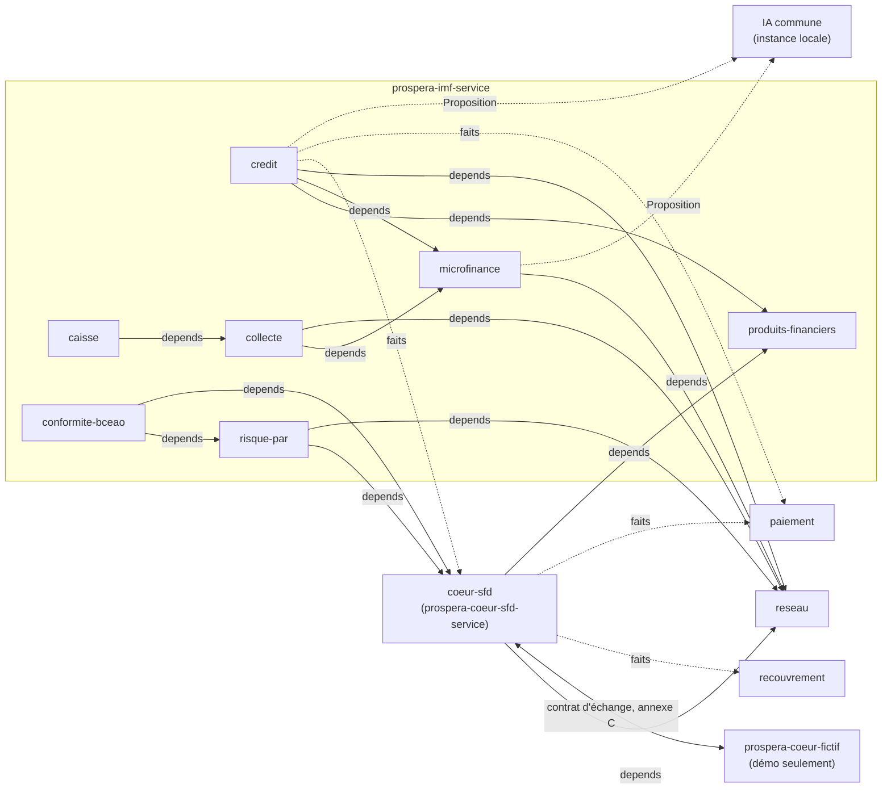
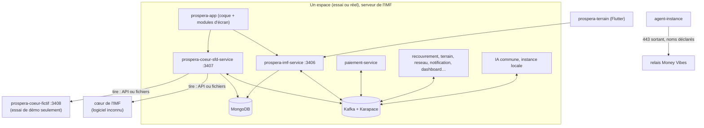

# Architecture Spine — Microfinance (IMF)

Rédigée en mode rapide le 2026-11-13 à la demande du PO, juste après le PRD final. Elle fixe ce que deux unités construites séparément pourraient choisir de façon incompatible. Les raisons sont au `.memlog.md`. Les marques `[ASSUMPTION]` sont à confirmer par le PO.

## Design Paradigm

**Un système d'engagement à côté d'un système d'enregistrement.** Le **cœur** de l'IMF (son logiciel) est le système d'enregistrement : il tient les comptes, l'épargne, la caisse du guichet, les écritures et le compte de prêt officiel. Prospera est le système d'**engagement** : il tient les **décisions** (dossier, comité, ordres, recouvrement) et des **projections datées** de ce que le cœur sait. Entre les deux, un seul canal : des **faits** tirés par Prospera, acquittés, idempotents, portant leur clé d'origine. Rien n'est poussé vers l'IMF ; aucun total n'est échangé, seulement des mouvements.

| Couche | Où | Ce qu'elle tient |
|---|---|---|
| Décisions de l'IMF | `prospera-imf-service` : modules `credit`, `produits-financiers`, `microfinance`, `collecte`, `caisse`, `risque-par`, `conformite-bceao` | dossiers, produits versionnés, clients et KYC, collectes, caisse des collecteurs, classes et provisions proposées, rapports |
| Frontière avec le cœur | `prospera-coeur-sfd-service` : module `coeur-sfd` | journal des échanges, file d'envoi, file des écarts, fraîcheur ; **aucun solde** |
| Cœur de démonstration | `prospera-coeur-fictif` (application à part) | comptes, prêts officiels, échéanciers, pénalités, épargne, caisse du guichet, balance — en démo seulement |
| Modules partagés | `paiement-service` (Créance, décaissement électronique), recouvrement, terrain, reseau, notification, dashboard, equipe, marketing, finance-transactions | inchangés, plus les écarts IMF du PRD (partie 4) |
| IA | instance locale de l'IA commune (service porteur à cadrer) | règles v0 puis modèles, servis par `PropositionPort` |
| Écrans | `prospera-app/src/modules/<code>/` ; application terrain `prospera-terrain` (Flutter) | aucune donnée ni règle métier (spine coque AD-11) |

## Inherited Invariants

| Inherited | From parent | Binds here |
| --- | --- | --- |
| AD-2, AD-10, AD-15, AD-16 | spine du moteur | un propriétaire par donnée ; Docker Compose, l'agent seul aux commandes ; une organisation, deux espaces (essai, réel) ; sauvegardes orchestrées par l'agent |
| AD-9 (amendé le 2026-11-13) | spine du moteur | sortie 443 vers les noms déclarés : centrale, registre, `destinationsSortantes` (relais, tunnel de l'IA commune, sorties d'intégration) ; aucun port entrant ; gel J+30 inchangé |
| AD-12 | spine du moteur | `instance.journal`, écrit par l'agent seul ; ici, la piste d'audit métier reste dans chaque module (AD-17) |
| AD-14, AD-39 | spine du moteur | l'apprentissage ne reçoit que des données préparées sur l'instance ; la calibration du client est intouchable |
| AD-24, AD-17 | spine du moteur | la garde lit l'état publié de son espace ; contrats nommés |
| AD-27 | spine du moteur | `@confluentinc/kafka-javascript`, Karapace, partition par `organisationId`, dédoublonnage par `eventId`, compatibilité BACKWARD ; `epoque` : moteur AD-16 et Connecteurs AD-25 |
| AD-13, AD-31 | spine du moteur | registre des consentements de l'IMF sur l'agent ; chemin du correctif de sécurité (le correctif réglementaire : AD-28) |
| AD-30 | spine du moteur | maintenance, version figée, fenêtre N/N-1 (licence à vie : PRD FR-261) |
| AD-3, AD-5, AD-13 | spine de la Reprise | la clé d'origine suit un objet ; les règles restent chez la cible, qui simule ; réconciliation par les valeurs de contrôle de la cible |
| AD-4, AD-5, AD-8, AD-13 | spine de Connecteurs | jamais un total ; identité d'un échange ; la file d'envoi ne perd rien ; concordance et file des écarts |
| AD-1, AD-2, AD-3, AD-8, AD-11 | spine de `paiement` | aucune détention de fonds ; la Créance projetée par upsert idempotent ; ledger d'encaissements en ajout seul ; montants en unité mineure avec devise ; séparation des pouvoirs au niveau de l'acteur |
| AD-1, AD-2, AD-11 | spine de l'assistant | forme de la Proposition (origine `LANGAGE \| REGLE`) ; décideur typé ; règles et scores en stratégies typées avec facteurs ; **le contrat est aligné, le service n'est pas repris** (AD-14) |
| AD-3, AD-6, AD-11, AD-16 | spine de la coque | module d'écran par dossier ; droits lus, jamais calculés ; aucun métier dans Next ; contrat d'un emplacement |
| Conventions et Stack | spine du moteur | nommage, données, idempotence, erreurs, événements, temps, tests ; Node 24, NestJS 11, Mongoose 8, MongoDB 8.0, BullMQ 6.7, Redis 7.2+ |
| C1 → C13 | contrat de module | chaque module : manifeste, gate, données possédées, emplacements vides, contrats, paramètres, droits, écran, installer et désinstaller, démarrer seul, IA, migrations, installable sous contrôle |

## Invariants & Rules



Trait plein : dépendance dure (`depends`, l'installation est refusée sans elle). Pointillé : enrichissement par des faits ou un port (`enrichiPar`, jamais bloquant). Aucune autre flèche n'est permise.

### AD-1 — Le cœur fait foi ; Prospera ne tient que des projections datées `[ADOPTED]`

- **Binds:** FR-2, FR-150 → FR-165, FR-209, FR-257, annexe C
- **Prevents:** un solde « officiel » calculé par Prospera qui contredit le cœur ; un paiement compté deux fois ; une projection présentée comme vérité ; des commandes d'argent lancées sur un cœur muet.
- **Rule:**
  - Aucun module de ce périmètre ne stocke un solde, un encours officiel, une caisse du guichet ou une écriture comme vérité. Ce qui vient du cœur est une **projection** : `valeur`, `lueLe` (date de la lecture du cœur), `cleOrigineCoeur`. **`coeur-sfd` est le seul écrivain des projections** (AD-2) ; les autres modules s'en font une copie locale par ses faits.
  - Tout affichage d'un montant issu du cœur porte sa date de lecture (FR-2). Une projection plus vieille que le seuil de fraîcheur de son objet (annexe D) est marquée « ancienne ».
  - Un fait saisi dans Prospera qui touche l'argent (remboursement, collecte, décaissement électronique) reste `EN_ATTENTE_COEUR` (affiché « en attente du cœur » ; `ENVOYEE` du PRD) jusqu'à ce que `coeur-sfd` publie son appariement (AD-8) ; aucun autre module ne le fait passer à confirmé.
  - Cœur indisponible (aucune lecture réussie depuis le double de la fraîcheur par défaut) : les commandes qui **engagent de l'argent** (ordre de décaissement, lien de paiement, marquage « exécuté ») sont refusées avec `COEUR_INDISPONIBLE` ; instruction, comité, relances sur la dernière échéance connue et collecte hors ligne continuent ; les envois attendent dans la file d'envoi, dans l'ordre.

### AD-2 — Les unités et leurs données : un propriétaire par objet `[ADOPTED]`

- **Binds:** C3, FR-15, FR-16, annexe A
- **Prevents:** deux modules qui écrivent le même objet ; un module qui lit la base d'un autre.
- **Rule:** chaque objet a **un seul écrivain**. Les autres le lisent par ses faits ou par sa route de lecture, jamais par sa base.

| Module (service) | Seul écrivain de | Lit (par faits ou route) |
|---|---|---|
| `credit` (imf) | dossiers, sous-dossiers de groupe, refinancements, pièces, cautions, garanties, **liens** de visite d'instruction `(dossierId, visiteId)`, checklists, grilles 5C, avis, décisions, séances de comité et votes, **échéanciers contractuels**, ordres de décaissement (`ordreId`, essais) et sous-états, dérogations, délégations, résultats BIC saisis, `gpPret`, table des combinaisons interdites | produits, clients et KYC, prêts et échéanciers officiels (projections), visites, Propositions de l'IA |
| `produits-financiers` (imf) | produits et leurs versions, journal de publication, **paramètres réglementaires datés** (AD-28) | code produit du cœur (projection) |
| `microfinance` (imf) | prospects, clients (hors identité du cœur), groupes, fiches, pièces, KYC et son statut calculé, sanctions et correspondances, revues, alertes CENTIF, consentements, suivi d'équité, `gpClient`, `cleOrigineCoeur` de la fiche | identité du client, comptes et mouvements d'épargne (projections), dossiers |
| `collecte` (imf) | **toute ligne d'encaissement d'espèces saisie dans Prospera (terrain ou guichet)**, collectes, reçus numérotés et leurs lignes, plages de reçus par collecteur, remises, annulations, écarts de remise, listes « à saisir dans le cœur » (vue) | échéances et mouvements (projections), clients |
| `caisse` (imf) | fonds de caisse des collecteurs (projection calculée de `collecte`), clôtures, rattrapages, écarts de clôture, seuils | caisse du guichet (projection), collectes, remises |
| `risque-par` (imf) | jours de retard et PAR, **arrêtés figés**, classes par arrêté, migrations, provisions **proposées** puis validées, alertes de risque, seuils proposés et validés, jeux de barème | prêts, échéanciers, mouvements (projections), agences, secteurs, statuts de recouvrement |
| `conformite-bceao` (imf) | rapports et leurs statuts, calendrier, statut juridique des paramètres, résultats de ratios, anomalies d'audit | arrêtés figés de `risque-par`, balance et classe officielle (projections), KYC (état neutre) |
| `coeur-sfd` (coeur-sfd) | **seul écrivain des projections du cœur** (prêts, échéances officielles, mouvements, pénalités, épargne, caisse du guichet, classe officielle, dépôts de garantie, balance, code produit), journal des échanges, file d'envoi, file des écarts, fraîcheur, rapprochement trimestriel | dossiers accordés, ordres, lignes d'encaissement, agences, produits |
| `terrain` | visites (instruction comprise), appareils | liens de `credit`, missions de recouvrement |
| `paiement` | **Créances** (dont `ECHEANCE_DE_PRET`), encaissements, ordres de paiement électroniques (décaissements compris) | échéanciers contractuels, restes dus du cœur (faits de `coeur-sfd`) |
| `recouvrement` | dossiers de recouvrement **par prêt** (IMF), actions, promesses, blocages | Créances, échéancier officiel et pénalités (faits de `coeur-sfd`), jours de retard (`risque-par`) |

- Une projection n'est pas une vérité : c'est une copie datée (`valeur`, `lueLe`, `cleOrigineCoeur`). Un autre module ne lit jamais la base de `coeur-sfd` ; il garde un **cache dérivé** nourri par ses faits. La projection d'un solde (encours officiel + mouvements postérieurs, FR-161) est calculée **une fois**, dans `coeur-sfd`, et comparée à la valeur de contrôle du cœur.
- Les objets de Reprise `client`, `pret`, `echeance`, `garantie`, `compte-epargne` sont ceux de `coeur-sfd` (manifeste A.6).
- Identité du client, champ par champ : nom, date de naissance, pièce, statut = cœur, projetés par `coeur-sfd` ; KYC, fiche enrichie, consentements, rattachements = `microfinance`. `microfinance` consomme `coeur-sfd.client.changed@1`, est seul à écrire `cleOrigineCoeur` sur la fiche, marque tout écart d'identité `A_RAPPROCHER` sans le corriger. Les consommateurs lisent l'identité dans `microfinance.client.changed@1` (valeur du cœur et `lueLe`).
- Une visite est un objet de `terrain` ; `credit` ne tient que le lien et une règle « visite valide » calculée sur `terrain.visite.changed@1`. Chaque service reçoit ses éléments de synchronisation par sa propre route (AD-19).
- Le statut KYC et sa validité (`valideJusquau`) sont calculés par `microfinance` seule ; `credit` ne recalcule jamais : à DOSSIER_COMPLET et à ORDONNE il relit la route de `microfinance` et enregistre `(statut, version, luLe)` dans l'audit.
- Un remboursement électronique est un encaissement de `paiement` ; un encaissement d'espèces est une ligne de `collecte`, jamais de `credit`.
- Le fonds d'un collecteur est une projection de `caisse` calculée de `collecte` seule (`calculeLe`) ; elle ne se présente jamais comme le compte d'attente du cœur. Un **écart de remise** appartient à `collecte`, un **écart de clôture** à `caisse` (champ `nature` distinct, jamais fusionnés).
- Le rattachement GP est à deux niveaux : `gpClient` (`microfinance`), `gpPret` (`credit`, `gpClient` par défaut) ; la portée « portefeuille » = l'un ou l'autre, filtrée par l'agence ; un conflit d'agence ouvre une alerte au RA sans élargir la portée.

### AD-3 — Sept modules dans un service, sans couplage de code `[ADOPTED]`

- **Binds:** C1, C2, C3, C4, C9, C10, FR-16
- **Prevents:** un module qui ne s'installe plus seul parce qu'il importe le code d'un voisin ; une collection partagée entre deux modules.
- **Rule:**
  - `prospera-imf-service` contient un module Nest **par code de module**, sous `src/modules/<code>/`. Un module n'importe **jamais** le code d'un autre module du service : il passe par ses faits (bus) ou sa route de lecture, comme s'il était dans un autre service. Un test de lint échoue sur tout import croisé entre `src/modules/*`.
  - Chaque module a sa garde (`<CODE>_NOT_ENTITLED`), ses collections préfixées par son code (`credit_dossiers`, `microfinance_clients`…), son outbox et ses migrations.
  - Un module non activé dort : ses routes rendent le refus de garde, ses consommateurs ne traitent rien. Le service démarre dès qu'un de ses modules est activé : au compose, `profiles: ["credit", "produits-financiers", "microfinance", "collecte", "caisse", "risque-par", "conformite-bceao"]`.
  - Un module peut sortir du service plus tard sans changer de contrat (ses routes, faits et collections sont déjà les siens).
  - L'image de `prospera-imf-service` est **une seule** ; son `retourArriere` est le plus restrictif de ses modules ; une migration qui n'est pas `SANS_PERTE` bloque la promotion de toute l'image et est refusée en CI. Un module désactivé ne migre pas.

### AD-4 — La machine à états du dossier : un seul écrivain, des transitions gardées

- **Binds:** FR-30 → FR-99, FR-270, FR-271, §5.11 du PRD
- **Prevents:** deux chemins qui changent le statut d'un dossier ; une transition sans trace ; un statut ajouté par un voisin.
- **Rule:**
  - Seul `credit` change le statut d'un dossier, par une **commande** : `(dossierId, transition, acteur, motif?, cléIdempotence)`. La table des transitions du PRD (§5.11 : douze statuts, REFUSE compris, plus ANNULE ; sous-état de décaissement À_ORDONNER, ORDONNE, EXECUTE, CONFIRME, INCONNU) est **la seule source** ; une transition absente est refusée (`TRANSITION_INTERDITE`). Pour un dossier de groupe, le sous-état est **par membre** ; le groupe n'est CONFIRME que quand tous le sont (FR-73).
  - Dans la **même transaction** : le dossier change, une entrée s'ajoute à la piste d'audit chaînée (AD-17), un fait part dans l'outbox.
  - EN_GESTION naît de la **décision favorable du comité** ; le décaissement vit dans le sous-état. Un dossier non CONFIRME n'entre ni dans l'encours, ni dans le PAR, ni dans les relances.
  - Les statuts de recouvrement sont un **second axe**, tenu par `recouvrement` ; ils n'ajoutent aucun statut au dossier.

### AD-5 — Le décaissement : un ordre, une clé, un seul canal

- **Binds:** FR-64 → FR-71, FR-256, NFR-4
- **Prevents:** un décaissement fait deux fois ; un ordre rejeté rejoué comme le même essai ; un ordre réémis sans savoir si le premier est parti ; deux canaux pour un même ordre ; deux clés pour un même ordre chez le fournisseur.
- **Rule:**
  - Un ordre a un `ordreId` **stable**, créé par `credit` seul à À_ORDONNER → ORDONNE, et des **essais numérotés** (`numeroEssai`, 1 au départ). La clé d'idempotence transmise au cœur ou au fournisseur est **celle de l'essai** (`<ordreId>:<numeroEssai>`) ; elle n'est **jamais régénérée** pour un même essai. `coeur-sfd` et `paiement` ne dérivent jamais un `ordreId`.
  - Un essai REJETE ou EXPIRE est terminal ; le retour À_ORDONNER (avec son motif) ouvre l'essai suivant avec une nouvelle clé d'essai. Un essai INCONNU n'est jamais terminal : il ne devient REJETE ou EXECUTE que sur confirmation du cœur ou du fournisseur ; aucun essai suivant avant.
  - Un ordre a **un seul canal** : espèces et virement → le cœur exécute ; Mobile Money et PI-SPI → `paiement` exécute, puis `coeur-sfd` le déclare au cœur. En démo, le cœur fictif exécute aussi le Mobile Money (décision Q1). Le canal ne change que depuis À_ORDONNER, après un rapprochement établissant qu'aucune exécution n'a eu lieu ; l'ordre garde son `ordreId` ; le changement est une entrée d'audit à deux personnes.
  - Canal électronique : `paiement` consomme `credit.ordre-decaissement.emis@1`, exécute et publie `paiement.ordre-decaissement.changed@1` (`ordreId`, `numeroEssai`, état EN_COURS, EXECUTE, REJETE ou INCONNU, référence du fournisseur) ; `credit` fait évoluer le sous-état **seulement** sur ce fait (canal électronique) ou sur `coeur-sfd.ordre-decaissement.*` (canal cœur) ; `coeur-sfd` déclare au cœur sur l'état EXECUTE. Le `txId` du fournisseur est dérivé de façon déterministe et réversible de la clé d'essai ; la table de correspondance est celle de `paiement`.
  - Un ordre sans réponse passe INCONNU : on interroge le cœur ou le fournisseur **avant** toute réémission. Au redémarrage ou après restauration, la fenêtre de rapprochement d'AD-29 s'applique avant reprise.
  - Un dossier dont l'ordre est rejeté peut être ANNULE (message d'annulation au cœur, acquitté).

### AD-6 — Échéancier contractuel, échéancier officiel, Créance

- **Binds:** FR-59 → FR-63, FR-70, FR-209, FR-210, FR-257 ; amendement `paiement` du 2026-11-13
- **Prevents:** deux restes dus qui se contredisent ; un reste dû qui remonte ou se réduit deux fois ; un lien de paiement sur un montant périmé ; un client qui paie deux fois.
- **Rule:**
  - `credit` génère l'**échéancier contractuel** (AD-11) et le publie dans `credit.dossier.accorde@1`.
  - `paiement` ouvre les Créances `ECHEANCE_DE_PRET` sur ce fait (upsert idempotent, spine `paiement` AD-2) ; elles deviennent exigibles sur `coeur-sfd.ordre-decaissement.confirme@1` (identité d'une échéance : AD-27). `paiement` en est **le seul propriétaire** (décision Q2).
  - **Montant exigible, une seule formule, calculée par `paiement` seul.** (1) `resteDuCoeur` = échéancier officiel + pénalités − mouvements du cœur, lu à `lueLe` (faits de `coeur-sfd`). (2) On retire les encaissements de `paiement` **postérieurs à `lueLe`** dont la clé n'est pas encore appariée par `coeur-sfd` (AD-8) ; un encaissement déjà apparié est déjà dans (1) et n'est jamais retiré deux fois. (3) `montantExigible` = (1) − (2). Une relecture du cœur **remplace** (1) et recalcule (2) ; elle ne s'ajoute jamais. **Le cœur gagne** : sans encaissement non apparié, le client voit `resteDuCoeur` tel quel ; une différence au-delà de la tolérance d'arrondi ouvre `coeur-sfd.ecart.ouvert@1`.
  - Le recalage sur le cœur est un **ajustement en ajout seul** `AJUSTEMENT_COEUR` (composante, signe, `lueLe`, clé d'origine du cœur) sur la Créance ; `montantOrigine` n'est jamais réécrit ; un ajustement n'est pas un encaissement et ne touche pas `montantImpute`.
  - `recouvrement`, `credit` et `risque-par` lisent `montantExigible` et `lueLe` dans `paiement.creance.changed@1`, sans jamais le recalculer. Un mouvement du cœur sans clé Prospera réduit ou ferme la Créance (AD-8).
  - Un lien de paiement n'est émis qu'après une relecture du reste dû plus récente que l'âge maximal (annexe D ; défaut 15 minutes). Si la fréquence déclarée du transport dépasse cet âge (cœur à fichiers « nuit »), le lien est **désactivé** (« paiement en ligne indisponible pour ce prêt ») ; sinon `paiement` demande une relecture ciblée par `paiement.relecture.demandee@1` (`pretIdCoeur`) et `coeur-sfd` répond par `coeur-sfd.echeancier.changed@1` ou `coeur-sfd.fraicheur.changed@1` en moins de 30 s.
  - L'**écart de rattachement** est un réglage de `paiement` par type de créance (1 % pour un prêt) ; il choisit l'échéance sans la solder ; la tolérance d'arrondi est un réglage distinct (5 FCFA).

### AD-7 — Le contrat d'échange avec le cœur : des objets, deux transports, Prospera tire

- **Binds:** FR-150 → FR-165, annexe C, A9, A10, B1 (moteur AD-9)
- **Prevents:** un échange qui dépend d'un produit de cœur ; un port ouvert chez l'IMF ; deux formats pour un même objet ; un tirage en delta chez l'un et en instantané chez l'autre ; un renvoi qui double un paiement.
- **Rule:**
  - Les objets échangés sont **ceux de l'annexe C**, décrits en JSON Schema dans `prospera-plateforme/contrats/coeur-sfd/` (version épinglée au build, comme spine Reprise AD-2).
  - Deux transports derrière un seul port `TransportCoeur` : **API** interrogée par Prospera, ou **fichiers** déposés par le cœur et tirés par Prospera. Les deux livrent le même objet. Aucun webhook entrant.
  - Chaque message porte : `messageId`, objet, sens, **clé d'origine** (identifiant dans le système qui l'a créé), `versionObjet`, date d'effet, empreinte SHA-256 du contenu (JCS). `messageId = SHA-256(organisationId | objet | cleOrigine | versionObjet)` : **déterministe**, identique à chaque tentative ; le cœur déduplique sur `cleOrigine + versionObjet`, `messageId` n'est qu'un témoin. Rejouer un message est sans effet ; une correction a `versionObjet` + 1.
  - Les envois vers le cœur (dossiers accordés, ordres, annulations, remboursements renvoyés si le cœur sait les recevoir, plans d'étalement, contentieux, pertes, blocages de conformité) passent par la **file d'envoi acquittée** (spine Connecteurs AD-8) ; un envoi non acquitté dans son délai (annexe D, compté depuis l'envoi) passe en écart. La file est **ordonnée par entité racine** : client, puis dossier ou prêt, puis ordre, annulation, remboursement ; un message n'est envoyé qu'après l'acceptation du précédent de sa chaîne ; une annulation qui rattrape un message encore en file le remplace (`ANNULE_AVANT_ENVOI`, jamais envoyé).
  - Chaque objet déclare dans son schéma son **mode de tirage** : `DELTA` (curseur monotone rendu par le cœur, conservé par `coeur-sfd` par organisation et par objet) ou `SNAPSHOT` (fichier avec `genereLe`, `nbLignes` et empreinte, sinon refusé et mis en écart ; l'absence d'une clé n'est une suppression que pour les objets déclarés `SUPPRESSION_PAR_ABSENCE`). Le cœur fictif et les tests de contrat exercent les deux modes pour chaque objet.
  - Les mouvements d'un prêt s'appliquent par date d'effet ; un mouvement antidaté déclenche le recalcul des jours de retard ; un trou de séquence ouvre une ligne d'écart sans bloquer.
  - Mouvements, jamais totaux (spine Connecteurs AD-4) ; la balance du cœur est le seul objet agrégé, lu pour les ratios.
  - `TransportCoeur` est la **couture** où se branche un adaptateur de Connecteurs (kit-cible) ; la file d'envoi, la file des écarts et la fraîcheur restent dans `coeur-sfd`.
  - Le catalogue d'AD-9 est consommé par les deux clients Kafka (`kafkajs` de `paiement`, Confluent) sans changer de schéma ; chaque fait est enregistré dans Karapace avec un test de contrat joué des deux côtés (moteur AD-17).

### AD-8 — Apparier par la clé d'origine

- **Binds:** FR-2, FR-137, FR-150, FR-155, FR-159, FR-161, FR-257
- **Prevents:** un remboursement saisi dans Prospera puis revu au cœur, compté deux fois ; un paiement fait au guichet du cœur pris pour un écart ; une remise d'espèces prise pour un second crédit du client ; deux modules qui apparient chacun de leur côté.
- **Rule:**
  - Un fait saisi dans Prospera porte une **clé d'origine Prospera** : pour l'argent collecté, le couple `(numeroRecu, numeroLigne)` (`collecte` seule numérote les lignes ; au plus une ligne par prêt ou compte et par nature ; une annulation référence la ligne) ; pour un ordre, la clé d'essai (AD-5) ; pour un dossier, son identifiant. Elle voyage vers le cœur et revient dans son mouvement ; le cœur fictif refuse de recopier un reçu sans numéro de ligne.
  - `coeur-sfd` classe chaque mouvement du cœur : (a) il porte une clé Prospera connue → il **confirme** le fait ; (b) il n'en porte pas et son canal n'est pas un canal Prospera (paiement au guichet du cœur : **cas normal**) → il s'applique à l'échéance par `(pretIdCoeur, numeroEcheance)` et réduit ou ferme la Créance (AD-6), sans écart ; (c) il est **ambigu** (deux appariements possibles, montant incohérent, clé inconnue sur un canal Prospera, un mouvement pour plusieurs lignes) → ligne de la file des écarts. Jamais un rapprochement « au plus proche » ; l'IA ne propose que des doublons probables, un humain applique.
  - **Seul** `coeur-sfd` apparie, une fois, et publie `coeur-sfd.mouvement.apparie@1` (clé d'origine, ligne, `mouvementCoeurId`, résultat CONFIRME ou ECART). Le module propriétaire du fait (`collecte`, `credit`, `paiement`) ne change son statut de EN_ATTENTE_COEUR à confirmé **que** sur ce fait et ne lit jamais `coeur-sfd.mouvement.recu@1` pour apparier. Un fait en attente plus vieux que son délai (annexe D) passe en écart par `coeur-sfd`, jamais par le module propriétaire.
  - La remise d'espèces d'un collecteur au guichet est un **transfert de caisse**, porteur des numéros de reçu remis ; elle ne crédite jamais un client.

### AD-9 — Un seul catalogue de contrats nommés

- **Binds:** C5 de chaque module, annexe A, annexe C
- **Prevents:** un module qui publie `x` pendant que son voisin écoute `y` (constaté dans l'annexe A du PRD : `credit.decaissement.ordonne` contre `credit.ordre-decaissement.emis`, `coeur-sfd.client.changed` jamais publié, `coeur-sfd.caisse.changed` contre `coeur-sfd.caisse-guichet.changed`) ; un flux de l'annexe C sans déclencheur ni retour.
- **Rule:** le tableau ci-dessous est le catalogue **complet** des faits de ce périmètre ; il **complète et corrige** les C5 de l'annexe A du PRD. Il est établi en parcourant les objets de l'annexe C (un objet cœur → Prospera = un fait `coeur-sfd.<objet>.changed@1` ou `.recu@1` ; un objet Prospera → cœur = un fait déclencheur nommé chez son décideur, consommé par `coeur-sfd`) et les clauses C5 de l'annexe A. Une table de correspondance « nom du PRD → nom de la spine » est tenue dans `manifestes-a-produire.md` (AD-25). Un nom absent du tableau ne se publie ni ne se consomme ; il s'ajoute par une PR qui amende ce tableau. Graphie `domaine.objet.fait@version`, au passé ; `.changed` pour un état complet (précédent `etat-publie.changed`).

| Publieur | Faits publiés |
|---|---|
| `credit` | `credit.dossier.changed@1`, `credit.dossier.soumis@1`, `credit.dossier.accorde@1` (conditions figées + échéancier contractuel), `credit.dossier.refuse@1`, `credit.dossier.annule@1`, `credit.dossier.cloture@1`, `credit.ordre-decaissement.emis@1`, `credit.ordre-decaissement.inconnu@1`, `credit.derogation.accordee@1`, `credit.alerte-audit.emise@1` |
| `produits-financiers` | `produits-financiers.produit.publie@1`, `produits-financiers.produit.retire@1`, `produits-financiers.produit.a-revoir@1`, `produits-financiers.parametre-reglementaire.changed@1` |
| `microfinance` | `microfinance.client.changed@1` (porte l'identité du cœur, `lueLe`, `creePar`, `valideePar`), `microfinance.client.converti@1`, `microfinance.kyc.changed@1` (état neutre, AD-22), `microfinance.groupe.changed@1`, `microfinance.consentement.changed@1`, `microfinance.client.bloque@1`, `microfinance.client.debloque@1` (code neutre `BLOCAGE_CONFORMITE`), `microfinance.revue.echue@1` |
| `collecte` | `collecte.collecte.changed@1` (états, lignes), `collecte.collecte.annulee@1`, `collecte.remboursement.saisi@1` (ligne d'espèces au guichet ou sur le terrain), `collecte.remise.contresignee@1`, `collecte.ecart.detecte@1` (`nature`), `collecte.liste-a-saisir.changed@1` |
| `caisse` | `caisse.fonds.changed@1`, `caisse.cloture.changed@1`, `caisse.ecart.detecte@1`, `caisse.ecart.resolu@1` |
| `coeur-sfd` | `coeur-sfd.client.changed@1`, `coeur-sfd.client.cree@1`, `coeur-sfd.pret.changed@1`, `coeur-sfd.pret.solde@1`, `coeur-sfd.echeancier.changed@1`, `coeur-sfd.mouvement.recu@1` (paiements, pénalités, décaissements exécutés), `coeur-sfd.mouvement.apparie@1`, `coeur-sfd.epargne.changed@1`, `coeur-sfd.compte-epargne.ouvert@1`, `coeur-sfd.caisse-guichet.changed@1`, `coeur-sfd.remise.changed@1`, `coeur-sfd.balance.recue@1`, `coeur-sfd.classe-officielle.recue@1`, `coeur-sfd.depot-garantie.changed@1`, `coeur-sfd.produit.code@1`, `coeur-sfd.ordre-decaissement.confirme@1` (porte `dossierId` et `pretIdCoeur`), `coeur-sfd.ordre-decaissement.rejete@1`, `coeur-sfd.envoi.etat@1`, `coeur-sfd.ecart.ouvert@1`, `coeur-sfd.ecart.resolu@1`, `coeur-sfd.fraicheur.changed@1` |
| `risque-par` | `risque-par.par.calcule@1` (état courant, affichage seul), `risque-par.arrete.fige@1`, `risque-par.classe.changed@1`, `risque-par.provision.proposee@1`, `risque-par.provision.validee@1`, `risque-par.perte.proposee@1`, `risque-par.alerte.changed@1`, `risque-par.seuil.propose@1`, `risque-par.seuil.valide@1` |
| `conformite-bceao` | `conformite-bceao.rapport.changed@1`, `conformite-bceao.ratio.calcule@1`, `conformite-bceao.usure.depassee@1`, `conformite-bceao.anomalie.detectee@1` |
| `recouvrement` (faits ajoutés) | `recouvrement.plan-etalement.decide@1` (décideur, nouvel échéancier contractuel), `recouvrement.contentieux.transfere@1`, `recouvrement.perte.decidee@1`, `recouvrement.credit.bloque@1`, `recouvrement.credit.debloque@1` |
| `paiement` (faits ajoutés) | `paiement.ordre-decaissement.changed@1`, `paiement.relecture.demandee@1` |
| agent, espace d'essai | `essai.horloge.changed@1` (AD-30) |

Les faits des voisins consommés ici gardent leurs noms (`paiement.creance.changed@1`, `paiement.encaissement.changed@1`, `recouvrement.dossier.changed@1`, `reseau.portee.changed@1`, `terrain.visite.changed@1` avec `visitePar`, `etat-publie.changed.*@1`). `coeur-sfd` consomme les faits de décision des autres modules (`recouvrement.plan-etalement.decide@1`, `recouvrement.contentieux.transfere@1`, `recouvrement.perte.decidee@1`, `microfinance.client.bloque@1`, `credit.dossier.accorde@1`, `collecte.*`, `paiement.ordre-decaissement.changed@1`), jamais un état comme `recouvrement.dossier.changed@1`. Les faits des analyses d'IA ne sont pas des faits de module : ce sont des Propositions (AD-14).

### AD-10 — Le cœur fictif : un logiciel à part, jamais en production `[ADOPTED]`

- **Binds:** FR-166 → FR-172, FR-11 → FR-13, UJ-6
- **Prevents:** une démo qui ne prouve pas le contrat ; un cœur fictif qui tourne chez un vrai client ; un jeu de démo différent d'une installation à l'autre.
- **Rule:**
  - `prospera-coeur-fictif` est un dépôt à part. Il parle le contrat d'AD-7 par les **deux** transports, comme un vrai cœur, et rien d'autre : il ne lit ni n'écrit aucune base de Prospera.
  - Il ne s'installe que dans un **espace d'essai** ; l'état voulu signé d'une instance porte `coeurFictifAutorise` (faux par défaut, vrai seulement pour les instances de démonstration) et l'agent refuse de le démarrer ailleurs (`COEUR_FICTIF_INTERDIT`).
  - Il tient lui-même comptes, prêts officiels, échéanciers, pénalités (calculées par ses règles), épargne, caisse du guichet et balance, et exécute les décaissements, Mobile Money compris (décision Q1).
  - Le jeu de démonstration (3 agences, 10 agents, 1 000 prêts actifs) est produit par un **générateur à graine fixe** : la même graine donne les mêmes données ; il passe par le contrat, jamais par une écriture directe.

### AD-11 — Une seule bibliothèque de calcul financier

- **Binds:** FR-10, FR-32 → FR-36, FR-59, FR-100 → FR-111, addendum §3
- **Prevents:** deux TEG différents pour un même prêt (simulation, comité, publication du produit, cœur fictif) ; un plafond d'usure contrôlé par deux méthodes.
- **Rule:**
  - L'échéancier (annuité constante, capital constant, in fine), le TEG (actuariel annuel proportionnel, frais retenus et assurance obligatoire inclus) et le **contrôle au pire cas** vivent dans **une** bibliothèque pure, `prospera-plateforme/finance` (sans base, sans état, déterministe).
  - `produits-financiers`, `credit`, `risque-par`, `conformite-bceao` (contrôle a posteriori, FR-189) et `prospera-coeur-fictif` l'utilisent à la **même version majeure.mineure épinglée** (contrôle au build) ; aucun module ne recalcule un TEG ou un échéancier à sa façon. Un prêt dont le TEG ne peut être calculé est « TEG indéterminé ».
  - L'alerte d'écart contractuel / officiel (FR-61) ignore les différences ≤ la tolérance d'arrondi cumulée (n × 1 FCFA).
  - Le tableau de référence de l'addendum §3 est sa suite de tests d'or (à 0,01 point).
  - La méthode est un paramètre daté (annexe D) : la corriger après la revue juridique change une version, pas le code des modules.

### AD-12 — Tout se fige au dossier : version du produit, version des paramètres

- **Binds:** FR-3, FR-4, FR-100, FR-112, annexe D
- **Prevents:** un dossier en cours dont les conditions changent quand un produit ou un seuil change ; deux écrans qui lisent deux versions différentes.
- **Rule:**
  - Produits et paramètres sont **versionnés** (version immuable, date d'effet). On ne modifie pas une version : on en publie une nouvelle.
  - Un dossier enregistre à sa soumission `produitVersionId`, `financeVersion` et `parametresVersion` de chaque module qu'il utilise, puis `strategieVersion` de la Proposition présentée au comité (AD-14) ; toute règle appliquée à ce dossier (plan d'étalement et refinancement compris) lit **ces** versions, jamais « la version courante ».
  - Les seuils d'alerte suivent la même règle ; leur valeur proposée par calcul (`risque-par.seuil.propose@1`) n'entre en vigueur qu'après validation humaine.

### AD-13 — Les montants : entiers d'unité mineure, avec leur devise `[ADOPTED]`

- **Binds:** FR-12, NFR-10, AD-8 de la spine `paiement`
- **Prevents:** un arrondi différent d'un module à l'autre ; un montant sans devise.
- **Rule:** tout montant est un couple `(entier, devise)` (XOF : unité mineure = 1 FCFA). Les calculs d'AD-11 arrondissent à la fin, à l'unité, avec ajustement de la dernière échéance. Aucun nombre flottant n'est stocké.

### AD-14 — L'IA : un port Proposition, des règles v0 dans l'IA commune `[ADOPTED]`

- **Binds:** AD-12, FR-8, FR-34, FR-47 → FR-53, FR-95 → FR-99, FR-112, FR-113, FR-124 → FR-131, FR-142, FR-147 → FR-149, FR-174, FR-178 → FR-181, FR-190, FR-194, FR-199, FR-206 → FR-208, FR-226 → FR-229, FR-236, FR-237, FR-260, C11
- **Prevents:** un module de l'IMF qui calcule son propre score ; une proposition sans provenance ; une décision prise par l'IA ; une donnée nominative qui part vers l'IA commune ; deux notions du « consentement en vigueur » ; un barème que l'IA ne connaît pas.
- **Rule:**
  - Aucun module de ce périmètre n'appelle un modèle ni ne code une règle de score : il demande une **Proposition** à l'**instance locale de l'IA commune** par un port unique, `PropositionPort`, qui a **son propre contrat** : aligné sur la Proposition de la spine de l'assistant (AD-1 : cycle de vie, audit, garde-fous, décideur typé AD-2, facteurs obligatoires AD-11) mais avec `origine: REGLE | MODELE`, version, `strategieVersion`, `parametresVersion`, date, données utilisées. L'assistant n'a que `LANGAGE | REGLE` ; il n'est pas modifié ici.
  - Le **service porteur** de l'instance locale est à cadrer (Deferred) ; AD-25 liste ce qu'il faudrait amender chez l'assistant si on le réutilise. Tant que l'origine `MODELE` n'existe pas, toute capacité est servie en `REGLE` et l'écran dit « règle », jamais « IA » (FR-8).
  - Les **règles explicables v0** (score 40/30/20/10, décision suggérée, priorités de relance, zones de prospection…) sont des stratégies typées de l'IA commune, remplacées par des modèles sans changer le port. Les **paramètres** d'un score (barème, seuils) sont des **entrées de la demande** (`parametres: {version, valeurs}` lus par `credit` dans `credit_parametres`) ; la stratégie ne code aucune valeur modifiable.
  - Le module stocke l'identifiant de la **Proposition présentée au comité** (après le premier avis du CC, FR-49 ; un recalcul crée une nouvelle Proposition sans remplacer celle-ci), la décision de l'humain (décideur typé) et le **motif d'écart** quand il s'en écarte. L'alignement avec la suggestion est calculé par `credit` seul, sur ces identifiants.
  - Sans IA commune, l'emplacement rend `NON_INSTALLE` et le processus continue (FR-8).
  - Les **écarts prédiction / réalité** sont enregistrés sur l'instance, préparés selon la spine du moteur (AD-14), puis envoyés par le tunnel sortant déclaré (AD-9 amendé). Un écart n'entre dans un lot d'export que si **les deux** conditions sont vraies à l'instant de la préparation : (1) le registre de l'agent couvre la finalité (moteur AD-13 ; vocabulaire fermé = finalités des clauses C11) ; (2) le client a un consentement « IA commune » en vigueur (`microfinance.consentement.changed@1`). Un retrait retire les écarts du client de la file d'export avant toute écriture ; les groupes de moins de 5 sont retirés ; la reconnaissance vocale exige un consentement propre (FR-207, FR-260) ; le niveau d'apprentissage est un champ du registre de l'agent, jamais un paramètre de module.
  - Une mise à jour de modèle est un artefact de la ligne de version vérifié hors ligne (moteur AD-7), le tunnel n'étant que le transport ; elle est appliquée à l'essai, puis promue à la date choisie par l'IMF ; la retirer repointe sur la calibration précédente (moteur AD-39).
  - Les entrées d'un score sont une **liste fermée de variables autorisées** ; genre, situation matrimoniale, nationalité et religion n'y entrent jamais.
  - Un chiffre d'un rapport réglementaire ne vient jamais d'un modèle (FR-190).

### AD-15 — La séparation des tâches se vérifie sur l'acteur, à chaque commande

- **Binds:** FR-6, FR-82, FR-85, FR-120, FR-143 ; spine `paiement` AD-11
- **Prevents:** une règle de séparation appliquée dans l'écran mais pas au serveur ; deux modules qui l'appliquent différemment ; un rôle qui la contourne.
- **Rule:**
  - Les combinaisons interdites sont **une donnée versionnée de `credit`** (FR-82, FR-6, FR-64 dont le changement de bénéficiaire à deux personnes, FR-138 contresignature de remise, FR-140 déclarant / valideur d'un paiement Mobile Money), un test par ligne. Elles se vérifient **sur l'identifiant de la personne**, au serveur, dans la commande, à partir de la piste d'audit du dossier et des références d'acteur portées par `microfinance.client.changed@1` (`creePar`, `valideePar`) et `terrain.visite.changed@1` (`visitePar`).
  - Refus nommé : `SEPARATION_DES_TACHES` ; là où `paiement` refuse lui-même, `SEPARATION_POUVOIRS_VIOLEE` : le front traite les deux comme une famille. Une délégation (datée, motivée) ne lève jamais une combinaison sur une même personne.
  - La règle est écrite une fois, dans `credit`, pour le dossier ; `microfinance`, `collecte` et `caisse` appliquent les combinaisons qui les touchent avec le même code de refus.

### AD-16 — Les périmètres : lus du réseau, appliqués par chaque module

- **Binds:** FR-5, annexe B, amendement `reseau` du 2026-11-13
- **Prevents:** un RA qui lit une autre agence par une route oubliée ; deux définitions du portefeuille d'un GP.
- **Rule:**
  - Les cinq échelons (réseau, région, agence, zone, portefeuille) se lisent dans `reseau.portee.changed@1`. Chaque module filtre **au serveur** chaque lecture par l'organisation et par la portée de l'acteur.
  - La portée « portefeuille » est **écrite** par `credit` (GP désigné au comité) et `microfinance` (clients rattachés), publiée dans leurs faits, et **reprise** par `reseau` dans la portée.
  - ADMIN_IMF n'a aucune portée métier : toute lecture métier lui est refusée.

### AD-17 — La piste d'audit métier : par module, en ajout seul, chaînée, ancrée hors de l'hôte

- **Binds:** FR-9, FR-78, FR-191, NFR-6 ; spine du moteur AD-12
- **Prevents:** une trace modifiable par l'application ; deux formats de trace ; une modification directe en base qui passe inaperçue.
- **Rule:**
  - Chaque module tient sa piste d'audit dans une collection en **ajout seul** (`<code>_audit`) : acteur, rôle, objet, état avant, état après, motif, date, empreinte de l'entrée précédente.
  - L'empreinte de tête de chaque piste, avec son `epoque`, est remise à l'agent chaque jour ; l'agent la joint à la **vérification quotidienne** (moteur AD-9) et la centrale la garde ; le champ est ajouté au schéma de `instance.indicateurs` (AD-25) et ne porte ni identité ni contenu. Un dépôt choisi par l'IMF est un complément, pas un substitut. Une chaîne cassée ou une tête qui recule **dans** une époque est une anomalie du signal ; un recul avec changement d'`epoque` (restauration) n'en est pas une (AD-29).
  - Le journal des **accès** (lectures) est une collection distincte, lisible par l'AUD seul.
  - Conservation : 10 ans (paramètre, J-11).

### AD-18 — Les données sensibles : chiffrées par champ, clés hors du compte d'administration

- **Binds:** FR-5, FR-15, FR-132, J-8, NFR-5
- **Prevents:** un administrateur système qui lit les pièces d'identité ; deux modules qui chiffrent de deux façons.
- **Rule:**
  - Les champs sensibles (numéros de pièce, téléphones, positions GPS, photos de pièces, motifs LBC/FT) sont **chiffrés par l'application**, champ par champ, avant l'écriture en base.
  - Une bibliothèque commune `prospera-plateforme/champs-sensibles` fixe l'**enveloppe** (version de clé, nonce, texte chiffré) ; les champs interrogeables par égalité (pièce, téléphone ; FR-116, FR-121, FR-123) portent un **index aveugle HMAC** ; les clés de données sont enveloppées par une clé maîtresse du coffre.
  - Les clés vivent dans le coffre de l'instance ; le déverrouillage exige le DG et le DAF ensemble, **une fois** (clé maîtresse scellée en mémoire du service), avec une procédure de redémarrage au manuel d'exploitation (FR-265) mesurée dans le RTO ; le compte ADMIN_IMF n'y a pas accès. Choix de la bibliothèque et rotation : story de pointe de `microfinance` (→ addendum §4).
  - Rien de nominatif ne quitte l'instance ; ce qui sort pour l'IA est anonymisé sur l'instance (AD-14).

### AD-19 — Le terrain hors ligne : l'appareil propose, le serveur juge

- **Binds:** FR-200 → FR-208, FR-135 → FR-142, NFR-8 ; décision D4 (Flutter)
- **Prevents:** un doublon à la synchronisation ; un solde changé par le téléphone ; deux numéros de reçu identiques ; une collecte tardive qui rouvre une clôture ; de l'argent perdu avec un appareil perdu.
- **Rule:**
  - L'application `prospera-terrain` (Flutter, client d'API généré depuis OpenAPI) enregistre localement visites, fiches, collectes et brouillons de demande, chacun avec un **identifiant unique créé sur l'appareil** ; la synchronisation est rejouable sans doublon.
  - Chaque service reçoit ses éléments par **sa propre route** de synchronisation ; l'application les envoie dans l'ordre collectes, puis missions de recouvrement urgentes, puis le reste, chaque élément portant sa clé d'idempotence ; un échec n'invalide que l'élément.
  - Aucune décision ne se prend hors ligne ; le serveur valide ou refuse chaque saisie et **horodate à la réception** ; l'heure de l'appareil est conservée comme « heure déclarée » et ne sert à aucun contrôle (délai de 7 jours, ordre, fraîcheur).
  - Les numéros de reçu hors ligne sont tirés d'une **plage attribuée par `collecte` à un collecteur** (jamais à un appareil), au format `RC-<agence>-<collecteur>-<n>` (entier à 8 chiffres, sans réutilisation) ; un appareil remplacé reprend la plage non consommée ; une plage perdue est déclarée `collecte.ecart.detecte@1` (`nature: TROU_DE_PLAGE`), jamais une anomalie silencieuse.
  - Chaque collecte porte `dateValeur` (jour de la collecte, fuseau de l'agence) et `dateSynchro` (serveur). Une collecte synchronisée après la clôture de sa `dateValeur` ne rouvre jamais la clôture : `caisse` crée un **rattrapage** daté de J+n rattaché à J. Un appareil non synchronisé au-delà de `delaiSynchroMax` (annexe D) lève `collecte.ecart.detecte@1` (`nature: NON_SYNCHRONISE`) et bloque la clôture du collecteur.
  - Un appareil déclaré **perdu** : session révoquée, ses collectes en file sont refusées par défaut mais mises en **quarantaine** (`A_ARBITRER`, lisible du RA seul) ; le RA décide de les reprendre ou non ; rien n'est perdu ni accepté en silence. `[ASSUMPTION]` arbitrage de FR-136 contre FR-204, à confirmer par le PO.
  - Les données locales sont chiffrées, l'application se verrouille, et s'efface après un délai sans connexion (annexe D) ou sur l'état « appareil perdu ».

### AD-20 — Le recouvrement de l'IMF : le module partagé, avec des écarts nommés

- **Binds:** FR-209 → FR-229, PRD-D §6.2
- **Prevents:** un second module de recouvrement pour l'IMF ; des statuts IMF codés en dur dans le noyau partagé.
- **Rule:**
  - L'IMF utilise le module partagé `recouvrement` ; ses écarts sont des **réglages de verticale** : dossier **par prêt** ; statuts EN_RETARD, EN_RECOUVREMENT, PLAN_ETALEMENT, REGULARISE, BLOQUE, CONTENTIEUX_JUDICIAIRE, PERTE_DEFINITIVE déclarés comme vocabulaire de la verticale ; blocage d'un dossier par le ROC seul ; caution bloquée seulement si appelée.
  - Le recouvrement lit `montantExigible` de la Créance de `paiement` (AD-6) et les jours de retard de `risque-par` (AD-21) ; il ne calcule ni pénalité, ni intérêt, ni retard.
  - Le plan d'étalement, le contentieux et la perte définitive passent au cœur par `coeur-sfd` (file d'envoi, AD-7) sur des **faits de décision** distincts (`recouvrement.plan-etalement.decide@1`, `recouvrement.contentieux.transfere@1`, `recouvrement.perte.decidee@1`, AD-9) ; `coeur-sfd` ne consomme jamais `recouvrement.dossier.changed@1`. Le nouvel échéancier contractuel est une donnée de la décision, jamais recalculée par `coeur-sfd`. Un nouvel échéancier officiel : AD-27.

### AD-21 — Le reporting BCEAO : les chiffres viennent des projections, jamais d'un calcul à part

- **Binds:** FR-183 → FR-195
- **Prevents:** un rapport dont le PAR diffère de celui du tableau de bord ; un ratio calculé sans la balance du cœur ; un arrêté du 31 décembre lu avant la synchronisation de nuit du cœur ; trois sources de jours de retard.
- **Rule:**
  - Les **jours de retard et le PAR sont calculés par `risque-par` seul**, depuis les projections du cœur (`coeur-sfd.*`) ; `recouvrement`, `paiement` et `conformite-bceao` les lisent, ne les calculent pas. Un fait EN_ATTENTE_COEUR n'entre jamais dans le PAR (affiché à part).
  - Un **arrêté** est un objet figé de `risque-par` `{date, lueLe, version, empreinte}` ; il n'est calculé que lorsque `coeur-sfd.fraicheur.changed@1` atteste que toutes les familles d'objets d'argent ont un `lueLe` ≥ date + 1 jour ; sinon il reste « en attente des données du cœur ». `conformite-bceao` ne lit que `risque-par.arrete.fige@1`, jamais `par.calcule` ni un calcul à la volée.
  - Les ratios prudentiels viennent de la balance du cœur (`coeur-sfd.balance.recue@1`). Sans balance : « en attente des données du cœur », jamais une valeur estimée.
  - La classe réglementaire du rapport est la **classe officielle du cœur** (`coeur-sfd.classe-officielle.recue@1`) quand elle existe ; la classe de `risque-par` n'y figure qu'à titre de comparaison. Le rapport présente côte à côte `provisionComptabilisee` (cœur, `lueLe`) et `provisionProposee` ; un écart au-delà du seuil (annexe D) ouvre `conformite-bceao.anomalie.detectee@1` ; aucun chiffre ne résulte d'une substitution de l'un par l'autre.
  - Un rapport est un objet **figé** : version, empreinte, statut (généré, validé par le DG, déposé hors Prospera) ; son PDF est rendu au serveur.
  - Les classes sont celles du référentiel réglementaire du pays (paramètre daté) ; les classes du rapport d'exemple de la démo ne sont jamais reprises (décision P3).

### AD-22 — La LBC/FT : listes importées, filtrage par l'IMF, secret au serveur

- **Binds:** FR-119 → FR-123, J-3 → J-7
- **Prevents:** une liste rafraîchie sans refiltrer le fichier ; un agent qui voit un dossier de soupçon.
- **Rule:**
  - Les listes de sanctions arrivent par fichier, par une source déclarée ou par le miroir tenu par Money Vibes (AD-26), chaque jour ; chaque import refiltre **tout** le fichier des clients.
  - Le dossier de soupçon, la correspondance de sanctions, l'alerte CENTIF et la procédure « correspondance confirmée » vivent dans `microfinance`, dans une collection lisible seulement par l'habilitation de conformité, le DG et l'AUD ; **aucun fait du bus, aucune route, aucun message ne les expose à un autre rôle** (pas même un compteur).
  - Seul un **état neutre** sort de `microfinance` : `microfinance.kyc.changed@1` (statut, `valideJusquau`) et `microfinance.client.bloque@1` / `.debloque@1` (code `BLOCAGE_CONFORMITE`, sans motif, sans liste, sans score). Les gardes de `credit`, `collecte` et `coeur-sfd` ne lisent que cet état ; `coeur-sfd` le consomme aussi pour demander le gel au cœur ; le refus de décaissement porte le motif générique `KYC_NON_VALIDE`. Les notifications de conformité sont émises par `microfinance` seule vers les habilitations de conformité, le DG et l'AUD, sans passer par le bus partagé. Test : un CC et un CPT ne trouvent la correspondance dans aucune route, aucun message, aucun journal d'accès autre que celui de l'AUD.

### AD-23 — Prospera dans l'espace d'essai et dans l'espace réel

- **Binds:** FR-11 → FR-13, UJ-6, spine du moteur AD-15, spine Connecteurs AD-18
- **Prevents:** un ordre réel parti d'une démo ; des données de démonstration dans l'espace réel.
- **Rule:** la démonstration (IMF fictive, cœur fictif, 1 000 prêts) vit dans un **espace d'essai**. Tout ordre, lien de paiement ou message vers l'extérieur y est intercepté et compté (contrat C13) ; rien de l'essai ne passe au réel, sauf par la Reprise.

### AD-24 — La tranche de février et l'ordre de construction

- **Binds:** B5, Q4, ★ du PRD
- **Prevents:** un module ★ qui attend un voisin non planifié.
- **Rule:** la démo de février exige, dans cet ordre : `prospera-plateforme/finance` et les schémas de l'annexe C ; `produits-financiers` (paramètres réglementaires, AD-28), `microfinance` ; `coeur-sfd` (avec le point d'import de la Reprise de `client`, `pret`, `echeance`, `garantie`, `compte-epargne`) et `prospera-coeur-fictif` ; `credit` (UJ-1 de bout en bout) ; `collecte` et le terrain IMF ; `risque-par` ; le recouvrement IMF ; l'IA commune minimale (règles v0) ; le tableau de bord. `caisse` et `conformite-bceao` suivent. Le Mobile Money sortant de `paiement` n'est pas dans février (le cœur fictif décaisse).

### AD-25 — Ce que cette spine change chez ses voisins

- **Binds:** AD-2, AD-3, AD-9, AD-14, AD-17, AD-26, AD-28
- **Prevents:** des voisins qui gardent une version contredite.
- **Rule:** à porter dans la même série de PR que les épics :
  - `manifestes-a-produire.md` : service porteur de M14, M15, M16, M18, M20, M32 et M46 = `prospera-imf-service` ; M47 = `prospera-coeur-sfd-service` ; `prospera-microfinance-service` reste le paquet comptable (M17 épargne : **lue du cœur** par `microfinance`, pas tenue) ; la table de correspondance « nom du PRD → nom de la spine » des faits (AD-9).
  - Spine du moteur : `coeurFictifAutorise` dans l'état voulu (AD-10) ; empreintes de tête des pistes d'audit (avec `epoque`) dans le schéma de `instance.indicateurs` (AD-17) ; AD-31 nomme le **correctif réglementaire** (jamais critique, jamais sans date d'effet) à côté du correctif de sécurité (AD-28) ; code de la centrale `LICENCE_A_VIE_NON_SUSPENDABLE`.
  - Module `recouvrement` : vocabulaire de verticale, dossier par prêt (AD-20), faits de décision (AD-9).
  - Spine `paiement` : AD-2 et AD-3 (source `ECHEANCE_DE_PRET`, `AJUSTEMENT_COEUR`, écart de rattachement par type de créance, AD-6) ; AD-9 (page de lien servie par le relais pour une instance sur site, AD-26) ; AD-11 (deux codes de séparation, AD-15) ; réservation du Mobile Money sortant.
  - PRD microfinance : addendum §6 aligné sur FR-263 (le lien ne porte aucun nom) ; renvoi de FR-8 vers AD-14 ; objet « Compte d'attente du collecteur » à décider pour l'annexe C (Deferred).
  - `prospera-plateforme` : bibliothèques `finance` (AD-11) et `champs-sensibles` (AD-18), contrats `coeur-sfd` (AD-7).
  - **Si** l'assistant porte l'instance locale de l'IA commune (Deferred) : amender sa spine AD-1 (origine `MODELE`), AD-7 (journal des écarts prédiction / réalité, donnée possédée, durée de conservation), AD-19 (portée par agence et portefeuille, pas le seul dossier) et AD-21 (instance sur site, modèle livré comme artefact signé de la ligne de version). Sans ces amendements, l'IMF a une instance locale distincte sous le même contrat `PropositionPort`.

### AD-26 — Le relais Money Vibes : une unité, un propriétaire, accusé après écriture `[ASSUMPTION]`

- **Binds:** FR-158, FR-258, FR-263, FR-268, addendum §6
- **Prevents:** un événement du fournisseur acquitté puis perdu ; une page de lien rendue par deux unités ; un lien qui porte un nom de client ; un état de lien que le relais ne connaît pas.
- **Rule:**
  - Le relais est une unité de la plateforme Money Vibes (service et base à part, un propriétaire), seul écrivain de la file des événements entrants et des états de liens ; Money Vibes y est sous-traitant. ~~`[ASSUMPTION]` nom et forme du service à fixer au cadrage du relais.~~ **Tranchée (2026-11-13)** : le relais est `prospera-relais`, service de plateforme décrit par AD-44 de la spine du moteur (boîte aux lettres chiffrée, durée limitée, l'instance tire, propriétaire Dev A, à cadrer avant février).
  - L'instance **publie** vers lui (sortie 443 déclarée, AD-9 du moteur) l'état de chaque lien (jeton opaque, montant, expiration, usage unique, état) et **tire** les événements entrants ; elle n'acquitte qu'après écriture ; le relais n'acquitte le fournisseur qu'après écriture durable ; rejeu par `(fournisseur, identifiant d'événement)` ; purge à 7 jours (annexe D).
  - La page de lien est **servie par le relais**, jamais par l'instance ; le lien ne porte **aucun nom** de client.
  - Un écart avec le relevé du fournisseur entre dans la file des écarts de `paiement`. Les listes de sanctions passent par un **miroir distinct** du relais.

### AD-27 — Identité d'une échéance et versions d'échéancier

- **Binds:** FR-59 → FR-63, FR-209, FR-210, annexe C
- **Prevents:** des Créances `dossierId:n` que `recouvrement` (clé : prêt) ne retrouve pas ; des lignes d'un ancien échéancier ni fermées ni remplacées après un plan d'étalement.
- **Rule:**
  - Une échéance a l'identité unique `(organisationId, pretIdCoeur, numeroEcheance, versionEcheancier)`.
  - `coeur-sfd.ordre-decaissement.confirme@1` porte `dossierId` **et** `pretIdCoeur` et est **le seul** fait qui les lie ; `paiement`, `recouvrement`, `risque-par` et `credit` le consomment. Avant lui, les Créances `dossierId:n` sont « à venir » et inexigibles ; après lui, `dossierId` n'apparaît plus dans `recouvrement`.
  - À chaque nouvel échéancier officiel (`versionEcheancier` + 1, plan d'étalement compris), `paiement` **ferme** les Créances non soldées de l'ancienne version (en reportant les encaissements) et ouvre celles de la nouvelle, dans une seule commande idempotente.

### AD-28 — Les paramètres réglementaires : un propriétaire, livrés comme données signées

- **Binds:** FR-10, FR-189, FR-195, FR-261, FR-262
- **Prevents:** un plafond d'usure sans écrivain avant `conformite-bceao` ; un second calculateur de TEG ; un IMF qui accorde au-dessus d'un nouveau plafond sur une instance gelée ou figée.
- **Rule:**
  - Les paramètres réglementaires datés (plafond d'usure par pays et catégorie, classes et barème de provision, seuils CENTIF, durées de conservation, périodicités) sont **possédés par `produits-financiers`** (seul écrivain, validés par le DG, FR-195) et lus par tous par `produits-financiers.parametre-reglementaire.changed@1` ; `conformite-bceao` y ajoute le statut juridique (« vérifié par un juriste ») sans en être propriétaire.
  - Ils sont livrés comme **données signées de la ligne de version** (moteur AD-7), appliquées à l'essai puis validées par le DG ; ils ne portent aucune migration. Sur une instance gelée, ils passent **par fichier** ; sur une version figée sans contrat de maintenance, un bandeau « paramètre réglementaire en retard : plafond en vigueur au <date> » s'affiche aux rôles de conformité et au DG.

### AD-29 — Après une restauration : une fenêtre de rapprochement, des numéros qui ne reculent pas

- **Binds:** FR-135, FR-267, NFR-4, NFR-6 ; moteur AD-16, Connecteurs AD-25
- **Prevents:** un ordre, un envoi ou une remise rejoué après restauration ; un numéro de reçu réémis ; une alerte d'audit permanente après une restauration légitime.
- **Rule:**
  - Une restauration ouvre une nouvelle `epoque`. La **fenêtre de rapprochement** est le paramètre d'annexe D (au moins égal au RPO) ; elle couvre les ordres (AD-5), les envois de la file d'envoi et les remises, avant toute reprise.
  - L'allocation des numéros de reçu est croissante et non réutilisable : la prochaine plage d'un collecteur démarre au-delà du maximum déclaré par ses appareils à leur reconnexion ; un numéro vu chez le client et absent du serveur est un trou déclaré (FR-135).
  - Les files d'export de l'IA sont vidées et reconstruites ; la tête d'une piste d'audit est publiée avec son `epoque` (AD-17).

### AD-30 — Une horloge unique, pilotée dans l'espace d'essai

- **Binds:** FR-166 → FR-172, FR-173 → FR-182, spine du moteur (conventions de temps)
- **Prevents:** un PAR de démo qui diffère de la cible du cœur fictif ; un retard calculé sur l'horloge système en essai.
- **Rule:** tout module lit le temps par un port `Horloge` (fuseau `Africa/Lome` ou celui de l'IMF). Dans l'espace d'essai l'horloge est **pilotée** par l'agent et partagée avec `prospera-coeur-fictif` (`essai.horloge.changed@1`) ; aucun calcul de retard, d'arrêté ou d'âge n'y utilise l'horloge système.

## Consistency Conventions

Les conventions de la spine du moteur s'appliquent (nommage, données, idempotence, erreurs, événements, temps, tests). S'y ajoutent :

| Concern | Convention |
| --- | --- |
| Nommage | services `prospera-imf-service`, `prospera-coeur-sfd-service` ; application `prospera-coeur-fictif` ; modules Nest `src/modules/<code>/` ; collections `<code>_<objet>` ; topics d'AD-9 seulement |
| Statuts | en majuscules, sans accent, tels que le PRD les nomme (`EN_COMITE_CREDIT`) ; `EN_ATTENTE_COEUR` est l'état d'un fait d'argent saisi dans Prospera (`ENVOYEE` du PRD, affiché « en attente du cœur ») ; un statut est une donnée de la machine à états, jamais une chaîne libre |
| Projections du cœur | trois champs toujours ensemble : `valeur`, `lueLe`, `cleOrigineCoeur` ; écrites par `coeur-sfd` seul |
| Clés d'origine | Prospera : collecte = `(numeroRecu, numeroLigne)`, ordre = `<ordreId>:<numeroEssai>`, autre objet = `<code>:<objet>:<id>` ; cœur : telle que le cœur la donne, jamais réécrite |
| Erreurs | codes nommés ajoutés : `TRANSITION_INTERDITE`, `SEPARATION_DES_TACHES`, `TEG_AU_DELA_DU_PLAFOND`, `KYC_NON_VALIDE`, `TAUX_EFFORT_DEPASSE`, `CREDIT_BLOQUE`, `ORDRE_DEJA_EMIS`, `ORDRE_ETAT_INCONNU`, `COEUR_INDISPONIBLE`, `COEUR_FICTIF_INTERDIT`, `DONNEES_DU_COEUR_ANCIENNES` |
| Paramètres | un document versionné par module (`<code>_parametres`), date d'effet, auteur, validateur ; lu par version (AD-12) |
| Ports de dev (réservés) | `prospera-imf-service` 3406, `prospera-coeur-sfd-service` 3407, `prospera-coeur-fictif` 3408 |
| Tests | chaque module : « transition interdite refusée », « commande rejouée sans effet », « séparation des tâches » ; `coeur-sfd` : « message rejoué », « mouvement sans clé → écart », « cœur coupé 3 jours » ; parcours UJ-1 de bout en bout sur le cœur fictif ; tableau de TEG de référence (AD-11) |

## Stack

Héritée de la spine du moteur (Node.js 24.x LTS, NestJS 11.x, Mongoose 8.x, MongoDB 8.0, `@confluentinc/kafka-javascript` 1.11.x, Karapace 6.2.x, Redis 7.2+, BullMQ 6.7.x, MinIO). Mesuré le 2026-11-13 : `prospera-microfinance-service` et `prospera-paiement-service` sont en NestJS 11, Mongoose 8 et **`kafkajs` 2.2.4** ; les deux nouveaux services suivent la spine du moteur (client Confluent), pas `kafkajs`.

| Name | Version |
| --- | --- |
| Flutter (application terrain) | stable du moment, épinglée à la première story terrain `[ASSUMPTION]` |
| Rendu PDF des rapports | bibliothèque épinglée à la story de pointe de `conformite-bceao` `[ASSUMPTION]` |

## Structural Seed



**Déploiement et environnements.** `prospera-imf-service` et `prospera-coeur-sfd-service` tournent dans **chaque espace** de l'instance de l'IMF (sur ses serveurs) et de la plateforme Money Vibes (démo). Le cœur fictif ne tourne que dans un espace d'essai de démonstration (AD-10). Démarrage, mises à jour, sauvegardes et supervision sont ceux du moteur (AD-10, AD-11, AD-16 de sa spine ; supervision sur place, amendement du 2026-11-13). Un serveur couvre jusqu'à dix fois la taille de la démo ; au-delà, étude avant mise en service (PRD FR-266).

```text
prospera-imf-service/
  src/modules/credit/              # AD-4, AD-5, AD-15
  src/modules/produits-financiers/ # AD-11, AD-12
  src/modules/microfinance/        # AD-18, AD-22
  src/modules/collecte/            # AD-8, AD-19
  src/modules/caisse/
  src/modules/risque-par/          # règles reprises du paquet comptable SFD
  src/modules/conformite-bceao/    # AD-21
prospera-coeur-sfd-service/
  src/transport/                   # TransportCoeur : api/, fichiers/
  src/echanges/                    # journal, file d'envoi, file des écarts, fraîcheur
prospera-coeur-fictif/             # AD-10 : contrat d'AD-7 + générateur à graine fixe
prospera-plateforme/
  finance/                         # AD-11
  contrats/coeur-sfd/              # AD-7, schémas de l'annexe C
```

## Capability → Architecture Map

| Capability / Area | Lives in | Governed by |
| --- | --- | --- |
| Crédit de bout en bout (FR-30 → FR-99, FR-270, FR-271) | `credit` | AD-4, AD-5, AD-6, AD-12, AD-14, AD-15 |
| Produits financiers (FR-100 → FR-113) | `produits-financiers` | AD-11, AD-12 |
| Clients, KYC, LBC/FT (FR-114 → FR-134) | `microfinance` | AD-16, AD-18, AD-22 |
| Collecte (FR-135 → FR-142) | `collecte`, `prospera-terrain` | AD-8, AD-19 |
| Caisse des collecteurs (FR-143 → FR-149) | `caisse` | AD-1, AD-8 |
| Échange avec le cœur (FR-150 → FR-165, FR-199) | `coeur-sfd` | AD-1, AD-7, AD-8 |
| Cœur fictif (FR-166 → FR-172) | `prospera-coeur-fictif` | AD-10, AD-23 |
| Risque de portefeuille (FR-173 → FR-182, FR-272) | `risque-par` | AD-12, AD-14, AD-21 |
| Conformité BCEAO (FR-183 → FR-195) | `conformite-bceao` | AD-21, AD-22 |
| Reprise du portefeuille (FR-196 → FR-198) | `reprise` + point d'import des modules | spine Reprise ; AD-7 |
| Terrain et recouvrement IMF (FR-200 → FR-229, FR-274) | modules partagés | AD-19, AD-20 |
| Pilotage, marketing, compta, IA commune, installation (FR-230 → FR-269, FR-273) | modules partagés, moteur | AD-14, AD-16, AD-17 ; spine du moteur |
| Règles transverses (FR-1 → FR-16) | tous | AD-1, AD-12, AD-13, AD-14, AD-15, AD-17 |
| Relais Money Vibes, liens de paiement (FR-158, FR-258, FR-263) | relais (plateforme) | AD-26, AD-6 |
| Paramètres réglementaires, licence à vie (FR-189, FR-195, FR-261) | `produits-financiers`, moteur | AD-28 |
| Restauration, horloge d'essai | tous | AD-29, AD-30 |

## Deferred

- **Le vrai connecteur vers le cœur de l'IMF** : son logiciel est inconnu ; le contrat d'AD-7 suffit pour février (décision A9).
- **Le choix de la bibliothèque de chiffrement et la rotation des clés** : à la story de pointe de `microfinance` (AD-18).
- **Le schéma des objets de Reprise de `credit` et `microfinance`** (dossiers, fiches) : à écrire avec leur point d'import ; ceux de `coeur-sfd` sont dans AD-2 et AD-24.
- **Le compte d'attente du collecteur** : objet cœur → Prospera à décider pour l'annexe C ; en attendant, le fonds de `caisse` n'est qu'une projection de `collecte` (AD-2).
- **Les faits `conformite-bceao.separation.contournee` et les alertes de `credit.visite`** de l'annexe A : non repris, aucun flux ne les consomme ; à rouvrir par une PR sur AD-9.
- **La supervision locale** de l'échange avec le cœur, du tunnel de l'IA et de la licence (FR-265) : au manuel d'exploitation.
- **Le Mobile Money sortant de `paiement`** : à chiffrer au plan (décision Q1).
- **La haute disponibilité et plusieurs serveurs** : au-delà de dix fois la démo (FR-266 ; spine du moteur, travaux différés).
- **Le service porteur de l'instance locale de l'IA commune** (assistant réutilisé ou instance distincte) et les modèles : à cadrer ; `PropositionPort` (AD-14) ne bougera pas ; amendements chez l'assistant listés dans AD-25.
- **La sortie d'un module de `prospera-imf-service`** vers son propre service : quand la charge ou l'équipe le demandera (AD-3).
