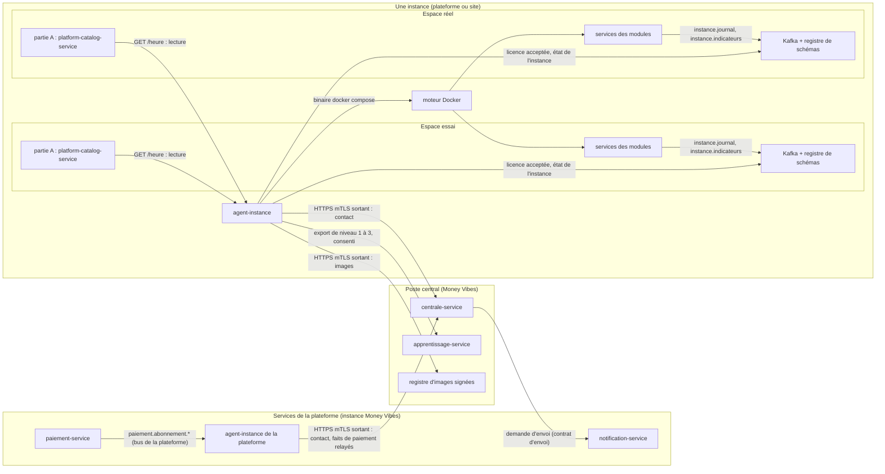
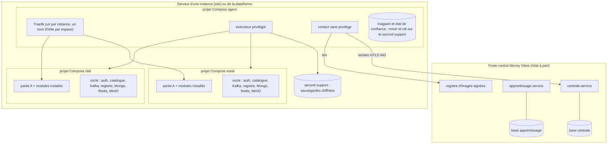
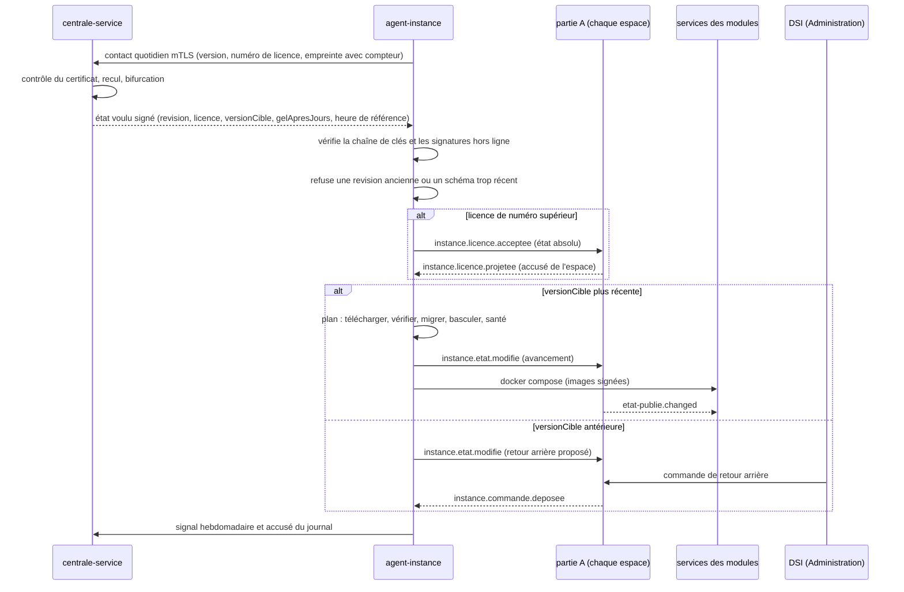

# Architecture Spine — Moteur d'installation

Due avant la semaine 5 (07/12/2026), quand la partie A entre en construction. Elle tranche ce que le PRD laisse à l'architecture (§7, §8.2, §8.3) : le découpage des services des parties B et C, l'ancrage de l'horloge scellée et de l'état de confiance, les formats signés, les noms des contrats et la bascule de l'existant. Les raisons des décisions sont au `.memlog.md`. Les constats de la relecture et leur traitement sont dans `reviews/disposition.md`.

## Design Paradigm

**Un poste central et un agent qui tire.** Money Vibes publie un **état voulu signé** pour chaque instance : licence (qui porte les sanctions), version de plateforme, interrupteurs, heure de référence. L'**agent d'instance** le tire par une connexion sortante, le vérifie, puis l'applique lui-même. Rien n'est jamais poussé vers une instance, et une instance coupée continue avec le dernier état voulu accepté.

| Couche | Où | Unités |
|---|---|---|
| **Poste central** | chez Money Vibes seulement | `centrale-service` (parc d'instances), `apprentissage-service` (partie C) |
| **Instance** | plateforme Money Vibes et chaque serveur sur site ; deux espaces, essai et réel | `agent-instance` (une par instance, hors des espaces), `platform-catalog-service` (partie A, **une par espace**), services des modules |
| **Artefacts signés** | entre les deux, par le réseau ou par fichier | manifeste de version, images, état voulu, licence, heure de référence, jeton d'export, fichiers d'urgence, de rétablissement et de prolongation, modèle commun |

## Invariants & Rules



Une flèche = « peut appeler ou écrire vers ». Aucune flèche ne va du poste central vers une instance cliente ; la seule flèche de la centrale vers un service de la plateforme est la demande d'envoi à `notification-service`, passerelle d'e-mail de Money Vibes. Aucun service de module ne parle à la centrale : les faits de paiement lui parviennent par l'agent de la plateforme, dans son contact (AD-25). L'agent se raccorde au Kafka de chaque espace par un réseau dédié (AD-34).

### AD-1 — Le poste central ne pousse rien ; l'agent tire et applique `[ADOPTED]`

- **Binds:** FR-14 → FR-25, FR-41, NFR-2
- **Prevents:** un port entrant ouvert sur site ; une instance qui reçoit un ordre qu'elle ne sait pas vérifier ; deux chemins de livraison (réseau et fichier) qui se comportent différemment.
- **Rule:** Toute décision de Money Vibes sur une instance (licence et sanctions qu'elle porte, version, interrupteur, heure de référence, révocation, approbation d'export) devient un **élément de l'état voulu** (AD-22), signé, que l'agent tire au contact suivant. Le contact par réseau et le **fichier** (FR-22) transportent **exactement les mêmes artefacts** ; l'agent les vérifie et les applique par le même code. La centrale n'appelle jamais une instance cliente ; aucune instance n'expose de port entrant vers internet. Pendant un gel (AD-9), seul un **correctif de sécurité critique** apporté par fichier est appliqué.

### AD-2 — Quatre unités, un propriétaire par donnée `[ADOPTED]`

- **Binds:** PRD §7, C3, C5, NFR-3, NFR-5
- **Prevents:** deux services qui écrivent la même donnée ; des données personnelles de la partie C mêlées à l'exploitation du parc ; deux parties A qui partagent une base.
- **Rule:**

  | Unité | Où | Possède (seule à écrire) |
  |---|---|---|
  | `platform-catalog-service`, partie A | **un exemplaire par espace** de chaque instance, **une base par espace** | offres, dossiers et plans d'installation (étapes horodatées), bilans, faits de l'état publié (installation, espace, interrupteurs), entitlements, liste blanche des sorties d'essai, état publié de son espace (**seul émetteur de cet espace**) |
  | `agent-instance` | une par instance, hors des espaces | horloge scellée, état de confiance, journal, registre des consentements, licence acceptée, plans de promotion et de retour arrière, signal, sauvegardes, tunnel de support, faits de l'instance (gel, version figée, santé) |
  | `centrale-service` | Money Vibes | instances (parc), licences émises, sanctions, versions publiées, vagues et correctifs, supervision (derniers contacts, empreintes, niveaux, santé, incidents), autorité de certificats d'instance |
  | `apprentissage-service` | Money Vibes, base et accès à part | échantillons de niveau 1, accès de niveau 2, contributions de niveau 3, modèles communs, copie signée des consentements reçue de l'agent |

  Chaque unité a sa base (P12). Une autre unité lit par contrat nommé (AD-17), jamais dans la base d'autrui. **Installer** un module est une opération logique de la partie A sur la plateforme (le profil est déjà lancé) ; sur site, c'est le lancement de son profil Compose par l'agent, sur la commande `module.installer` de la partie A (AD-10, AD-37).

### AD-3 — L'agent vit hors de la version de plateforme `[ADOPTED]`

- **Binds:** FR-17, FR-18, FR-21, FR-40, PRD §7 (« un retour arrière ne peut pas être exécuté par le service qu'il remplace »)
- **Prevents:** une version cassée qui casse aussi son propre retour arrière ; deux agents qui écrivent en même temps.
- **Rule:** `agent-instance` a **sa propre ligne de version**, publiée et signée à part. Une version de l'agent sait opérer les versions de plateforme N et N-1 (**compatibilité d'agent**, à ne pas confondre avec la fenêtre N-1 d'une instance, AD-30). L'agent ne fait partie d'aucun projet Compose d'espace. Aucune version de plateforme ne change l'agent.
  - Il se met à jour **hors plan** seulement (aucune promotion ni retour arrière en cours), en lançant sa nouvelle image ; l'ancienne reste sur le disque pour revenir.
  - Un **bail exclusif**, renouvelé dans le magasin de l'agent, garantit qu'un seul agent écrit le journal, l'horloge et les plans. La nouvelle image prend le bail seulement après son contrôle de santé ; l'ancienne s'arrête alors d'elle-même.
  - Une version de l'agent lit tous les formats de plan, de journal et d'état écrits par la précédente. Elle ne migre le format du magasin qu'après sa propre validation (AD-34).

### AD-4 — L'ancrage de l'état de confiance : le magasin, un miroir qui n'avance que, un témoin `[ADOPTED]`

- **Binds:** NFR-11, NFR-10, FR-15, FR-16, PRD §8.2 (mécanisme d'ancrage)
- **Prevents:** une restauration, un instantané de VM, un jumeau de VM ou un changement de date qui ramène en arrière ou duplique la licence, l'horloge, un consentement retiré ou le journal.
- **Rule:**
  - **Composition** de l'état de confiance : horloge scellée, plus haut numéro de licence vu par clé, heure de référence de la dernière licence acceptée, registre des consentements, tête du journal, époque (AD-16), niveau d'ancrage.
  - **Niveau unique sur site en v1 : `LOGICIEL`.** L'état vit dans le magasin de l'agent (AD-34) et est copié sur un **volume dédié du second support**, qui n'est pas une sauvegarde mais un **miroir qui n'avance que** (AD-16, AD-35) : l'agent n'y écrit qu'un état de compteur supérieur ou égal, à chaque changement d'état. Au démarrage, un magasin de compteur ou de rang de journal inférieur à ceux du miroir est un **recul local** : refus de toute licence et de tout export jusqu'au rétablissement (AD-35).
  - **Compteur** (logiciel, dans le magasin, recopié au miroir) : il s'incrémente de un **à chaque contact préparé**, réseau ou fichier, et seulement alors. L'**empreinte** de l'état de confiance envoyée est celle **calculée à cet incrément** ; reprendre un contact interrompu renvoie le même couple (compteur, empreinte). Les changements d'état entre deux contacts n'entrent dans l'empreinte qu'au contact suivant.
  - **Témoin** (Money Vibes) : chaque contact porte le compteur, l'empreinte et l'empreinte précédente. La centrale garde la dernière. Un compteur plus bas est un **recul** ; deux empreintes différentes pour un même compteur, ou une précédente inconnue alors que le compteur suit de un, sont une **bifurcation** (jumeau de VM). Un compteur plus haut avec une lacune (centrale restaurée, contacts manqués) n'est ni l'un ni l'autre : la lacune est journalisée. Recul ou bifurcation font refuser toute licence et tout export de niveau 1 à 3, refuser le renouvellement du certificat (AD-29) et ouvrir un ticket.
  - **Plus faible que le matériel** : le niveau `LOGICIEL` est visible dans la supervision comme le niveau le plus faible (AD-34) ; un niveau d'ancrage matériel est au Deferred.
  - La plateforme Money Vibes est au niveau `PLATEFORME` : son horloge est celle de Money Vibes et elle est son propre témoin.

### AD-5 — L'horloge scellée n'avance que, et seul Money Vibes la corrige

- **Binds:** FR-15, A-1, NFR-11, SM (test « + 10 ans »)
- **Prevents:** une échéance qui tombe parce qu'on a avancé la date du serveur ; une échéance qui ne tombe jamais parce qu'on l'a reculée.
- **Rule:** L'agent tient l'horloge scellée dans l'état de confiance. Trois règles testables :
  1. **Allumée**, elle avance du temps machine mesuré (horloge monotone du système). Elle n'avance jamais d'elle-même de plus de **48 heures** de plus que ce temps mesuré.
  2. **Éteinte**, le temps n'est pas mesurable : au redémarrage, elle prend la date du serveur seulement si elle avance, et de 48 heures au plus. Un serveur resté éteint plus longtemps la laisse en arrière : les échéances ne tombent pas, jusqu'au prochain contact.
  3. Seule une **heure de référence signée** par Money Vibes, **de numéro plus élevé** que la dernière acceptée, la corrige, en avant comme en arrière. Chaque correction va au journal.

  Toute anomalie va au journal et à la centrale.

### AD-6 — Un seul port d'heure pour les échéances de contrat `[ADOPTED]`

- **Binds:** FR-34, A-1, §3.1 axe 3, FR-33, FR-17
- **Prevents:** deux services qui font tomber la même échéance à deux heures différentes ; une garde de module qui calcule une échéance sur l'horloge de son conteneur ; une horloge système qui rouvre l'attaque « avancer la date ».
- **Rule:**
  - La partie A lit l'heure par un **port `HorlogeDeReference`**. Sur site : `GET /heure` de l'agent, servi par son exécuteur (AD-36), sur le réseau interne de l'instance seulement. Sur la plateforme : l'horloge système de Money Vibes (NTP). La réponse est `instantUtc`, `horlogeId` (`SCELLEE` ou `PLATEFORME`) et `numeroHeureReference`. Les deux espaces d'une instance lisent **la même horloge**.
  - L'**état publié se calcule à la lecture**, depuis les faits et l'heure du port (`terme.ts` garde son principe : un statut lu, jamais écrit). Les **tâches BullMQ** n'existent que pour **émettre** `etat-publie.changed` à l'heure dite. Leur clef est `<organisationId>:<module>:<transition>:<date>:<epoque>` ; elles sont recalculées à chaque changement de fait et **annulées puis recalculées** après toute correction signée de l'heure ou toute époque nouvelle. Au redémarrage, la partie A rejoue celles qu'elle a manquées.
  - Les transitions de l'état publié sont : fin d'essai, préavis, lecture seule, effacement, date limite d'un interrupteur (`<organisationId>:<module>:<interrupteur>:<date>`). Le gel est un fait de l'agent (AD-9), pas une tâche de la partie A.
  - Si `GET /heure` est injoignable, périmé (plus de 5 minutes) ou en anomalie, la partie A **ne fait tomber ni ne reporte aucune échéance**, garde l'état publié courant et lève `HORLOGE_INDISPONIBLE`. Elle n'utilise jamais l'horloge système pour une échéance sur site.
  - L'essai d'un prospect (FR-33) et les vagues se lisent sur l'horloge de Money Vibes (A-1). `paiement-service` garde ses propres jalons de relance (J-7, J+7) sur sa propre horloge : ce sont des relances, pas des transitions d'état publié.
  - Aucun autre service ne calcule une transition de l'état publié ; aucun ne lit `Date.now()` pour en décider.

### AD-7 — Tout ce qui arrive de Money Vibes est signé, et vérifié hors ligne `[ADOPTED]`

- **Binds:** NFR-1, NFR-8, FR-14, FR-19, FR-22, FR-31
- **Prevents:** une image ou une licence fabriquée ; une vérification qui exige internet sur une instance coupée ; une clé compromise qui bloque sa remplaçante.
- **Rule:**
  - **Chaîne de clés** : une **clé racine hors ligne** (AD-28) signe un **certificat de clé** (JWS Ed25519 : `kid`, clé publique, période de validité, `usage`) pour chaque **clé de signature**. Deux familles, d'`usage` distinct (AD-28) : `ci` (images, manifeste, ligne de version de l'agent) et `centrale` (licence, état voulu, heure de référence, jeton d'export, fichiers de rétablissement et de prolongation). L'agent refuse un artefact signé par une clé dont l'`usage` ne le couvre pas. La vérification de cette chaîne est **du code de l'agent** : cosign par clé ne porte pas de chaîne. L'agent vérifie le certificat avec la racine, puis utilise la clé publique certifiée.
  - **Images** : signées par `cosign sign --key … --tlog-upload=false`, bundle conservé à côté de l'image. Vérification hors ligne : `cosign verify --key … --bundle … --insecure-ignore-tlog`. Ni `--offline` (déprécié en v3) ni Sigstore sans clé. La clé passée à cosign est celle que l'agent vient de certifier.
  - **Version de plateforme** : un **manifeste signé** (JWS) liste les empreintes de toutes les images (coque comprise, spine `prospera-app` AD-20), les migrations (AD-33), les schémas d'événements (AD-27), les interrupteurs, `retourArriere`, le niveau de correctif et la date de fin de maintenance.
  - **État voulu, licence (qui porte les sanctions), heure de référence, jeton d'export, fichiers d'urgence, de rétablissement et de prolongation, certificat de clé** : des **JWS Ed25519** (AD-26), avec un numéro qui ne fait que croître par clé.
  - **Liste de révocation** : voyage dans chaque contact et chaque fichier. Un **fichier d'urgence** signé par la racine révoque une clé ; il **réinitialise le plus haut numéro retenu pour cette clé et l'heure de la dernière licence acceptée**, révoque tout ce que la clé a signé et ré-émet les licences sous une nouvelle clé. Il passe par le chemin rapide (AD-31).
  - **Fichier hors ligne** (FR-22) : images, manifeste, état voulu (licence, heure de référence, approbations d'export), liste de révocation, et au besoin ligne de version de l'agent, dans une seule archive.
  - **Environnements** : une racine de test ne sera jamais acceptée par un agent de production (AD-28).

  L'instance refuse tout ce qui n'est pas signé, et tout ce qui l'est par une clé révoquée ou hors de sa période de validité, lue sur l'horloge scellée.

### AD-8 — La licence est le seul canal des droits et des sanctions sur site

- **Binds:** FR-14, FR-32, FR-41, A-2 (source `licence`), FR-12, FR-4
- **Prevents:** un droit ouvert sur site sans licence ; une licence perdue entre l'agent et la partie A ; une licence d'une autre instance ou d'un autre temps.
- **Rule:**
  - **Contenu** : `instanceId`, modules et droits, `miseAJour` (date), `kid`, `numero`, `heureDeReference`, sanctions, `origineContrat` si elle suit un hébergé (AD-19). Elle est dérivée du contrat (AD-25).
  - **Refus** : une licence d'une autre instance (`LICENCE_AUTRE_INSTANCE`) ; une licence dont le numéro n'est pas supérieur au plus haut vu pour sa clé, ou dont l'heure de référence est antérieure à celle de la dernière licence acceptée **toutes clés confondues** (`LICENCE_ANTERIEURE`) ; une licence invalide en un point (`LICENCE_INVALIDE`, refusée entière : l'instance garde la précédente).
  - **Validité** : celle d'un abonné est le plus tardif de ses `preavisJusquau` ; jamais sur un module perpétuel ; un client payé en plusieurs fois a une licence à échéance jusqu'au solde.
  - **Remise** : l'agent garde la licence dans l'état de confiance, puis publie `instance.licence.acceptee` (état absolu : licence complète et `numero`) vers chaque espace. La partie A de chaque espace acquitte par `instance.licence.projetee` (espace, numéro). L'agent **republie à chaque démarrage de la partie A et à chaque contact** jusqu'à l'accusé de chaque espace.
  - **Ordre** : la partie A met en file et applique **dans l'ordre du numéro** toute licence reçue pendant `EN_INSTALLATION`. Une licence acceptée est un contact : elle lève le gel avant d'être projetée. Le point de décision lit la licence acceptée la plus récente, pas la projection.
  - **Droits** : la partie A **projette** la licence en entitlements de source `licence` ; elle ne crée jamais un droit autrement (FR-4).
  - **Sanction** (FR-41) : un fait **porté par la licence** ; elle n'a pas d'autre canal. L'agent qui reçoit un numéro supérieur au sien l'applique avant tout autre élément de l'état voulu. Un acheteur entièrement payé n'est jamais suspendu.
  - **Plateforme** : la licence est remplacée par les faits du contrat (AD-19).

### AD-9 — Le contact : un seul protocole sortant, trois rythmes, un gel `[ADOPTED]`

- **Binds:** FR-15, FR-16, FR-22, FR-26, A-4, NFR-2, NFR-8
- **Prevents:** un signal qui laisse sortir une donnée métier ; une supervision qui confond « silencieux » et « en panne » ; un gel qui tombe au moment même de l'alerte.
- **Rule:**
  - **Transport** : l'agent appelle la centrale en **HTTPS avec certificat client** (AD-29), sortant **443** vers deux noms seulement (centrale, registre), **sans inspection TLS** ; un proxy sortant explicite est configurable. L'accès au registre d'images utilise la même identité. Le protocole porte `versionProtocole` ; la centrale sert N et N-1.
  - **Contact** = un échange authentifié et daté par Money Vibes, jamais déjà vu : vérification quotidienne, signal, ou fichier signé dont l'heure de référence est plus récente que la dernière vue. Redéposer un fichier déjà vu n'est pas un contact.
  - **Vérification quotidienne** : identifiant, version, numéro de licence, empreinte de l'état de confiance (avec compteur), niveau d'ancrage et, sur site, les compteurs de Connecteurs (FR-26). La réponse porte l'**état voulu** et l'éventuel jeton d'export (AD-14).
  - **Signal hebdomadaire** : **schéma fermé et publié** (FR-26). Il porte la santé de chaque module (`OK` ou `DEGRADE`), le voyant de l'instance (dont le test de restauration), le niveau et les anomalies de l'état de confiance (codes), les mises à jour en attente, les écarts nommés (codes, sans contenu métier), l'avancement d'un retour arrière et les **incidents** (retour arrière demandé, anomalie grave, contrôle de santé en échec après promotion). Un test échoue si un champ non déclaré ou un identifiant de personne sort.
  - **Fichier** : le même contenu, dans les deux sens.
  - **Gel** : le seuil est une valeur de l'état voulu, `gelApresJours`, **30 jours pour toutes les instances** en v1. L'agent compte depuis le dernier contact qu'il a vu (horloge scellée), émet le fait `instance.etat.modifie` (type gel) que la partie A publie sans le calculer, et le lève au premier contact. Un seuil modifié par l'état voulu vaut au contact réussi suivant et ne raccourcit jamais un silence déjà écoulé.
  - **Registre des consentements** : à chaque changement du registre (retrait compris), l'agent joint sa copie signée au contact suivant ; la centrale la garde pour le fichier de rétablissement (AD-13, AD-35).
  - **Alertes de silence** : la centrale alerte à **J+7** depuis le dernier contact qu'**elle** a vu, au DSI et à Money Vibes.
  - **Panne de la centrale** : voir AD-35.

### AD-10 — Exécuter : Docker Compose, deux projets, l'agent seul aux commandes `[ADOPTED]`

- **Binds:** D3, C10, FR-25, FR-9, NFR-10, NFR-5, spine `prospera-app` (deux hôtes par instance)
- **Prevents:** un service qui démarre ou arrête un autre service ; deux façons de monter une instance ; un secret d'écriture du réel dans l'essai ; un port publié par erreur.
- **Rule:**
  - **Projets** : une instance est **un serveur** avec Docker Compose et un Traefik unique (route par nom d'hôte, un nom par espace). L'essai et le réel sont **deux projets Compose** (`<instance>-essai`, `<instance>-reel`), chacun avec un profil par module installé (D3). L'agent et Traefik sont dans un **troisième projet** (`<instance>-agent`) : il est le socle de C10 pour l'instance, hors profils (AD-3).
  - **Commande** : l'agent appelle le **binaire `docker compose`** (sous-processus, version figée dans son image, sortie `--format json`). `dockerode` ne sert qu'à **inspecter** (santé, empreintes d'images, journaux). Il ne lance que des images dont l'empreinte est signée (AD-7). Seul l'exécuteur de l'agent a le socket Docker (AD-36).
  - **Traefik** : **un seul par instance**, dans le projet de l'agent (hors socle d'espace), seul à publier le 443 de l'hôte ; il rejoint le réseau de chaque espace. La liste des modules installés d'un espace est tenue par la partie A ; l'agent en déduit la configuration de routage.
  - **Socle d'espace** (C10, sans profil) : auth, catalogue, Kafka, **registre de schémas** (AD-27), **un Mongo par espace** en jeu de réplicas à un nœud (une base et un compte par service), Redis, MinIO. Aucun service d'espace ne publie de port sur l'hôte ; `TRUSTED_PROXIES` vaut le CIDR de Traefik ; le jeu de réplicas est initialisé par le gabarit.
  - **Essai** : l'essai ne reçoit **aucun secret d'écriture du réel** et aucune destination déclarée de l'espace réel. La liste blanche des sorties est tenue par la partie A ; chaque module intercepte (C13) et la partie A tient le journal des interceptions.
  - **Montage (FR-25)** : le gabarit refuse un serveur sous la configuration minimale ou sans disque chiffré, génère les secrets et la clé mTLS sur place, obtient le certificat par le jeton d'enrôlement (AD-29), initialise l'état de confiance, puis rend le **bilan** : espaces actifs, licence valide, premier signal reçu et **confirmé par la centrale**, sauvegarde testée par une restauration, état de confiance initialisé et rapporté.
  - **Sonde (SM-3)** : l'agent liste périodiquement les empreintes lancées dans l'espace réel et les compare à la tête du journal ; un écart est un fait journalisé et une ligne rouge en supervision.
  - La plateforme Money Vibes est montée de la même façon ; sa tranche minimale pour la démo du 15/01 est décrite en AD-41.

### AD-11 — Promouvoir, puis revenir sans perte : relancer, pas restaurer `[ADOPTED]`

- **Binds:** FR-17, FR-18, FR-19, FR-40, C12, NFR-5, NFR-9
- **Prevents:** un retour arrière qui perd une heure de saisie ; une promotion à moitié faite ; un retour arrière qui retire un correctif de sécurité ; une interruption de plus de 15 minutes.
- **Rule:**
  - **Plan** : une promotion est un **plan enregistré** par l'agent (FR-40) : télécharger et vérifier les images, **migrer** (AD-33), basculer, vérifier la santé. Chaque étape est horodatée. Elle se joue d'abord dans l'essai (images **préchargées** à ce moment), puis dans le réel à la date choisie (FR-17). Elle installe et met en service un module que la majeure ajoute, après l'avenant automatique (FR-12).
  - **Interruption (NFR-9)** : les migrations additives (C12) se jouent **avant** la bascule, pendant que l'ancienne version sert. La bascule ne relance que les services dont l'image change. La durée d'interruption est journalisée par promotion ; l'annonce part avec la date choisie.
  - **Retour arrière** : pendant 7 jours, il **relance les empreintes de la version précédente au niveau de correctif courant** (le manifeste de cette version corrigée), sur la même base. Il ne retire jamais un correctif de sécurité. Aucune restauration. Un retour arrière interrompu reprend à son étape.
  - **`AVEC_PERTE`** : une promotion interrompue revient d'elle-même, sauf pour une version `AVEC_PERTE` : l'agent s'arrête et alerte, et seul le DSI décide de la restauration (FR-18). Elle n'est permise que sur site, jamais en vague, et le catalogue la refuse sur la plateforme (`AVEC_PERTE_INTERDIT_PLATEFORME`). La restauration suit AD-16.
  - **Calibration d'IA** : une promotion ne touche pas aux modèles calibrés (AD-39).
  - **Interrupteurs** : sur site, la promotion fait passer tous les interrupteurs à leur position finale ; un interrupteur ne change jamais la forme des données (test éteint/allumé, conventions).
  - **Pas deux promotions** dans une même fenêtre de 7 jours, sauf un correctif (AD-31) ; l'agent le refuse sur site, la centrale le tient pour la plateforme.

### AD-12 — Le journal : chaîné, écrit par l'agent seul, une seule enveloppe `[ADOPTED]`

- **Binds:** NFR-4, NFR-11, FR-27, FR-33
- **Prevents:** un journal amputé sans que personne le voie ; un service qui réécrit son passé ; deux services qui versent deux formes d'entrée ; une pseudonymisation qui casse la chaîne.
- **Rule:**
  - Chaque service verse ses faits à journaliser (installation, mise en service, promotion, retour arrière, sanction, consentement, export, session de support, lecture d'exploitation de la plateforme) sur `instance.journal`, par son outbox, avec une **enveloppe unique** : `idempotence`, `source`, `type` (liste fermée), `organisationId`, `espace`, `acteurRef`, `instantUtc`, `charge`. Les identités vivent **seulement** dans `acteurRef` ; `charge` est opaque. Le schéma est enregistré (AD-27) ; une entrée hors schéma est rejetée (`JOURNAL_FORME_INVALIDE`) et tracée.
  - L'agent **complète** l'enveloppe (`rang`, `empreintePrecedente`) et hache sa **forme canonique JCS** (RFC 8785) ; il tient la **tête** dans l'état de confiance. L'ordre de la chaîne est celui de l'écriture par l'agent, pas celui de Kafka.
  - La livraison est **au moins une fois** ; l'agent dédoublonne par `idempotence`. Si Kafka est arrêté, l'agent met en tampon localement et écrit un fait « trou ».
  - **Pseudonymisation** : elle remplace `acteurRef` par un pseudonyme stable ; la chaîne porte sur le pseudonyme. La table de correspondance nominative est **hors chaîne**, et seule elle est effaçable. Le journal d'un prospect effacé est pseudonymisé, jamais supprimé.
  - **Rétention** : le journal survit à la fin d'un contrat selon la durée légale ; à l'effacement final (AD-38), seule la table de correspondance disparaît.

### AD-13 — Les consentements vivent sur l'instance ; Money Vibes n'en a qu'une copie signée `[ADOPTED]`

- **Binds:** FR-27, FR-28 → FR-30, FR-35, AD-P16, C11
- **Prevents:** une donnée qui sort sans consentement en vigueur ; un consentement retiré qui revient avec une sauvegarde ou qui est ignoré entre deux contacts ; une lecture d'IA sans garde sur la plateforme.
- **Rule:**
  - Le registre des consentements appartient à l'agent ; sa tête est dans l'état de confiance (AD-4). Seul le DG de l'organisation, identité enregistrée par Money Vibes à la signature et transmise à l'agent par l'état voulu, ou la personne qu'il désigne par écrit, le modifie ; le refus est `CONSENTEMENT_RESERVE_AU_DG` (403), appliqué par `auth-service` (PRD §8.4). Sans contrat client signé portant la clause, aucun consentement ne s'enregistre.
  - Le **vocabulaire des finalités** est fermé et versionné avec les contrats (AD-26). Chaque **échantillon** envoyé porte `teteRegistre` et la copie signée **complète** du registre au moment de l'envoi.
  - **Copie au contact** : l'agent joint la copie signée du registre au contact à **chaque changement du registre** (retrait compris), sans attendre un échantillon ; la centrale la garde pour le fichier de rétablissement (AD-35).
  - **Retrait** : l'agent vide sa file d'export de la finalité retirée **avant** d'écrire le retrait au registre. `apprentissage-service` refuse toute donnée dont la finalité n'est pas couverte par la copie la plus récente par `rangRegistre`, et **met en quarantaine ou supprime**, journalisé, toute donnée reçue pour une finalité qu'une copie ultérieure retire. Une copie plus ancienne que 14 jours n'autorise rien.
  - **Plateforme** : le registre de la plateforme est tenu par l'agent de la plateforme et alimenté à la signature du contrat d'abonnement par le contrat `abonnement.contrat.signe` de `paiement-service` (AD-17), que l'agent consomme : une ligne de niveau 3 par finalité. L'IA lit par un **compte de service dédié** (contrat C11 amendé, pas AD-P16) dont **toute lecture passe par la garde du registre** (`CONSENTEMENT_ABSENT`). Les lectures d'exploitation (AD-P16) sont journalisées à part, jamais pour l'apprentissage, et comptent dans SM-4. Les routes AD-P16 sont inaccessibles sur site hors tunnel ouvert (AD-20).
  - La console lit le registre par `apprentissage-service` (AD-17).

### AD-14 — La partie C : un service à part, des données qui ne sortent que préparées `[ADOPTED]`

- **Binds:** FR-26 → FR-31, FR-27, FR-28, A-10, NFR-3, SM-4
- **Prevents:** un export non pseudonymisé ; un accès de niveau 2 sans trace ; un modèle commun qui arrive par un autre chemin que les versions ; un export après un recul d'empreinte.
- **Rule:**
  - **Niveau 0** : les indicateurs agrégés passent par le signal (AD-9). Chaque module avec IA les remet à l'agent sur `instance.indicateurs` (C11).
  - **Niveau 1** : l'agent prépare l'échantillon sur l'instance (pseudonyme salé propre à chaque export, groupes de moins de 5 retirés, A-10). La **table de correspondance ne quitte jamais l'instance**. Un **manifeste d'export signé** (champs, nombre de lignes, finalité) est approuvé par le DG (ou son désigné), par une commande (AD-37), **et** par le responsable des données de Money Vibes, dont l'approbation signée par la clé de la centrale arrive à l'agent **dans l'état voulu** (`approbationsExport`, AD-22) ou par le fichier ; le manifeste est rangé au registre : sans les deux approbations, pas d'export.
  - **Chemin** : l'envoi à `apprentissage-service` utilise la même identité mTLS que le contact (AD-29), par morceaux repris, avec clef d'idempotence.
  - **Refus après recul** : la réponse quotidienne de la centrale porte un **jeton d'export signé, à courte durée** (« export autorisé jusqu'à… »), refusé par la centrale en cas de recul ou de bifurcation (AD-4). L'agent le joint à tout export ; `apprentissage-service` le vérifie **hors ligne** avec la chaîne de clés (AD-7) et refuse sans jeton valide. C'est le seul lien de la centrale vers `apprentissage-service`, et il passe par le jeton.
  - **Niveau 2** : fermé tant que le poste d'accès enregistré n'existe pas (ordre de sacrifice).
  - **Niveau 3** : les contributions suivent le chemin du niveau 1. La contribution non transmise sous 30 jours est **purgée** sur l'instance ; chez Money Vibes elle est gardée jusqu'au tour d'entraînement, puis supprimée.
  - **Modèle commun** (FR-31) : il redescend comme un **artefact signé de la ligne de version** (AD-7), jamais autrement.

  `apprentissage-service` a sa base, son compte de service dédié (contrat C11) et ne se connecte à aucun autre service du poste central.

### AD-15 — Une organisation, deux espaces : le moteur seul la fait naître

- **Binds:** FR-42, FR-8, FR-9, FR-10, NFR-3, A-7
- **Prevents:** deux identifiants pour la même organisation ; un espace qui lit l'autre hors des trois exceptions ; un rafraîchissement qui écrase un essai de prospect ; un secret partagé entre espaces.
- **Rule:**
  - **Naissance** (orchestrée par la partie A) : sur l'**ordre de naissance** de la console (AD-17), la partie A de chaque espace concerné appelle la **route interne d'`auth-service`**, réservée à l'identité de service du moteur, avec un `organisationId` imposé et idempotente sur cet identifiant (AD-42). Elle crée l'organisation **sans utilisateur**. `auth-service` publie `identity.org.created`, puis la partie A pose le module `instance` (chemin 0). Ordre : console, route interne, `identity.org.created`, module `instance`, invitation. Il y a un compte par espace, avec les mêmes identifiants ; l'invitation au réel part à la mise en service.
  - **Trois exceptions de NFR-3**, et seulement elles :
    - la **naissance**, orchestrée par la partie A de chaque espace ;
    - le **dossier d'installation** (FR-8), de l'essai vers le réel, sans donnée métier : plan d'installation de la partie A, rejoué par le contrat d'import (C13) de chaque propriétaire, y compris pendant `EN_INSTALLATION`, à l'identité de service du moteur ou de la Reprise (C2) ;
    - le **rafraîchissement** (FR-10), du réel vers l'essai : seul plan qu'**exécute l'agent** (copie entre espaces), sur la commande `espace.rafraichir` (AD-37). Il passe par les mêmes routes d'export et d'import C13 et la même bibliothèque de masquage que le niveau 1 (AD-14).

    Aucun service d'un espace ne connaît l'adresse de l'autre. L'agent n'écrit jamais lui-même dans la base d'un service.
  - **Rafraîchissement** : par organisation ; accepté seulement vers un essai de nature `ESSAI_CLIENT`, jamais `ESSAI_PROSPECT` ; refusé pendant une répétition générale de cette organisation ; obligatoire avant d'essayer une majeure ; avant d'écrire, l'agent ordonne à la partie A de l'essai cible de **suspendre ses échéances** (`SUSPENDRE_ECHEANCES`, ordre de l'agent, AD-17), attend son accusé, puis lui ordonne de les **reprendre** (`REPRENDRE_ECHEANCES`) : la partie A annule puis recalcule alors ses tâches (AD-6), l'agent n'ayant jamais accès à son Redis ; il masque les champs personnels sans accord écrit ; il conserve les règles d'accès du réel et n'écrit jamais dans le réel.
  - **Identités de service** : émises par l'`auth-service` de chaque espace, jamais partagées entre espaces ni avec l'agent d'un autre espace.

### AD-16 — Les sauvegardes : orchestrées par l'agent, sans jamais l'état de confiance `[ADOPTED]`

- **Binds:** NFR-7, NFR-11, FR-18, FR-16, FR-33
- **Prevents:** une sauvegarde qui ramène un état de confiance ancien ; une perte de plus d'une heure ; des événements rejoués après une restauration ; une restauration du mauvais instant.
- **Rule:**
  - **Règle 3-2-1** : copie complète chaque jour, incrément toutes les heures (**perte tolérée 1 h, remise en route 4 h**). La copie hors machine est sur le second support, chiffrée, sur site ; pour la plateforme, sur l'**hôte du poste central**, et inversement pour la centrale (AD-35). Mongo et MinIO sont sauvegardés au **même instant** de référence ; l'oplog (fenêtre de 1 h plus marge) est dimensionné en conséquence.
  - **Rétention** (défaut du gabarit) : 7 quotidiennes, 4 hebdomadaires, 3 mensuelles, sur la plateforme et sur site. Cette politique fixe la date d'expiration de la dernière sauvegarde qui contient des données effacées (AD-38).
  - **Clés** : la sauvegarde est chiffrée par une clé d'exploitation tenue par l'agent sur l'instance ; la clé de secours est remise au client (A-3).
  - **État de confiance** : son volume est **exclu** de tout jeu que le DSI peut restaurer. Son miroir du second support (AD-4) est écrit par l'agent avec le numéro d'époque et n'avance que.
  - **Restauration** (retour `AVEC_PERTE`, test mensuel, sinistre) : l'agent choisit la sauvegarde la plus récente **antérieure à l'étape « migrer »** du plan inscrit, jamais une autre sans décision écrite du DSI. Il rejoue sur l'état de confiance courant sans le toucher, ajoute au journal `restauration` (sauvegarde, instant restauré), **incrémente `epoque`** et redémarre les parties A. `epoque` entre dans tout `eventId` d'outbox et dans la clef d'idempotence des tâches d'échéance (AD-6).
  - **Test de restauration** chaque mois, dans un projet Compose jetable ; son échec passe le voyant de l'instance à l'orange et remonte par le signal (AD-9).

### AD-17 — Les contrats nommés du moteur

- **Binds:** C5, FR-8, FR-14, FR-26, FR-34, spine `prospera-app` AD-5
- **Prevents:** deux producteurs pour un même fait ; des noms de topics inventés par chaque story ; une garde qui lit deux sources pour une décision.
- **Rule:** Ces noms sont les seuls ; tout nouveau contrat s'ajoute ici avec son schéma dans `prospera-plateforme` (AD-26). Chaque contrat a un test de contrat joué des deux côtés.

  | Contrat | Producteur | Consommateurs |
  |---|---|---|
  | `entitlement.changed` (v2, champs additifs `preavisJusquau`, `essai`) | partie A | modules : fait d'octroi et invalidation de cache seulement (AD-24) |
  | `etat-publie.changed.essai`, `etat-publie.changed.reel` (état absolu, `eventId`, `espace`, `instanceId`) | partie A de l'espace, seule | gardes des modules **du même espace** |
  | `GET /api/instance/v1/etat-publie/{organisationId}` (service : `/api/v1/etat-publie/{organisationId}`) | partie A | coque, app expert-comptable, app mobile |
  | `contrat/etat-publie.openapi.json`, `contrat/matrice-etats.json` | partie A (dépôt `platform-catalog-service`) | coque (doublure, AD-23 de la coque), modules |
  | `instance.bilan.changed` | partie A | console Money Vibes, coque (Administration) |
  | `instance.licence.acceptee`, `instance.licence.projetee` | agent ; partie A | partie A de chaque espace ; agent |
  | `instance.etat.modifie` (gel, version figée, annonce, avancement, version de plateforme) | agent | partie A de chaque espace |
  | `POST /api/instance/v1/commandes` et `instance.commande.deposee` (`module.installer`, `module.retirer`, `espace.rafraichir`, mise à jour, retour arrière, fichier, tunnel, consentement, export ; porte le jeton de l'appelant, AD-37) | partie A | agent |
  | `instance.commande.executee` (résultat d'une commande : statut, étapes) | agent | partie A de l'espace |
  | `instance.espace.ordre.donne` (`SUSPENDRE_ECHEANCES`, `REPRENDRE_ECHEANCES`) et `instance.espace.ordre.execute` (accusé) | agent ; partie A de l'espace cible | partie A de l'espace cible ; agent |
  | `instance.journal` | tous les services (outbox) | agent |
  | `instance.indicateurs` | modules avec IA, Connecteurs | agent |
  | `reprise.feu-vert.donne` | reprise-service | partie A (FR-8) |
  | `reception-definitive.enregistree` | partie A | reprise-service |
  | routes d'export, d'import, d'effacement et de vérification (C13) | chaque module | partie A, agent (rafraîchissement) |
  | route interne de création d'organisation (identifiant imposé, identité de service du moteur) | `auth-service` | partie A de chaque espace |
  | `identity.org.created` | `auth-service` | partie A de chaque espace |
  | ordre de naissance d'une organisation (`POST /api/instance/v1/naissances`) | partie A | console Money Vibes |
  | `paiement.abonnement.echeance.encaissee` | paiement-service | partie A (plateforme : échéances d'un hébergé), agent de la plateforme (relais) |
  | `paiement.abonnement.impayee` | paiement-service | partie A (plateforme : parcours de l'impayé d'un hébergé), agent de la plateforme (relais) |
  | `paiement.abonnement.regularise` | paiement-service | partie A (plateforme : régularisation d'un hébergé), agent de la plateforme (relais) |
  | `catalogue.manifeste.publie` (manifeste d'une version : modules, dépendances, prix, `ModuleVersion` de C1) | partie A (catalogue) | paiement-service (read-model de manifestes pour la vente, qui résout les dépendances comme la console) |
  | `abonnement.contrat.signe` (une ligne de niveau 3 par finalité acceptée) | paiement-service | agent de la plateforme (registre, AD-13) |
  | relais de paiement : section « faits de paiement » du contact, avec `eventId` | agent de la plateforme | centrale-service |
  | contrat d'envoi existant de `notification-service` (licence, paquet de correctif, avis de fin d'essai) | notification-service | centrale-service, partie A de la plateforme |
  | `GET /heure` (réseau interne) | agent (exécuteur) | partie A |
  | contact (`/v1/contact`, mTLS) : vérification quotidienne, signal hebdomadaire (schéma fermé), réponse portant l'**état voulu** (JWS, AD-22) et le jeton d'export | agent ; centrale | centrale ; agent, apprentissage-service |
  | jeton d'enrôlement à usage unique (montage, rétablissement) | centrale-service (émis à la demande de la console) | agent |
  | fichier de rétablissement et fichier de prolongation (JWS) | centrale-service | agent |
  | fichier d'urgence (JWS de la racine, hors ligne, AD-7) | Money Vibes (cérémonie de la racine) | agent |
  | copie signée du registre des consentements, jointe au contact à chaque changement du registre (retrait compris) | agent | centrale-service (la garde pour le fichier de rétablissement, AD-35) |
  | approbation d'export du responsable des données, élément `approbationsExport` de l'état voulu | centrale-service | agent |
  | envoi d'échantillons (mTLS) | agent | apprentissage-service |
  | lecture du registre des consentements, et copie signée du registre | apprentissage-service ; agent | console Money Vibes ; apprentissage-service |

### AD-18 — Reprise, Connecteurs et adaptateurs : des voisins aux frontières fixées `[ADOPTED]`

- **Binds:** PRD Reprise OQ-1, PRD Connecteurs QK-15, QK-16, QK-19, contrat §4
- **Prevents:** un adaptateur réécrit deux fois ; un connecteur qui écrit dans la base du moteur ; un appel entrant depuis le logiciel du client.
- **Rule:** `reprise-service` et `connecteurs-service` sont deux services (agrégats distincts). La bibliothèque des adaptateurs vit dans le dépôt **`prospera-adaptateurs`** (AD-26), paquet npm privé versionné ; elle porte la lecture et l'écriture d'Odoo et des autres sources ; chaque service garde ses propres identifiants de connexion. Ils parlent au moteur par AD-17 seulement. Le logiciel du client n'appelle jamais Prospera : les adaptateurs l'interrogent en sortant (aucun webhook entrant en v1). La règle « autorité métier extérieure » s'écrit comme décision de programme **AD-P18** dans `architecture-prospera-ecosystem-2026-07-04.md`.

### AD-19 — La plateforme Money Vibes est une instance comme les autres, sauf sept points

- **Binds:** FR-13, FR-16, FR-17, FR-18, FR-32, §3.1 axe 1
- **Prevents:** un deuxième chemin de code pour la plateforme ; une plateforme qui se gèle ; deux sources d'échéance pour un client hébergé.
- **Rule:** La plateforme a un agent, deux espaces, des promotions et un journal, comme une instance sur site. Elle diffère par ces points, et par aucun autre :
  - son horloge de référence est celle de Money Vibes ;
  - **la seule source d'échéance et d'impayé d'un client hébergé est le contrat de `paiement-service`**, lu par la partie A de la plateforme : elle consomme `paiement.abonnement.impayee` et `paiement.abonnement.regularise` (AD-17) et en déduit le parcours de l'impayé (préavis de 30 jours, puis lecture seule, FR-32 et FR-41) et la régularisation ; un impayé ne produit jamais `SUSPENDU`, qui reste une sanction décidée (la sanction par la licence ne vaut que sur site, AD-8) ; la centrale n'émet **aucune licence** pour une organisation hébergée (elle l'inscrit au parc et la supervise). Le jour où un hébergé passe sur site, sa licence porte l'`echeanceLe` copiée du contrat avec `origineContrat`, jamais recalculée ;
  - elle n'entre jamais en `GEL` ni en `VERSION_FIGEE` ;
  - **FR-17** : la fenêtre de mise à jour est fixée par Money Vibes, avec annonce 7 jours avant ; les interrupteurs sont allumés par l'administrateur de chaque organisation, avec date limite ; le retour arrière est **global** et décidé par Money Vibes ;
  - **FR-18** : `AVEC_PERTE` est interdite (AD-11) ;
  - son registre et sa garde de lecture (AD-13) ;
  - sa copie hors machine est sur l'hôte du poste central (AD-16).

  Un test impose : aucune branche « plateforme » hors du port d'heure, de la source de droits et de la configuration de ces points. Elle est supervisée dans la même liste que les instances sur site.

### AD-20 — Le support à distance : ouvert par l'agent, borné, journalisé `[ADOPTED]`

- **Binds:** FR-23, FR-36, NFR-2
- **Prevents:** un accès permanent de Money Vibes aux serveurs du client.
- **Rule:** Le tunnel de support est un **tunnel inverse ouvert par l'agent**, sortant en 443, sur le clic d'un détenteur de `instance:support:ouvrir`, pour une durée annoncée (2 heures par défaut, prolongeable par le même clic). Il se ferme à l'échéance ou au clic. Les **comptes Money Vibes** de l'instance sont une ouverture distincte, à durée bornée, fermés par défaut ; leur journal est consultable par le client. Chaque ouverture, chaque session et chaque fermeture vont au journal.

### AD-21 — Un seul fait de contrat par instance : le réel fait foi, l'essai le reçoit `[ADOPTED]`

- **Binds:** FR-17, FR-33, A-1, A-2, NFR-3
- **Prevents:** une échéance qui tombe dans un espace et pas dans l'autre ; un module en lecture seule dans le réel mais ouvert dans l'essai.
- **Rule:** Un contrat (organisation × module) a **un seul fait de contrat par instance**, celui du réel : la licence de numéro N sur site, la révision du contrat de `paiement-service` sur la plateforme. La partie A de l'essai en reçoit le même numéro par `instance.licence.acceptee` (sur la plateforme, elle lit la même révision du contrat) et **n'émet aucune transition de contrat avant de l'avoir reçu**. L'essai d'un prospect (`ESSAI_PROSPECT`, horloge de la plateforme) est un fait de nature distincte, jamais confondu avec un contrat.

### AD-22 — L'état voulu : un document versionné, signé comme un tout, qui propose `[ADOPTED]`

- **Binds:** FR-14, FR-17, FR-18, FR-22, NFR-1
- **Prevents:** un retour arrière silencieux imposé par la centrale ; un agent bloqué sur un format qu'il ne sait pas lire ; deux agents qui ne comprennent pas pareil le « plus récent ».
- **Rule:** L'état voulu est **un document unique** : `schemaEtatVoulu`, `instanceId`, `revision` (entier croissant par instance), licence, `versionCible` (manifeste et niveau de correctif), `gelApresJours`, interrupteurs, annonce de mise à jour, heure de référence, liste de révocation, DG enregistré, `approbationsExport` (approbations du responsable des données de Money Vibes, AD-14). Les **sanctions** sont portées par la licence, qui est son seul canal (AD-8). Il est signé comme un tout (AD-26).
  - **En-tête lisible par toute version** : `schemaEtatVoulu`, `revision` et `agentCible` (manifeste signé de la ligne de version de l'agent, AD-3) sont dans l'**en-tête protégé** du JWS : un agent qui ne sait pas lire la charge peut vérifier la signature, lire `agentCible`, tirer sa mise à jour par le contact (le registre, AD-9) et la lancer hors plan (AD-3).
  - L'agent n'applique jamais une `revision` inférieure à la dernière acceptée.
  - Un `schemaEtatVoulu` plus récent que celui qu'il lit est refusé (`ETAT_VOULU_TROP_RECENT`) et déclenche, par `agentCible`, une **mise à jour de l'agent seul**, jamais de la plateforme.
  - Une `versionCible` **antérieure** à l'installée est une **proposition de retour arrière soumise au DSI**, jamais appliquée seule (FR-18).
  - Une `versionCible` que l'agent ne sait pas opérer (AD-3) attend la mise à jour de l'agent.
  - Un refus rend `ETAT_VOULU_REFUSE` sans dire quelle vérification a échoué ; le détail va au journal.

### AD-23 — La partie A : manifeste, point de décision, neuf états, bascule

- **Binds:** FR-1 → FR-13, FR-37, FR-38, FR-42, C1, C2, C9, C13, NFR-5, SM-7
- **Prevents:** un module installé sans manifeste ; deux calculs de « qui a droit » ; un chemin qui pose `ACTIVE` hors du moteur ; une recette croisée qui rougit sans plan de bascule.
- **Rule:**
  - **Manifeste** : la source est `module.manifest.ts` dans le dépôt du service (schéma de C1 amendé) ; le catalogue en garde une copie par `ModuleVersion`, comparée par une garde de test. Le catalogue refuse : une dépendance dure manquante à l'installation (`MODULE_DEPENDANCE_MANQUANTE`, 422), un module requis à la désinstallation (`MODULE_REQUIS_PAR`), un cycle (`MANIFESTE_CYCLE`), une mineure qui ajoute une dépendance dure (`MANIFESTE_DEPENDANCE_MINEURE`), `AVEC_PERTE` sur la plateforme (`AVEC_PERTE_INTERDIT_PLATEFORME`). `reseau` est enregistré au nouveau format, et le moteur est le module `instance` (`depends: []`).
  - **Point de décision unique** : une bibliothèque `point-de-decision`, publiée par `prospera-plateforme` (AD-26), embarquée telle quelle par la partie A **et** par la centrale pour dériver la licence, avec la même suite de conformité et une preuve par mutation. Ordre des refus : `MODULE_NON_SOUSCRIT`, `MODULE_HORS_LICENCE`, `MODULE_DEPENDANCE_MANQUANTE` ; sur site, `MODULE_HORS_LICENCE` seul s'évalue. Les écarts nommés des chemins 2 et 3 (FR-4) sont des codes.
  - **Neuf états** (C2) : calculés à la lecture (AD-6). Le module `instance` naît avec l'organisation, sans installation (chemin 0). Une installation est un plan enregistré, idempotent, aux étapes horodatées (mesure de SM-7 et de NFR-5).
  - **Bascule** : les quatre chemins d'octroi qui posent `ACTIVE` sont retirés : `octroi-par-abonnement`, `octroi-par-vertical`, `propagation-des-packs` et le `PUT` d'entitlement, avec la migration `rattrapage-packs`. Les droits présents sur `dev` sont des données de test, **réamorcés une seule fois** à la livraison du lot. Les recettes 631, 632, 649, 650/651 et 728 de `prospera-recette` sont rejouées à la fin de la partie A.
  - **Verrou** : pendant un plan de l'agent, la partie A refuse `PROMOTION_EN_COURS` (AD-33).

### AD-24 — L'état publié : une forme, un propriétaire, un état par espace

- **Binds:** FR-34, FR-35, C2, spine `prospera-app` AD-5, AD-6, AD-15, AD-23
- **Prevents:** une garde qui lit deux sources ; un module de l'essai coupé par une transition du réel ; une coque qui construit sur une forme qui bouge.
- **Rule:**
  - **Forme** : par (organisation × module), l'état parmi les neuf, `finLe`, `preavisJusquau`, `effacementLe`, `essai`, `sante`, `retourArriere`, `interrupteurs` (code, état, `dateLimite`). Par instance : `espace`, `hebergement`, gel (`NORMAL` ou `GEL`), `VERSION_FIGEE`, version de plateforme, `heureDeReference` (instant, numéro, `horlogeId`), `retourArriereEnCours` (étape, avancement), `miseAJourAnnoncee` (date, `SANS_PERTE` ou `AVEC_PERTE`). Par utilisateur appelant : `droitsEffectifs`.
  - **`droitsEffectifs`** : intersection des droits que le jeton de l'appelant porte déjà (résolus par `auth-service`) avec l'état des modules. La partie A ne tient aucun read-model des membres.
  - **Un état publié par espace** : chaque partie A émet sur le topic de son espace (`etat-publie.changed.essai` ou `.reel`, AD-17) ; le message porte `espace` et `instanceId` ; l'`eventId` les contient, avec `epoque`. Chaque service ne consomme que les messages de son espace.
  - **Source unique** : la garde applique l'**état publié seul**. `entitlement.changed` ne sert plus à fermer : `echeanceLe` n'est plus lu pour décider. Chaque consommateur existant (paiement, microfinance, bilan, notification, balance) joue un test de conformité en **double lecture** avant le retrait.
  - **Contrats** : `contrat/etat-publie.openapi.json` et `contrat/matrice-etats.json` appartiennent à la partie A, dans `platform-catalog-service`, versionnés (ajouts seulement), publiés dans la semaine 5 (avant le 11/12/2026). La vraie route est servie avant la démo du 15/01/2027, au plus tard au premier gate de la coque.

### AD-25 — L'émission de la licence : la centrale, par le bus

- **Binds:** FR-14, FR-22, FR-32, FR-41
- **Prevents:** un paiement qui n'ouvre pas de droit ; un appel direct de paiement-service à la centrale ; une sanction qui attend la licence suivante ; une licence payée jamais reçue.
- **Rule:**
  - **Les faits de paiement** (`paiement.abonnement.*`) vont de `paiement-service` à la centrale **par l'agent de la plateforme** : il les consomme sur le bus de l'espace réel et les relaie dans son contact (section « faits de paiement », même protocole sortant mTLS), avec leur `eventId` ; la centrale dédoublonne et acquitte dans sa réponse. Aucun service de module ne parle à la centrale.
  - La centrale dérive la licence de ces faits avec le **point de décision** (AD-23) et la signe de sa clé d'exécution (AD-28). Elle demande l'envoi **par e-mail au DSI à chaque paiement** à `notification-service`, avec un **lien sécurisé à durée limitée** (objet signé de MinIO) ; le paquet de mise à jour suit la même règle.
  - Toute **sanction** ou levée décidée dans la centrale **émet dans la minute une nouvelle licence** (numéro croissant) ; l'agent l'applique avant tout autre élément (AD-8).
  - La centrale n'émet **aucune licence** pour un hébergé (AD-19) et n'applique jamais de sanction à un acheteur entièrement payé.
  - Alerte à Money Vibes **7 jours avant** l'échéance d'une licence payée que l'instance n'a pas reçue.
  - Les numéros de licence sont attribués par la seule centrale, par clé, croissants.

### AD-26 — Deux dépôts neufs ; des formats signés et testés des deux côtés `[ADOPTED]`

- **Binds:** NFR-1, NFR-8, C5, FR-22
- **Prevents:** deux développeurs qui construisent l'agent et la centrale sur deux lectures d'un format ; une bibliothèque sans dépôt d'accueil ; une signature jamais rejouée par un test.
- **Rule:** Il n'y a pas de mono-dépôt (19 dépôts git). Deux dépôts naissent :
  - **`prospera-plateforme`** : gabarits Compose de l'instance et de la centrale, manifeste de version, signature, CI de publication, bibliothèque `point-de-decision`, et les **contrats entre agent, centrale et partie A**.
  - **`prospera-adaptateurs`** : bibliothèque commune de Reprise et de Connecteurs, paquet npm privé (GitHub Packages).

  Chaque contrat est un **schéma JSON** versionné avec des **vecteurs signés** (état voulu, licence, heure de référence, jeton d'export, fichiers d'urgence, de rétablissement et de prolongation, liste de révocation, certificat de clé, manifeste, signal, contact), que l'agent et la centrale rejouent **tous deux** en test. Enveloppe : **JWS compact Ed25519**, en-tête protégé `alg`, `kid`, `typ` (et, pour l'état voulu, `schemaEtatVoulu`, `revision`, `agentCible`, AD-22) ; charge en JSON canonique **JCS** (RFC 8785) ; champs obligatoires `kid`, `iat`, `numero`, `instanceId`, `audience`. Les vecteurs prouvent aussi la signature Ed25519 de `jose`. Les dépôts de services copient les schémas à une version épinglée au build.

### AD-27 — Le bus : un client Kafka, un registre de schémas, une graphie `[ADOPTED]`

- **Binds:** P9, C5, C12, NFR-6
- **Prevents:** un client Kafka non maintenu ; un schéma qui casse un lecteur ; trois graphies du même identifiant.
- **Rule:**
  - **Client** : `@confluentinc/kafka-javascript` 1.11. Les nouveaux services naissent dessus ; les services existants migrent dans la version de plateforme 1.0.
  - **Registre** : **Karapace 6.2** (Apache-2.0) dans le socle de **chaque espace**, client `@confluentinc/schemaregistry` 1.11, **JSON Schema**, compatibilité **BACKWARD** vérifiée en CI. Les schémas voyagent dans le manifeste de version et sont **enregistrés par l'agent à l'étape « migrer »** (AD-33).
  - **Graphie** : les nouveaux contrats écrivent `organisationId` seul (chaîne hexadécimale d'ObjectId). Les contrats existants gardent leur graphie (`orgId` dans les charges utiles de `entitlement.changed`, `organizationId` en base) : un renommage passe par un topic `@2`, jamais dans un `@1`.
  - **Messages** : livraison au moins une fois ; chaque consommateur dédoublonne par `eventId` ; les topics `instance.*` sont partitionnés par `organisationId`, ou par `instanceId` si le fait n'a pas d'organisation ; aucun ordre n'est présumé entre deux topics.

### AD-28 — La garde des clés `[ADOPTED]`

- **Binds:** NFR-8, NFR-1, FR-22
- **Prevents:** une signature frauduleuse de licence ; une racine perdue sans remplaçante ; un agent de recette qui accepte une racine de production, ou l'inverse.
- **Rule:**
  - **Racine** : sur **deux clés matérielles hors ligne** au coffre de Money Vibes, deux détenteurs (le DG de Money Vibes et Dev B, à nommer), **cérémonie annuelle** journalisée. Une **racine de secours** est pré-installée dans l'agent et active la première en cas de perte ou de compromission ; la rotation de la racine passe par une nouvelle version de l'agent signée par la racine de secours.
  - **Deux familles de clés de signature**, d'`usage` distinct inscrit dans leur certificat (AD-7), toutes certifiées par la racine :
    - **clés de CI** (`ci`), annuelles, **scellées dans la CI de publication** de `prospera-plateforme`, jamais en clair, jamais sur un poste de développeur : elles ne signent que les **images, le manifeste et la ligne de version de l'agent** ;
    - **clé d'exécution de la centrale** (`centrale`), qui signe les **licences (sanctions comprises), l'état voulu, l'heure de référence, les jetons d'export, les approbations d'export et les fichiers de rétablissement et de prolongation** : **scellée sur l'hôte de la centrale**, jamais dans la CI, **renouvelée chaque trimestre**.
  - Aucune signature de licence ou de sanction hors de la centrale ; un agent refuse une licence signée par une clé de CI.
  - **Compromission** d'une clé de signature, de CI ou de la centrale : fichier d'urgence (AD-7).
  - **Jeux distincts** dev, recette, production ; l'agent de production refuse une racine qui n'est pas de production.

### AD-29 — L'identité de l'instance : une autorité de certificats mTLS `[ADOPTED]`

- **Binds:** FR-16, FR-25, NFR-2, NFR-8
- **Prevents:** un certificat volé qui parle à la centrale ; un certificat expiré sur une instance coupée sans issue ; un jumeau de VM qui renouvelle le certificat de l'autre.
- **Rule:**
  - **Autorité** : une CA dédiée de la centrale, **distincte de la racine de signature**.
  - **Enrôlement** : un jeton à usage unique émis par la console, consommé au montage (AD-10). La clé privée est générée sur place.
  - **Durée et renouvellement** : 30 jours, renouvelé à chaque contact réussi. Le renouvellement est **refusé** après recul ou bifurcation (AD-4) et après une sanction de révocation.
  - **Expiré** : une grâce de 30 jours, pendant laquelle l'agent renouvelle en prouvant la possession de sa clé ; au-delà, un ré-enrôlement par fichier signé.
  - **Révocation** : par liste côté centrale (la centrale refuse) ; jamais côté instance.
  - **Rotation de la CA** : la nouvelle CA est annoncée dans l'état voulu avant d'émettre.

### AD-30 — Maintenance, version figée et fenêtre N/N-1

- **Binds:** FR-14, FR-19, FR-21, FR-32, §3.1 axe 1, A-8
- **Prevents:** une instance gelée parce que sa maintenance a pris fin ; une instance qui reçoit tout après la fin de sa maintenance ; un DG surpris.
- **Rule:**
  - Chaque version majeure a une **durée de maintenance publiée de 3 ans**, inscrite au manifeste (AD-7).
  - **`VERSION_FIGEE`** : l'agent compare `miseAJour` de la licence à l'horloge scellée et émet le fait `instance.etat.modifie`. Une instance figée ne reçoit que les correctifs critiques, tant que sa majeure est dans sa durée (AD-31). Elle ne peut ni ajouter un module ni monter de version sans revenir à la maintenance (FR-32).
  - **Fenêtre N/N-1** (FR-21) : une instance maintenue n'a jamais plus d'une majeure de retard. Hors de cette fenêtre, le support contractuel cesse et le DG est prévenu ; il n'y a **pas de promotion forcée**. L'instance figée est exemptée.
  - La centrale prévient le **DG 90 jours** avant qu'une majeure sorte de sa durée de maintenance, pour une instance figée.

### AD-31 — Le correctif de sécurité : un chemin rapide hors vagues

- **Binds:** FR-19, FR-16, FR-22, FR-18, A-1
- **Prevents:** une faille exploitée qui attend sa vague ; un correctif qui porte une migration ; un correctif retiré par un retour arrière.
- **Rule:**
  - La centrale publie un artefact `CORRECTIF` pour **chaque version majeure encore dans sa durée de maintenance**, jamais au-delà. Il ne porte **jamais de migration** ; son retour arrière est toujours sans perte. Il est **critique** si CVSS ≥ 9 ou si la faille est exploitée.
  - L'annonce part dans la réponse quotidienne. Money Vibes prévient le DSI par e-mail (demande à `notification-service`) et par un ticket d'appel téléphonique.
  - L'horloge de **72 heures** est tenue par la centrale ; son départ est le moment où le client est prévenu. Le DSI peut **reporter une seule fois, de 7 jours au plus**, tracé au journal ; il ne peut pas refuser : passé les 72 heures, ou le report, le correctif s'applique seul. L'essai et la promotion se font dans les 72 heures, avec retour arrière automatique.
  - Hors vagues (AD-32). Un retour arrière ne le retire jamais (AD-11). En version figée, seul un correctif **critique** passe (AD-30) ; pendant un gel, il ne passe que **par fichier** (AD-1).

### AD-32 — Les vagues et les incidents

- **Binds:** FR-20, FR-17, A-1, §3
- **Prevents:** une version qui passe à tout le parc avant d'avoir été vue ; deux promotions dans la même semaine.
- **Rule:** La centrale fixe l'ordre : un **client pilote** d'abord, la plateforme comptant comme une instance. Une version passe à la vague suivante après **7 jours sans incident**, avec un plafond d'attente de **14 jours** par instance qui ne promeut pas. Un **incident** est un retour arrière demandé, une anomalie grave ou bloquante imputée à la version, ou un contrôle de santé en échec après promotion ; il remonte par le signal (AD-9). La centrale peut arrêter une vague. Une version de l'agent suit les mêmes vagues (pilote d'abord) ; un incident remonté suspend la vague suivante jusqu'à décision de Money Vibes. Les correctifs ne suivent pas les vagues. La centrale tient « pas deux promotions en 7 jours » pour la plateforme, et la garde « une seule version d'interrupteurs ouverte à la fois ».

### AD-33 — Les migrations : déclarées au manifeste, jouées par l'agent, sous verrou

- **Binds:** C12, FR-17, FR-18, FR-40, NFR-9
- **Prevents:** une migration jouée au démarrage d'un service sans plan ; deux équipes qui inventent chacune leur mécanisme ; une installation de module pendant une promotion.
- **Rule:** Chaque service livre dans son image un **point d'entrée `migrer`**, idempotent et additif, déclaré au **manifeste** avec son ordre. L'agent le lance en conteneur dédié, pendant l'étape « migrer » de son plan, et enregistre le résultat. **Aucune migration ne se joue au démarrage d'un service**, partie A comprise. L'agent enregistre à cette étape les schémas d'événements (AD-27). Chaque service lit ses données en N et N-1, preuve par le test « promouvoir, saisir, revenir ». Pendant un plan, l'agent pose un **verrou de composition** : la partie A refuse `PROMOTION_EN_COURS` toute installation, désinstallation ou mise en service jusqu'à la fin ou au retour arrière.

### AD-34 — Le magasin de l'agent et son raccordement aux espaces `[ADOPTED]`

- **Binds:** NFR-4, NFR-11, NFR-3, AD-3
- **Prevents:** un état d'agent dans la base d'un espace ; une agent qui voit les deux espaces par une porte ouverte ; un journal perdu quand Kafka s'arrête.
- **Rule:**
  - **Magasin** : **SQLite chiffré**, journal à écriture anticipée, sur un volume dédié de l'agent. Il porte le journal, l'état de confiance, le registre des consentements, les plans et le bail (AD-3). La **clé du SQLite est rangée sur le second support**, sur le volume dédié du miroir (AD-4). Ce niveau est **plus faible** : qui détient le serveur et son second support lit le magasin ; il est dit dans la supervision (AD-4, AD-40). Le format de la version N est lisible par N-1, ou N ne migre qu'après sa validation.
  - **Raccordement** : un réseau Docker dédié rattache l'agent à chaque projet d'espace, avec seulement le Kafka de l'espace et le point `GET /heure` exposés entre eux, plus les routes d'export et d'import C13 des modules de l'espace, exposées par le Traefik de l'instance à l'agent seul, sous l'identité de service de cet espace (le rafraîchissement, AD-15, n'a pas d'autre chemin). Les espaces ne se voient pas. L'agent a un client Kafka par espace, avec des identifiants distincts (NFR-3).

### AD-35 — Le ré-ancrage après sinistre, et la continuité de la centrale `[ADOPTED]`

- **Binds:** NFR-7, NFR-11, FR-15, A-4
- **Prevents:** une instance dont le serveur est perdu et qui reste refusée ; un consentement retiré qui revient ; une centrale restaurée qui voit de faux reculs ; un parc gelé par la faute de Money Vibes.
- **Rule:**
  - **Ré-ancrage** : après la perte du serveur, sur **demande écrite du DSI**, la centrale émet un **fichier de rétablissement signé**, à usage unique, lié à la nouvelle machine, portant la dernière empreinte connue, le dernier compteur, la licence, la copie signée du registre des consentements (la dernière jointe au contact, AD-9 et AD-13), la tête du journal et un **jeton d'enrôlement** à usage unique (AD-29). L'agent reprend l'état, fixe son compteur à **`dernier + 1`** (la centrale ne voit donc pas de recul), marque un trou dans la chaîne du journal, incrémente l'époque et journalise l'événement des deux côtés. La nouvelle machine obtient son certificat par le jeton d'enrôlement (AD-29), le renouvellement étant refusé après recul. Le miroir du second support (AD-4) accélère le cas où le second support survit mais ne remplace pas le fichier.
  - **Centrale** : pas de haute disponibilité en février ; sauvegarde 3-2-1 de sa base, de la CA et du registre, remise en route 4 h, copie hors machine sur l'hôte de la plateforme. L'empreinte portant un **compteur**, une centrale restaurée ne voit pas de faux recul : une lacune de compteur est journalisée, jamais sanctionnée (AD-4).
  - **Panne imputable** à Money Vibes plus longue que 3 jours : la centrale publie un fichier de **prolongation** (heure de référence signée et seuil de gel allongé), joint par e-mail aux DSI.

### AD-36 — La posture de sécurité de l'hôte et de la chaîne de livraison `[ADOPTED]`

- **Binds:** NFR-1, NFR-2, NFR-10, FR-25
- **Prevents:** une faille de l'agent qui vaut root sur le serveur de l'assureur ; un secret dans un fichier versionné ; une image signée mais vulnérable.
- **Rule:**
  - **Deux processus** : un **exécuteur** minimal, seul à avoir le socket Docker, qui n'accepte que des plans signés vérifiés localement et une liste blanche de commandes `docker compose` ; un processus de **contact** sans privilège et sans socket. Aucun n'écrit dans le système de fichiers hors de ses volumes.
  - **Répartition** : le **tunnel de support** (AD-20) et la **copie hors machine** (AD-16) sortent sur le réseau : ils sont côté **contact**, sur ordre de l'exécuteur par le socket local. L'**exécuteur** porte le magasin et son miroir, l'état de confiance, l'horloge scellée, `GET /heure`, les clients Kafka par espace, la vérification des signatures, le chargement des images dans le démon et `docker compose`. Le **contact** porte la liaison réseau sortante (clé mTLS, contact, envoi d'échantillons, relais de paiement) et le **tirage des images et des fichiers reçus vers un volume de dépôt** ; il ne vérifie ni n'applique rien. Ils échangent par ce volume et un socket local : le contact remet à l'exécuteur ce qu'il a tiré et reçoit de lui la charge du contact (version, numéro de licence, empreinte, signal, **faits de paiement à relayer**, échantillons préparés). Le contact n'a **aucun client Kafka** : c'est l'exécuteur qui consomme les faits de paiement sur le bus de l'espace réel et les range dans le magasin, d'où le contact les relaie.
  - **Gabarits signés** : ils interdisent `privileged`, les montages de l'hôte, `network_mode: host` et les capacités ajoutées ; un test de conformité du manifeste le vérifie.
  - **Secrets** : fichiers sous contrôle de l'agent, générés au montage, jamais dans l'environnement du Compose versionné. Disque, Mongo, MinIO et sauvegardes sont chiffrés au repos ; le montage refuse un disque non chiffré. Les identifiants des connecteurs du client restent dans les secrets de `connecteurs-service`.
  - **Hôte** : aucun port entrant d'internet ; la mise à jour de l'OS et de Docker relève du DSI, selon la liste du bilan ; les images de base sont dans la ligne de version.
  - **Livraison** : build dans la CI de `prospera-plateforme`, avec liste des composants (SBOM) et analyse de vulnérabilités ; une vulnérabilité critique **bloque la signature**.

### AD-37 — Les commandes vers l'agent `[ADOPTED]`

- **Binds:** FR-35, FR-36, FR-17, FR-22, FR-23, NFR-2
- **Prevents:** une commande sans droit vérifié ; une commande rejouée ; un agent qui écoute un port.
- **Rule:** Les actions de l'écran Administration (planifier ou revenir sur une mise à jour, déposer un fichier, ouvrir un tunnel, consentir, exporter) et les opérations de la partie A (`module.installer`, `module.retirer`, `espace.rafraichir`, qu'elle dépose elle-même) passent par `POST /api/instance/v1/commandes` de la partie A. Elle vérifie le droit `instance:*` du jeton de l'appelant et dépose une **commande idempotente** (`instance.commande.deposee`) **qui porte ce jeton** et que l'agent tire.
  - **Revérification par l'agent** : la signature du jeton par l'`auth-service` de l'espace et son droit `instance:*` ; pour le consentement et l'export, l'identité de l'appelant contre le **DG enregistré de l'état voulu** (AD-22), ou la personne qu'il a désignée par écrit au registre (AD-13).
  - L'agent exécute `module.installer`, `module.retirer` et `espace.rafraichir` sous le verrou de composition (AD-33), puis publie `instance.commande.executee`. Hors de l'intersection en gel (FR-35), seules les commandes de fichier et de support passent.

### AD-38 — L'effacement : l'essai prospect et l'acheteur hébergé

- **Binds:** FR-32, FR-33, C13, NFR-7
- **Prevents:** un prospect dont les données restent après l'essai ; un essai de client effacé par erreur ; un certificat d'effacement qui ment sur les sauvegardes.
- **Rule:**
  - L'essai d'un prospect est un fait de nature `ESSAI_PROSPECT`, propriété de la partie A de la plateforme, sur l'horloge de Money Vibes : J0 à J+30, une prolongation avant la fin, 60 jours au plus ; `ESSAI_TERMINE`, puis 30 jours pour exporter ou signer ; signer pendant `ESSAI_TERMINE` rouvre l'essai sans perte.
  - L'**avis** part 7 jours avant chaque fin, à l'administrateur du prospect et à son commercial, par `notification-service`.
  - L'**effacement** est un plan enregistré et idempotent de la partie A, qui appelle la route d'effacement C13 de **chaque propriétaire** (données, copies chez les voisins, calibration, Reprise comprise). Les journaux sont pseudonymisés (AD-12).
  - Le **certificat d'effacement** est signé et porte la date d'expiration de la dernière sauvegarde qui contient les données (AD-16).
  - La même mécanique supprime les données d'un acheteur hébergé après 90 jours de lecture seule (FR-32).
  - À la fin d'un contrat sur site, l'agent exporte puis efface le magasin (état de confiance, registre des consentements) ; seul le journal est gardé, pseudonymisé (AD-12).

### AD-39 — L'IA du client est intouchable

- **Binds:** FR-24, FR-31, C11, NFR-7
- **Prevents:** une mise à jour qui change la calibration d'un client ; un nouveau modèle qui écrase l'ancien.
- **Rule:** Les volumes de calibration sont **versionnés et hors de la migration** : une promotion ne les ouvre pas en écriture. Un nouveau modèle commun (FR-31) crée une **calibration sœur** à côté de la précédente, qui est conservée pour le retour arrière, lequel repointe sur elle. La calibration est sauvegardée et restaurée avec les données. Un test compare l'**empreinte de la calibration avant et après** une mise à jour de code.

### AD-40 — Observabilité et mesures

- **Binds:** NFR-5, NFR-9, SM-3, SM-4, SM-6, SM-7, FR-16
- **Prevents:** un agent muet pris pour une centrale muette ; un budget de temps jamais mesuré ; une alerte sans destinataire.
- **Rule:**
  - **Journaux techniques** de la centrale et de l'agent en JSON, avec `instanceId` et `correlationId` portés dans le contact. Métriques exposées sur le réseau interne. Les alertes (silence, bifurcation, écart de la sonde, échec de test de restauration) vont au ticket de Money Vibes. Une alerte « agent muet » (aucun contact) est distincte d'une alerte « centrale muette » (l'agent ne la joint plus).
  - **NFR-5** se mesure sur la plateforme par les étapes horodatées du plan d'installation (AD-23). **NFR-9** se mesure par la durée d'interruption journalisée de chaque promotion (AD-11) et par un test de performance sur une instance de recette au volume représentatif. **SM-3** : la sonde (AD-10), avec un test d'intrusion en recette. **SM-6** : la garde de balayage C6 est posée au gabarit de chaque dépôt.

### AD-41 — La tranche de départ et le repli `[ADOPTED]`

- **Binds:** amendement du plan v3 §6, §8.4, SM-1
- **Prevents:** deux unités qui divergent faute de squelette commun ; un février qui glisse sans ordre de sacrifice.
- **Rule:**
  - **Premier incrément** (semaines 5 et 6) : les contrats signés avec leurs vecteurs (AD-26), un agent simulé qui contacte une centrale simulée, vérifie un état voulu signé et applique une licence, avec le test croisé. Les autres exigences s'ajoutent derrière.
  - **Démo du 15/01** : la partie A sur l'espace d'essai de la plateforme, avec le port d'heure branché sur l'horloge système de Money Vibes (légitime sur la plateforme) ; l'agent complet de la plateforme est monté avant février.
  - **Repli, dans cet ordre** (PRD §8.4) : niveau 2 fermé ; apprentissage réduit à la réception des niveaux 0 et 1 ; supervision réduite à la liste et au dernier contact ; vagues manuelles ; outillage de fenêtre N/N-1.

### AD-42 — L'existant, ratifié ou changé `[ADOPTED]`

- **Binds:** C7, C10, P9, P10, P12
- **Prevents:** une spine qui suppose un existant qui n'existe pas ; une bascule sans story.
- **Rule:**

  | Existant mesuré le 2026-11-11 | Décision |
  |---|---|
  | 19 dépôts git, pas de mono-dépôt (P10 est fausse) | changé : `prospera-plateforme` et `prospera-adaptateurs` (AD-26) |
  | Catalogue sans Redis ni BullMQ ; outbox à `setInterval`, mono-instance | changé : Redis et BullMQ entrent au catalogue ; l'outbox prend un verrou |
  | `terme.ts` : statut lu, jamais écrit | ratifié (AD-6) |
  | Consommateur d'impayé dans le catalogue (`suspension-par-impaye`) | changé : sur site il disparaît, la sanction est portée par la licence (AD-8) ; sur la plateforme, la partie A consomme `paiement.abonnement.impayee` et `paiement.abonnement.regularise` pour un hébergé et en déduit le parcours de l'impayé (préavis, lecture seule), jamais `SUSPENDU` (AD-19) ; les jalons de relance restent à `paiement-service` |
  | Format de droit `^[a-z]+:[a-z-]+:[a-z]+$` refuse les codes à tiret | changé : élargi dans `auth-service` avant `pi-spi`, `conformite-bceao`, `finance-transactions`, `support-client` ; **story livrée avant la semaine 5**, avec la route de naissance (amendement du plan §4) |
  | `auth-service` sans route d'organisation à identifiant imposé | changé : route interne réservée à l'identité de service du moteur, **story livrée avant la semaine 5** |
  | `mongo:7` en jeu de réplicas à un nœud | changé : **MongoDB 8.0** dans le gabarit 1.0, compose de développement aligné |
  | `node:20-slim` | changé : **Node 24** pour tous les services dans la version 1.0, avant février |
  | `kafkajs` 2.2 (non maintenu depuis 2023) | changé : `@confluentinc/kafka-javascript` (AD-27) |
  | Pas de registre de schémas | changé : Karapace (AD-27) |
  | BullMQ 5.79 (auth), 6.3 (paiement) | changé : BullMQ 6 partout ; `@nestjs/bullmq` 11 pour les nouveaux services |
  | `orgId`, `organizationId`, `organisationId` | ratifié pour l'existant, une graphie pour le neuf (AD-27) |

## Consistency Conventions

| Concern | Convention |
| --- | --- |
| Nommage | services `centrale-service`, `agent-instance`, `apprentissage-service`, `reprise-service`, `connecteurs-service` ; dépôts `prospera-plateforme`, `prospera-adaptateurs` ; topics `domaine.objet.fait` en français, au passé (`instance.licence.acceptee`) ; `.changed` est toléré par précédent (`entitlement.changed`, `etat-publie.changed`) ; les **flux de données** nomment le flux, pas un fait (`instance.journal`, `instance.indicateurs`) ; les ordres entre unités sont au passé (`instance.commande.deposee`, `instance.espace.ordre.donne`) ; projets Compose `<instance>-essai`, `<instance>-reel`, `<instance>-agent` |
| Données | identifiants `organisationId` (neuf), `instanceId`, `versionPlateforme` ; dates ISO 8601 UTC ; empreintes SHA-256 en hexadécimal ; JSON canonique JCS pour tout ce qui est haché ou signé ; montants en couple (entier d'unité mineure, devise) |
| Idempotence | toute commande et toute vérification porte une clef d'idempotence (NFR-6) ; toute tâche d'échéance a la clef d'AD-6 ; rejouer ne crée rien |
| Erreurs | codes nommés : `LICENCE_ANTERIEURE`, `LICENCE_AUTRE_INSTANCE`, `LICENCE_INVALIDE`, `MANIFESTE_CYCLE`, `MANIFESTE_DEPENDANCE_MINEURE`, `MODULE_DEPENDANCE_MANQUANTE`, `MODULE_REQUIS_PAR`, `AVEC_PERTE_INTERDIT_PLATEFORME`, `MISE_EN_SERVICE_SANS_FEU_VERT`, `ECRITURE_REELLE_DEPUIS_ESSAI`, `PROMOTION_EN_COURS`, `HORLOGE_INDISPONIBLE`, `ETAT_VOULU_TROP_RECENT`, `CONSENTEMENT_ABSENT`, `CONSENTEMENT_RESERVE_AU_DG` ; un refus de signature rend à l'extérieur `ETAT_VOULU_REFUSE` ou `SIGNATURE_REFUSEE`, sans dire quelle vérification a échoué ; le détail va au journal |
| Événements | outbox par service ; clef de partition `organisationId` (`instanceId` sans organisation) ; schémas au registre, compatibilité BACKWARD (AD-27) ; `eventId` avec `epoque` |
| Temps | une transition de l'état publié ne se lit que par `HorlogeDeReference` (AD-6) ; un minuteur technique (relance, délai réseau) peut lire l'horloge système |
| Ports de dev (réservés) | `centrale-service` 3401, `apprentissage-service` 3402, `agent-instance` 3403, `reprise-service` 3404, `connecteurs-service` 3405, registre d'images 5001, Karapace 8081 ; la coque réserve 8080 et 3200 |
| Tests | chaque unité joue : la matrice des neuf états et ses cas (droit `ACTIVE` sans installation, recul, avance) ; « + 10 ans », « recul de 40 jours » et « restaurer une sauvegarde de six mois » (agent) ; coupure à une étape tirée au hasard (FR-40) ; « promouvoir, saisir, revenir, tout se relit », puis re-promouvoir (C12) ; chaque interrupteur éteint puis allumé ; empreinte de la calibration avant et après (AD-39) ; aucun identifiant de personne dans un indicateur (FR-26) ; `instance:*` en gel (FR-35) ; compatibilité croisée agent N/N-1 × plateforme N/N-1 ; test de contrat des deux côtés pour AD-17 ; attaques (certificat révoqué, clé révoquée, licence rejouée, fichier modifié, jumeau de VM, magasin restauré sous son miroir) ; serveur perdu et nouvelle machine ; registre d'images indisponible ; garde C6 et sonde SM-3 |

## Stack

| Name | Version |
| --- | --- |
| Node.js | 24.x LTS (Node 26 est LTS depuis le 28/10/2026 : après février) |
| NestJS (les nouveaux services suivent le socle) | 11.x |
| Mongoose | 8.x |
| MongoDB | 8.0 |
| @confluentinc/kafka-javascript | 1.11.x |
| Broker Kafka (apache/kafka) | 3.9 |
| Karapace (registre de schémas) | 6.2.x |
| @confluentinc/schemaregistry | 1.11.x |
| Redis | 7 |
| BullMQ | 6.7.x |
| @nestjs/bullmq | 11.x |
| MinIO | dernière RELEASE datée, épinglée par le gabarit d'instance |
| jose (JWS Ed25519) | 6.2.x |
| dockerode (agent, inspection seulement) | 5.0.x |
| Docker Compose (binaire) | 5.7.x |
| cosign | 3.1.x |
| SQLite (magasin de l'agent, chiffré) | 3.x, bibliothèque épinglée à la première story de l'agent |
| Traefik | 3.7.x |

## Structural Seed

```text
MoneyVibes_Apps/                  # 19 dépôts git frères, pas de mono-dépôt
  platform-catalog-service/       # partie A (existant) : + installation, état publié, échéances BullMQ, contrat/
  agent-instance/                 # nouveau, hors version de plateforme (AD-3)
  centrale-service/               # nouveau, Money Vibes seulement
  apprentissage-service/          # nouveau, Money Vibes seulement, base à part
  reprise-service/                # nouveau (sa propre spine)
  connecteurs-service/            # nouveau (sa propre spine)
  prospera-plateforme/            # nouveau (AD-26) : gabarits, manifeste, signature, CI, contrats et vecteurs, point-de-decision
    instance/                     #   gabarit Compose des deux espaces + agent + Traefik + socle
    centrale/                     #   Compose du poste central
    contrats/                     #   schémas JSON et vecteurs signés
  prospera-adaptateurs/           # nouveau (AD-26) : bibliothèque commune, paquet npm privé
```



**Configuration minimale d'un serveur sur site** (NFR-10, valeurs de départ à mesurer à la première installation) : 8 cœurs, 32 Go de mémoire, 500 Go de SSD chiffré, second support de 1 To ou plus. La procédure de montage (FR-25) refuse un serveur en dessous de la configuration ou sans disque chiffré.

**Environnements.** En développement, un profil `moteur` du `docker-compose` lève la centrale et un agent en mode simulé : horloge pilotable par le test et ancrage `LOGICIEL`. En recette, une instance de test complète (deux espaces) contacte une centrale de recette, par réseau puis par fichier, avec ses propres clés (AD-28). En production, la centrale tourne sur un hôte Money Vibes **distinct** de celui de la plateforme cliente.



## Capability → Architecture Map

| Capability / Area | Lives in | Governed by |
| --- | --- | --- |
| Partie A : FR-1 → FR-13, FR-37 → FR-43 | `platform-catalog-service` | AD-2, AD-23, AD-15, AD-17 |
| État publié et échéances (FR-34, §3.1 axe 3) | `platform-catalog-service` | AD-6, AD-21, AD-24 |
| Licence, sanction, fin de contrat (FR-14, FR-32, FR-41) | `centrale-service` émet ; agent vérifie ; partie A projette | AD-7, AD-8, AD-25 |
| Coupé de Money Vibes, gel (FR-15) | agent | AD-4, AD-5, AD-9 |
| Liaison sortante, supervision (FR-16) | agent, `centrale-service` | AD-1, AD-9, AD-29, AD-40 |
| Mises à jour, retour arrière, migrations (FR-17, FR-18, FR-40) | agent exécute ; centrale publie | AD-3, AD-10, AD-11, AD-22, AD-33 |
| Correctifs, vagues, ligne de version, maintenance (FR-19 → FR-21) | centrale publie ; agent applique | AD-30, AD-31, AD-32 |
| Fichier (FR-22) | agent | AD-1, AD-7 |
| Support à distance (FR-23) | agent | AD-20 |
| Modèles d'IA du client intouchables (FR-24) | volumes des modules | AD-39 |
| Monter une instance (FR-25), NFR-10 | `prospera-plateforme`, agent | AD-4, AD-10, AD-36 |
| Données et apprentissage (FR-26 → FR-31) | agent prépare ; `apprentissage-service` reçoit | AD-13, AD-14 |
| Essai prospect, effacement (FR-32, FR-33) | partie A | AD-38, AD-16 |
| Commandes du DSI (FR-35, FR-36) | partie A, agent | AD-37 |
| Journal (NFR-4) | agent | AD-12 |
| Sauvegardes, sinistre (NFR-7) | agent ; centrale | AD-16, AD-35 |
| État de confiance, clés, certificats (NFR-8, NFR-11) | agent ; centrale | AD-4, AD-5, AD-28, AD-29 |
| Formats, bus, dépôts | `prospera-plateforme` | AD-26, AD-27, AD-42 |
| Mesures (NFR-5, NFR-9, SM-3, SM-6) | agent, partie A | AD-40 |
| Reprise et Connecteurs | `reprise-service`, `connecteurs-service`, `prospera-adaptateurs` | AD-17, AD-18 |
| Ordre de construction et repli | toutes | AD-41 |

## Deferred

| Point | Pourquoi il peut attendre | Revoir quand |
| --- | --- | --- |
| Kubernetes pour la plateforme | deux clients en février tiennent sur un serveur | la plateforme dépasse un serveur |
| Haute disponibilité de la centrale | décision du PO (Q-3) : sauvegarde 3-2-1 et remise en route 4 h suffisent en février | un client exige une disponibilité chiffrée, ou le parc dépasse la tolérance de 4 h |
| Outil du tunnel de support (SSH inverse, WireGuard, WebSocket) | la règle (AD-20) et l'exigence « sortant 443 » suffisent au découpage | première story du support (FR-23) |
| Outil de sauvegarde (instantanés Mongo, PBM, `mc mirror`) | la règle 3-2-1, le RPO, le RTO et la cohérence Mongo et MinIO sont fixés (AD-16) | première story des sauvegardes |
| Niveau d'ancrage `TPM` (TPM 2.0 physique : compteur NV, scellement de la clé du magasin, `tpm2-tools`, détection de `TPM2_Clear`) et gel différencié (30 jours avec TPM, 7 jours au niveau `LOGICIEL`) | décision du PO (D-12) : une v1 sans TPM, un seul niveau `LOGICIEL` et un gel unique à 30 jours ; le miroir et le témoin à compteur couvrent février | un client ou un assureur qui exige un ancrage matériel, ou une fraude constatée au niveau `LOGICIEL` |
| Clé matérielle USB comme ancre | 100 à 650 € par client ; le témoin et le miroir couvrent février | un client qui refuse le niveau `LOGICIEL` |
| Montée à NestJS 12 et Mongoose 9 | tout d'un coup, services et dépôts ensemble ; `paiement-service` embarque déjà `@nestjs/bullmq` 12 sur NestJS 11 | après février |
| Node 26 (LTS depuis le 28/10/2026) | Q-8 fixe Node 24 pour la version 1.0 | après février |
| Builds reproductibles | la liste des composants et l'analyse de vulnérabilités bloquent déjà la signature (AD-36) | le premier assureur qui l'exige |
| SLO chiffrés de la centrale et traces distribuées | les alertes de silence suffisent à février (AD-40) | première astreinte |
| Poste d'accès enregistré du niveau 2 (FR-29) | niveau 2 fermé (ordre de sacrifice) | quand un projet de recherche le demande |
| Rythme exact de rotation des clés de CI | une par an au départ (A-3) ; la clé de la centrale est trimestrielle (D-14) | après la première rotation |
| Validation juridique des clauses d'apprentissage (loi 2019-014) | ne change pas l'architecture | avant le premier contrat, février 2027 |
