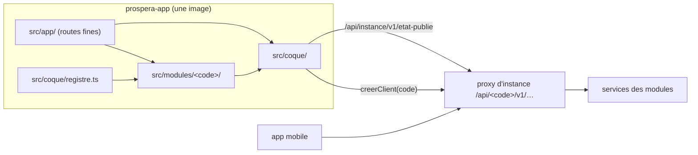
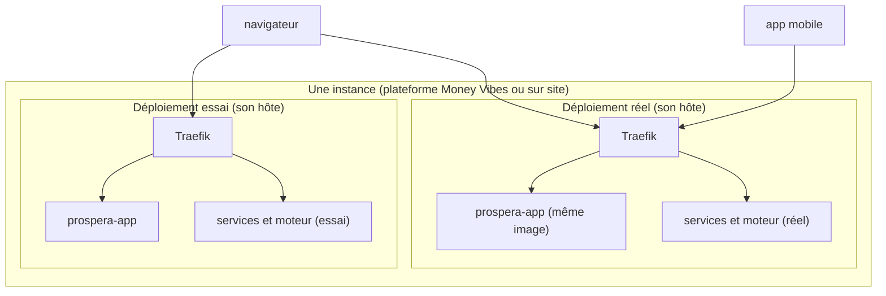
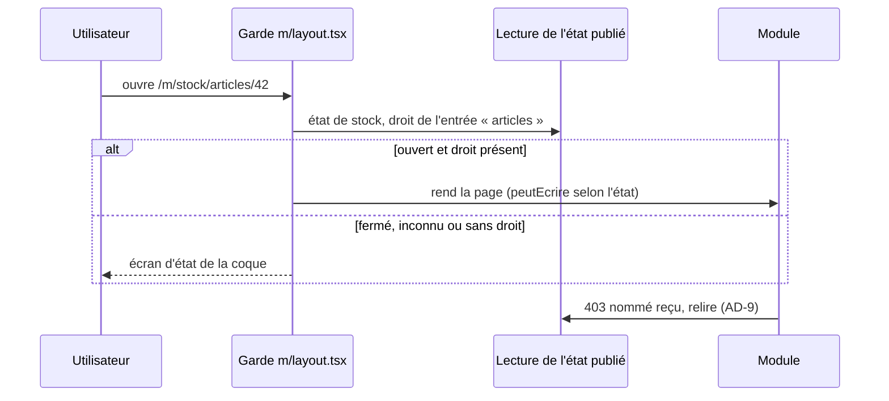

# Architecture Spine — `prospera-app`, la coque

*Amendée le 2026-11-11 par la spine de la Reprise de données (`architecture-reprise-donnees-2026-11-11`, AD-22) : AD-8 (téléversement, code du module dans le chemin du service), AD-25 (lien de provenance), Stack (`tus-js-client`).*

*Amendée le 2026-11-12 par la spine de Connecteurs (`architecture-connecteurs-2026-11-12`, AD-31) : AD-7 (seuils lus de `seuils-fraicheur@1`, `ageSecondes` et échéance de nuit, bandeau de la file pour `connecteurs:file:consulter`), AD-8 (troisième préfixe de route `echange`), AD-14 (l'Administration renvoie vers le module d'écran `connecteurs`), AD-15 (copie épinglée de `seuils-fraicheur@1`), AD-25 (marqueurs `autoriteExterieure` et `mouvementsEnAttente`), Structural Seed (arbre : `connecteurs` n'est plus requis en février).*

Remise de Dev B à Dev A, **ven. 20/11/2026**, avant le squelette de la coque (semaine 3). Préfixe des stories : **`PRA-`**.

## Design Paradigm

**Application modulaire unique.** Une seule application Next.js, une seule image ; chaque module d'écran est un dossier compilé avec la coque. Rien ne se charge à l'exécution : un module est **présent dans le code de tous les clients** et **allumé** par l'état publié de son organisation, comme un module Odoo installé. C'est une **application cliente servie par Next** : toutes les données se lisent dans le navigateur, avec le jeton en mémoire.

| Couche | Dossier | Possède |
|---|---|---|
| **Coque** | `src/coque/` | session, client d'API, lecture de l'état publié, registre, menu, garde, écrans d'état, bandeaux, habillage, emplacements, kit d'interface, i18n, signalement d'erreur |
| **Modules d'écran** | `src/modules/<code>/` | écrans, client d'API typé, descripteur `ecran.ts`, messages |
| **Routes** | `src/app/` | fichiers fins qui réexportent les écrans ; aucun écran n'y est écrit |
| **Serveur Next** | `src/app/coque/` (route handlers) | session web, configuration d'exécution, santé ; rien d'autre |

## Invariants & Rules



Une flèche = « peut importer ou appeler ». Aucun module ne pointe vers un autre module ; la coque ne connaît les modules que par `registre.ts`.

### AD-1 — Une seule application, des modules compilés ensemble `[ADOPTED]`

- **Binds:** D1, C8, tous les modules d'écran
- **Prevents:** une app ou une branche par verticale ou par client ; des modules qui sortent chacun à leur rythme (contraire à FR-21).
- **Rule:** Une image unique sert tous les clients, toutes les verticales et les deux espaces. Aucun chargement de code à l'exécution (pas de Module Federation, pas de script distant). Un module s'ajoute par un dossier `src/modules/<code>/` et une ligne au registre ; il ne s'allume que par l'état publié.

### AD-2 — Sens des dépendances : un module ne connaît que la coque `[ADOPTED]`

- **Binds:** C3, C4, `enrichiPar`, tous les modules d'écran
- **Prevents:** le couplage entre modules que les manifestes interdisent côté backend ; un module qui casse quand son voisin n'est pas installé ; deux modules qui fabriquent leurs tableaux et formulaires chacun à sa façon.
- **Rule:** `src/modules/<a>/` importe `src/coque/` et lui-même, **jamais** `src/modules/<b>/`. Il n'importe ni `radix-ui` ni une bibliothèque d'interface directement : seulement le kit `src/coque/ui/` (dont `<Liste>`, `<EtatVide>`, `<ErreurApi>`, `<Confirmer>`). Un lien vers un autre module passe par `lienVers(code, nomDuLien, params)` de la coque, qui rend `null` si la cible est fermée ; aucun chemin `/m/<autre>` n'est écrit à la main. Les données d'un autre module se lisent par son API, avec `creerClient(<son code>)`. La CI applique ces règles par `eslint-plugin-boundaries` (règle `boundaries/dependencies`) et `no-restricted-imports`.

### AD-3 — Le module d'écran : un dossier, un descripteur de données, une ligne au registre

- **Binds:** C8, C13, FR-17, FR-37, FR-43
- **Prevents:** deux formes de module ; un menu codé en dur ; un descripteur qui embarque des composants dans le premier chargement ; une matrice qu'on ne peut pas jouer faute de savoir quelles actions un module expose.
- **Rule:** Le dossier porte **le code du catalogue** (tiret compris : `pi-spi`). `ecran.ts` est **de la donnée pure** (aucun import de composant, sauf par `() => import(…)`) :

  | Champ | Contenu |
  |---|---|
  | `code` | le code du catalogue |
  | `entrees` | `[{ chemin, droit, cleLibelle }]` ; `chemin` relatif à `/m/<code>`, sans `/` initial |
  | `actionsHorsGarde` | `[{ sorte: 'export' \| 'reglementaire', route, droit, cleLibelle }]`, les routes que le manifeste déclare autorisées hors écriture (C13, FR-43) |
  | `liens` | les liens profonds nommés que d'autres modules peuvent demander |
  | `emplacements` | les emplacements que l'hôte offre, avec le type de leurs props (AD-16) |
  | `contributions` | `[{ emplacement, composant: () => import(…), droit, ordre, taille }]` |
  | `interrupteurs` | les noms d'interrupteurs, identiques au manifeste (FR-17) |
  | `routesPubliques` | les écrans sans session (AD-18) |

  `src/coque/registre.ts` importe chaque `ecran.ts` explicitement. Un test vérifie que `src/modules/*`, le registre et `src/app/(app)/m/*` coïncident, qu'aucun `chemin` ne sort de son préfixe et que chaque droit commence par `<code>:` (C7). Le **libellé de premier niveau** est celui du module commercial (FR-37), lu dans l'état publié (`libelle` du module, addendum §A-2) ; s'il manque, la coque affiche `modules['<code>'].titre`.

### AD-4 — Une seule garde, sous `/m/` `[ADOPTED]`

- **Binds:** C8, FR-34, §3.1
- **Prevents:** un module qui oublie sa garde ; une page de module placée hors garde ; un écran cassé sur une URL saisie à la main.
- **Rule:** Toute page de module vit sous `src/app/(app)/m/<code>/…`, et **un seul** `src/app/(app)/m/layout.tsx` les garde tous : composant client, il lit le segment enfant (`useSelectedLayoutSegment`), y trouve le code, puis l'état publié et le droit de l'entrée dont le `chemin` est le plus long préfixe de l'URL (une page de détail hérite du droit de son entrée). S'il est ouvert et que le droit est présent, il rend la page ; sinon il rend l'**écran d'état de la coque** : « non installé », « en cours d'installation », « suspendu, voir votre administrateur », « essai terminé, effacement le … », « accès non accordé ». Un code absent du registre, ou un état inconnu, se lit `NON_INSTALLE`. Aucune garde n'est rendue par le serveur : il n'a pas de jeton (AD-11).

### AD-5 — L'état publié : une seule lecture, jamais recalculée `[ADOPTED]`

- **Binds:** FR-34, §3.1, A-2, FR-17, SM-1
- **Prevents:** une coque qui calcule une échéance sur l'horloge du navigateur ; deux écrans qui affichent deux états différents ; un module réinstallé qui réaffiche un cache périmé ; un module qui s'ouvre parce que la lecture a échoué.
- **Rule:**
  - **Source unique** : `GET /api/instance/v1/etat-publie/{organisationId}`, sous une seule clé `['coque', 'etat-publie']`. Un état publié et un topic par espace (essai, réel) : la coque lit celui de l'espace où elle se trouve. Les fichiers `contrat/etat-publie.openapi.json` et `contrat/matrice-etats.json` appartiennent à `platform-catalog-service` (spine du moteur, AD-24) : la coque en garde une copie testée, elle ne les édite pas.
  - **Relecture** : toutes les **30 s** quand l'onglet est visible (`refetchIntervalInBackground: false`), au retour sur l'onglet, à la connexion et après un refus nommé (AD-9). Une seule lecture en vol à la fois.
  - **Échec de lecture** : le dernier état connu reste affiché. Sans état connu, rien n'est ouvert et l'écran « service momentanément indisponible » s'affiche.
  - **Table unique** : la correspondance « état publié → ouvert, écriture, bandeau, destinataire » vit dans un seul fichier, transcription du §3.1. Un module y accède par `useModule(code)` → `{ ouvert, peutEcrire, sante, interrupteur(nom) }`, jamais par la valeur brute.
  - **Interrupteur** : un nom absent du descripteur ou de la lecture rend « éteint » (on ferme, on n'ouvre pas).
  - **Dates** : `finLe` et `effacementLe` ne servent qu'à l'affichage. « Maintenant » vaut `instance.heureDeReference` plus le temps écoulé depuis la lecture (`performance.now()`), jamais `Date.now()`. Une règle ESLint interdit `Date.now()` et `new Date()` sans argument dans `src/modules/**` et `src/coque/etat-publie/`.
  - **Purge** : quand un module quitte l'ensemble ouvert, la coque supprime les requêtes `['<code>', …]` du cache.

### AD-6 — Les droits effectifs se lisent, ils ne se calculent pas `[ADOPTED]`

- **Binds:** FR-35, C7, A-2, A-5
- **Prevents:** une intersection calculée deux fois (coque et mobile) qui diverge ; un module qui masque une action par droit et un autre qui laisse le bouton et attend le 403.
- **Rule:** Une entrée, une action ou une contribution n'est visible que si le module est ouvert (AD-5) **et** que son droit figure dans `utilisateur.droitsEffectifs` de la lecture. Un module teste un droit par `useDroit('<code>:<objet>:<action>')`, seule voie d'accès à ces droits. Toute action d'écriture porte un droit nommé en plus de `<Ecriture>`. La coque ne lit jamais `perms[]` du jeton pour afficher quoi que ce soit. L'écran des rôles ne propose que les droits que la lecture déclare pour les modules ouverts et pour `instance`. *(Addendum §A-5 amendé le 2026-11-11 : l'intersection est calculée par le moteur et rendue par la lecture.)* `droitsEffectifs` est calculé par **intersection des droits du jeton de l'appelant avec l'état des modules** (spine du moteur, AD-24) : la lecture est propre à l'appelant, jamais partagée entre deux utilisateurs.

### AD-7 — Écriture, actions hors garde et bandeaux : la coque décide, le module obéit `[ADOPTED]`

- **Binds:** FR-9, FR-15, FR-17, FR-33, FR-43, C8, §3.1
- **Prevents:** une action d'écriture offerte en lecture seule ; un export ou un état réglementaire masqué alors que FR-43 les ouvre ; un bandeau qui manque ou qui s'affiche au mauvais public.
- **Rule:**
  - **Écriture** : toute action d'écriture d'un module est enveloppée dans `<Ecriture code>`, qui la masque ou la désactive quand `peutEcrire` est faux.
  - **Actions hors garde** : l'export et les états réglementaires ne passent **jamais** par `<Ecriture>`. Ils sont déclarés dans `actionsHorsGarde` (AD-3) et rendus par la coque, dans le module quand il est ouvert et dans l'Administration (AD-14) dans tous les états où FR-43 les ouvre.
  - **Bandeaux** : ils sont rendus **par la coque seule** ; un module n'en rend jamais.

  | Bandeau | Source dans la lecture | Destinataire |
  |---|---|---|
  | Compte à rebours de l'essai | `ESSAI_PROSPECT{finLe}` | tous |
  | Essai terminé, effacement le … | `ESSAI_TERMINE{effacementLe}` | tous |
  | Préavis, date de passage en lecture seule | `PREAVIS{finLe}` | administrateurs et DG |
  | Lecture seule | `LECTURE_SEULE` | tous |
  | Module suspendu, raison et action | `SUSPENDU` | administrateurs et DG |
  | Installation en cours, lien vers le bilan | `EN_INSTALLATION` | administrateurs |
  | Santé dégradée, raison et action | `sante: DEGRADE` | administrateurs |
  | Instance gelée | `instance.etat: GEL` | administrateurs |
  | Version figée, fin de maintenance | `instance.versionFigee` | administrateurs et DG |
  | Changement à venir, date limite | `interrupteurs[].dateLimite` | administrateurs |
  | Mise à jour annoncée, avertissement si `AVEC_PERTE` | `instance.miseAJourAnnoncee` | administrateurs |
  | Retour arrière en cours, avancement | `instance.retourArriereEnCours` | administrateurs |
  | File d'envoi d'un connecteur en attente | `etat-synchro` du module `connecteurs` | ~~administrateurs~~ détenteurs de `connecteurs:file:consulter` (amendement 2026-11-12, spine de Connecteurs, AD-16 et PRD Connecteurs FR-12) |
  | Données synchronisées en retard (orange ou rouge) | `etat-synchro` du module `connecteurs` | utilisateurs de l'écran concerné |

  « Administrateurs » = détenteurs de `instance:bilan:consulter` ; « DG » = l'indicateur `utilisateur.estDG` de la lecture (FR-35).
  - **Fraîcheur des données synchronisées** (PRD Connecteurs, décision du PO du 2026-11-11) : quand `connecteurs` est ouvert, la coque lit `GET /api/connecteurs/v1/etat-synchro`, au rythme de l'état publié (AD-5). La réponse a une forme normalisée : par domaine et par sens, `dernierEchangeLe`, le niveau de fraîcheur (`IMMEDIAT` | `HEURE` | `NUIT`), la source (`API` | `EXPORT`) et la file d'envoi (`enAttente`, `plusAncienLe`). Un écran déclare le domaine qu'il montre et rend `<Fraicheur domaine>`. La coque y applique **sa table de seuils** orange et rouge par niveau (valeurs QK-3 du PRD Connecteurs, FR-11), avec le « maintenant » d'AD-5, et choisit le message et la clef de libellé d'action du domaine. Le module `connecteurs` ne rend ni bandeau ni mention de fraîcheur.
  - **Amendement (2026-11-12, spine de Connecteurs, AD-16).** La table de seuils n'est pas écrite à la main dans la coque : elle est **générée** depuis le contrat `seuils-fraicheur@1` (`prospera-plateforme/contrats/seuils-fraicheur.json`), que lit aussi Connecteurs (une seule source). Le contrat porte, par niveau, le champ `messageDes` : le message d'action est rendu dès l'orange pour `IMMEDIAT` et `HEURE`, dès 06 h pour `NUIT`. La réponse d'`etat-synchro` porte aussi `ageSecondes` (calculé par Connecteurs à la réponse, pour que la coque ne compare pas deux horloges) et, pour le niveau `NUIT`, l'échéance (`nuit.attendueAvant`, `nuit.arriveeLe`) ; la file (`enAttente`, `plusAncienLe`) n'est rendue qu'à qui détient `connecteurs:file:consulter` : le bandeau de la file d'envoi s'adresse à ces détenteurs, et non plus aux « administrateurs ».

### AD-8 — Une seule origine : `/api/*` appartient au proxy `[ADOPTED]`

- **Binds:** tous les modules, l'app mobile, le déploiement (FR-25)
- **Prevents:** des adresses de services dans le code ou la configuration ; des CORS par service et par espace ; un relais qui masque le navigateur à l'IdP ; deux modules d'un même service mal gardés.
- **Rule:**
  - **Une origine** : le navigateur et l'app mobile n'appellent qu'une origine.
  - **Routage** : le proxy d'instance réécrit `/api/<code>/v1/…` en `/api/v1/…` du service qui porte `<code>` (Traefik `replacePathRegex`). Plusieurs codes peuvent viser un même service ; `<code>` est un code du catalogue ou un nom du socle (`auth`). Un service qui porte plusieurs modules remet le code dans son propre chemin pour les routes d'instance et de reprise (`/api/v1/instance/<code>/…`, `/api/v1/reprise/<code>/…`, contrat C13) ; **amendement (2026-11-12, spine de Connecteurs, AD-10) : un troisième préfixe, `echange`** (`/api/v1/echange/<code>/…`, route d'échange de Connecteurs vers une cible).
  - **En-têtes** : le proxy transmet `User-Agent` et `X-Forwarded-For` (proxies de confiance déclarés).
  - **Garde côté service** : le code dans l'URL ne sert **qu'au routage**. La garde du service applique le module de sa propre route, jamais celui de l'URL.
  - **Préfixes réservés** : tout `/api/*` appartient au proxy. Les routes du serveur Next vivent sous `/coque/*` (`src/app/coque/…`), jamais sous `/api/` ni dans un dossier préfixé `_`, qui est privé et non routable dans Next.
  - **Client unique** : chaque module construit son client avec `creerClient(code)`, qui seul ajoute le jeton, le préfixe, l'identifiant de corrélation (AD-24) et une reprise unique sur 401, partagée par toutes les requêtes en vol. Aucune URL de service n'apparaît dans `src/`. Un gros fichier s'envoie par `creerTeleversement(code)` (protocole tus, `tus-js-client`), qui emprunte au client le jeton, le préfixe et la reprise sur 401 (spine de la Reprise, AD-15).

### AD-9 — Un refus de droit d'utiliser relit l'état, il ne s'interprète pas

- **Binds:** C2, FR-34, FR-43
- **Prevents:** un module qui affiche une erreur technique alors que l'état a changé ; une boucle entre refus et relecture.
- **Rule:** `creerClient` intercepte `403 <MODULE>_NOT_ENTITLED` et `403 ABONNEMENT_EXPIRE`. Il annule la requête, sans rejeu ni message d'erreur, relit l'état publié (au plus une fois par rafale de 5 s), puis la garde (AD-4) ou `<Ecriture>` (AD-7) rendent l'écran ou le bandeau juste. Un module ne capture pas ces codes. Tout autre refus, dont `CONSENTEMENT_RESERVE_AU_DG` sur l'écran des rôles, reste une `ApiError` que l'écran traite par son message traduit.

### AD-10 — Configuration à l'exécution, jamais au build `[ADOPTED]`

- **Binds:** déploiement, les deux espaces, sur site et sur la plateforme
- **Prevents:** une image construite par client ou par espace.
- **Rule:** Aucune valeur propre à une instance ou à un espace n'entre dans une variable `NEXT_PUBLIC_*`. Le serveur Next lit son environnement à la requête et transmet à la page une configuration minimale :
  - `espace` (`ESSAI` | `REEL`), propriété du déploiement ;
  - `autreEspaceUrl`, absente quand l'organisation n'a pas d'autre espace (prospect) ;
  - l'identifiant de déploiement.

  Côté serveur seulement : `PROSPERA_PROXY_URL_INTERNE`, pour joindre `auth` depuis la session. Après connexion, l'espace de la lecture fait foi ; s'il diffère de la configuration, la coque affiche une erreur de déploiement et n'ouvre rien. L'habillage et l'état ne se mettent jamais en configuration.

### AD-11 — Le serveur Next ne porte aucune donnée ni règle métier `[ADOPTED]`

- **Binds:** l'app mobile, toutes les règles des modules
- **Prevents:** une règle écrite côté web que l'app mobile devrait recoder, puis qui diverge ; un `fetch` de service glissé dans un Server Component.
- **Rule:** Le serveur Next n'appelle que `auth`, pour ouvrir, rafraîchir et fermer la session (patron BFF de l'app expert-comptable : refresh en cookie httpOnly, access en mémoire, `User-Agent` reporté, refresh sérialisé). Il sert la configuration (AD-10), la santé (`/coque/sante`) et le rendu de la coque. Aucune page n'est rendue avec des données de service ; tout accès aux données se fait dans le navigateur. Une règle qui doit valoir pour le web et le mobile vit dans un service, derrière le proxy.

### AD-12 — L'espace d'essai ne se confond pas avec le réel

- **Binds:** FR-9, FR-33, FR-42, §3.1 axe 1
- **Prevents:** un utilisateur qui saisit du réel dans l'essai ; un module de l'essai qui apparaît dans le réel ; un lien profond vers un module absent de l'autre espace.
- **Rule:** En `ESSAI`, la coque affiche **sur chaque écran, connexion comprise**, une marque permanente : bandeau, couleur de bordure et titre d'onglet préfixé `[ESSAI]`. Aucun écran, aucun habillage et aucun réglage ne peut la retirer. Seul `src/coque/espace/` construit un lien vers l'autre espace, uniquement vers sa racine, et seulement si `autreEspaceUrl` existe. Chaque déploiement lit son propre moteur, et la coque ne fusionne jamais deux lectures.

### AD-13 — La verticale et la marque sont des données

- **Binds:** D1, `accueil` de la lecture, design system Prospera
- **Prevents:** du code par verticale ; une marque client qui casse le design system ou injecte du CSS.
- **Rule:** Aucun `if (verticale === …)` dans `src/` (un test le recherche). L'habillage (marque, logo, couleurs, langue) vient de `accueil` dans la lecture. Les couleurs sont validées (hexadécimal, schéma zod) puis posées **uniquement sur les jetons sémantiques**, et les composants n'emploient que ces jetons. Le logo n'est chargé que depuis la même origine. Avant la connexion, la coque s'affiche à la marque Prospera, avec la marque d'essai si `espace = ESSAI`. Le tableau de bord d'accueil est l'emplacement `accueil` (AD-16), où chaque module ouvert dépose ses tuiles.

### AD-14 — L'Administration est le module d'écran du module `instance`

- **Binds:** FR-17, FR-18, FR-22, FR-23, FR-27, FR-33, FR-35, FR-36, FR-43, A-5
- **Prevents:** une Administration à part qui échappe à la garde et à la matrice ; un écran d'export propre à chaque module, inatteignable quand ce module est suspendu.
- **Rule:** Les écrans d'Administration vivent dans `src/modules/instance/`, sous `/m/instance/…`, comme tout module. `instance` est toujours `EN_SERVICE`, et chaque entrée exige son droit `instance:*`, hors intersection. Inventaire :
  - **Mises à jour** : voir, essayer, choisir la date, revenir en arrière ; avancement d'un retour arrière.
  - **Dépôt de fichier** : mise à jour ou licence.
  - **Tunnel de support** : ouvrir et consulter son journal.
  - **Consentement** : le donner ou le retirer, par le DG seulement, et consulter le registre.
  - **Données** : l'**export et les états réglementaires de chaque module** (ses `actionsHorsGarde`), dans tous les états que FR-43 ouvre (tous sauf `NON_INSTALLE`), `SUSPENDU` et `DESINSTALLE` compris.
  - **Bilan d'installation.**
  - **Rôles et droits.**
  - **Interrupteurs** : quand les utilisateurs voient un changement, avant sa date limite.
  - **Reprise des données** : un renvoi vers le module d'écran **`reprise`** (`/m/reprise/…`, droits `reprise:*`), qui porte l'import, en autonomie pour le prospect dès février (décision du PO, 2026-11-11). L'Administration ne recode pas l'import.
  - **Connecteurs** (amendement 2026-11-12, spine de Connecteurs, AD-28) : un renvoi vers le module d'écran **`connecteurs`** (`/m/connecteurs/…`, droits `connecteurs:*`), qui porte la configuration, la file des écarts, les refus, la file d'envoi et les interceptions de l'essai. L'Administration ne recode pas la configuration.
  - **Pour le prospect** : le compte à rebours, l'export pendant `ESSAI_TERMINE`.

  Les entrées qui n'ont pas d'objet sur la plateforme (planifier, revenir, fichier, support) n'apparaissent que si `instance.hebergement` vaut `SITE`.

### AD-15 — Les contrats se génèrent et se partagent, ils ne se recopient pas `[ADOPTED]`

- **Binds:** `prospera-app`, l'app expert-comptable, l'app mobile, le moteur, tous les services
- **Prevents:** trois lectures de l'état publié qui dérivent ; des types écrits à la main qui mentent sur une route.
- **Rule:** Les types de **toute** API appelée (état publié compris) sont générés depuis l'OpenAPI du service (`openapi-typescript`), jamais écrits à la main. La **matrice des neuf états** (état → menu, garde par sorte de route, bandeau, destinataire) est un fichier JSON versionné publié par le moteur, et c'est `platform-catalog-service` qui le possède, avec `contrat/etat-publie.openapi.json` (spine du moteur, AD-24) ; il y a un état publié et un topic par espace. La coque en garde une copie qu'un test compare à la source, et son test de concordance menu/garde la joue entièrement. Une version de matrice inconnue d'un consommateur le fait fermer, jamais ouvrir. **Amendement (2026-11-12, spine de Connecteurs, AD-16) :** il en va de même pour `seuils-fraicheur@1` : la coque en garde une copie épinglée qu'un test compare à la source, et génère sa table de seuils de cette copie.

### AD-16 — Le contrat d'un emplacement

- **Binds:** C4, `enrichiPar`, AD-2, AD-13
- **Prevents:** un hôte et un contributeur qui s'attendent à des props différentes ; un contributeur en panne qui casse l'écran hôte ; un emplacement vide qu'on prend pour un zéro.
- **Rule:** L'hôte déclare l'emplacement dans son `ecran.ts`, avec le type de ses props : **des identifiants seulement** (jamais des objets métier). Le contributeur charge ses données lui-même, avec son client. La coque rend chaque contribution dans une frontière d'erreur et un `Suspense`, triée par `ordre` et filtrée par son droit et par l'ouverture de son module. Sans contribution ouverte, elle rend `<EmplacementVide raison>`, distinct de tout « 0 » qu'un contributeur affiche. Une tuile d'accueil déclare `taille` (S, M ou L).

### AD-17 — Une session, une organisation ; le cache appartient à son module

- **Binds:** web, mobile, AD-5, tous les modules
- **Prevents:** les données de l'organisation A affichées sous B ; deux sources de l'organisation courante ; un module qui invalide le cache d'un autre.
- **Rule:** L'organisation courante est **celle du jeton**, jamais un paramètre d'URL ni une valeur stockée dans le navigateur ; une session vaut pour une seule organisation. Changer d'organisation ouvre une nouvelle session et vide tout le cache (`queryClient.clear()`) ; se déconnecter aussi. Les clés de requête commencent par le code du module (`['<code>', …]`) ; le préfixe `['coque', …]` est réservé. Un module n'invalide jamais les clés d'un autre : la fraîcheur des données d'autrui suit la durée de validité et le retour sur l'onglet de leur propre module.

### AD-18 — Les écrans publics, sans session, dans `prospera-app` `[ADOPTED]`

- **Binds:** liens envoyés aux tiers (lien de paiement, reçu, page publique), AD-4, AD-8
- **Prevents:** un écran public placé sous la garde, donc bloqué, ou placé hors garde sans règle.
- **Rule:** Un écran sans session vit sous `src/app/(public)/p/<code>/…`, déclaré dans `routesPubliques` du descripteur. Il appelle l'API par `creerClientPublic(code)`, sans jeton ; l'autorisation est celle que le service porte (jeton du lien). Il ne lit pas l'état publié et n'affiche ni menu ni bandeau, sauf la marque d'essai (AD-12).

### AD-19 — Sécurité du front

- **Binds:** tout `src/`, le serveur Next, le déploiement
- **Prevents:** un jeton volé par script ; un cookie de session partagé entre l'essai et le réel ; une marque client qui injecte du contenu.
- **Rule:**
  - **En-têtes** : le serveur Next pose une CSP à nonce (aucun script ni style en ligne sans nonce, `frame-ancestors 'none'`), HSTS, `X-Content-Type-Options: nosniff` et `Referrer-Policy: strict-origin-when-cross-origin`.
  - **Jeton** : l'access ne vit qu'en mémoire, jamais dans `localStorage`.
  - **Cookie de refresh** : `HttpOnly`, `Secure`, `SameSite=Strict`, sans `Domain` (attaché à l'hôte), `Path=/coque/session`. L'essai et le réel sont servis sur **deux hôtes distincts**, jamais sur deux chemins d'un même hôte.
  - **CSRF** : les routes de session n'acceptent que `POST` avec un en-tête propre à la coque.
  - **Rendu brut** : `dangerouslySetInnerHTML` est interdit hors du kit.

### AD-20 — La coque suit la version de plateforme

- **Binds:** FR-17, FR-18, FR-21, `VERSION_FIGEE`
- **Prevents:** une coque plus récente que les services figés d'une instance, qui appelle des routes inexistantes.
- **Rule:** L'image de la coque fait partie de la **version de plateforme**. Elle porte le même numéro et le moteur la livre, l'essaie, la promeut et la retire **avec** les services ; elle ne se déploie jamais seule. Une instance en `VERSION_FIGEE` garde la coque de sa version.

### AD-21 — Découpage et budget de chargement

- **Binds:** AD-1, AD-3, UJ-3 (téléphone)
- **Prevents:** une coque qui charge les écrans de tous les modules à la première page.
- **Rule:** Un écran n'est atteint que par son fichier de route (découpage de Next) ou par un `() => import(…)` de contribution. Le registre ne charge que des descripteurs. La CI mesure le JS du premier chargement de `/accueil` et refuse un dépassement du budget fixé au squelette (PRA-01 : mesure + 10 %).

### AD-22 — Accessibilité

- **Binds:** tous les écrans
- **Prevents:** un module accessible et un autre non.
- **Rule:** WCAG 2.2 niveau AA. Le kit porte les rôles, le focus et les contrastes (règle orange sur clair du design system). Chaque entrée de module passe un contrôle `axe` dans Playwright, et un module qui échoue n'est pas `done`.

### AD-23 — Une doublure de l'état publié, jusqu'au premier gate `[ADOPTED]`

- **Binds:** squelette de la coque (S3), modules de Dev A (S3 → S5), tests de la coque
- **Prevents:** une coque construite avant le moteur sur une forme d'état inventée, puis qui casse à son arrivée.
- **Rule:** Tant que le moteur ne sert pas `GET /etat-publie`, le développement et les tests utilisent une **doublure**, construite par Dev A dans PRA-01, qui sert la route au même chemin, derrière le Traefik de dev. Elle est générée depuis `contrat/etat-publie.openapi.json` et `contrat/matrice-etats.json`, avec un scénario par état publié. Elle n'entre jamais dans l'image. C'est une dette nommée, éteinte au premier Integration Gate de la coque, qui se joue sur le vrai moteur, sans aucun mock. La **vraie route** est servie par `platform-catalog-service` **avant le 15/01/2027** (spine du moteur, AD-24 et AD-41) ; la doublure est éteinte à ce premier gate, pas après.

### AD-24 — Une erreur se retrouve

- **Binds:** `creerClient`, tunnel de support (FR-23), santé (FR-34)
- **Prevents:** chaque module qui invente son `console.error` ; un support qui n'a rien à lire.
- **Rule:** `creerClient` pose un `X-Request-Id` sur chaque appel ; `ApiError` le porte et l'écran d'erreur l'affiche. Toute erreur inattendue passe par `signaler(erreur)` de la coque : un journal structuré aujourd'hui, branchable sur un collecteur plus tard.

### AD-25 — Un objet protégé se protège par la coque

- **Binds:** les modules cibles de la Reprise, PRD Reprise (OQ-2, `historique`, `montantASaisir`), AD-7
- **Prevents:** un écran qui laisse modifier un historique repris ou qui cache un montant à saisir, quand un autre écran les protège.
- **Rule:** L'API d'un module cible renvoie, **par objet**, les marqueurs `historique` (lecture seule) et `montantASaisir` (montant manquant, à compléter). Un écran n'interprète jamais ces marqueurs lui-même : il enveloppe l'objet dans `<ProtectionObjet>` de la coque, qui retire les actions d'écriture d'un objet `historique` et signale un `montantASaisir`, sur le patron d'`<Ecriture>` (décision du PO, 2026-11-11). La `provenance` d'un objet repris (lot, ligne) ouvre, dans l'écran de la cible, le lien vers la ligne de la source tant que le lot existe (PRD Reprise FR-2).
  **Amendement (2026-11-12, spine de Connecteurs, AD-11).** L'API de la cible rend aussi, par objet, les marqueurs **`autoriteExterieure`** (domaine dont le propriétaire est le logiciel du client) et **`mouvementsEnAttente`** ; `<ProtectionObjet>` retire alors les actions de modification directe de l'objet et affiche « en attente ».

## Consistency Conventions

| Concern | Convention |
| --- | --- |
| Nommage | dossier, segment d'URL, espace de messages (`modules['<code>']`) et préfixe de clé de requête = **code du catalogue** ; API de la coque en français (`useModule`, `useDroit`, `<Ecriture>`, `creerClient`, `lienVers`, `signaler`) |
| Données | dates ISO 8601 telles que rendues, affichées avec `Intl` dans la langue d'`accueil`, au fuseau de l'organisation (`instance.fuseau` de la lecture ; `Africa/Lome` s'il manque) ; montants = couple (entier d'unité mineure, devise), décimales du référentiel (notification AD-16) |
| Erreurs | `ApiError` de la coque ; un code nommé s'affiche par son message traduit, jamais par le texte brut du serveur ; l'identifiant de corrélation est visible |
| État côté client | serveur = TanStack Query uniquement ; aucun store global ; formulaires React Hook Form + zod ; aucun `localStorage` pour un état métier ou un jeton ; un `queryFn` qui résout `undefined` est une requête en erreur (piège déjà payé) |
| Session | patron de l'app expert-comptable, déplacé de `/api/auth/*` vers `/coque/session/*` : refresh en cookie httpOnly, access en mémoire, une reprise partagée sur 401 |
| Interface | design system Prospera (jetons sémantiques, shadcn/ui, Lucide), par le kit seulement ; web adaptatif dès 360 px (UJ-3) |
| Next 16 | `proxy.ts` (et non `middleware`) ; `cookies()` est asynchrone ; build `next build --webpack` ; purger les barrels créés par l'IDE avant chaque build |
| Définition de « fini » d'un module d'écran | descripteur au registre ; test de la garde sur ses entrées ; test d'`<Ecriture>` en `LECTURE_SEULE` ; actions hors garde atteignables depuis l'Administration ; `axe` sans erreur ; budget tenu ; Integration Gate en fin d'épic, avec le vrai backend et aucun mock |
| Tests | Vitest + Testing Library ; Playwright sur `http://localhost:8080` (Traefik de dev) ; matrice des neuf états jouée dans la coque |
| Identifiants de story | `PRA-01 → 99` (Dev A), `PRA-100 → 199` (Dev B) |

## Stack

| Name | Version |
| --- | --- |
| Node.js | 24.x LTS (Krypton) |
| Next.js (App Router, build webpack, `output: 'standalone'`) | 16.4.x |
| React / React DOM | 19.3.x |
| TypeScript | 5.x |
| Tailwind CSS + shadcn/ui (radix-ui) + Lucide | 4.x, comme l'app expert-comptable |
| @tanstack/react-query | 5.107.x |
| next-intl | 4.14.x |
| React Hook Form + zod | 7.x + 4.x |
| openapi-typescript | 7.13.x |
| ESLint (configuration plate) + eslint-plugin-boundaries | 9.x + 7.4.x |
| Vitest + Playwright | 4.x + 1.6x |
| axe-core pour Playwright | 4.x |
| Traefik (proxy d'instance et de dev) | 3.7.x |
| tus-js-client (téléversement, `creerTeleversement`) | 4.3.x |

## Structural Seed

```text
prospera-app/
  src/
    app/
      (auth)/                 # connexion, invitation, mot de passe (marque Prospera, marque d'essai)
      (app)/
        accueil/              # tableau de bord = emplacement "accueil"
        m/
          layout.tsx          # LA garde (AD-4)
          <code>/…            # pages fines réexportées depuis src/modules/<code>/
      (public)/p/<code>/…     # écrans sans session (AD-18)
      coque/                  # route handlers : session/*, config, sante (AD-10, AD-11)
    coque/
      api/                    # creerClient, creerClientPublic, ApiError, refus (AD-8, AD-9, AD-24)
      etat-publie/            # lecture, useModule, useDroit, table §3.1 (AD-5, AD-6)
      registre.ts             # imports explicites des ecran.ts (AD-3)
      menu/ garde/ bandeaux/ emplacements/ habillage/ espace/ securite/
      ui/                     # kit du design system
      i18n/
    modules/
      instance/               # Administration (AD-14)
      reseau/ pdv/ catalogue/ stock/   # les 4 modules de Dev A pour le 15/01
      reprise/ connecteurs/            # reprise : février ; connecteurs : au premier contrat qui garde un logiciel (spine de Connecteurs, AD-32)
  contrat/
    etat-publie.openapi.json  # copie gardée (AD-15)
    matrice-etats.json
  outils/doublure-etat-publie/  # dev et tests seulement (AD-23)
```



**Environnements.** En développement, un profil `coque` du `docker-compose` lève un Traefik sur **:8080**. Il route `/` vers `prospera-app` (`next dev` sur **:3200** ; `:3100` reste à l'app expert-comptable), `/api/<code>/` vers les services du compose et, jusqu'au moteur, `/api/instance/` vers la doublure (AD-23). Aucun CORS à configurer pour la coque. En recette et en production, l'image `standalone` (Node 24) tourne derrière le Traefik de l'instance, un déploiement par espace. Ses journaux sortent en JSON sur la sortie standard, et `/coque/sante` sert la supervision.



## Capability → Architecture Map

| Capability / Area | Lives in | Governed by |
| --- | --- | --- |
| FR-34 état publié, < 1 min | `coque/etat-publie/` | AD-5, AD-15, AD-23 |
| §3.1 menu, garde, bandeaux | `coque/menu`, `app/(app)/m/layout.tsx`, `coque/bandeaux` | AD-4, AD-5, AD-7 |
| FR-35 droits de tenant, écran des rôles | `coque/etat-publie/` (`useDroit`), `modules/instance/` | AD-6, AD-14 |
| FR-36 Administration | `modules/instance/` | AD-14 |
| FR-37 de l'offre au menu | `coque/registre.ts`, libellé lu dans la lecture | AD-3 |
| FR-43 lecture seule et export | `<Ecriture>`, `actionsHorsGarde`, `modules/instance/` | AD-7, AD-14 |
| FR-9, FR-42 deux espaces | `coque/espace/`, configuration d'exécution | AD-10, AD-12, AD-19 |
| FR-15, FR-17 gel, interrupteurs, version figée | `coque/bandeaux`, `useModule().interrupteur` | AD-5, AD-7, AD-20 |
| FR-33 essai prospect | bandeaux, `modules/instance/` (compte à rebours, export), `modules/reprise/` (import en autonomie) | AD-7, AD-12, AD-14 |
| PRD Reprise et Connecteurs : écrans du client | `modules/reprise/`, `modules/connecteurs/` ; fraîcheur et file d'envoi rendues par la coque | AD-3, AD-7, AD-14 |
| Objets repris protégés (`historique`, `montantASaisir`) | `<ProtectionObjet>` de la coque | AD-25 |
| C4 emplacement vide, `enrichiPar` | `coque/emplacements/` | AD-2, AD-16 |
| C8 module d'écran | `modules/<code>/ecran.ts` | AD-1, AD-3, AD-4 |
| D1 verticale = configuration | `coque/habillage/`, emplacement `accueil` | AD-13 |
| Liens envoyés aux tiers | `app/(public)/p/<code>/` | AD-18 |
| App mobile | hors dépôt : même proxy, même lecture, même organisation du jeton | AD-8, AD-11, AD-15, AD-17 |
| C8 pour le cabinet : l'app expert-comptable suit la même règle de menu, sur le même état publié | `prospera-frontend-expert-comptable`, par **Dev B**, livré pour **février 2027** | AD-4 → AD-7, AD-15 |
| SM-1 démo du 15/01 (installer, désinstaller, réinstaller sans perte) | `modules/reseau, pdv, catalogue, stock` sur l'essai de la plateforme ; installation pilotée depuis la console Money Vibes | AD-1 → AD-5 (purge du cache) |

## Deferred

| Point | Pourquoi il peut attendre | Revoir quand |
| --- | --- | --- |
| Canal poussé (SSE, WebSocket) pour l'état publié | 30 s tiennent FR-34 | un besoin mesuré sous la minute |
| Architecture de l'app mobile : une app pour toutes les verticales ou `prospera-terrain` seule ; authentification (code + PKCE) | la coque n'en dépend que par AD-8, AD-11, AD-15, AD-17 | lot 2 (distributeur, `prospera-terrain`) |
| Paquet partagé avec l'app expert-comptable (kit, client d'API, session) | aucun second consommateur stable | quand l'app expert-comptable adopte `/m/<code>/` |
| Hors-ligne et PWA | porté par l'app mobile | — |
| Contrôle du contraste des couleurs de marque | se fait là où la marque est saisie | spine de la console |
| Table de routage du proxy (générée depuis les manifestes, C10), montage de l'instance, certificats | relèvent du moteur, partie B (FR-25) | spine du moteur, due avant le 07/12 |
| Collecteur d'erreurs et télémétrie | `signaler()` en fixe le point d'entrée (AD-24) | supervision (FR-16) |
| Montée à Vitest 5, TypeScript 7, ESLint 10, Node 26 | pile alignée sur l'app expert-comptable | première montée de version de la coque |
