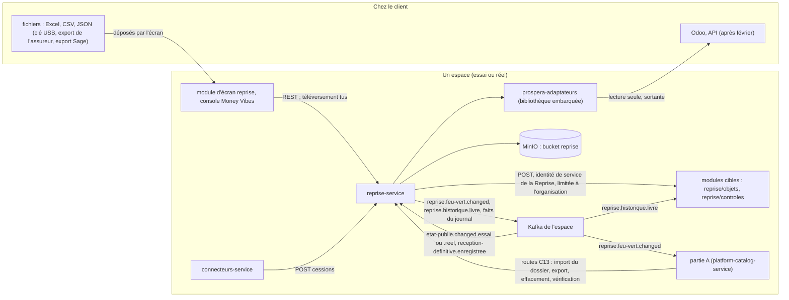
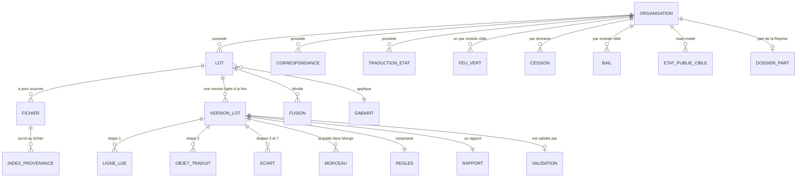
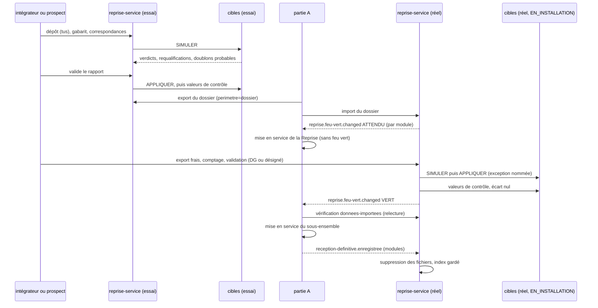

# Architecture Spine — Reprise de données

*Amendée le 2026-11-12 par la spine de Connecteurs (`architecture-connecteurs-2026-11-12`, AD-31) : AD-3 (code du système d'origine déclaré par l'intégrateur), AD-4, AD-13 et AD-21 (kit des cibles, route des contrôles ouverte à Connecteurs, contrats ajoutés), AD-7 et AD-33 (code du système d'origine au dossier, tables de correspondance, effacement des tables cédées), AD-11 (comptage d'ouverture), AD-18 (paquet d'adaptateurs et écriture), AD-20 et AD-28 (domaine d'une correspondance, point de coupure), AD-23 (liste des objets de février), Deferred (adaptateur `odoo` et nuit résolus).*

Requise pour février : la mise en service des deux clients attend le feu vert de la Reprise. L'**assureur** (sur site) fournit un export Excel ; le **distributeur** (hébergé) fournit des fichiers ou un export Sage, et quitte Sage. Raisons au `.memlog.md` (D-1 → D-36, N-1 → N-6). `[ADOPTED]` = tranché par le PO.

## Design Paradigm

**Un lot à étapes figées, sur une zone de transit.** La Reprise ne charge rien directement : chaque lot traverse sept étapes. Chacune écrit un résultat figé et haché, que la suivante lit.

| Étape | Lit | Écrit | Qui |
|---|---|---|---|
| 1. Lire | la source, par un adaptateur | lignes lues : numéro de ligne, contenu brut, empreinte | `prospera-adaptateurs`, piloté par `reprise-service` |
| 2. Traduire | lignes lues, règles du lot | objets au format de la cible, clé d'origine, régime, valeurs de contrôle de la source | `prospera-adaptateurs` (fonctions pures) |
| 3. Contrôler | objets traduits | écarts (schéma, références, doublons, montants requis, dates) et verdict de la cible en **simulation** | `reprise-service`, point d'import de la cible |
| 4. Rapporter | écarts, verdicts | rapport figé (JSON, version, empreinte), rendu PDF | `reprise-service` |
| 5. Valider | rapport | validation : acteur, deux empreintes, verdicts validés | un humain, dans les écrans de la Reprise |
| 6. Livrer | objets validés | résultat par objet | point d'import de la cible, mode `APPLIQUER` |
| 7. Réconcilier | valeurs de la source, valeurs de contrôle de la cible | écarts de réconciliation, feu vert | `reprise-service` |

On corrige en changeant une **règle**, en décidant une **fusion** ou en déposant une **source corrigée**, puis on rejoue à partir de l'étape touchée. Rejouer donne le même résultat.

| Couche | Où |
|---|---|
| Adaptateurs et application des règles (pure : ni base, ni état) | `prospera-adaptateurs` |
| Orchestration des lots ; données de la Reprise | `reprise-service` |
| Schémas d'objets et suite de conformité | `prospera-plateforme/contrats/objets/` |
| Point d'import et valeurs de contrôle | chaque module cible |
| Écrans | `prospera-app/src/modules/reprise/` (module d'écran `reprise`) et console Money Vibes |

## Inherited Invariants

| Inherited | From parent | Binds here |
| --- | --- | --- |
| AD-2 | spine du moteur | la Reprise n'écrit jamais dans la base d'une cible ; une cible ne lit jamais la base de la Reprise |
| AD-6 | spine du moteur | les échéances (suppression de fichiers) se lisent par `HorlogeDeReference` |
| AD-12 | spine du moteur | la traçabilité de NFR-2 passe par `instance.journal`, que l'agent écrit seul ; liste fermée des `type`, amendée ici (AD-22) |
| AD-15 | spine du moteur | la part de la Reprise au dossier d'installation est sans donnée métier ; identités de service émises par espace ; rejeu pendant `EN_INSTALLATION` |
| AD-16 | spine du moteur | les fichiers déposés (MinIO) sont sauvegardés avec l'espace, au même instant que Mongo ; rétention des sauvegardes |
| AD-17 | spine du moteur | contrats nommés ; amendé ici (AD-12, AD-22) |
| AD-18 | spine du moteur | deux services, `prospera-adaptateurs`, identifiants propres à chaque service, aucun webhook entrant |
| AD-24 | spine du moteur | la garde lit l'état publié de son espace seul |
| AD-26 | spine du moteur | contrats en JSON Schema dans `prospera-plateforme`, copiés au build à une version épinglée ; amendé ici (AD-22) |
| AD-27 | spine du moteur | `@confluentinc/kafka-javascript`, Karapace, `organisationId`, dédoublonnage par `eventId` (qui porte `epoque`), partition par `organisationId` |
| AD-38 | spine du moteur | l'effacement d'un prospect ou d'un acheteur hébergé appelle la route d'effacement de la Reprise |
| AD-40 | spine du moteur | alertes vers le ticket de Money Vibes |
| Conventions et Stack | spine du moteur | nommage, port 3404, montants, JCS et SHA-256, idempotence, temps ; Node 24, NestJS 11, Mongoose 8, MongoDB 8.0, BullMQ 6.7, Redis 7, MinIO |
| AD-8, AD-14 | spine de la coque | proxy `/api/<code>/v1/…` réécrit en `/api/v1/…` ; l'Administration renvoie vers le module d'écran `reprise` |
| AD-25 | spine de la coque | la cible rend `historique` et `montantASaisir` par objet ; l'écran les honore par `<ProtectionObjet>` |
| C2, C3, §4, C12, C13 | contrat de module | exception nommée (amendée ici, AD-22) ; un agrégat distinct, un service distinct ; installable sous contrôle ; rétrocompatibilité |

## Invariants & Rules



Une flèche = « peut appeler ou écrire vers ». Aucune flèche ne va d'une cible vers la Reprise, de la Reprise vers la base d'une cible, ni de la Reprise vers une source en écriture.

### AD-1 — Le lot avance par étapes figées `[ADOPTED]`

- **Binds:** FR-2, FR-11, FR-16, NFR-1, NFR-4, NFR-5
- **Prevents:** un rapport qu'on ne sait pas refaire ; un lot qui recommence ou double après une coupure.
- **Rule:**
  - Un lot a une **sorte** (`INITIALE`, `COURANTE`, `COMPTAGE`), des sources, des règles et une **version** entière croissante. Son état est la dernière étape atteinte : `DEPOSE`, `LU`, `TRADUIT`, `CONTROLE`, `VALIDE`, `LIVRE`, `RECONCILIE` ; `CONTROLE` inclut le rapport figé (étape 4) et la validation n'est permise qu'en `CONTROLE` ; `ABANDONNE` est terminal et permis tant que le lot n'est pas `LIVRE`. Son **statut d'exécution** est orthogonal à l'état (AD-30).
  - Chaque étape lit le résultat figé de la précédente et les règles du lot ; seule l'étape 1 lit la source. Elle écrit son résultat dans la zone de transit de `reprise-service`, avec son empreinte (SHA-256 du JCS).
  - Une version embarque un **instantané des règles**, haché avec son rapport ; changer une règle ou une source crée une **nouvelle version**, recalculée à partir de la première étape touchée ; une version figée n'est jamais modifiée. Une version livrée est gelée (AD-25).
  - Le travail se découpe en **morceaux** (1 000 lignes en lecture, 500 objets en traduction, en simulation et en livraison), travaux BullMQ de clef `(lotId, version, étape, numéro)`. Les **passes globales** (doublons, références du lot, cycles) sont des travaux à part, idempotents, recalculés en entier.
  - Kafka ne transporte que des faits (AD-21), jamais une ligne ni un objet.

### AD-2 — Le format commun est le schéma d'objet de la cible `[ADOPTED]`

- **Binds:** FR-1, FR-5, FR-7, FR-14, FR-20, C5, C6
- **Prevents:** un format pivot qui diverge du contrat de la cible ; deux formes du même objet ; un champ ajouté ignoré en silence.
- **Rule:**
  - Chaque sorte d'objet qu'un module accepte en reprise a un **schéma d'objet** JSON Schema **draft-07** `<code>.<objet>@<majeure>.<mineure>` (exemple : `pdv.point-de-vente@1.0`), rangé dans `prospera-plateforme/contrats/objets/<code>/`. Mots-clés postérieurs à draft-07 et `$ref` entre fichiers interdits (Ajv par défaut, Karapace). Le module `<code>` en est le **seul propriétaire**. Dans une majeure, il n'ajoute que des champs facultatifs (nouvelle mineure) ; une rupture passe par `@2`.
  - Le schéma déclare : les champs ; `cleOrigine` (obligatoire) ; les **références** vers d'autres objets, avec le type visé ; les régimes admis (`VIVANT`, `HISTORIQUE`) ; les états du circuit ; les **champs obligatoires** (absent : écart `CHAMP_OBLIGATOIRE_ABSENT`) ; les **montants requis** (FR-7 ; absent : écart `MONTANT_REQUIS_ABSENT`) ; les **valeurs de contrôle** (AD-13).
  - L'enveloppe de livraison porte `schema`. La cible **refuse** un champ inconnu de sa mineure (`SCHEMA_NON_CONFORME`, jamais d'ignorance silencieuse) et accepte toute mineure ≤ la sienne ; les lecteurs de réponses tolèrent les champs inconnus.
  - Le module déclare ses schémas à son manifeste (`objetsDeReprise`, AD-16) et joue la **suite de conformité de la reprise**, publiée avec les schémas : idempotence, simulation sans écriture, historique non modifiable, alias, matrice des neuf états, appel croisé d'organisation (AD-27), lot de 600 objets chaînés (AD-4), motif et trace de la saisie d'un `montantASaisir` (FR-7), verdict validé (AD-4), `OUVERTURE_CLOSE` (stock).
  - `reprise-service`, `prospera-adaptateurs` et `connecteurs-service` copient les schémas à une version épinglée au build, alignée par version de plateforme (contrôle en CI) ; aucun ne définit de forme d'objet à lui.
  - La Reprise ne tient aucune liste des objets d'un métier : un objet dont aucun module installé ne porte le schéma est déclaré « non installé » au rapport ; sans aucun module cible, le rapport se fait seul, sans erreur (C4).

### AD-3 — La clé d'origine suit un objet de la reprise aux mouvements `[ADOPTED]`

- **Binds:** FR-2, FR-12, FR-24, NFR-1
- **Prevents:** un objet chargé deux fois, par la Reprise puis par Connecteurs ; une table d'identifiants Prospera tenue par la Reprise ; une fiche absorbée qui reparaît.
- **Rule:**
  - `cleOrigine = { source, objet, identifiant }`. `source` est le code stable du système d'origine, déclaré par le gabarit (`sage-100`, `export-assureur`), jamais un nom de fichier ; **amendement (2026-11-12, spine de Connecteurs, AD-5) : ce code est déclaré par l'intégrateur, une fois par organisation, et partagé avec Connecteurs (ex. `odoo-principal`) ; la source n'est jamais `odoo:<connecteurId>`** ; `identifiant` est celui de la ligne dans ce système, sous la forme canonique d'AD-32. Une source sans identifiant stable reçoit du gabarit une règle de composition, elle aussi une donnée.
  - Une **référence** entre objets s'écrit par clé d'origine ; la cible la résout, y compris vers un alias.
  - La cible range la clé d'origine dans un **index unique** (organisation, objet, source, identifiant), avec les **alias** (AD-9) dans le même index.
  - Livrer un objet dont la clé existe déjà le **met à jour** : la réponse dit `CREE`, `MODIFIE` ou `INCHANGE`, par comparaison de l'empreinte de contenu. Un objet `HISTORIQUE` n'est jamais modifié : 409 `OBJET_HISTORIQUE`.
  - Connecteurs envoie ses mouvements avec la même clé d'origine (FR-24), seulement après la cession (AD-28).

### AD-4 — Le point d'import de la cible : un contrat, deux modes `[ADOPTED]`

- **Binds:** FR-14, FR-16, FR-19, C2, C3, C5, C13, NFR-1
- **Prevents:** une écriture dans la base d'une cible ; une livraison qui contourne la garde ou la validation ; un doublon au rejeu ; une création partielle.
- **Rule:**
  - **Amendement (2026-11-12, spine de Connecteurs, AD-12).** La mécanique commune de ce point d'import (garde d'identité de service et d'organisation, exceptions nommées par état, validation de l'enveloppe et du schéma, magasin d'idempotence, index de clé d'origine et d'alias, `SIMULER` par transaction annulée, comparaison au verdict validé, refus 413) vit dans le **kit des cibles**, `kit-cible`, bibliothèque NestJS de `prospera-plateforme` ; le module déclare ses objets et, pour un objet de référence simple, un raccord vers sa collection. **Le point d'import fait partie de la définition de « fini » de chaque module cible** (schémas d'objets, raccord ou fonctions, suite de conformité de la reprise verte) ; ce n'est plus un passage d'une semaine dans les dépôts cibles.
  - Route de service : `POST /api/v1/reprise/<code>/{organisationId}/objets/<objet>` (public : `/api/<code>/v1/reprise/<code>/{organisationId}/objets/<objet>`, AD-16), appelée par la seule identité de service de la Reprise (AD-10), limitée à l'organisation (AD-27). Enveloppe : `lotId`, `versionLot`, `schema`, `mode` (`SIMULER` ou `APPLIQUER`), `acteur`, `objets` (500 au plus, corps ≤ 1 Mio), chacun avec `cleOrigine`, `alias`, `regime`, `provenance` (`lotId`, `ligne`, `empreinteLigne`), `montantsASaisir`, `rattacherA` (AD-9) et ses champs. En `APPLIQUER` s'ajoutent `validationId`, `empreinteLivrable` et le **verdict validé** de chaque objet.
  - Réponse **par objet** : `cleOrigine`, `resultat` (`CREE`, `MODIFIE`, `INCHANGE`, `REQUALIFIE`, `REFUSE`), `code`, `etatRetenu`, `referencesNonResolues`, `doublonsProbables` (`SIMULER`), identifiant Prospera. Un corps trop gros rend 413 `LOT_TROP_GROS` avec `maxObjets` et `maxOctets` ; la Reprise réduit le morceau. Un `SIMULER` de 500 objets répond en moins de 30 s (conformité).
  - `APPLIQUER` sans `validationId` et `empreinteLivrable` : 422 `VALIDATION_ABSENTE`. La cible **n'écrit un objet que si son verdict recalculé égale le verdict validé** ; sinon `REFUSE` `VERDICT_DIFFERENT`, sans écriture, et le lot passe en `ECART_DE_LIVRAISON` (AD-30). Un `APPLIQUER` d'une `versionLot` plus ancienne du même lot rend `INCHANGE` (`VERSION_ANTERIEURE`).
  - Idempotente par (`lotId`, `versionLot`, `cleOrigine`) : rejouer rend le même résultat et n'écrit rien de plus.
  - Garde de la cible : ouverte selon la matrice des neuf états de C2 (`EN_SERVICE`, `ESSAI_PROSPECT`, `PREAVIS` ; l'essai « client » est une nature, pas un état) et, en `EN_INSTALLATION`, par l'exception nommée de C2 amendée (AD-22) ; refusée dans les autres états. La Reprise écrit alors « non installé » (`NON_INSTALLE`) ou « cible fermée (état) » (`CIBLE_FERMEE`) au rapport et ne livre jamais ailleurs. Ce refus n'est **jamais** un verdict d'objet (AD-30).
  - Ordre : tri topologique **par objet** des références déclarées (intra-type compris), modules confondus ; un morceau ne contient jamais un objet avant ses références. Un cycle intra-type est un écart `CYCLE_REFERENCES` ; un cycle entre types est refusé à la création du gabarit (`GABARIT_CYCLE`). La simulation est découpée comme la livraison. Une référence non résolue en `APPLIQUER` rend `REFUSE` `REFERENCE_INCONNUE`, jamais une création partielle.
  - La cible pose `historique` et `montantASaisir` sur l'objet et les rend par objet dans ses API (AD-25 de la coque) ; elle exige un motif à la saisie d'un montant à saisir et le journalise.

### AD-5 — Les règles métier restent chez la cible, qui simule

- **Binds:** FR-5, FR-11, SM-2
- **Prevents:** une Reprise qui recopie les conditions du circuit d'une cible ; un rapport validé qui ne prédit pas ce que la cible acceptera.
- **Rule:**
  - La Reprise **traduit** l'état (table de traduction, donnée du lot) ; la cible **juge**. En mode `SIMULER`, le point d'import joue les mêmes contrôles qu'en `APPLIQUER`, n'écrit rien et rend son verdict par objet, dont la **requalification** (`REQUALIFIE`, `etatRetenu`, raison) d'un objet qui ne satisfait pas les conditions de l'état traduit, et ses doublons probables parmi ses objets existants (AD-9).
  - Les références vers des objets du même lot, inconnues de la cible en simulation, reviennent dans `referencesNonResolues` ; la Reprise retire celles dont la clé figure au lot, et seules les autres sont des écarts.
  - La Reprise ne contrôle elle-même que ce qui ne demande pas le métier : conformité au schéma, références, cycles, doublons dans le lot, montants requis, dates (AD-14).
  - Le verdict de la simulation validée fait foi à la livraison (AD-4) : un verdict différent suspend le lot en `ECART_DE_LIVRAISON` (AD-30) ; il n'y a jamais de correction silencieuse.

### AD-6 — On corrige par des règles, jamais par une cellule `[ADOPTED]`

- **Binds:** FR-4, FR-5, FR-7, FR-12, FR-16, C6
- **Prevents:** une correction faite à la main dans l'essai et perdue le jour J ; un résultat qu'on ne sait pas expliquer par la source et les règles.
- **Rule:**
  - Le résultat d'une version de lot ne dépend que de ses sources et de ses **règles** : **gabarit** (colonnes vers champs, composition de l'identifiant, régime par critère, **filtre d'exclusion**, AD-24), **correspondances**, **traductions d'état**, **critères de doublon**, décisions de **fusion**. Une **correspondance** est une table de valeurs de référence (codes de zone, de produit, d'agence), jamais une clé d'origine.
  - Aucune route ne modifie une ligne lue ni un objet traduit. Un montant requis absent reste « à saisir » et se saisit dans la cible après l'import (FR-7). La seule saisie de la Reprise est la feuille de comptage, qui est une source (AD-11).
  - Les **modèles de gabarit** (Sage, assureur) sont des données livrées avec `prospera-adaptateurs`, copiées dans le lot puis ajustées ; jamais du code par client. Une valeur sans correspondance est un écart `CORRESPONDANCE_ABSENTE`, jamais une invention.

### AD-7 — Ce qui passe de l'essai au réel `[ADOPTED]`

- **Binds:** FR-4, FR-13, FR-16, FR-23, NFR-3
- **Prevents:** une donnée métier ou une identité qui franchit le cloisonnement ; un réel qui rejoue des règles différentes de l'essai ; un module mis en service sans ses données.
- **Rule:**
  - La part de la Reprise au **dossier d'installation** : gabarits (sans identifiants de connexion), **code du système d'origine** (amendement 2026-11-12, spine de Connecteurs, AD-5 et AD-19 : il passe au dossier, partagé avec Connecteurs), correspondances (leur **propriétaire à l'export** est la Reprise avant la cession, Connecteurs après ; l'import du réel n'écrase jamais une table cédée), traductions d'état, critères de doublon, et la **liste des modules attendus** (modules qu'un lot a alimentés dans l'essai). Codes et libellés seulement : aucun montant, aucune identité de personne, aucun identifiant d'origine ; à l'export, une valeur de correspondance hors du **domaine de valeurs** déclaré par le gabarit est rejetée ; un test cherche une valeur d'origine témoin dans le dossier.
  - La partie A l'importe par la route C13 `import` de la Reprise (AD-16), idempotente par version du dossier ; une version supérieure est refusée (`DOSSIER_VERSION_DIFFERENTE`) dès qu'un lot du réel a été validé. À l'import, la Reprise publie `ATTENDU` pour chaque module listé (AD-12).
  - Séquence du réel : import du dossier, mise en service de la Reprise par le plan (sans feu vert, AD-17), lots, `VERT` par module, mise en service des modules cibles.
  - Ne passent jamais : fichiers, lignes, objets, rapports, validations, fusions, feux verts, identifiants de connexion. Dans le réel, le rapport propose de nouveau les doublons regroupés ; les fusions se refont. La Reprise ne participe pas au rafraîchissement de l'essai du moteur : les lots, rapports et fichiers de l'essai sont supprimés, le dossier est gardé.

### AD-8 — Valider engage deux empreintes `[ADOPTED]`

- **Binds:** FR-11, FR-13, NFR-2
- **Prevents:** une livraison qui diffère de ce que le client a validé ; une validation de l'essai qui vaudrait dans le réel.
- **Rule:**
  - Le rapport d'une version est un **document JSON figé** : comptes par cible, écarts par type et gravité (AD-24) avec leurs lignes d'origine, requalifications, montants à saisir, lignes « non installé » ou « cible fermée », historique court. Son PDF en est un rendu (pdfkit), jamais une source. Avant chaque rapport, la Reprise resynchronise son read-model des états publiés (AD-17) ; le rapport enregistre instant et `numero` de l'état lu par module, versés à la validation, hors de l'empreinte.
  - La validation enregistre `validationId`, l'acteur, l'instant, `versionLot`, l'**empreinte du rapport**, l'**empreinte du livrable** (AD-32), le **verdict validé** de chaque objet et `modulesAlimentes` (gelé). Elle exige `reprise:lot:valider`, relu à la validation et à la livraison (AD-26).
  - Avant de livrer, la Reprise recalcule les deux empreintes et refuse si l'une diffère : 409 `LOT_MODIFIE_APRES_VALIDATION`. Une nouvelle version exige une nouvelle validation.
  - La validation accepte les avertissements et livre les objets sans erreur (AD-24). Chaque espace a ses validations ; aucune ne traverse (AD-7).

### AD-9 — Doublons, fusions et alias `[ADOPTED]`

- **Binds:** FR-12, FR-24
- **Prevents:** une fusion sans trace ; un mouvement de Connecteurs sur une fiche absorbée qui crée un second objet ; un doublon créé avec un objet déjà présent dans la cible.
- **Rule:**
  - Les doublons probables se détectent à l'étape 3 sur des valeurs **normalisées** (téléphone en E.164 avec le pays de l'organisation, nom et raison sociale sans accents ni casse, adresse, identifiant national sans espaces), par une fonction commune de `prospera-adaptateurs`, selon les critères de FR-12, qui sont des règles du lot ; un doublon est un écart `DOUBLON_PROBABLE`. En `SIMULER`, la cible rend en plus les `doublonsProbables` parmi ses objets **existants** ; l'intégrateur rattache la ligne à l'objet existant, ou crée.
  - Une fusion est la décision d'un détenteur de `reprise:doublon:fusionner` : une ligne conservée, des lignes absorbées, les champs vides de la conservée repris d'une absorbée ; journalisée, elle crée une nouvelle version. Une fusion qui absorbe une clé déjà livrée est refusée (`FUSION_APRES_LIVRAISON`).
  - Un **alias** est une `cleOrigine` complète, portée par l'objet conservé et rangée dans l'index unique (AD-3). Un alias déjà détenu par un objet distinct : `REFUSE` `ALIAS_DEJA_UTILISE`, jamais de fusion côté cible. Un alias n'est jamais retiré. `APPLIQUER` avec `rattacherA` (identifiant Prospera de l'objet existant) fait de la clé d'origine de la ligne une clé de cet objet : rien n'est créé.

### AD-10 — Une seule identité vers les cibles `[ADOPTED]`

- **Binds:** FR-14, FR-16, FR-19, C2, C7
- **Prevents:** deux chemins d'appel (utilisateur, service) qui se comportent différemment ; un utilisateur qui appelle un module en installation.
- **Rule:** La Reprise appelle les routes `reprise/*` des cibles sous **son identité de service**, émise par l'`auth-service` de son espace, limitée à l'organisation (AD-27), dans les états où la garde de la cible l'autorise (AD-4) et pour toutes les sortes de lot. Un utilisateur n'appelle jamais une route `reprise/*` d'une cible. L'autorité est la validation (AD-8), que la cible vérifie par `validationId` ; l'acteur voyage dans l'enveloppe pour le journal de la cible.

### AD-11 — Le comptage d'ouverture est un lot de la Reprise `[ADOPTED]`

- **Binds:** FR-10, FR-15, FR-16
- **Prevents:** une saisie de comptage impossible parce que le Stock est en installation ; un mouvement de stock entre le comptage et la mise en service ; une ouverture additionnée deux fois.
- **Rule:**
  - Un lot `COMPTAGE` du réel porte **une feuille par entrepôt**. Elle est pré-remplie par le fichier de stock (quantité du fichier, pour information) ; la **quantité comptée** se saisit par article dans les écrans de la Reprise (`reprise:comptage:saisir`) : c'est sa source. Tant que le comptage n'est pas clos, la saisie est un **brouillon mutable** ; « comptage clos » **fige une version** et est la validation du lot (AD-8).
  - Livré au module `stock` comme objet `stock.stock-ouverture@1` par son point d'import, pendant que `stock` est `EN_INSTALLATION` : aucun utilisateur ne peut y passer de mouvement. L'ouverture est **remplaçante** (jamais additive) par (entrepôt, article) et refusée une fois `stock` `EN_SERVICE` (`OUVERTURE_CLOSE`). Sa valeur de contrôle est la **quantité comptée**. La livraison attend que les lots des modules référencés (articles, entrepôts) soient `LIVRE`.
  - L'écart entre le fichier et le comptage figure au rapport en `INFORMATION`, sans rien bloquer ; le stock sort de la règle « écart nul ». Les inventaires suivants appartiennent au module `stock`.
  - **Amendement (2026-11-12, spine de Connecteurs, AD-20).** Le comptage livré à `stock` est **gardé par `stock` comme un ajustement en attente**, et **publié à la mise en service** si Odoo possède le stock ; Connecteurs le capte alors et l'envoie à Odoo comme ajustement d'inventaire en quantité comptée, jamais additionné.

### AD-12 — Le feu vert : par module cible, un état absolu `[ADOPTED]`

- **Binds:** FR-8, FR-15, SM-1
- **Prevents:** un sous-ensemble mis en service sur des données changées après le feu vert ; un feu vert perdu ou lu hors ordre ; un module mis en service sans ses données.
- **Rule:**
  - Topic `reprise.feu-vert.changed`, publié **dans le réel seulement** (un feu vert d'essai échoue à la conformité). Charge : `organisationId`, `espace`, `moduleCible`, `etat` (`ATTENDU` ou `VERT`), `lots` (`lotId`, `versionLot`, empreinte du rapport), `comptageClos` (pour `stock`), `epoque`, `numero`, `eventId` (qui contient `epoque`). Le consommateur ordonne par (`epoque`, `numero`) et garde le plus grand ; au démarrage après un changement d'époque, la Reprise republie l'état absolu de chaque module.
  - `numero` est un compteur par (organisation, module), tenu **dans la même transaction Mongo** que le changement d'état (`$inc`) et publié par l'outbox ordonnée (partition `organisationId`). La partie A relit l'état par la vérification `donnees-importees` (C13) avant toute mise en service et devant tout trou de `numero` : elle ne déduit jamais l'état d'un seul message.
  - `ATTENDU` est publié à l'import du dossier pour chaque module de la **liste du dossier** (AD-7) et à la création du premier lot du réel visant un module non listé. Pour un module listé, l'absence de fait vaut `ATTENDU`. Seul un module absent de la liste et sans lot est dispensé de feu vert (moteur FR-11).
  - `VERT` est publié quand tous les lots du réel du module sont `RECONCILIE` et qu'il ne reste **aucun écart ouvert** (AD-24) ; pour `stock`, quand le lot `COMPTAGE` est validé et livré.
  - Un module `VERT` est **figé** : un lot ou une version qui le livrerait est refusé (409 `FEU_VERT_DONNE`) jusqu'à `EN_SERVICE` ou jusqu'à la réouverture (AD-25). Les lots suivants sont de sorte `COURANTE`, sans feu vert.
  - La partie A regroupe par sous-ensemble, ne met en service que si tous ses modules listés sont `VERT` ; `MISE_EN_SERVICE_SANS_FEU_VERT` est son seul refus.
  - La vérification `donnees-importees` (C13) rend par module le même état et son critère chiffré (objets `VIVANT` en erreur, écarts ouverts, seuil 0), même code que le fait.

### AD-13 — Réconcilier par les valeurs de contrôle de la cible `[ADOPTED]`

- **Binds:** FR-15, FR-17, SM-1
- **Prevents:** une Reprise qui lit la base d'une cible pour prouver l'écart nul ; un « écart nul » qui ne compare que des nombres d'objets ; un écart nul impossible ou aléatoire.
- **Rule:**
  - Chaque schéma d'objet déclare ses **valeurs de contrôle** (prêt : capital restant dû, jours de retard, nombre d'échéances ; police : prime, échéance ; créance : reste dû), comme **champs de l'objet canonique** que la source fournit à l'étape 2 et que la cible recalcule. Types fermés : `montant {unitesMineures, devise}`, `date` `AAAA-MM-JJ`, `entier`, `etat`. Aucune valeur ne dépend de l'horloge hors `dateDeValeur`, jour fixé par le lot et rejoué.
  - La cible les rend par `POST /api/v1/reprise/<code>/{organisationId}/controles/<objet>` (public : `/api/<code>/v1/reprise/<code>/…`), identité de la Reprise, lecture seule, 500 clés au plus, avec `dateDeValeur`.
  - La Reprise compare aux valeurs de la source par **une seule fonction**, dans `prospera-adaptateurs`, avec vecteurs par devise. La comparaison porte sur l'`etatRetenu` validé : une requalification acceptée à la validation est une exception tracée, pas un écart ; un `montantASaisir` est exclu de la comparaison et listé. Écart nul = même nombre d'objets `VIVANT` livrés et aucune valeur différente (`VALEUR_DE_CONTROLE_DIFFERENTE`).
  - La comparaison de nuit de la marche en parallèle (FR-17) réutilise cette route ; son ordonnancement se décide avec Connecteurs (Deferred ; résolu le 2026-11-12 : spine de Connecteurs, AD-15).
  - **Amendement (2026-11-12, spine de Connecteurs, AD-10, AD-13 et AD-21).** Cette route est de **lecture** et reste **la seule route de contrôle** : elle est ouverte aux identités de la Reprise **et** de Connecteurs (en `EN_SERVICE`, `PREAVIS`, `ESSAI_PROSPECT` et `LECTURE_SEULE`, la Reprise seule en `EN_INSTALLATION` du réel). Elle vit dans le kit des cibles. Connecteurs la lit pour sa concordance de nuit et compare avec la même fonction unique de `prospera-adaptateurs` ; l'écart nommé `VALEUR_DE_CONTROLE_DIFFERENTE` est partagé. La comparaison de nuit de la marche en parallèle est désormais **résolue** : la Reprise lit le rapport de concordance de Connecteurs (`connecteurs.nuit.terminee`), sans relire elle-même le logiciel du client.

### AD-14 — Les dates d'origine voyagent sans glisser

- **Binds:** FR-6, SM-3
- **Prevents:** une date d'Excel décalée d'un jour par un passage en UTC ; une date métier égale au jour de l'import ; deux gabarits qui lisent une même colonne de deux façons.
- **Rule:** Une date métier sans heure (déclaration, échéance, naissance) voyage en `AAAA-MM-JJ`, jamais comme un instant. Le gabarit déclare un `format` par colonne de date (`serie-excel`, `JJ/MM/AAAA`, `ISO`) ; le système 1900 ou 1904 se lit dans le classeur ; une chaîne ambiguë sans format est un écart `DATE_AMBIGUE`. Un numéro de série devient une date de calendrier, sans fuseau. Un instant de la source se lit dans le fuseau de l'organisation déclaré au gabarit (addendum A-2), puis se range en UTC. Aucun champ de date métier ne prend la date du jour : absent, il est un écart `DATE_ABSENTE`, ou un champ « à saisir » s'il est requis.

### AD-15 — Les fichiers : tus, MinIO de l'espace, suppression tracée `[ADOPTED]`

- **Binds:** FR-3, NFR-3, NFR-6
- **Prevents:** un fichier qui quitte l'instance ; un envoi perdu à la première coupure ; un contenu gardé après la réception, ou supprimé avant.
- **Rule:**
  - Téléversement par le protocole **tus** sur la seule route `/api/reprise/v1/televersements`, en morceaux de 10 Mio ; `partSize` du magasin réglé à 10 Mio (≥ 5 Mio exigés par S3). Traefik : limite de corps relevée à 12 Mio sur cette route seule ; en-têtes tus (`Upload-Offset`, `Upload-Length`, `Tus-Resumable`, `Location`, `Upload-Metadata`) transmis et exposés en CORS ; `respectForwardedHeaders` actif. Validé par un test réel à la première story de téléversement. Les règles de sécurité de l'envoi sont en AD-29.
  - Les fichiers vont dans le bucket `reprise` du MinIO **de l'espace**, sous `<organisationId>/<lotId>/<fichierId>` ; sur site, ils ne quittent pas l'instance.
  - **Suppression**, toujours journalisée, lue sur `HorlogeDeReference` (AD-6 du moteur) :
    - lot `INITIALE` ou `COMPTAGE` du réel : quand `modulesAlimentes ⊆ modulesRecus` (union des `reception-definitive.enregistree`, dédoublonnés par `eventId`) et le lot `RECONCILIE` ; un fait pour un module non alimenté est ignoré ; aucune suppression pendant un rejeu ou une calibration ;
    - lot `ABANDONNE` du réel : 30 jours après l'abandon ;
    - lot `COURANTE` : 30 jours après la livraison réussie ;
    - essai : 30 jours après la livraison ou l'abandon du lot, et à l'effacement du prospect (AD-33) ;
    - un fichier remplacé par une source corrigée part avec la version remplacée (rétention ci-dessous).
  - **Zone de transit** : les lignes lues et les objets traduits sont purgés avec les fichiers, aux mêmes déclencheurs ; les rapports archivés gardent clés et comptes, pas de contenu de cellule ; les contenus d'une version remplacée sont purgés quand une version plus récente est validée.
  - L'**index de provenance** survit au fichier : `lotId`, numéro de ligne, empreinte SHA-256 de la ligne brute, sans son contenu. La suppression n'est pas l'effacement des sauvegardes (AD-33).

### AD-16 — Les noms des routes de C13 et de la reprise `[ADOPTED]`

- **Binds:** C1, C13
- **Prevents:** 44 manifestes qui nomment chacun leurs routes ; une partie A ou une Reprise qui ne sait pas où appeler ; deux modules d'un même service aux mêmes routes.
- **Rule:**
  - Le proxy réécrit `/api/<code>/v1/X` en `/api/v1/X` (AD-8 de la coque) : le **code du module figure donc dans le chemin du service**. Routes de service de tout module, `{organisationId}` dans le chemin : `/api/v1/instance/<code>/{organisationId}/export` (GET), `import` (POST, sa part du dossier), `effacement` (POST, rend un accusé idempotent), `verifications/<code-de-verification>` (POST, clef d'idempotence), `sante` (GET, `OK` ou `DEGRADE`). Chemin public : `/api/<code>/v1/instance/<code>/{organisationId}/…`. Les appels de service à service passent par le proxy de l'espace.
  - `export` sert deux publics : l'utilisateur qui détient `instance:donnees:exporter` (chemin public) et la partie A, identité de service ; `perimetre=dossier` produit la part au dossier.
  - Un module qui reçoit une reprise expose en plus `/api/v1/reprise/<code>/{organisationId}/objets/<objet>` (AD-4) et `/api/v1/reprise/<code>/{organisationId}/controles/<objet>` (AD-13), et déclare `objetsDeReprise` à son manifeste.
  - Les routes propres de la Reprise sont publiques sous `/api/reprise/v1/…` ; ses routes C13 suivent la convention avec le code `reprise`.
  - Test de contrat : deux modules d'un service, cinq routes chacun. Amende C1 et C13 (AD-22).

### AD-17 — La Reprise, module installable `[ADOPTED]`

- **Binds:** FR-19, FR-21, FR-22, C1, C2, C4, C7, C8, C9, C10, C12, C13
- **Prevents:** une garde qui lit l'horloge ; un lot qui avance pendant une lecture seule ; une mise en service faite depuis un écran de la Reprise.
- **Rule:**
  - **Manifeste `reprise`** (M44). Le manifeste source est écrit dans `prospera-stories/manifestes/reprise.manifest.ts` (rangement des 44 manifestes : `manifestes/<code>.manifest.ts`) ; champs non nommés par C13 : `routesInstance` (export, import, effacement, sante, etatPublie) et `migrer` ; le dépôt le recopie dans `src/module.manifest.ts` (D-34). `depends: []` ; `enrichiPar` = les modules qui déclarent `objetsDeReprise` ; `prerequis` (MinIO du socle, Redis, serveur de référence de NFR-4) ; `interrupteurs: []` ; `publie` : `reprise.feu-vert.changed`, `reprise.historique.livre`, `reprise.cles-rattachement.publiees`, faits du journal ; `consomme` : `etat-publie.changed.*`, `reception-definitive.enregistree` ; `migrer` (AD-31) ; droits `reprise:lot:importer`, `reprise:lot:valider`, `reprise:doublon:fusionner`, `reprise:rapport:consulter`, `reprise:regle:modifier`, `reprise:comptage:saisir` ; rôle « Responsable de la reprise » (tout sauf valider) ; le rôle du DSI du distributeur les contient dès l'installation, l'administrateur du client les attribue (moteur FR-35), Money Vibes n'accorde rien hors moteur ; `retourArriere: SANS_PERTE` ; profil compose `reprise` ; vérification `donnees-importees` ; routes C13 (AD-16) ; routes autorisées en lecture seule : export, lecture des lots, des rapports et des correspondances.
  - **Garde** `REPRISE_NOT_ENTITLED` (`ABONNEMENT_EXPIRE` à l'expiration) : lit l'état publié de son espace seul et applique la matrice de FR-21. Au démarrage et après restauration, elle lit la route de l'état publié (identité de service) et reste fermée (`NON_INSTALLE`) tant que la lecture n'a pas réussi. En `LECTURE_SEULE`, les travaux des lots de l'organisation sont **interrompus**, le lot passe en `LIVRAISON_PARTIELLE` et le travail reprend seul à la réouverture de la cible (AD-30).
  - **Read-model** de l'état publié de tous les modules de l'organisation, pour le rapport : il porte le `numero` de l'événement, ignore les anciens et se resynchronise (démarrage, avant chaque rapport) ; la garde de la cible reste l'autorité.
  - **Export** : réservé à `instance:donnees:exporter` pour l'utilisateur (CSV et JSON : lots, rapports, correspondances ; cellules neutralisées, AD-29), ouvert dans tous les états sauf `NON_INSTALLE`. `export` + `effacement` + `import` du dossier rendent les mêmes règles (C13 point 7).
  - **Essai et santé** : aucun identifiant d'écriture du réel ne sert dans l'essai (`ECRITURE_REELLE_DEPUIS_ESSAI`) ; Redis ou MinIO indisponible rend `DEGRADE`, module ouvert ; une Reprise rouge met ses cibles `enrichiPar` à orange, jamais à fermé.
  - **Mise en service** : la Reprise est mise en service par le plan de la partie A **juste après l'import du dossier, sans feu vert, avant ses modules cibles** (OQ-4) ; le module d'écran `reprise` n'offre aucune action de mise en service, acte de Money Vibes sur le feu vert. Le module est ouvert d'office dans toute offre d'essai du prospect (moteur FR-33), testé. Désinstaller retire le service ; la base reste jusqu'à l'effacement ou l'export (C9). Le cabinet ne déclare aucun `objetsDeReprise` (OQ-6) : l'avertissement vient du moteur.

### AD-18 — Les adaptateurs : une interface, une bibliothèque pure `[ADOPTED]`

- **Binds:** FR-1, FR-23, NFR-4
- **Prevents:** un adaptateur écrit deux fois ; une bibliothèque qui garde des données ; une écriture vers le logiciel du client.
- **Rule:**
  - `prospera-adaptateurs` exporte l'interface `Adaptateur` : `decrire()`, `verifierAcces(connexion)`, `lire(source, gabarit, curseur)`, qui rend un flux asynchrone de lignes lues (`ligne`, `brut`, `empreinte`). Elle exporte aussi les fonctions **pures** d'application des règles (gabarit, correspondances, traductions d'état, conformité au schéma, normalisation des doublons, comparaison des valeurs de contrôle), pour que la Reprise et Connecteurs appliquent les mêmes. Un adaptateur de démonstration s'ajoute sans toucher aux autres.
  - **Amendement (2026-11-12, spine de Connecteurs, AD-23).** Le paquet porte aussi l'**écriture** : l'interface `AdaptateurEcriture` étend `Adaptateur` (elle garde `decrire`, `verifierAcces` et `lire`, et ajoute `detecter`, `verifierLectureSeule`, `relever`, `ecrire`, `lireValeurs`). La Reprise importe `lire`, `decrire` et `verifierAcces` seulement.
  - La bibliothèque n'a ni base ni état ; elle ne touche le réseau que pour lire une source (**amendement 2026-11-12, spine de Connecteurs, AD-23 : cette phrase vaut pour l'interface `Adaptateur`** ; l'extension d'écriture appartient à Connecteurs). Paquet en semver, majeure alignée sur celle des schémas d'objets, version épinglée par service, jamais deux majeures actives dans un espace.
  - Adaptateur `fichier` pour février : `.xlsx` lu en flux (`WorkbookReader`), CSV, JSON ; le `.xls` binaire est refusé avec un message lisible. `odoo` et `api` après février (Deferred).
  - La Reprise n'importe de la bibliothèque **aucune fonction d'écriture** ; une garde de test le vérifie (FR-23). Un corpus d'exports Sage partagé est joué par la bibliothèque et par `balance-service`.
  - Les **identifiants de connexion** (Odoo, API) appartiennent à chaque service, par espace, chiffrés au repos ; ils n'apparaissent ni au dossier, ni à l'export, ni dans un journal. Dans l'essai, ce sont des identifiants en lecture seule propres à l'essai.

### AD-19 — L'historique : protégé, une calibration par lot initial `[ADOPTED]`

- **Binds:** FR-8, FR-9, FR-20, C11
- **Prevents:** un historique modifié depuis l'application ; une calibration lancée deux fois, ou jamais, ou déclenchée en production par un lot courant.
- **Rule:**
  - Le **régime** d'un objet (`VIVANT` ou `HISTORIQUE`) est fixé par le gabarit (règle par critère : sinistre clos, prêt soldé), sans borne haute d'historique. La cible pose le marqueur `historique` et refuse toute modification (`OBJET_HISTORIQUE`), même par une reprise suivante.
  - Après le dernier morceau `HISTORIQUE` accepté d'un lot **`INITIALE`** pour une cible, la Reprise publie `reprise.historique.livre` : `organisationId`, `espace`, `moduleCible`, `lotId`, `versionLot`, `nombreObjets`, `epoque`, `eventId` dérivé de (`lotId`, `moduleCible`, `versionLot`, `epoque`). La cible dédoublonne par (`lotId`, `moduleCible`) et lance sa calibration une fois ; un lot `COURANTE` ne publie pas ce fait.
  - Le fait est publié dans l'espace du lot : l'essai calibre sur son lot, le réel recalcule sur le sien (FR-20). Un historique de moins de 3 ans est signalé au rapport en `AVERTISSEMENT`.

### AD-20 — Ce que la Reprise cède à Connecteurs `[ADOPTED]`

- **Binds:** FR-4, FR-24
- **Prevents:** deux propriétaires d'une table de correspondance ; un objet repris puis reçu une seconde fois en mouvement ; des tables copiées qui divergent.
- **Rule:** `POST /api/reprise/v1/correspondances/{organisationId}/cessions`, appelable par la seule identité de service de Connecteurs (limitée à l'organisation), idempotente par (organisation, domaine). Elle est **atomique** : copie des tables de valeurs de référence du domaine, lecture du **point de coupure** de la version livrée (instant de début de l'extraction de la source fraîche du lot du réel, enregistré au lot, **immuable** une fois le lot `LIVRE`) et marque `CEDEE`, dans une transaction ; elle rend les tables, le point de coupure, `versionCession` et le hachage des tables que Connecteurs compare. Ensuite la Reprise refuse de les modifier (409 `CORRESPONDANCE_CEDEE`) et tout lot sur le domaine (AD-28). Une nouvelle extraction après livraison crée un lot `COURANTE` à son propre point. Connecteurs ignore tout mouvement dont l'horodatage source est ≤ au point de coupure. La copie vit chez Connecteurs et survit à la réception définitive comme à la désinstallation de la Reprise ; son manifeste déclare `reprise` dans `enrichiPar`. Aucune cession n'est attendue avant les connecteurs Odoo et microfinance.

  - **Amendement (2026-11-12, spine de Connecteurs, AD-20 et AD-31).** Le **domaine** d'une correspondance est celui qui liste l'objet dont elle remplit un champ ; la Reprise tient l'association **objet → domaine** depuis le catalogue (`domainesEchange` des manifestes). Le **point de coupure** (début de l'extraction du lot du réel) est le point d'où part le premier relevé de Connecteurs ; la **mise en service** reste ce qui rend le domaine `ACTIF`.

### AD-21 — Les contrats nommés de la Reprise

- **Binds:** C5, FR-3, FR-8, FR-15, FR-18, FR-20, FR-24, NFR-2
- **Prevents:** des noms de topics ou de routes inventés par chaque story ; deux producteurs pour un même fait.
- **Rule:** Ces noms sont les seuls. Chaque contrat a un test joué des deux côtés. Les schémas des topics de la Reprise vivent dans `prospera-plateforme/contrats/` et sont enregistrés à « migrer » ; un test de recette enregistre chaque schéma de topic de la Reprise dans Karapace.

  | Contrat | Producteur | Consommateurs |
  |---|---|---|
  | schémas d'objets `prospera-plateforme/contrats/objets/<code>/<objet>@<n>.<m>.json` et suite de conformité | module propriétaire | reprise-service, prospera-adaptateurs, connecteurs-service |
  | `POST /api/<code>/v1/reprise/<code>/{organisationId}/objets/<objet>` (`SIMULER`, `APPLIQUER` ; service : `/api/v1/reprise/<code>/…`) | module cible | reprise-service |
  | `POST /api/<code>/v1/reprise/<code>/{organisationId}/controles/<objet>` (**amendement 2026-11-12, spine de Connecteurs, AD-21 et AD-29** : route de lecture, aussi ouverte à Connecteurs) | module cible (kit) | reprise-service, connecteurs-service |
  | **Amendement (2026-11-12, spine de Connecteurs, AD-29).** `connecteurs.nuit.terminee`, `connecteurs.nuit.absente` | connecteurs-service | reprise-service (marche en parallèle dans l'essai, avant la mise en service, FR-17) |
  | **Amendement (2026-11-12, spine de Connecteurs, AD-29).** `GET /api/connecteurs/v1/concordances/{id}` (rapport de concordance de la nuit) | connecteurs-service | reprise-service (identité de la Reprise), module d'écran |
  | `reprise.feu-vert.changed` (état absolu par module, réel seulement) | reprise-service | partie A du réel |
  | `reprise.historique.livre` | reprise-service | modules cibles avec IA |
  | `reprise.cles-rattachement.publiees` (nom réservé ; charge décidée avec le PRD de la GED) | reprise-service | GED |
  | `reception-definitive.enregistree` (charge : `organisationId`, `modules`, instant, `epoque`, `eventId`) | partie A du réel | reprise-service |
  | `etat-publie.changed.essai`, `etat-publie.changed.reel` | partie A de l'espace | reprise-service (garde, read-model des cibles) |
  | routes C13 de la Reprise : `/api/reprise/v1/instance/reprise/{organisationId}/export`, `/import`, `/effacement`, `/verifications/donnees-importees`, `/sante` | reprise-service | partie A, agent, utilisateur (export) |
  | `POST /api/reprise/v1/correspondances/{organisationId}/cessions` | reprise-service | connecteurs-service |
  | `/api/reprise/v1/televersements` (tus) et API REST des lots | reprise-service | module d'écran `reprise`, console Money Vibes |
  | faits du journal, `type` (liste fermée, identique à AD-12 du moteur : lot validé, fusion, rattachement, livraison, feu vert donné ou retiré, suppression de fichier, cession, effacement) : `reprise.lot.valide`, `reprise.fusion`, `reprise.rattachement`, `reprise.livraison`, `reprise.feu-vert`, `reprise.feu-vert.rouvert`, `reprise.fichier.supprime`, `reprise.cession`, `reprise.effacement` ; charge : identifiants de lot et d'étape, comptes, `acteurRef`, jamais un contenu de cellule, un nom ni une valeur d'origine | reprise-service (fait) | agent (seul à l'inscrire) |

### AD-22 — Ce que cette spine change chez ses voisins

- **Binds:** C1, C2, C12, C13, PRD Reprise FR-1, FR-9, FR-10, FR-13, FR-15, FR-17, spine du moteur AD-12, AD-17, AD-23, AD-26
- **Prevents:** une spine et ses documents amont qui divergent en silence ; une réconciliation impossible dans le réel.
- **Rule:** Ces amendements partent dans la même PR que la spine :

  | Document | Amendement |
  |---|---|
  | contrat C2, PRD moteur FR-42 et tableau §3.1 (ligne `EN_INSTALLATION`), addendum A-6 | l'exception nommée s'élargit de « routes d'import déclarées » à **routes de reprise déclarées** pour l'identité de la Reprise : objets (`SIMULER` et `APPLIQUER`) et contrôles, plus la route C13 `import`, **tant que le module est `EN_INSTALLATION` dans le réel** ; une ligne « route `reprise/*` » par état dans la matrice des neuf états |
  | PRD moteur §3 (glossaire « Feu vert », « Réception définitive »), FR-8, FR-11, ligne C5 de la table des clauses, tableau des voisins ; addendum A-2 (ligne C5) | le feu vert est un état absolu **par module** (`ATTENDU`, `VERT`), regroupé par sous-ensemble par la partie A ; « lot de reprise » = module `ATTENDU` ; la réception définitive porte `modules` |
  | PRD moteur FR-8 ; spine du moteur AD-23 | la Reprise forme un sous-ensemble mis en service par le plan juste après l'import du dossier, sans feu vert, avant ses cibles ; la ligne « Reprise » du bilan se lit par module `ATTENDU` ; le refus de mise en service lit l'état par module par la vérification `donnees-importees` ; `MISE_EN_SERVICE_SANS_FEU_VERT` est le seul refus |
  | addendum A-7 et PRD moteur §3 (dossier d'installation) | la part de la Reprise : gabarits, correspondances (valeurs de référence), traductions d'état, critères de doublon, liste des modules attendus |
  | spine du moteur, AD-12 | `type` de la liste fermée du journal : ceux d'AD-21 de cette spine |
  | spine du moteur, AD-17 | `reprise.feu-vert.donne` devient `reprise.feu-vert.changed` ; la charge de `reception-definitive.enregistree` porte `modules` ; `eventId` des faits de la Reprise contient `epoque` ; les lignes des contrats de la Reprise (objets, contrôles, historique, cessions, clés de rattachement, routes C13 de la Reprise) s'ajoutent à la table ; `.changed` toléré comme l'amont |
  | spine du moteur, AD-26 | schémas d'objets en JSON Schema draft-07, mots-clés postérieurs et `$ref` entre fichiers interdits ; schémas de topics dans `prospera-plateforme/contrats/`, enregistrés à « migrer » |
  | spine du moteur, conventions d'erreurs | le code `ORGANISATION_HORS_JETON` ; les autres codes restent propres à la Reprise |
  | spine du moteur, AD-15 et AD-34 ; `auth-service` (plan v3) | jetons de service limités à l'organisation (claim `organisationId`, AD-27), aussi pour les appels C13 du moteur ; `reprise:lot:valider` attribuable par le DG seul, avec désignation écrite tracée (AD-26) |
  | `epics-moteur-installation-2026-11-11.md`, EPIC-146 (texte et critères d'acceptation) ; EPIC-143 | renommage ; la partie A consomme l'état par module, regroupe par sous-ensemble, lit l'état par la vérification avant mise en service ; EPIC-143 : champ `objetsDeReprise` du catalogue et garde de test source/copie ; épics de la Reprise (EPIC-161+) à écrire, écart de charge de Dev A marqué risque ouvert |
  | contrat de module, C1, C2, C13 | C1 : champ `objetsDeReprise` (schéma `<code>.<objet>@<majeure>`, l'enveloppe porte la mineure) ; C2 : exception élargie aux routes de reprise tant que le module est `EN_INSTALLATION` dans le réel, ligne « routes de reprise » dans la matrice des neuf états, jeton limité à l'organisation ; C13 : chemins des routes, dont `sante` |
  | spine de la coque, AD-8 et stack ; AD-25 | `creerTeleversement(code)` du kit emprunte le jeton, le préfixe et la reprise sur 401 de `creerClient` ; `tus-js-client` à la stack de la coque ; le code du module dans le chemin du service (AD-16) ; `provenance` ouvre le lien vers la ligne de la source |
  | PRD Reprise, FR-1 | Sage = export de fichiers, lu par un gabarit ; Odoo et API après février |
  | PRD Reprise, FR-9 | un prêt en cours sans échéancier complet est une `ERREUR` sur `VIVANT` (AD-24) |
  | PRD Reprise, FR-10 et QR-5 | le comptage d'ouverture est un lot de la Reprise, saisi dans ses écrans (OQ-4) ; QR-5 remplacée |
  | PRD Reprise, FR-13 | `reprise:lot:valider` attribuable par le DG seul, désignation écrite tracée (AD-26) |
  | PRD Reprise, FR-15 | feu vert par module cible, regroupé par la partie A ; aucun objet `VIVANT` en `ERREUR` ; réouverture possible tant que le module n'est pas `EN_SERVICE` (AD-24, AD-25) |
  | PRD Reprise, FR-17 | la comparaison de nuit se règle avec Connecteurs (résolu le 2026-11-12 : spine de Connecteurs, AD-15) |
  | `manifestes-a-produire.md`, M44 et les 43 autres manifestes | M44 : service porteur `reprise-service`, manifeste écrit ; un paragraphe rappelle que chaque module cible déclare `objetsDeReprise` dès l'écriture de son manifeste |

### AD-23 — La tranche de février `[ADOPTED]`

- **Binds:** SM-5, FR-19, FR-21
- **Prevents:** un adaptateur construit avant ce que les deux clients de février demandent ; un ordre de construction qui manque la démo du 15/01.
- **Rule:**
  - **Pour février** : adaptateur `fichier` ; modèles de gabarit `sage-100` et `export-assureur` ; lots `INITIALE`, `COURANTE` et `COMPTAGE` ; simulation, rapport, validation, livraison, réconciliation, feu vert ; module d'écran `reprise` (dépôt, rapport, fusion, validation, comptage, suivi), tous les écrans par Dev B.
  - **Ordre** : le distributeur d'abord (démo du 15/01 : un prospect dépose ses fichiers dans son essai, lit le rapport, valide et retrouve ses données ; client hébergé ; minimum : une cible, `pdv`), l'assurance ensuite (assureur sur site, export Excel). Microfinance après février.
  - **Amendement (2026-11-12, spine de Connecteurs, AD-12 et AD-32).** La liste d'objets de février **n'est plus présumée à sept modules** : chaque manifeste tranche son cas, jusqu'à une trentaine de modules cibles ; **le point d'import est dans la définition de « fini »** de chaque module cible (AD-4), porté par le kit des cibles.
  - **Objets et modules présumés** (le manifeste du module tranche, AD-2) :

    | Métier | Objets | Module présumé |
    |---|---|---|
    | Distributeur | points de vente | `pdv` |
    | Distributeur | produits et prix (société, freelance) | `catalogue` |
    | Distributeur | commerciaux | `reseau` (à confirmer) |
    | Distributeur | stock d'ouverture (comptage) | `stock` |
    | Distributeur | créances ouvertes | `facturation` (à confirmer) |
    | Distributeur | fournisseurs | `approvisionnement` (à créer ; « non installé » s'il n'existe pas en février) |
    | Distributeur | historique des ventes et des paiements | à confirmer |
    | Assurance | assurés, polices en vigueur et échues | `polices` (code à confirmer) |
    | Assurance | sinistres ouverts et clos | `sinistres` |

### AD-24 — La gravité des écarts et la livraison partielle `[ADOPTED]`

- **Binds:** FR-9, FR-11, FR-13, FR-15, SM-1
- **Prevents:** deux stories qui décident différemment ce qui bloque la validation ou le feu vert ; une gravité réglée par le client ; une livraison tout ou rien.
- **Rule:**
  - Trois gravités : `ERREUR` (l'objet n'est pas livré), `AVERTISSEMENT` (livré, signalé), `INFORMATION`. La gravité de chaque type d'écart est **fixée par le produit** : par le code de la Reprise pour ses contrôles, par la cible pour ses verdicts de simulation ; jamais réglable par le client.
  - La **livraison partielle** est permise : la validation accepte les avertissements et livre les objets sans erreur. Le rapport offre un **fichier téléchargeable des lignes en erreur**, pour corriger la source et relivrer dans une nouvelle version.
  - Aucune exclusion ligne à ligne : on exclut par une **règle de filtre du gabarit** (rejouée, visible au rapport).
  - **Écart ouvert** : un objet `VIVANT` en `ERREUR` non livré, un écart de réconciliation (AD-13) ou un objet « en trop » (AD-25). Le feu vert (AD-12) n'en admet aucun. Les erreurs d'un objet `HISTORIQUE` sont listées au rapport, jamais bloquantes.
  - Un prêt en cours sans échéancier complet (FR-9) est une `ERREUR` sur `VIVANT` : écart `ECHEANCIER_INCOMPLET`.

### AD-25 — Réouverture, correction après livraison, versions gelées `[ADOPTED]`

- **Binds:** FR-8, FR-15, FR-16, NFR-1
- **Prevents:** un module figé sans sortie ; une version livrée qu'on modifie ; un objet livré puis absent d'une version suivante qui fausse l'écart nul.
- **Rule:**
  - **Réouverture** : commande journalisée d'un détenteur de `reprise:lot:valider`, motif obligatoire ; elle publie `ATTENDU` (`numero` + 1) et lève le gel ; refusée une fois le module `EN_SERVICE`.
  - Pas de retrait objet par objet en v1. Un objet livré par une version et absent de la suivante est un écart « en trop » (`OBJET_EN_TROP`), qui bloque `VERT`. L'échappatoire est la **remise à zéro du module** pour l'organisation : effacement C13 de la cible, rejeu du dossier, relivraison, tant que le module est `EN_INSTALLATION`.
  - Une **version livrée est gelée** : changer une source ou une règle après `LIVRE` crée un nouveau lot de la même sorte, jamais une version de plus du même lot. La cible ignore un `APPLIQUER` d'une `versionLot` plus ancienne du même lot (AD-4).

### AD-26 — Qui valide `[ADOPTED]`

- **Binds:** FR-13, FR-19, NFR-2
- **Prevents:** une validation par quelqu'un que le client n'a pas désigné ; une désignation sans trace.
- **Rule:** `reprise:lot:valider` n'est attribuable que par le **DG seul**, comme le droit de consentir de l'`auth-service`, avec la référence de la désignation écrite ; l'attribution est tracée. Le « Responsable de la reprise » ne valide jamais ; le droit est relu à la validation et à la livraison. La Reprise ne tient pas de liste de désignés : elle lit le droit.

### AD-27 — Le jeton de service fixe l'organisation `[ADOPTED]`

- **Binds:** FR-14, FR-24, NFR-3, C13
- **Prevents:** un `organisationId` altéré ou une cession mal routée qui écrit dans une autre organisation de la plateforme partagée.
- **Rule:** L'identité de service porte la claim `organisationId`. Toute route `…/{organisationId}/…` (C13, `reprise/*`, cessions) refuse un chemin différent : 403 `ORGANISATION_HORS_JETON`. Un garde commun l'applique dans chaque cible ; le corps ne porte jamais d'`organisationId` ; la suite de conformité joue l'appel croisé d'organisation. Vaut aussi pour les appels C13 du moteur.

### AD-28 — Un domaine, un écrivain `[ADOPTED]`

- **Binds:** FR-4, FR-24
- **Prevents:** deux écrivains d'un même domaine dont la valeur ancienne écrase la récente.
- **Rule:** Pour (organisation, domaine), la Reprise écrit jusqu'à la cession (AD-20), Connecteurs ensuite. Après la cession, la Reprise refuse tout lot sur le domaine, imports courants compris : 409 `DOMAINE_CEDE`. **Amendement (2026-11-12, spine de Connecteurs, AD-20 et AD-31) :** `DOMAINE_CEDE` se **calcule par objet** (le domaine d'un objet est celui que l'association objet → domaine du catalogue lui donne) ; le point de coupure est celui d'AD-20.

### AD-29 — Les fichiers non fiables `[ADOPTED]`

- **Binds:** FR-3, NFR-3, NFR-6
- **Prevents:** un service qui tombe sous le fichier d'un tiers ; une injection de formule à l'export ; un envoi écrasé par un autre utilisateur.
- **Rule:**
  - **Limites dures, par défaut et configurables** : 100 Mio déposés, 1 Gio décompressés (ratio ≤ 100, entrées de zip bornées), 1 000 000 lignes, 500 colonnes, 32 767 caractères par cellule, budget de mémoire et délai. La lecture se fait dans un **processus de travail isolé** : un dépassement tue le travail, pas le service.
  - Type détecté par **signature**, jamais par extension ; le nom d'origine n'entre dans aucun chemin (seul `fichierId`) ; XML sans DTD ni entité externe.
  - Export CSV : une cellule commençant par `=`, `+`, `-`, `@`, tabulation ou retour chariot est préfixée d'une apostrophe.
  - **tus** : la création vérifie `reprise:lot:importer` et l'appartenance du lot à l'organisation du jeton ; l'envoi est lié à l'identité créatrice et à `lotId` ; `Upload-Metadata` est ignoré pour l'organisation et le chemin. Un envoi incomplet expire en 24 h et sa partie est purgée. La finalisation calcule le SHA-256 côté serveur et rejette un fichier identique dans le lot : 409 `FICHIER_DEJA_DEPOSE`. L'antivirus reste différé.

### AD-30 — L'exploitation des lots `[ADOPTED]`

- **Binds:** NFR-1, NFR-5, FR-14, FR-21
- **Prevents:** un lot bloqué sans que personne le voie ; un morceau rejoué après une version plus récente ; un lot réputé terminé alors qu'il est partiel.
- **Rule:**
  - **Statut d'exécution**, orthogonal à l'état : `EN_COURS`, `LIVRAISON_PARTIELLE`, `ECART_DE_LIVRAISON`, `EN_ECHEC`, `TERMINE`.
  - L'**acquittement** d'un morceau s'écrit dans Mongo, dans la **même transaction** que son résultat ; Redis est perdable. Reprises bornées avec attente croissante ; un morceau empoisonné met le lot `EN_ECHEC` avec sa cause au rapport.
  - **Verrou** : bail Mongo par (organisation, module cible), jeton de fencing croissant porté par chaque morceau, renouvelé pendant la livraison ; les verrous d'un lot se prennent dans l'ordre alphabétique du code de module. Un morceau de la version n n'est jamais rejoué après la création de la version n+1.
  - Un **refus de garde** (cible fermée, `LECTURE_SEULE`, `REPRISE_NOT_ENTITLED`) n'est jamais un verdict d'objet : il interrompt le morceau, met le lot en `LIVRAISON_PARTIELLE` et le travail reprend seul à la réouverture. `LIVRE` exige tous les morceaux acquittés ; `RECONCILIE`, aucun morceau interrompu. Un `VERDICT_DIFFERENT` met le lot en `ECART_DE_LIVRAISON` jusqu'à une nouvelle validation.
  - **Métriques** : morceaux acquittés et échoués, durée par étape, âge du dernier morceau, lisibles par l'agent ; un lot bloqué lève une alerte vers le ticket de Money Vibes (AD-40 du moteur).
  - Plafond de la zone de transit par lot : 1 000 000 lignes (AD-29) ; objectif de NFR-4 : 100 000 objets en moins de 10 minutes. Concurrence des travaux et plafond de mémoire : réglages mesurés à la première story.

### AD-31 — Rétrocompatibilité (C12) `[ADOPTED]`

- **Binds:** C12, NFR-5
- **Prevents:** une montée de version qui rend un lot en cours ou un rapport illisible ; un retour arrière qui perd des données.
- **Rule:** Le manifeste déclare un point d'entrée `migrer`, idempotent : c'est une route de service, sans organisation, appelée par l'agent sous verrou. Pendant 7 jours, les versions N et N-1 relisent les lots, les règles, la zone de transit, les rapports et les charges de travaux BullMQ en vol. Un document figé n'est jamais réécrit par une migration ; ses empreintes sont lues, jamais recalculées. Les lecteurs d'énumérations (sortes, états, types d'écart, gravités) et de topics tolèrent une valeur inconnue. Pas d'interrupteur en v1. Test : promouvoir, déposer un lot, revenir, tout se relit (rapport et ses deux empreintes compris).

### AD-32 — Formes canoniques : empreintes, identifiant, nombres `[ADOPTED]`

- **Binds:** FR-2, FR-6, FR-11, NFR-1
- **Prevents:** deux empreintes, deux clés ou deux montants pour la même donnée.
- **Rule:**
  - **Empreinte du livrable** = SHA-256 du JCS de `[{cleOrigine, regime, alias triés, champs, montantsASaisir}]`, trié par (rang topologique du type, `source`, `objet`, `identifiant` en octets UTF-8). Exclus : `provenance`, instants, identifiants Prospera. Les entiers sont des entiers sûrs (≤ 2^53), jamais `1.0`. L'**empreinte du rapport** exclut `genereLe` et l'état lu des cibles. Seul `reprise-service` les recalcule ; la partie A et la console comparent ; des vecteurs d'or vivent dans `prospera-plateforme`.
  - **`identifiant`** : chaîne NFC sans espaces de bord, jamais un nombre ; un nombre de cellule se lit comme son texte affiché, sans séparateur, zéros de tête conservés ; casse conservée sauf `normalisation: minuscules` déclarée au gabarit ; une seule fonction dans `prospera-adaptateurs`, avec vecteurs d'essai.
  - **Nombres** : une cellule se lit en décimal exact depuis le texte ou le `numFmt`, jamais depuis le flottant ; la conversion en unités mineures est unique, arrondi `HALF_EVEN` avec écart `ARRONDI_APPLIQUE` en cas de perte. La devise vient du gabarit ; une devise différente de celle de l'organisation est un écart `DEVISE_HORS_ORGANISATION`, jamais une conversion.

### AD-33 — Suppression et effacement `[ADOPTED]`

- **Binds:** FR-3, FR-22, NFR-3
- **Prevents:** un document recréé après l'accusé ; un accusé invérifiable ; une suppression prise pour un effacement des sauvegardes.
- **Rule:**
  - L'**effacement** (FR-22) est une transition d'état : `EFFACEMENT_EN_COURS` refuse toute écriture, draine les travaux, annule les verrous, vide l'outbox, supprime fichiers, zone de transit, index de provenance, lots, rapports, validations, fusions, feux verts, read-model, correspondances non cédées, identifiants de connexion et envois tus ; puis balaie collections et buckets et vérifie zéro reste. Idempotent : rejoué, il rend le même accusé. Les entrées nominatives du journal sont pseudonymisées par le mécanisme du moteur, jamais supprimées. Le plan de la partie A appelle aussi l'effacement de Connecteurs pour les correspondances cédées ; valable pour l'essai prospect et l'acheteur hébergé. **Amendement (2026-11-12, spine de Connecteurs, AD-26) :** l'effacement de Connecteurs supprime les tables de correspondance cédées (avec ses identifiants, curseurs, liaisons, files, écarts et rapports) et rend son propre accusé au format de cette spine.
  - **Accusé** : organisation, instant, `[{collection, supprimes, restants}]` trié par nom, buckets balayés, envois tus purgés, et l'empreinte SHA-256 du JCS de cette liste. Une écriture après l'accusé échoue à la conformité ; un test cherche une valeur témoin dans toutes les collections et tous les journaux.
  - La suppression d'un fichier ou l'effacement ne touche pas les sauvegardes : elles suivent la rétention du moteur (AD-16 du moteur), que le certificat d'effacement énonce (AD-38 du moteur).

### AD-34 — Mesures `[ADOPTED]`

- **Binds:** SM-1, SM-2, SM-3, SM-4, SM-5
- **Prevents:** des indicateurs de succès que personne ne compte.
- **Rule:** Compteurs du rapport lus par la console (`reprise:rapport:consulter`) : écarts ouverts `VIVANT` à la mise en service (SM-1), objets requalifiés et états invalides refusés (SM-2), dates métier égales à la date de livraison (SM-3), montants requis à zéro (SM-4), reprises validées et réceptionnées (SM-5). Contre-indicateurs : requalifications par lot (lus au rapport) ; orphelins de plus de 30 jours (mesurés par la GED, Deferred) ; montants à saisir vides un mois après la mise en service (comptés par chaque cible, AD-25 de la coque).

## Consistency Conventions

| Concern | Convention |
| --- | --- |
| Nommage | service `reprise-service`, module `reprise`, dépôt `reprise-service` ; schémas d'objets `<code>.<objet>@<majeure>.<mineure>`, objets au singulier et en kebab-case (`point-de-vente`) ; topics `reprise.<objet>.<fait>` au passé, `.changed` toléré pour un état absolu, comme l'amont ; sortes de lot et états en majuscules |
| Données | `organisationId` seul (AD-27 du moteur) ; `lotId` et identifiants Prospera en ObjectId hexadécimal ; `versionLot` entier croissant ; `cleOrigine` `{ source, objet, identifiant }` ; montants en couple (entier d'unité mineure, devise ISO 4217 ; XOF sans décimale) ; dates métier `AAAA-MM-JJ`, instants ISO 8601 UTC (AD-14) ; empreintes SHA-256 hexadécimales du JCS (AD-32) |
| Idempotence | travaux de lot `(lotId, version, étape, numéro)` ; point d'import `(lotId, versionLot, cleOrigine)` ; cession `(organisationId, domaine)` ; dossier : version du dossier ; vérifications : clef de C13 ; `eventId` de tout fait de la Reprise contient `epoque` |
| Erreurs | codes HTTP nommés : `REPRISE_NOT_ENTITLED`, `ABONNEMENT_EXPIRE`, `LOT_MODIFIE_APRES_VALIDATION`, `FEU_VERT_DONNE`, `CORRESPONDANCE_CEDEE`, `DOMAINE_CEDE`, `FICHIER_DEJA_DEPOSE`, `GABARIT_CYCLE`, `SCHEMA_NON_CONFORME`, `VALIDATION_ABSENTE`, `LOT_TROP_GROS`, `OBJET_HISTORIQUE`, `OUVERTURE_CLOSE`, codes du moteur repris : `DOSSIER_VERSION_DIFFERENTE`, `ECRITURE_REELLE_DEPUIS_ESSAI`, `MISE_EN_SERVICE_SANS_FEU_VERT`, `ORGANISATION_HORS_JETON` (contrat C2) ; résultats d'objet `REFUSE` avec `code` : `REFERENCE_INCONNUE`, `VERDICT_DIFFERENT`, `ALIAS_DEJA_UTILISE`, `VERSION_ANTERIEURE` ; types d'écart au rapport, avec gravité (AD-24) : `DOUBLON_PROBABLE`, `CYCLE_REFERENCES`, `REFERENCE_INCONNUE`, `MONTANT_REQUIS_ABSENT`, `DATE_ABSENTE`, `DATE_AMBIGUE`, `CORRESPONDANCE_ABSENTE`, `CHAMP_OBLIGATOIRE_ABSENT`, `DEVISE_HORS_ORGANISATION`, `ARRONDI_APPLIQUE`, `VALEUR_DE_CONTROLE_DIFFERENTE`, `OBJET_EN_TROP`, `FUSION_APRES_LIVRAISON`, `REQUALIFIE`, `NON_INSTALLE`, `CIBLE_FERMEE`, `ECHEANCIER_INCOMPLET` |
| Lecture de fichiers | un contenu de fichier recopié dans un message d'erreur est tronqué (patron `extraitBorne` de balance-service) ; aucune ligne entière ne sort dans un journal technique |
| Écrans et API | même API pour la console et le module d'écran `reprise` ; ressources `lots`, `lots/<id>/versions/<n>`, `lots/<id>/versions/<n>/rapport`, `correspondances` ; étapes asynchrones en 202 ; ressource `lots/<id>/progression` (étape, morceaux acquittés sur total, statut d'exécution) lue par interrogation périodique, sans poussée ; pagination par curseur ; OpenAPI publié par `reprise-service` ; chaque écran lié à son droit (dépôt `importer`, validation `valider`, fusion `fusionner`, rapport `consulter`, règles `regle:modifier`, comptage `comptage:saisir`) |
| Temps | la garde lit l'état publié ; les échéances de suppression de fichiers lisent `HorlogeDeReference` (AD-6 du moteur) |
| Ports de dev | `reprise-service` 3404 (réservé par la spine du moteur) |
| Tests | matrice des neuf états (garde de la Reprise et routes `reprise/*` de chaque cible, identité de la Reprise et utilisateur) ; C13 points 1 à 9 ; rejouer un lot deux fois ne crée rien ; coupure à un morceau tiré au hasard ; 100 000 lignes lues et rapportées en moins de 10 minutes avec les simulations des cibles de la suite de conformité (NFR-4) ; une date Excel ne glisse pas et un délai calculé égale celui de la source ; essai puis réel avec le seul dossier ; restaurer puis rejouer (époque) ; la Reprise n'importe aucune fonction d'écriture ; suite de conformité jouée par chaque cible ; calibration une seule fois ; réel sans essai : feu vert exigé ; aucun module cible : rapport seul |

## Stack

| Name | Version |
| --- | --- |
| Node.js | 24.x LTS |
| NestJS | 11.x |
| Mongoose | 8.x |
| MongoDB | 8.0 |
| @confluentinc/kafka-javascript | 1.11.x |
| @confluentinc/schemaregistry | 1.11.x |
| Karapace | 6.2.x |
| BullMQ | 6.7.x (héritée de la spine du moteur) |
| @nestjs/bullmq | 11.x (héritée de la spine du moteur) |
| Redis | 7 |
| MinIO (serveur) | RELEASE épinglée par le gabarit d'instance |
| @aws-sdk/client-s3 | 3.x (client S3 unique, tiré par @tus/s3-store ; pas de client `minio` dans `reprise-service`) |
| @tus/server | 2.4.x |
| @tus/s3-store | 2.1.x |
| tus-js-client (coque) | 4.3.x |
| exceljs | 4.4.0 (maintenance quasi arrêtée ; lecteur en flux mesuré contre NFR-4 à la première story ; plan B : SheetJS Community Edition, tarball officiel, dans le processus isolé) |
| csv-parse | 7.0.x |
| stream-json | 3.9.x |
| ajv | 8.20.x (draft-07) |
| ajv-formats | 3.0.x |
| libphonenumber-js | 1.13.x |
| pdfkit | 0.19.x (aligné sur bilan-service et balance-service ; 0.20 disponible, montée décidée avec eux) |

## Structural Seed

```text
MoneyVibes_Apps/
  reprise-service/                  # nouveau dépôt
    src/
      module.manifest.ts            # M44
      garde/                        # REPRISE_NOT_ENTITLED, état publié, read-model des cibles
      televersements/               # tus vers MinIO (client S3 unique)
      lots/                         # automate, étapes, travaux BullMQ, baux, statut d'exécution
      regles/                       # gabarits, correspondances, traductions, critères de doublon
      controle/                     # schémas, doublons, appel de simulation
      rapports/                     # JSON figé, rendu PDF
      validation/
      livraison/                    # client des points d'import, ordre topologique par objet
      reconciliation/               # valeurs de contrôle, feu vert, réouverture
      comptage/
      cessions/
      instance/                     # C13 : /api/v1/instance/reprise/{organisationId}/…
      kafka/outbox/
  prospera-adaptateurs/             # nouveau dépôt, paquet npm privé
    src/adaptateurs/fichier/        # Excel en flux, CSV, JSON
    src/adaptateurs/odoo/           # après février
    src/regles/                     # application pure : gabarit, correspondances, traductions, schéma, normalisation, comparaison
    gabarits/                       # modèles : sage-100, export-assureur
  prospera-plateforme/
    contrats/objets/<code>/         # schémas d'objets, propriété de chaque module
    contrats/objets/conformite/     # suite de conformité de la reprise
  prospera-app/src/modules/reprise/ # module d'écran
```





**Déploiement et environnements.** `reprise-service` tourne dans **chaque espace** (essai et réel) de chaque instance, plateforme Money Vibes comme serveur sur site, dans le profil compose `reprise`, avec sa base, son bucket MinIO `reprise` et sa file BullMQ ; il est livré et retiré avec la version de plateforme. En développement : port 3404, MinIO et Redis du compose de développement. Les réglages tus de Traefik (AD-15) vivent dans le gabarit de `prospera-plateforme`. Le serveur de référence de NFR-4 est la configuration minimale du moteur (8 cœurs, 32 Go), partagé avec la production du client : la concurrence des travaux et le plafond de mémoire de lecture sont réglés pour ne pas la priver (AD-30).

## Capability → Architecture Map

| Capability / Area | Lives in | Governed by |
| --- | --- | --- |
| Lire les sources (FR-1), lecture seule (FR-23) | `prospera-adaptateurs` | AD-18, AD-23, AD-29 |
| Provenance (FR-2) | zone de transit, index de provenance, champ `provenance` des cibles | AD-1, AD-3, AD-4, AD-15 |
| Fichiers et téléversement (FR-3, NFR-6) | `reprise-service`, MinIO de l'espace | AD-15, AD-29, AD-33 |
| Correspondances (FR-4), cession (FR-24) | `reprise-service` | AD-6, AD-7, AD-20, AD-28 |
| États valides, requalification (FR-5) | table de traduction (Reprise), simulation (cible) | AD-5 |
| Dates d'origine (FR-6), montants à saisir (FR-7) | `prospera-adaptateurs`, cibles | AD-14, AD-32, AD-2, AD-4 |
| Deux régimes, périmètre, historique (FR-8, FR-9, FR-20) | gabarit, cibles | AD-19, AD-24 |
| Comptage d'ouverture (FR-10) | `reprise-service`, module `stock` | AD-11 |
| Rapport, validation (FR-11, FR-13) | `reprise-service` | AD-8, AD-24, AD-26 |
| Doublons (FR-12) | `reprise-service`, cibles | AD-9 |
| Livraison (FR-14) | point d'import des cibles | AD-4, AD-10, AD-27, AD-30 |
| Écart nul, feu vert (FR-15) | `reprise-service`, valeurs de contrôle des cibles | AD-12, AD-13, AD-25 |
| Essai puis réel (FR-16) | dossier d'installation | AD-7 |
| Marche en parallèle (FR-17) | valeurs de contrôle ; ordonnancement avec Connecteurs (résolu le 2026-11-12 : spine de Connecteurs, AD-15) | AD-13, Deferred (résolu) |
| Clés de rattachement (FR-18) | nom réservé | AD-21, Deferred |
| Deux publics, libre-service (FR-19) | même API, console et module d'écran | AD-10, AD-17, AD-23 |
| Module installable, états, effacement (FR-21, FR-22) | `reprise-service` | AD-16, AD-17, AD-31, AD-33 |
| Idempotence, reprise sur incident, volume (NFR-1, NFR-4, NFR-5) | lots, travaux BullMQ | AD-1, AD-4, AD-30 |
| Traçabilité (NFR-2) | `instance.journal` | AD-21 |
| Cloisonnement (NFR-3) | espaces, jetons | AD-7, AD-15, AD-27 |
| Mesures (SM-1 à SM-5) | API des lots, console | AD-34 |

## Deferred

| Point | Pourquoi il peut attendre | Revoir quand |
| --- | --- | --- |
| Adaptateurs `odoo` et `api` | les deux clients de février donnent des fichiers ; ils se construisent avec Connecteurs, à qui revient aussi la matrice des versions d'Odoo. **Amendement (2026-11-12, spine de Connecteurs) : l'adaptateur `odoo` est résolu par cette spine (AD-23) ; l'adaptateur `api` (IMF) reste différé (QK-18).** | spine de Connecteurs, premier client qui garde Odoo ou son logiciel de microfinance |
| ~~Ordonnancement de la comparaison de nuit (FR-17) et rapport d'écarts de la période~~ | **Résolu le 2026-11-12 par la spine de Connecteurs (AD-15)** : un seul ordonnancement de la nuit, une seule lecture du logiciel du client, et la Reprise construit son rapport d'écarts de la période à partir du rapport de concordance de Connecteurs | spine de Connecteurs |
| Contrat des clés de rattachement à la GED (FR-18) | la GED n'a pas de PRD ; l'assurance de février tourne sans GED ; le nom est réservé ; les clés seront les `identifiant` des objets `polices` et `sinistres`, `VIVANT` avant `HISTORIQUE` | PRD de la GED |
| Schémas d'objets de la microfinance (prêts, échéanciers, épargne, garanties) | microfinance après février ; règle à reporter : un prêt en cours sans échéancier complet est une `ERREUR` (AD-24) | PRD et manifestes du lot microfinance |
| Analyse antivirus des fichiers déposés | les fichiers ne sont jamais exécutés, seulement lus dans un processus isolé (AD-29) | premier dépôt par un client en libre-service hors Money Vibes, ou exigence d'un assureur |
| Migration de `fichier-tabulaire` de balance-service vers `prospera-adaptateurs` | balance-service marche ; le corpus Sage partagé garde les deux lecteurs d'accord (AD-18) | prochaine story de balance-service sur les imports |
| Fusion de deux objets déjà livrés | `ALIAS_DEJA_UTILISE` et `FUSION_APRES_LIVRAISON` ne corrompent rien | premier cas réel ; opération explicite de la cible |
| Retrait d'un objet livré, objet par objet | la remise à zéro du module (AD-25) suffit | premier client qui veut corriger sans tout rejouer |
| Commande `reprise:dossier:reimporter` | le refus `DOSSIER_VERSION_DIFFERENTE` protège (AD-7) | premier dossier modifié après une validation |
| Séparation des tâches (valideur différent de l'auteur) | arbitrage de gouvernance du PO | premier audit, ou exigence d'un assureur |
| Réponse 202 et `jobId` d'un `SIMULER` de plus de 30 s | la borne de 30 s et le morceau réduit (AD-4) suffisent | premier module qui dépasse la borne |
| ~~Qui construit, quand~~ | **Écrit le 2026-11-12** : `epics-reprise-connecteurs-2026-11-12.md`, EPIC-161 → 168 (kit des cibles en S4, démo du 15/01 en S7-S8, février en S9-S13) ; rien n'est retiré du plan (décision du PO du 2026-11-12) ; le propriétaire du backend reste à confirmer (question 1 de ce document) | question 1 tranchée |
